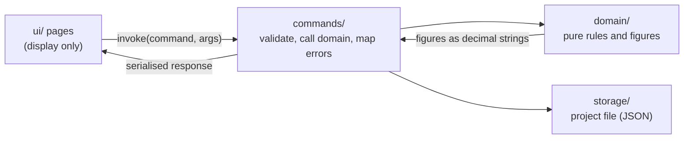

# Architecture

How the code is organised and the conventions it follows. For *what* the app must do, read the capability specifications in [`csd/`](csd/); this page is about *where things live* and *why*.

## The big picture

Varde is a Tauri app: a Rust backend and a vanilla HTML, CSS and JS frontend, with nothing in between (no framework, no build step, no server). All data lives in one project file the user chooses.



Two rules shape everything:

- **`domain/` is pure.** No Tauri, no IO. Every financial figure is computed there and unit-tested.
- **The frontend only displays.** It never computes a financial figure. The only arithmetic in `ui/` is turning a value into a position on a chart.

## Backend (`src-tauri/src/`)

| Folder | Holds |
|---|---|
| `domain/income/` | Jobs, paychecks, annual statements, yearly totals, dashboard overview, insights |
| `domain/investments/` | Accounts, statements, net deposits, capital growth, yearly totals, insights |
| `domain/debts/` | Debts, statements with non-negative balances, the change per statement, colour slots, yearly totals with the amount repaid, insights per debt. Reuses the investments' `Period` and `Note` |
| `domain/expenses/` | Expenses (dated, with a fixed category and a note), the year and month filter, yearly totals with the largest expense, insights per category. Reuses the investments' `Note` |
| `domain/bank_accounts/` | Bank accounts, entries with signed balances, colour slots, yearly totals, insights per bank. Reuses the investments' `Period` and `Note` |
| `domain/money.rs`, `settings.rs`, `error.rs`, `project_data.rs` | Amounts and currency, project settings, the domain error enum, the project's data sections |
| `commands/` | `#[tauri::command]` handlers, one file per area. Thin: parse and bound the input, call `domain`, map errors |
| `storage/` | Reading and writing the project file (atomic write), remembering the last project |

A big domain module is a folder. Its `mod.rs` holds the data struct (`Income`, `Investments`) and the rules for changing it. The other files add value types (`dates`, `job`, `entry`; `period`, `amounts`, `account`, `statement`) and the figures derived from the data (`totals`, `insights`, `overview`, `growth`). Each file starts with a one-line `//!` comment saying what it is. Tests sit next to the code in `tests.rs`.

**Naming.**

- Types that exist for both capabilities carry the capability: `IncomeInsightsYear` and `InvestmentInsightsYear`, `IncomeYearlyTotal` and `InvestmentYearlyTotal`. The income annual statement is `AnnualStatement`, the investment one `InvestmentStatement`.
- IPC command names and JSON fields are the contract with the frontend and appear in the approved specs, so they are not renamed lightly.
- Errors are one `DomainError` enum with a stable `code()` per variant (for example `INVESTMENT_BALANCE_NEGATIVE`). The frontend shows the safe message and never sees paths or internals.

**Tests.** Test names point at the specification: `test_csd005_ac_23_3_...` proves AC-23.3 of CSD-005. `cargo test test_csd005_` runs one spec's tests.

## Frontend (`ui/`)

```
index.html          all pages and dialogs in one file
main.js             entry point: wires every page and reloads them when a project opens
navigation.js       left-pane navigation (a plain script, no imports)
pages/              one file per page or view
shared/             helpers pages share
styles/             CSS by area
```

**`pages/`** files are named `<page>-<view>.js`: `income-overview.js`, `income-insights.js`, `investments-overview.js`, `investments-insights.js`, `bank-overview.js`, `bank-insights.js`, `debts-overview.js`, `debts-insights.js`, `expenses-overview.js`, `expenses-insights.js`. Each exports `init<Page><View>()` (wire the events once) and `reload<Page><View>()` (fetch from Rust and render). `dashboard.js`, `settings.js` and `project.js` are pages without views.

**Element ids** follow `<page>-<view>-<part>`: `income-insights-chart`, `investments-insights-legend`, `investments-tab-insights`. The shared chart code finds its parts from the one id it is given.

**`shared/`** has one job per file:

| File | Job |
|---|---|
| `ipc.js` | `invoke`, `listen`, `errorText`: the only place that talks to Tauri |
| `dom.js` | `h` (element builder), icons, toast, the confirm dialog, `showError` |
| `format.js` | Display formatting and today's year or month. No figures are computed |
| `chart.js` | Chart building blocks: SVG helper, bar segments, the tooltip, the legend highlight |
| `yearly-chart.js` | The frame both insights charts share: axis, bars, tooltip, loading, resize |
| `tabs.js` | Tabs such as Overview and Insights |

**Composition, not inheritance.** The two insights charts differ only in their data, so `createYearlyChart(strategy)` takes a small object (the stacked pieces, tooltip rows, extra marks, labels under the axis) and draws the rest. The CRUD dialogs of the two overview pages stay separate on purpose: their forms differ (the statement form calculates balance and growth), and one generic dialog would be harder to read than two plain files.

**Styles** are loaded in order by `<link>` tags: `base` (tokens, light and dark), `layout`, `components`, `pages`, `charts`. Colours come from CSS variables so both modes work. Motion uses CSS transitions of 140 ms and is switched off under `prefers-reduced-motion`.

**Charts, in short.** Items in a legend, a tooltip row and a bar segment share a `data-legend` key, which is how hovering a segment can highlight its legend item without any lookup table.

## How to add...

**A yearly chart for a new area.** Add a Rust command that returns `{ years }`, add the panel markup with ids `<page>-insights-{legend,empty,scroll,chart}`, write `pages/<page>-insights.js` with a strategy for `createYearlyChart`, and register its init and reload in `main.js`.

**A new page.** Add a `<section>` in `index.html` and a nav item, a `pages/<page>-overview.js` with `init…` and `reload…`, and wire both in `main.js`.

**A new command.** Write the rule and its tests in `domain/`, a thin handler in `commands/`, register it in `lib.rs`, add an IPC test in `ipc_tests.rs`, and call it from a page through `invoke`.

## Workflow

Behaviour changes start with a specification in `csd/` (draft, then approved), then tests, then code. Pure refactors need no specification. Work happens on the `development` branch in small commits, one concern each, with fmt, clippy and tests green.
