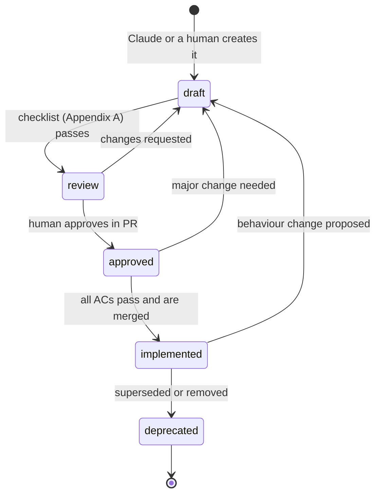
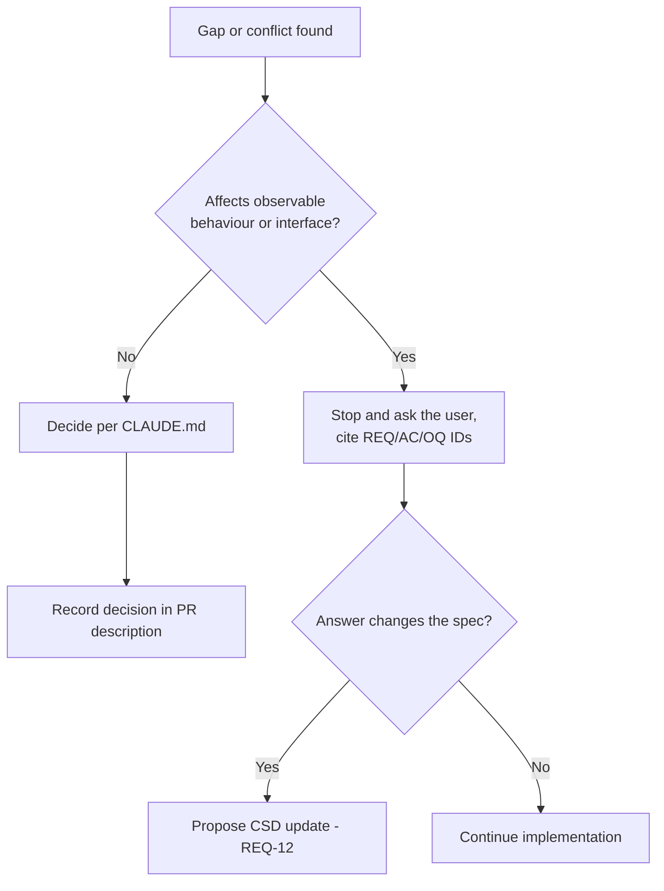
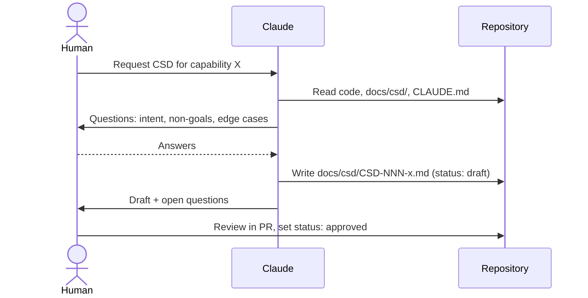
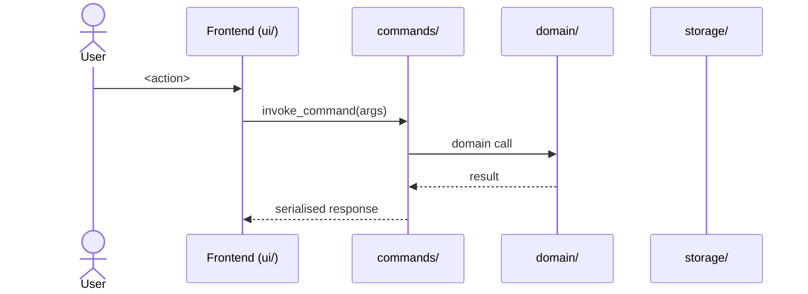
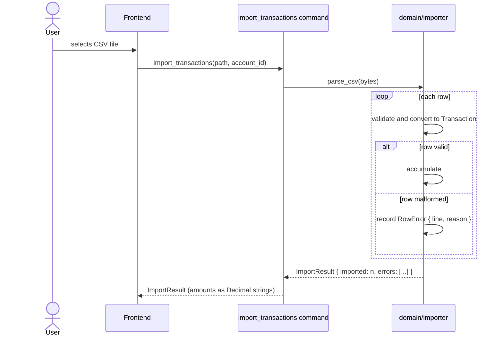

# CSD-000: Capability Specification Documents

> This document is a CSD, and it specifies how CSDs work. If a rule here
> is unclear, the document's own structure shows the intended answer.

## 1. Intent

### 1.1 Problem
Without a written specification, coding agents fill gaps with assumptions. That leads to scope creep, unverified behaviour, and code that drifts from what was agreed.

### 1.2 Purpose
A **Capability Specification Document (CSD)** is the single source of truth for *what* a capability must do and *how we know it is done*. This CSD defines:

- how a CSD is structured (the contract)
- how requirements are written (**EARS**), how they are verified (**Gherkin**), and how flows are explained (**Mermaid**)
- how Claude **reads**, **interprets**, **writes** and **maintains** a CSD

### 1.3 Audience
Primarily Claude Code and other coding agents. Engineers and reviewers of pull requests are the secondary audience.

## 2. Scope

### 2.1 In scope
- Every CSD stored under `docs/csd/`.
- Creating, reviewing, implementing against, and maintaining CSDs.

### 2.2 Non-goals
- **NG-1:** CSDs do not replace `CLAUDE.md`. Repo-wide conventions belong in `CLAUDE.md`, and capability-specific behaviour belongs in a CSD.
- **NG-2:** CSDs are not implementation plans. Step-by-step *how* goes in an optional `plan.md`, not in the CSD.
- **NG-3:** CSDs are not task trackers. Tickets and work items stay in GitHub Issues.
- **NG-4:** CSDs are not end-user documentation.

## 3. Definitions

| Term | Meaning |
|---|---|
| **Capability** | A coherent piece of system behaviour that can be shipped on its own (e.g. "account management", "transaction import", "net-worth calculation"). |
| **Requirement** | A single EARS statement of required behaviour, identified as `REQ-<n>`. |
| **Acceptance criterion (AC)** | A Gherkin scenario that proves a requirement, identified as `AC-<n>.<m>` and tagged `@AC-<n>.<m>`. |
| **EARS** | *Easy Approach to Requirements Syntax*: five sentence patterns for unambiguous requirements (§4.0). |
| **Gherkin** | The Given/When/Then language used by Cucumber, Behave and similar tools, used here for acceptance criteria. |
| **Mermaid** | Text-based diagram syntax that renders in GitHub, used to explain flows and states. |
| **Non-goal** | Something explicitly *not* to be built, identified as `NG-<n>`. |
| **Constraint** | A limit on the solution (performance, security, compatibility, tech choice), identified as `CON-<n>`. |
| **Open question** | An unresolved decision, identified as `OQ-<n>`. |
| **Normative keywords** | **shall** = mandatory, **shall not** = forbidden, **should** = recommended (a deviation needs a stated reason), **may** = optional. |

## 4. Requirements

### 4.0 Requirement syntax: EARS

Every requirement in a CSD is written using exactly one of these EARS patterns:

| Pattern | Template | Use when |
|---|---|---|
| **Ubiquitous** | The \<system\> shall \<action\>. | Always true, no trigger |
| **Event-driven** | When \<event\>, the \<system\> shall \<action\>. | Response to a trigger |
| **State-driven** | While \<state\>, the \<system\> shall \<action\>. | Holds during a state |
| **Optional** | Where \<feature\>, the \<system\> shall \<action\>. | Only if a feature or configuration is present |
| **Unwanted behaviour** | If \<condition\>, then the \<system\> shall \<action\>. | Errors, faults, misuse |

*Complex* requirements may combine patterns in the fixed order **While → When/If → the system shall**, for example: "While the app is offline, when a transaction is entered, the app shall store it locally."

In this CSD, the "system" is **Claude** (or any agent working in the repository).

### 4.1 Reading a CSD

**REQ-1: Locate the governing CSD** *(event-driven)*
When Claude is asked to implement or change behaviour, Claude shall search `docs/csd/` for the CSD governing that capability and read it in full before writing code.

```gherkin
@AC-1.1
Scenario: Existing CSD is identified before coding
  Given a task that changes the behaviour of a capability
  And "docs/csd/CSD-003-transaction-import.md" governs that capability
  When Claude starts the task
  Then Claude names "CSD-003" and its title before writing any code

@AC-1.2
Scenario: No CSD exists for a non-trivial capability
  Given a task introducing a new capability
  And no CSD in "docs/csd/" covers it
  When Claude starts the task
  Then Claude proposes drafting a CSD before writing code

@AC-1.3
Scenario: Trivial change needs no CSD
  Given a task that is a typo fix, dependency bump or refactor with no behaviour change
  When Claude starts the task
  Then Claude proceeds without requiring a CSD
```

**REQ-2: Respect the status lifecycle** *(state-driven)*
While a CSD has status `draft` or `review`, Claude shall not implement code against it.
While a CSD has status `deprecated`, Claude shall not build new code against it and shall follow its `superseded_by` link.



| Status | What Claude may do |
|---|---|
| `draft` / `review` | Discuss and edit the CSD only |
| `approved` | Implement against it |
| `implemented` | Treat it as the description of current behaviour. Changes need a CSD update first |
| `deprecated` | Read only. Follow `superseded_by` |

```gherkin
@AC-2.1
Scenario: Implementation requested against a draft
  Given a CSD with status "draft"
  When the user asks Claude to implement it
  Then Claude states the CSD is not approved
  And asks whether to finalise the spec first or proceed under explicit override
```

### 4.2 Interpreting a CSD

**REQ-3: Normative keywords are binding** *(ubiquitous)*
Claude shall treat "shall" as mandatory, shall state a reason when not following a "should", and shall not implement "may" items unless asked.

**REQ-4: Non-goals take precedence** *(unwanted behaviour)*
If a feature is listed as a non-goal, then Claude shall not implement it, and may only suggest it as a follow-up.

```gherkin
@AC-4.1
Scenario: Tempting feature excluded by a non-goal
  Given a CSD lists "NG-2: no automatic bank sync"
  And adding bank sync would be a natural extension
  When Claude implements the capability
  Then no bank sync code is implemented
  And Claude may mention it as a suggested follow-up in the PR
```

**REQ-5: Ambiguity is resolved by asking** *(unwanted behaviour)*
If the CSD is silent, contradictory or has a relevant `OQ-n` affecting observable behaviour or an interface, then Claude shall stop and ask, citing the IDs involved.
If the gap is purely internal (naming, private structure), then Claude may decide, following `CLAUDE.md`, and shall record the decision in the PR description.

Precedence when sources conflict:
**Gherkin ACs > EARS requirements > constraints > Mermaid diagrams > intent > code comments > existing code.**
Diagrams are explanatory, not normative. Existing code that contradicts an `approved` CSD is a bug, not the spec.



```gherkin
@AC-5.1
Scenario: Requirement and acceptance criterion contradict
  Given REQ-3 and AC-3.2 describe different outcomes for the same input
  When Claude notices the contradiction
  Then Claude reports both IDs to the user
  And does not silently choose one
```

**REQ-6: Traceability** *(ubiquitous)*
Claude shall reference CSD IDs in all related work:

- Rust unit and integration tests are named after the AC they prove: `test_ac_3_2_<description>` in `#[test]` functions
- commit messages and PR descriptions list the `REQ-`/`AC-` IDs covered
- the PR description includes a coverage table: each AC → test name, or "not covered (reason)"

### 4.3 Writing a CSD

**REQ-7: Draft through investigation and interview** *(event-driven)*
When Claude is asked to write a CSD, Claude shall:

1. read the relevant code, existing CSDs in `docs/csd/`, and `CLAUDE.md`
2. ask the requester about intent, users, non-goals and edge cases, in a few focused rounds
3. produce a draft from the template in §5.2 with `status: draft`
4. list everything it cannot determine as `OQ-n` and not invent answers



**REQ-8: Requirements use EARS** *(ubiquitous)*
Claude shall write every requirement as exactly one EARS pattern (§4.0), or a complex combination in the order While → When/If → shall, with one "shall" per requirement.

```gherkin
@AC-8.1
Scenario Outline: Non-EARS requirement is rewritten
  Given a draft requirement "<original>"
  When Claude reviews the draft
  Then the requirement is rewritten as "<ears>"

  Examples:
    | original                                  | ears                                                                                                               |
    | Handle import errors gracefully           | If a CSV row is malformed, then the importer shall skip the row and record a structured error for that row.        |
    | Balance calculation must be fast          | When net worth is requested, the domain shall return it within 50 ms for up to 10,000 transactions.               |
    | Use rust_decimal for money                | (moved to CON-n with rationale, or replaced by a correctness requirement)                                          |
```

**REQ-9: Acceptance criteria use Gherkin** *(ubiquitous)*
Claude shall give every requirement at least one Gherkin scenario in a ```` ```gherkin ```` block, tagged `@AC-<n>.<m>`, using concrete values (amounts, currencies, dates), and covering at least one unwanted-behaviour or edge case for every event-driven requirement.
Claude should use `Scenario Outline` with `Examples` for variations of the same behaviour, and `Background` for shared setup.

**REQ-10: Flows are explained with Mermaid** *(event-driven)*
When a capability involves more than one actor or component, a state machine, or a decision flow with more than two branches, Claude shall include a Mermaid diagram in a ```` ```mermaid ```` block:

| Situation | Diagram type |
|---|---|
| Interaction between UI, commands layer, domain, storage | `sequenceDiagram` |
| Lifecycle or status transitions (e.g. account status) | `stateDiagram-v2` |
| Decision logic, processing pipeline (e.g. import flow) | `flowchart` |
| Data model / entities (e.g. Account, Transaction, Category) | `erDiagram` |

Diagrams shall be consistent with the EARS requirements and Gherkin ACs. If a diagram and an AC disagree, then the AC wins and the diagram shall be corrected (REQ-5).

**REQ-11: Specify behaviour, not implementation** *(unwanted behaviour)*
If a draft prescribes internal design, then Claude shall rewrite it as observable behaviour, or move it to a constraint (`CON-n`) with a rationale.

**REQ-12: Keep it small** *(ubiquitous)*
A CSD should fit in about 1–3 pages excluding diagrams and appendices. If it grows beyond that, it should be split into an overview CSD plus linked sub-CSDs.

**REQ-13: Humans approve** *(unwanted behaviour)*
If a CSD is ready for approval, then Claude shall not set `status: approved` itself. Only a human reviewer does this, normally through a pull request.

### 4.4 Maintaining a CSD

**REQ-14: Spec changes before or with behaviour changes** *(unwanted behaviour)*
If implementation shows the CSD is wrong or incomplete, then Claude shall stop, explain why, and propose amended CSD text in the same PR or one before it, instead of quietly building something different.

**REQ-15: Track changes** *(event-driven)*
When a CSD changes substantively, Claude shall bump `version` (minor for clarifications, major for changed behaviour), update `last_updated`, and add a changelog line.

**REQ-16: Mark completion** *(event-driven)*
When all ACs are covered by passing tests and merged, Claude should propose changing the status to `implemented`.

## 5. Interfaces and contracts

### 5.1 File layout
```
docs/csd/
├── CSD-000-capability-specifications.md   # this document
├── CSD-001-<kebab-case-name>.md           # simple capability: single file
└── CSD-002-<kebab-case-name>/             # larger capability: folder
    ├── spec.md                            # the CSD (required)
    ├── plan.md                            # implementation approach (optional)
    └── tasks.md                           # task breakdown (optional)
```
- All CSDs are stored in `docs/csd/`. No other location is valid.
- IDs are sequential and never reused.
- `CLAUDE.md` shall contain the pointer from Appendix B.

### 5.2 CSD template (the contract)

````markdown
---
id: CSD-XXX
title: <capability name>
status: draft
owner: Thijs Bardoel
version: 0.1
last_updated: YYYY-MM-DD
related: [CSD-YYY]          # optional
superseded_by:              # only when deprecated
---

# CSD-XXX: <capability name>

## 1. Intent
Problem, who it is for, why now. 3–6 sentences.

## 2. Scope
### 2.1 In scope
### 2.2 Non-goals
- NG-1: ...

## 3. Definitions        (optional; non-obvious domain terms only)

## 4. Requirements

### 4.0 Overview flow   (required when REQ-10 applies)


**REQ-1: <short title>** *(event-driven)*
When <event>, the <system> shall <action>.

```gherkin
@AC-1.1
Scenario: <happy path>
  Given <state with concrete values>
  When <event>
  Then <observable result with concrete values>

@AC-1.2
Scenario: <unwanted behaviour / edge case>
  Given <state>
  When <event>
  Then <observable result>
```

**REQ-2: <short title>** *(unwanted behaviour)*
If <condition>, then the <system> shall <action>.

```gherkin
@AC-2.1
Scenario: ...
```

## 5. Interfaces and contracts
Tauri command signatures, IPC payload shapes, data models (`erDiagram` where useful), error codes.

## 6. Constraints
- CON-1: <constraint>. Rationale: <why>.

## 7. Verification
How to prove it's done: which `cargo test` filter covers which ACs, environments, expected output.

## 8. Open questions
- OQ-1: <question>. Owner: Thijs. Blocks: REQ-n.

## 9. Changelog
- 0.1 (YYYY-MM-DD): initial draft.
````

### 5.3 Required vs optional sections
Sections 1, 2, 4, 7 and 9 are **required**. Sections 3, 5, 6 and 8 may be omitted only if they would be empty. Write "None" rather than deleting them when in doubt.

## 6. Constraints

- **CON-1:** CSDs are Markdown in `docs/csd/`, versioned with the code. Rationale: Claude Code and the PR reviewer see the same source of truth.
- **CON-2:** Diagrams use Mermaid only, with no images or external tools. Rationale: renders in GitHub, diffable, and readable by agents as text.
- **CON-3:** Acceptance criteria are valid Gherkin. Rationale: they are precise enough to drive Rust test naming and serve as executable specs if a Rust BDD crate is adopted later.
- **CON-4:** Language: English. Rationale: consistent with code and tooling.
- **CON-5:** No secrets, credentials, or real financial data (including PII) in CSDs. Use synthetic examples (e.g. "Example Bank", round amounts in EUR). Rationale: specs are widely read and fed into agent context; the repo is public.
- **CON-6:** IDs (`REQ`, `AC`, `NG`, `CON`, `OQ`) are stable. Removed items are marked `(removed in vX)`, never renumbered. Rationale: tests and PRs reference them.

## 7. Verification

This CSD is working when:

- **V-1:** A reviewer can map every behavioural change in a PR to a `REQ-`/`AC-` ID in its description.
- **V-2:** Every new CSD passes the checklist in Appendix A before going to `review`.
- **V-3:** Claude, given a draft CSD and an implementation request, does not implement until the CSD is approved or the human explicitly overrides (AC-2.1).
- **V-4 (optional automation):** A CI job lints `docs/csd/`: valid front matter, required sections present, every `REQ-n` has at least one `@AC-n.*`, and Mermaid renders (`mmdc --input` dry-run).

## 8. Open questions

- **OQ-1:** Should CI enforce V-4, or is it advisory only? Owner: Thijs.
- **OQ-2:** Who may approve CSDs — the owner only, or any reviewer? Owner: Thijs.
- **OQ-3:** Do we want to adopt a Rust BDD crate (e.g. `cucumber-rust`) so Gherkin ACs run as tests directly, or keep the convention of naming `#[test]` functions `test_ac_n_m_…`? Owner: Thijs.
- **OQ-4:** Add a `/csd` Claude Code slash command that scaffolds a new CSD from §5.2? Owner: Thijs.

## 9. Changelog

- 2.0 (2026-10-25): Adapted from the original template for the personal-finance project. GitLab → GitHub; MR → PR; BDD runner references updated for Rust; worked example replaced with a personal finance domain scenario; `.feature` file layout removed (OQ-3 left open); template flow diagram updated to reflect Tauri layered architecture.
- 1.0 (2026-10-25): initial version.

---

## Appendix A: Review checklist (use before `status: review`)

- [ ] File is in `docs/csd/` and named `CSD-NNN-<kebab-name>`
- [ ] Intent explains the problem, not the solution
- [ ] At least one non-goal is listed
- [ ] Every REQ is a single EARS pattern with one "shall", and its pattern is labelled
- [ ] Every REQ has ≥1 Gherkin scenario tagged `@AC-n.m` with concrete values (amounts in EUR with two decimal places, dates as YYYY-MM-DD, etc.)
- [ ] Every event-driven REQ has at least one unwanted-behaviour or edge-case scenario
- [ ] No vague words ("fast", "robust", "gracefully", "intuitive") without measurable criteria
- [ ] A Mermaid diagram is present for multi-actor, stateful or branching flows, and it matches the ACs
- [ ] Constraints have a rationale
- [ ] Verification states which `cargo test` filter or command proves each AC
- [ ] Unknowns are listed as OQs, not guessed
- [ ] Fits in about 1–3 pages, or is split into sub-CSDs
- [ ] No secrets, credentials, or real financial data; synthetic examples only

## Appendix B: Snippet for `CLAUDE.md`

```markdown
## Specifications (CSD)
- All capability specs (CSDs) live in `docs/csd/`. Read `docs/csd/CSD-000-capability-specifications.md` before reading, writing, or implementing any CSD.
- Requirements use EARS, acceptance criteria use Gherkin (tagged @AC-n.m), and flows use Mermaid.
- Before changing behaviour, find and read the governing CSD; only implement CSDs with `status: approved`.
- Never build what a CSD lists as a non-goal. Ask when the spec is ambiguous about behaviour or interfaces.
- Reference REQ-/AC- IDs in tests (test name: `test_ac_n_m_…`), commits, and PR descriptions.
```

## Appendix C: Worked example

**Weak:**
> The system should handle bad CSV data gracefully and import quickly.

**Good:**



**REQ-3: Malformed CSV rows** *(unwanted behaviour)*
If a CSV row is missing required fields or contains a non-numeric amount, then the importer shall skip that row, record a structured error containing the line number and reason, and continue processing the remaining rows.

```gherkin
@AC-3.1
Scenario: Valid CSV imports all rows
  Given an account with id "acc-001"
  And a CSV file with 3 valid rows totalling EUR 142.50
  When import_transactions is called
  Then ImportResult.imported equals 3
  And ImportResult.errors is empty
  And the account balance increases by EUR 142.50

@AC-3.2
Scenario: One malformed row does not abort the import
  Given an account with id "acc-001"
  And a CSV file where row 2 has amount "not-a-number"
  When import_transactions is called
  Then ImportResult.imported equals 2
  And ImportResult.errors contains exactly 1 entry with line 2
  And the error entry includes a human-readable reason

@AC-3.3
Scenario: Amount with more than 2 decimal places is rejected
  Given a CSV row with amount "10.999"
  When import_transactions is called
  Then ImportResult.errors contains that row
  And no Transaction is created for it
```
