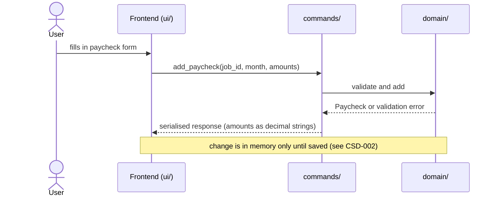
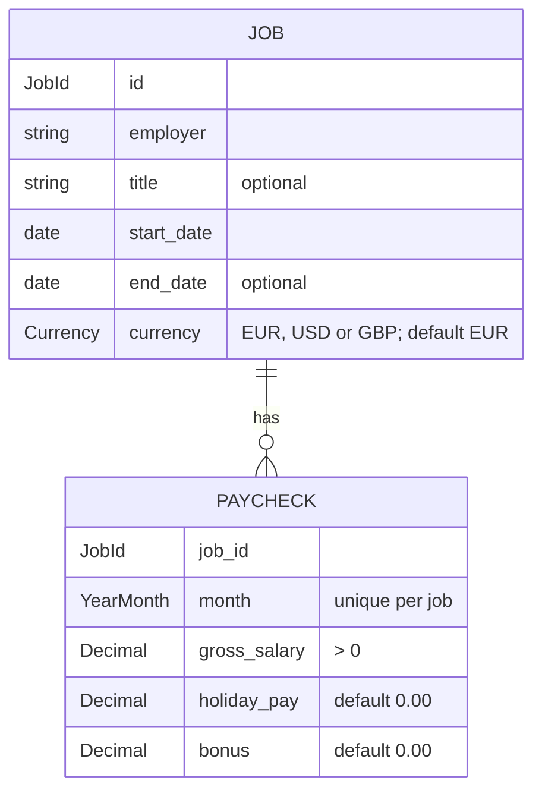

# CSD-001: Employment income tracking

## 1. Intent
The app tracks wealth but has no view of what comes in. This capability lets the user record employment income over time: any number of jobs, each with one monthly paycheck made up of gross salary, holiday pay and bonus. It is for a single person keeping a private, local history of their employment earnings. Scope is employment only. The result is a month-by-month record per job and yearly totals, which later features (net-worth linkage, income charts) can build on.

## 2. Scope
### 2.1 In scope
- Create, edit, end and delete jobs.
- Create, edit and delete one paycheck per job per calendar month.
- Yearly totals per job.
- Income data is part of the project file. Saving and loading is specified in CSD-002.

### 2.2 Non-goals
- NG-1: Net pay, income tax, pension and other deductions.
- NG-2: Freelance and self-employment income, and other income (rental, dividends, etc.).
- NG-3: Automatic payslip import (PDF, bank) and bulk import of paychecks.
- NG-4: Forecasting future income.
- NG-5: Integration with net worth.
- NG-6: A combined income-over-time chart or view across jobs (candidate for a later CSD).
- NG-7: Automatic calculation of holiday pay or any other amount. All amounts are entered manually.
- NG-8: (moved to CSD-002 NG-1 in v0.4)

## 3. Definitions
| Term | Meaning |
|---|---|
| **Job** | One employment relationship, identified by an employer name and start date. |
| **Paycheck** | The record of one job for one calendar month (`YYYY-MM`). |
| **Total gross** | Gross salary + holiday pay + bonus of one paycheck. |
| **Project file** | The single user-chosen file holding all app data. Income is its first section. See CSD-002. |

## 4. Requirements

### 4.0 Overview flow


### 4.1 Jobs

**REQ-1: Add a job** *(event-driven)*
When the user submits a new job with an employer name and a start date, the app shall create the job with currency EUR unless USD or GBP is chosen.

```gherkin
@AC-1.1
Scenario: Job created with defaults
  Given no jobs exist
  When the user adds a job with employer "Example Employer" and start date 2024-03-01
  Then one job exists with employer "Example Employer", start date 2024-03-01 and currency "EUR"
  And the job has no title and no end date

@AC-1.2
Scenario Outline: Invalid job is rejected
  Given no jobs exist
  When the user adds a job with employer "<employer>", start date "<start>" and end date "<end>"
  Then the job is rejected with error code "<code>"
  And no job exists

  Examples:
    | employer         | start      | end        | code                |
    |                  | 2024-03-01 |            | JOB_EMPLOYER_REQUIRED |
    | Example Employer |            |            | JOB_START_REQUIRED    |
    | Example Employer | 2024-03-01 | 2024-02-29 | JOB_END_BEFORE_START  |

@AC-1.3
Scenario: Supported non-default currency
  Given no jobs exist
  When the user adds a job with employer "Example Employer", start date 2024-03-01 and currency "GBP"
  Then the job has currency "GBP"

@AC-1.4
Scenario: Unsupported currency is rejected
  Given no jobs exist
  When the user adds a job with employer "Example Employer", start date 2024-03-01 and currency "CHF"
  Then the job is rejected with error code "JOB_CURRENCY_UNSUPPORTED"
  And no job exists
```

**REQ-2: Edit a job** *(event-driven)*
When the user edits a job's employer, title, start date or end date, the app shall apply the change regardless of existing paychecks.

```gherkin
@AC-2.1
Scenario: Dates change freely with paychecks present
  Given a job "Example Employer" starting 2024-03-01 with a paycheck for 2024-03
  When the user sets the job's start date to 2024-06-01 and its end date to 2025-01-31
  Then the job has start date 2024-06-01 and end date 2025-01-31
  And the paycheck for 2024-03 still exists

@AC-2.2
Scenario: End date before start date is rejected on edit
  Given a job "Example Employer" starting 2024-03-01
  When the user sets the job's end date to 2024-02-01
  Then the edit is rejected with error code "JOB_END_BEFORE_START"
  And the job has no end date
```

**REQ-3: Currency is locked once paychecks exist** *(unwanted behaviour)*
If the user changes the currency of a job that has at least one paycheck, then the app shall reject the change.

```gherkin
@AC-3.1
Scenario: Currency change rejected
  Given a job in "EUR" with one paycheck
  When the user changes the job's currency to "USD"
  Then the change is rejected with error code "JOB_CURRENCY_LOCKED"
  And the job currency is "EUR"

@AC-3.2
Scenario: Currency change allowed without paychecks
  Given a job in "EUR" with no paychecks
  When the user changes the job's currency to "USD"
  Then the job currency is "USD"
```

**REQ-4: Delete a job** *(event-driven)*
When the user confirms deletion of a job, the app shall remove the job and all of its paychecks.

```gherkin
@AC-4.1
Scenario: Deletion cascades
  Given a job "Example Employer" with 3 paychecks
  When the user deletes the job and confirms
  Then the job no longer exists
  And none of its 3 paychecks exist

@AC-4.2
Scenario: Cancelled deletion changes nothing
  Given a job "Example Employer" with 3 paychecks
  When the user starts deleting the job and cancels
  Then the job and its 3 paychecks still exist
```

### 4.2 Paychecks

**REQ-5: Add a paycheck** *(event-driven)*
When the user submits a paycheck for a job and a calendar month with a gross salary, the app shall store it, with holiday pay and bonus defaulting to 0.00, and shall accept any month that is not later than the current month, including months outside the job's start and end dates.

```gherkin
@AC-5.1
Scenario: Paycheck with defaults
  Given the current date is 2026-10-25
  And an EUR job "Example Employer" starting 2024-03-01
  When the user adds a paycheck for 2026-09 with gross salary 3000.00
  Then the paycheck has gross salary 3000.00, holiday pay 0.00, bonus 0.00 and total gross 3000.00

@AC-5.2
Scenario: Month before the job start date is accepted
  Given an EUR job "Example Employer" starting 2024-03-01
  When the user adds a paycheck for 2024-01 with gross salary 2800.00
  Then the paycheck for 2024-01 exists

@AC-5.3
Scenario: Month after the job end date is accepted
  Given an EUR job "Example Employer" ending 2025-01-31
  When the user adds a paycheck for 2025-03 with gross salary 1500.00
  Then the paycheck for 2025-03 exists

@AC-5.4
Scenario: Month later than the current month is rejected
  Given the current date is 2026-10-25
  When the user adds a paycheck for 2026-11 with gross salary 3000.00
  Then the paycheck is rejected with error code "PAYCHECK_MONTH_IN_FUTURE"

@AC-5.5
Scenario: Current month is accepted
  Given the current date is 2026-10-25
  When the user adds a paycheck for 2026-10 with gross salary 3000.00
  Then the paycheck for 2026-10 exists
```

**REQ-6: One paycheck per job per month** *(unwanted behaviour)*
If the user adds a paycheck for a job and month that already has one, then the app shall reject it and leave the existing paycheck unchanged.

```gherkin
@AC-6.1
Scenario: Duplicate month rejected
  Given a job with a paycheck for 2026-09 with gross salary 3000.00
  When the user adds another paycheck for 2026-09 with gross salary 3100.00
  Then it is rejected with error code "PAYCHECK_DUPLICATE_MONTH"
  And the paycheck for 2026-09 still has gross salary 3000.00

@AC-6.2
Scenario: Same month on a different job is allowed
  Given two jobs, and the first has a paycheck for 2026-09
  When the user adds a paycheck for 2026-09 to the second job
  Then both jobs have a paycheck for 2026-09
```

**REQ-7: Amount validation** *(unwanted behaviour)*
If a paycheck amount is negative, has more than two decimal places or exceeds 1,000,000.00, or if gross salary is not greater than 0.00, then the app shall reject the paycheck without rounding or storing it.

```gherkin
@AC-7.1
Scenario Outline: Invalid amounts rejected
  Given an EUR job and the current date 2026-10-25
  When the user adds a paycheck for 2026-09 with gross "<gross>", holiday pay "<holiday>" and bonus "<bonus>"
  Then it is rejected with error code "<code>"
  And no paycheck for 2026-09 exists

  Examples:
    | gross      | holiday | bonus   | code                   |
    | 0.00       | 0.00    | 0.00    | PAYCHECK_GROSS_INVALID |
    | -100.00    | 0.00    | 0.00    | PAYCHECK_AMOUNT_NEGATIVE |
    | 3000.00    | -1.00   | 0.00    | PAYCHECK_AMOUNT_NEGATIVE |
    | 3000.00    | 0.00    | -5.00   | PAYCHECK_AMOUNT_NEGATIVE |
    | 3000.999   | 0.00    | 0.00    | PAYCHECK_AMOUNT_PRECISION |
    | 1000000.01 | 0.00    | 0.00    | PAYCHECK_AMOUNT_TOO_LARGE |

@AC-7.2
Scenario: Boundary amount accepted
  Given an EUR job and the current date 2026-10-25
  When the user adds a paycheck for 2026-09 with gross 1000000.00, holiday pay 0.00 and bonus 0.00
  Then the paycheck for 2026-09 exists
```

**REQ-8: Edit and delete a paycheck** *(event-driven)*
When the user edits the amounts of an existing paycheck or deletes it, the app shall apply the change without asking for confirmation, validating edited amounts under REQ-7. The month of an existing paycheck shall not be editable.

```gherkin
@AC-8.1
Scenario: Edit amounts
  Given a paycheck for 2026-05 with gross 3000.00, holiday pay 0.00 and bonus 0.00
  When the user sets holiday pay to 2400.00
  Then the paycheck has holiday pay 2400.00 and total gross 5400.00

@AC-8.2
Scenario: Invalid edit rejected
  Given a paycheck for 2026-05 with gross 3000.00
  When the user sets gross salary to -1.00
  Then the edit is rejected with error code "PAYCHECK_AMOUNT_NEGATIVE"
  And the paycheck still has gross 3000.00

@AC-8.3
Scenario: Delete paycheck
  Given a job with paychecks for 2026-04 and 2026-05
  When the user deletes the paycheck for 2026-05
  Then only the paycheck for 2026-04 exists
  And no confirmation was asked

@AC-8.4
Scenario: Month stays fixed on edit
  Given a paycheck for 2026-05 with gross 3000.00
  When the user edits its amounts
  Then the edit offers no month field
  And the paycheck is still for 2026-05
```

**REQ-9: Copy previous month** *(event-driven)*
When the user starts adding a paycheck using "copy previous month", the app shall pre-fill the form with the gross salary of the job's most recent paycheck and holiday pay and bonus of 0.00, and shall not store anything until the user confirms.

```gherkin
@AC-9.1
Scenario: Form pre-filled from latest paycheck
  Given a job with paychecks for 2026-07 (gross 3000.00) and 2026-08 (gross 3100.00, bonus 500.00)
  When the user starts "copy previous month"
  Then the form shows gross 3100.00, holiday pay 0.00 and bonus 0.00
  And no new paycheck exists

@AC-9.2
Scenario: No paycheck to copy
  Given a job with no paychecks
  When the user starts "copy previous month"
  Then the form shows gross empty, holiday pay 0.00 and bonus 0.00
```

**REQ-10: Total gross is derived** *(ubiquitous)*
The app shall compute a paycheck's total gross as gross salary plus holiday pay plus bonus, and shall not store or accept it as input.

```gherkin
@AC-10.1
Scenario: Total is the sum
  Given a paycheck with gross 3000.00, holiday pay 240.00 and bonus 500.00
  Then its total gross is 3740.00
```

### 4.3 Views

**REQ-11: Yearly totals** *(event-driven)*
When the user views a job's yearly totals, the app shall return, for each calendar year with at least one paycheck, the sums of gross salary, holiday pay, bonus and total gross, and the number of paychecks, without extrapolating partial years.

```gherkin
@AC-11.1
Scenario: Totals per calendar year
  Given a job with paychecks 2025-11 (gross 3000.00), 2025-12 (gross 3000.00, bonus 1000.00) and 2026-05 (gross 3000.00, holiday pay 2400.00)
  When the user views the yearly totals
  Then 2026 shows gross 3000.00, holiday pay 2400.00, bonus 0.00, total 5400.00, count 1
  And 2025 shows gross 6000.00, holiday pay 0.00, bonus 1000.00, total 7000.00, count 2

@AC-11.2
Scenario: No paychecks
  Given a job with no paychecks
  When the user views the yearly totals
  Then the totals list is empty and the UI shows 0.00
```

**REQ-12: Ordering** *(ubiquitous)*
The app shall list jobs by start date, newest first, and a job's paychecks by month, newest first.

```gherkin
@AC-12.1
Scenario: Newest first
  Given jobs starting 2020-01-01 and 2024-03-01, and a job with paychecks for 2026-07 and 2026-09
  Then jobs are listed 2024-03-01 before 2020-01-01
  And paychecks are listed 2026-09 before 2026-07
```

**REQ-13: Empty states** *(state-driven)*
While no jobs exist, the app shall show an "add your first job" prompt, and while a job has no paychecks, the app shall show an empty paycheck table with totals of 0.00 and no error.

```gherkin
@AC-13.1
Scenario: No jobs
  Given no jobs exist
  Then the income view shows an "add your first job" prompt

@AC-13.2
Scenario: Job without paychecks
  Given a job with no paychecks
  Then the paycheck table is empty and no error is shown
```

### 4.4 Saving and loading
REQ-14 to REQ-21 (removed in v0.4): moved to CSD-002 (Project file). Income data is saved and loaded as one section of that project file.

## 5. Interfaces and contracts



Commands (all inputs validated in Rust; amounts cross IPC as decimal strings):
`list_jobs`, `create_job`, `update_job`, `delete_job`, `list_paychecks(job_id)`, `add_paycheck`, `update_paycheck`, `delete_paycheck`, `yearly_totals(job_id)`. Project commands (save, open, new) are in CSD-002. The income data is stored as one section of the project file defined there.

Error codes (returned as code plus safe message): `JOB_EMPLOYER_REQUIRED`, `JOB_START_REQUIRED`, `JOB_END_BEFORE_START`, `JOB_CURRENCY_UNSUPPORTED`, `JOB_CURRENCY_LOCKED`, `PAYCHECK_MONTH_IN_FUTURE`, `PAYCHECK_DUPLICATE_MONTH`, `PAYCHECK_GROSS_INVALID`, `PAYCHECK_AMOUNT_NEGATIVE`, `PAYCHECK_AMOUNT_PRECISION`, `PAYCHECK_AMOUNT_TOO_LARGE`. Project error codes are in CSD-002.

## 6. Constraints
- CON-1: Amounts use `rust_decimal::Decimal` and carry the job's currency. Totals are per job and never summed across currencies. Rationale: `CLAUDE.md` money rules.
- CON-2: The frontend displays figures computed in Rust and computes none itself. Rationale: `CLAUDE.md` layout rule.
- CON-3: No network access. Rationale: `CLAUDE.md` Tauri security rules.
- CON-4: Errors shown to the user never contain file paths or OS details. Rationale: `CLAUDE.md` error rules.
- CON-5: Amounts, employer names and balances are not logged at `info` or above. Rationale: `CLAUDE.md` privacy rules.
- CON-6: Tests and fixtures use synthetic data only ("Example Employer", round amounts). Rationale: the repo is public.
- CON-7: (moved to CSD-002 CON-1 in v0.4)
- CON-8: (moved to CSD-002 CON-2 in v0.4)
- CON-9: (moved to CSD-002 CON-3 in v0.4)

## 7. Verification
All ACs are proven by `cargo test`, with domain logic tested in `domain/`. Tests are named `test_csd001_ac_<n>_<m>_<description>` (CSD-000 REQ-6).

| Requirement | Command |
|---|---|
| All of REQ-1 to REQ-13 | `cargo test test_csd001_` |
| One requirement, e.g. REQ-5 | `cargo test test_csd001_ac_5_` |

Done means fmt, clippy (`-D warnings`) and `cargo test --all-features` pass.

## 8. Open questions
- OQ-1: (moved to CSD-002 in v0.4) File format, resolved there.
- OQ-2: (moved to CSD-002 in v0.4) Dialog plugin and permissions, resolved there.
- OQ-3: (moved to CSD-002 OQ-2 in v0.4) The `CLAUDE.md` update at approval.
- OQ-4: (resolved in v0.2) Currencies are EUR, USD and GBP.
- OQ-5: (moved to CSD-002 in v0.4) Testing the unsaved state, resolved there.
- OQ-6: (resolved in v0.2) The month of an existing paycheck is not editable.
- OQ-7: (resolved in v0.2) Deleting a single paycheck needs no confirmation.

## 9. Changelog
- 0.5 (2026-10-25): Verification uses the `test_csd001_` filter (CSD-000 2.1 naming).
- 0.4 (2026-10-25): Split persistence into CSD-002. REQ-14 to REQ-21, NG-8, CON-7 to CON-9, AC-14.* to AC-21.*, the project commands and error codes, and OQ-1, OQ-2, OQ-3, OQ-5 moved there (IDs kept as removed markers per CSD-000 CON-6). No change to income behaviour.
- 0.3 (2026-10-25): Resolved OQ-1, OQ-2, OQ-3, OQ-5. Added NG-8, REQ-18 to REQ-21 and AC-14.3, AC-14.4, AC-15.3. REQ-14 and REQ-15 use native dialogs and the commands no longer take a path. Added CON-7 to CON-9, the project file description, and the revised verification table.
- 0.2 (2026-10-25): Resolved OQ-4, OQ-6, OQ-7. REQ-1 restricts currency to EUR, USD, GBP (AC-1.3, AC-1.4, new code `JOB_CURRENCY_UNSUPPORTED`). REQ-8 fixes the paycheck month and removes delete confirmation (AC-8.3 amended, AC-8.4 added).
- 0.1 (2026-10-25): initial draft.
