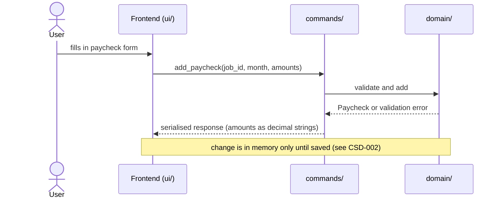
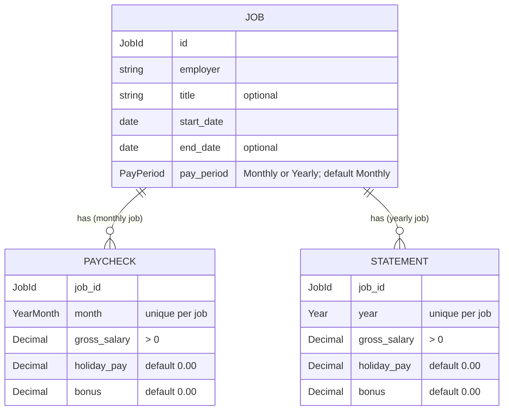

# CSD-001: Employment income tracking

## 1. Intent
The app tracks wealth but has no view of what comes in. This capability lets the user record employment income over time: any number of jobs, each recorded either monthly, with one paycheck per month, or yearly, with one annual statement per year. Both are made up of gross salary, holiday pay and bonus. It is for a single person keeping a private, local history of their employment earnings. Scope is employment only. The result is a record per job, by month or by year, and yearly totals, which later features (net-worth linkage, income charts) can build on.

## 2. Scope
### 2.1 In scope
- Create, edit, end and delete jobs.
- Create, edit and delete one paycheck per monthly job per calendar month.
- Create, edit and delete one annual statement per yearly job per calendar year.
- Change the month of an existing paycheck and the year of an existing annual statement (REQ-29).
- One employment view with the jobs, the yearly totals over all jobs and the paychecks and annual statements of all jobs.
- Income data is part of the project file. Saving and loading is specified in CSD-002.

### 2.2 Non-goals
- NG-1: Net pay, income tax, pension and other deductions.
- NG-2: Freelance and self-employment income, and other income (rental, dividends, etc.).
- NG-3: Automatic payslip import (PDF, bank) and bulk import of paychecks.
- NG-4: Forecasting future income.
- NG-5: Integration with net worth.
- NG-6: A chart or other income-over-time visualisation, except the yearly insights view of CSD-006. Yearly totals over all jobs are in scope (REQ-11).
- NG-7: Automatic calculation of holiday pay or any other amount. All amounts are entered manually.
- NG-8: (moved to CSD-002 NG-1 in v0.4)
- NG-9: Moving an entry to another job. Only the month or year of an entry can change (REQ-29).
- NG-10: Changing the months or years of several entries at once.

## 3. Definitions
| Term | Meaning |
|---|---|
| **Job** | One employment relationship, identified by an employer name and start date. |
| **Pay period** | How a job is recorded: **Monthly** (one paycheck per month) or **Yearly** (one annual statement per calendar year). A job is Monthly unless Yearly is chosen. |
| **Paycheck** | The record of one monthly job for one calendar month (`YYYY-MM`). |
| **Annual statement** | The record of one yearly job for one calendar year (`YYYY`): the gross salary, holiday pay and bonus of that year. |
| **Entry** | A paycheck or an annual statement. |
| **Date format** | Dates are shown and typed as dd/mm/yyyy (for example 01/03/2024). Months stay `YYYY-MM`. |
| **Total gross** | Gross salary + holiday pay + bonus of one entry. |
| **Project file** | The single user-chosen file holding all app data. Income is its first section. See CSD-002. |

## 4. Requirements

### 4.0 Overview flow


### 4.1 Jobs

**REQ-1: Add a job** *(event-driven)*
When the user submits a new job with an employer name, a start date and a pay period, the app shall create the job, with pay period Monthly unless Yearly is chosen.

```gherkin
@AC-1.1
Scenario: Job created with defaults
  Given no jobs exist
  When the user adds a job with employer "Example Employer" and start date 01/03/2024
  Then one job exists with employer "Example Employer" and start date 01/03/2024
  And the job has pay period "Monthly"
  And the job has no title and no end date

@AC-1.2
Scenario Outline: Invalid job is rejected
  Given no jobs exist
  When the user adds a job with employer "<employer>", start date "<start>" and end date "<end>"
  Then the job is rejected with error code "<code>"
  And no job exists

  Examples:
    | employer         | start      | end        | code                |
    |                  | 01/03/2024 |            | JOB_EMPLOYER_REQUIRED |
    | Example Employer |            |            | JOB_START_REQUIRED    |
    | Example Employer | 01/03/2024 | 29/02/2024 | JOB_END_BEFORE_START  |


@AC-1.5
Scenario: Yearly pay period
  Given no jobs exist
  When the user adds a job with employer "Example Employer", start date 01/03/2024 and pay period "Yearly"
  Then the job has pay period "Yearly"

@AC-1.6
Scenario Outline: Unsupported pay period is rejected
  Given no jobs exist
  When the user adds a job with employer "Example Employer", start date 01/03/2024 and pay period "<period>"
  Then the job is rejected with error code "JOB_PERIOD_UNSUPPORTED"
  And no job exists

  Examples:
    | period   |
    | Weekly   |
    | monthly! |
    |          |

@AC-1.7
Scenario: The job form offers the pay period
  When the user opens the add job form
  Then it has a "Pay period" choice with "Monthly" and "Yearly"
  And "Monthly" is chosen
```

AC-1.3 and AC-1.4 (removed in v0.8): a job no longer has a currency. The project has one (CSD-003).

**REQ-2: Edit a job** *(event-driven)*
When the user edits a job's employer, title, start date or end date, the app shall apply the change regardless of existing entries.

```gherkin
@AC-2.1
Scenario: Dates change freely with paychecks present
  Given a job "Example Employer" starting 01/03/2024 with a paycheck for 2024-03
  When the user sets the job's start date to 01/06/2024 and its end date to 31/01/2025
  Then the job has start date 01/06/2024 and end date 31/01/2025
  And the paycheck for 2024-03 still exists

@AC-2.2
Scenario: End date before start date is rejected on edit
  Given a job "Example Employer" starting 01/03/2024
  When the user sets the job's end date to 01/02/2024
  Then the edit is rejected with error code "JOB_END_BEFORE_START"
  And the job has no end date
```

**REQ-3: (removed in v0.8)** Jobs no longer have a currency, so there is nothing to lock. The project has one currency (CSD-003). AC-3.1 and AC-3.2 are removed.

**REQ-4: Delete a job** *(event-driven)*
When the user confirms deletion of a job, the app shall remove the job and all of its entries.

```gherkin
@AC-4.1
Scenario: Deletion cascades
  Given a job "Example Employer" with 3 entries
  When the user deletes the job and confirms
  Then the job no longer exists
  And none of its 3 entries exist

@AC-4.2
Scenario: Cancelled deletion changes nothing
  Given a job "Example Employer" with 3 entries
  When the user starts deleting the job and cancels
  Then the job and its 3 entries still exist
```

### 4.2 Paychecks and annual statements

**REQ-5: Add a paycheck** *(event-driven)*
When the user submits a paycheck for the job chosen in the add form and a calendar month with a gross salary, the app shall store it, with holiday pay and bonus defaulting to 0.00, and shall accept any month that is not later than the current month, including months outside the job's start and end dates.

```gherkin
@AC-5.1
Scenario: Paycheck with defaults
  Given the current date is 25/10/2026
  And an EUR job "Example Employer" starting 01/03/2024
  When the user adds a paycheck for 2026-09 with gross salary 3000.00
  Then the paycheck has gross salary 3000.00, holiday pay 0.00, bonus 0.00 and total gross 3000.00

@AC-5.2
Scenario: Month before the job start date is accepted
  Given an EUR job "Example Employer" starting 01/03/2024
  When the user adds a paycheck for 2024-01 with gross salary 2800.00
  Then the paycheck for 2024-01 exists

@AC-5.3
Scenario: Month after the job end date is accepted
  Given an EUR job "Example Employer" ending 31/01/2025
  When the user adds a paycheck for 2025-03 with gross salary 1500.00
  Then the paycheck for 2025-03 exists

@AC-5.4
Scenario: Month later than the current month is rejected
  Given the current date is 25/10/2026
  When the user adds a paycheck for 2026-11 with gross salary 3000.00
  Then the paycheck is rejected with error code "PAYCHECK_MONTH_IN_FUTURE"

@AC-5.5
Scenario: Current month is accepted
  Given the current date is 25/10/2026
  When the user adds a paycheck for 2026-10 with gross salary 3000.00
  Then the paycheck for 2026-10 exists

@AC-5.6
Scenario: The add form chooses the job
  Given jobs "Example Employer" starting 01/03/2024 and "Older Example Employer" starting 01/01/2020
  When the user opens the add paycheck form
  Then the job shown is "Example Employer", the job with the newest start date
  And the user can choose "Older Example Employer" instead
```

**REQ-6: One paycheck per job per month** *(unwanted behaviour)*
If the user adds a paycheck for a job and month that already has one, then the app shall reject it and leave the existing paycheck unchanged.

```gherkin
@AC-6.1
Scenario: Duplicate month rejected
  Given a job with a paycheck for 2026-09 with gross salary 3000.00
  When the user adds another paycheck for 2026-09 with gross salary 3100.00
  Then it is rejected with error code "PAYCHECK_DUPLICATE_MONTH"
  And the paycheck for 2026-09 still has gross salary 3000.00

@AC-6.2
Scenario: Same month on a different job is allowed
  Given two jobs, and the first has a paycheck for 2026-09
  When the user adds a paycheck for 2026-09 to the second job
  Then both jobs have a paycheck for 2026-09
```

**REQ-7: Amount validation** *(unwanted behaviour)*
If an amount of a paycheck or annual statement is negative, has more than two decimal places or exceeds 1,000,000.00, or if gross salary is not greater than 0.00, then the app shall reject the entry without rounding or storing it.

```gherkin
@AC-7.1
Scenario Outline: Invalid amounts rejected
  Given an EUR job and the current date 25/10/2026
  When the user adds a paycheck for 2026-09 with gross "<gross>", holiday pay "<holiday>" and bonus "<bonus>"
  Then it is rejected with error code "<code>"
  And no paycheck for 2026-09 exists

  Examples:
    | gross      | holiday | bonus   | code                   |
    | 0.00       | 0.00    | 0.00    | PAYCHECK_GROSS_INVALID |
    | -100.00    | 0.00    | 0.00    | PAYCHECK_AMOUNT_NEGATIVE |
    | 3000.00    | -1.00   | 0.00    | PAYCHECK_AMOUNT_NEGATIVE |
    | 3000.00    | 0.00    | -5.00   | PAYCHECK_AMOUNT_NEGATIVE |
    | 3000.999   | 0.00    | 0.00    | PAYCHECK_AMOUNT_PRECISION |
    | 1000000.01 | 0.00    | 0.00    | PAYCHECK_AMOUNT_TOO_LARGE |

@AC-7.2
Scenario: Boundary amount accepted
  Given an EUR job and the current date 25/10/2026
  When the user adds a paycheck for 2026-09 with gross 1000000.00, holiday pay 0.00 and bonus 0.00
  Then the paycheck for 2026-09 exists
```

**REQ-8: Edit and delete an entry** *(event-driven)*
When the user edits the amounts of an existing paycheck or annual statement or deletes it, the app shall apply the change without asking for confirmation, validating edited amounts under REQ-7. Changing the month of a paycheck or the year of an annual statement is specified in REQ-29.

```gherkin
@AC-8.1
Scenario: Edit amounts
  Given a paycheck for 2026-05 with gross 3000.00, holiday pay 0.00 and bonus 0.00
  When the user sets holiday pay to 2400.00
  Then the paycheck has holiday pay 2400.00 and total gross 5400.00

@AC-8.2
Scenario: Invalid edit rejected
  Given a paycheck for 2026-05 with gross 3000.00
  When the user sets gross salary to -1.00
  Then the edit is rejected with error code "PAYCHECK_AMOUNT_NEGATIVE"
  And the paycheck still has gross 3000.00

@AC-8.3
Scenario: Delete paycheck
  Given a job with paychecks for 2026-04 and 2026-05
  When the user deletes the paycheck for 2026-05
  Then only the paycheck for 2026-04 exists
  And no confirmation was asked

# @AC-8.4 (removed in v0.12): the month of a paycheck is editable now, see AC-29.1 to AC-29.6.

@AC-8.5
Scenario: Edit and delete an annual statement
  Given a yearly job with an annual statement for 2025 with gross 40000.00
  When the user sets bonus to 3000.00
  Then the statement has bonus 3000.00 and total gross 43000.00
  When the user deletes the statement
  Then the job has no annual statements
  And no confirmation was asked

# @AC-8.6 (removed in v0.12): the year of an annual statement is editable now, see AC-29.3 and AC-29.6.

@AC-8.7
Scenario: Invalid statement edit rejected
  Given an annual statement for 2025 with gross 40000.00
  When the user sets gross salary to -1.00
  Then the edit is rejected with error code "PAYCHECK_AMOUNT_NEGATIVE"
  And the statement still has gross 40000.00
```

**REQ-29: Change the month or year of an entry** *(event-driven)*
When the user changes the month of an existing paycheck or the year of an existing annual statement in the edit form and saves, the app shall give the entry the new month or year together with any amounts edited at the same time, without asking for confirmation. The entry stays with its job, and the entries list, the yearly totals and the insights show it under its new month or year.

```gherkin
@AC-29.1
Scenario: Move a paycheck to another month
  Given a job with a paycheck for 2026-04 with gross 3000.00
  When the user changes its month to 2026-03
  Then the job has a paycheck for 2026-03 with gross 3000.00
  And the job has no paycheck for 2026-04
  And no confirmation was asked

@AC-29.2
Scenario: Change the month and an amount together
  Given a paycheck for 2026-05 with gross 3000.00, holiday pay 0.00 and bonus 0.00
  When the user changes its month to 2026-04 and sets holiday pay to 2400.00
  Then the paycheck for 2026-04 has holiday pay 2400.00 and total gross 5400.00
  And there is no paycheck for 2026-05

@AC-29.3
Scenario: Move an annual statement to another year
  Given a yearly job with an annual statement for 2025 with gross 40000.00
  When the user changes its year to 2024
  Then the job has an annual statement for 2024 with gross 40000.00
  And the job has no annual statement for 2025

@AC-29.4
Scenario: The yearly totals follow the move
  Given a monthly job with paychecks for 2025-11 and 2025-12, each with gross 3000.00
  When the user changes the month of the paycheck for 2025-12 to 2026-01
  Then the yearly total of 2025 has total gross 3000.00
  And the yearly total of 2026 has total gross 3000.00

@AC-29.5
Scenario: Keeping the month changes only the amounts
  Given a paycheck for 2026-05 with gross 3000.00
  When the user saves it with the month 2026-05 and gross 3200.00
  Then the paycheck for 2026-05 has gross 3200.00
  And no error about a duplicate month is shown

@AC-29.6
Scenario Outline: The edit form offers the month or year
  Given <entry>
  When the user opens it for editing
  Then the form shows <field> "<value>" and the job, which cannot be changed

  Examples:
    | entry                                        | field | value   |
    | a paycheck for 2026-05                       | month | 2026-05 |
    | an annual statement for 2025                 | year  | 2025    |

@AC-29.7
Scenario: A move is an unsaved change
  Given a saved project with a paycheck for 2026-05
  When the user changes its month to 2026-04
  Then the unsaved indicator is shown
```

**REQ-30: Invalid new month or year** *(unwanted behaviour)*
If the new month or year of an edited entry is later than the current month or year, or the job already has another entry for it, or the edit also has an invalid amount, then the app shall reject the whole edit with the error code of the violated rule and leave the entry, with its month or year and its amounts, as it was. The start and end dates of the job do not matter, as in REQ-5 and REQ-25, and another job may have an entry for the same month or year.

```gherkin
@AC-30.1
Scenario Outline: A month or year in the future is rejected
  Given the current date is 26/10/2026
  And <entry>
  When the user changes its <field> to "<new>"
  Then the edit is rejected with error code "<code>"
  And <entry> is unchanged

  Examples:
    | entry                                                | field | new     | code                      |
    | a paycheck for 2026-05 with gross 3000.00            | month | 2026-11 | PAYCHECK_MONTH_IN_FUTURE  |
    | an annual statement for 2025 with gross 40000.00     | year  | 2027    | STATEMENT_YEAR_IN_FUTURE  |

@AC-30.2
Scenario: A month that already has a paycheck is rejected
  Given a job with a paycheck for 2026-04 with gross 2000.00 and one for 2026-05 with gross 3000.00
  When the user changes the month of the paycheck for 2026-05 to 2026-04 and sets holiday pay to 100.00
  Then the edit is rejected with error code "PAYCHECK_DUPLICATE_MONTH"
  And the paycheck for 2026-04 still has gross 2000.00
  And the paycheck for 2026-05 still has gross 3000.00 and holiday pay 0.00

@AC-30.3
Scenario: A year that already has an annual statement is rejected
  Given a yearly job with annual statements for 2024 and 2025
  When the user changes the year of the statement for 2025 to 2024
  Then the edit is rejected with error code "STATEMENT_DUPLICATE_YEAR"
  And both statements still exist with their own years

@AC-30.4
Scenario: An invalid amount rejects the whole edit
  Given a paycheck for 2026-05 with gross 3000.00
  When the user changes its month to 2026-04 and sets gross salary to -1.00
  Then the edit is rejected with error code "PAYCHECK_AMOUNT_NEGATIVE"
  And the paycheck is still for 2026-05 with gross 3000.00
  And the unsaved indicator is not shown

@AC-30.5
Scenario: The job dates do not matter
  Given a job that started on 01/03/2024 with a paycheck for 2026-05
  When the user changes its month to 2024-01
  Then the job has a paycheck for 2024-01

@AC-30.6
Scenario: Another job may have the same month
  Given two monthly jobs, the first with a paycheck for 2026-04 and the second with one for 2026-05
  When the user changes the month of the second job's paycheck to 2026-04
  Then both jobs have a paycheck for 2026-04
```

**REQ-9: Copy previous month or year** *(event-driven)*
When the user chooses "copy previous month" (for a monthly job) or "copy previous year" (for a yearly job) in the add form, the app shall pre-fill the gross salary with that of the most recent entry of the job chosen in the form and holiday pay and bonus with 0.00, and shall not store anything until the user confirms.

```gherkin
@AC-9.1
Scenario: Form pre-filled from latest paycheck
  Given a job with paychecks for 2026-07 (gross 3000.00) and 2026-08 (gross 3100.00, bonus 500.00)
  When the user chooses "copy previous month" in the add form for that job
  Then the form shows gross 3100.00, holiday pay 0.00 and bonus 0.00
  And no new paycheck exists

@AC-9.2
Scenario: No paycheck to copy
  Given a job with no paychecks
  When the user chooses "copy previous month" in the add form for that job
  Then the form shows gross empty, holiday pay 0.00 and bonus 0.00

@AC-9.3
Scenario: The copy follows the chosen job
  Given job "Example Employer" with a latest paycheck of gross 3000.00
  And job "Older Example Employer" with a latest paycheck of gross 1000.00
  When the user chooses "Older Example Employer" in the add form and then "copy previous month"
  Then the form shows gross 1000.00

@AC-9.4
Scenario: Copy previous year for a yearly job
  Given a yearly job with annual statements for 2024 (gross 40000.00) and 2025 (gross 42000.00, bonus 3000.00)
  When the user chooses "copy previous year" in the add form for that job
  Then the form shows gross 42000.00, holiday pay 0.00 and bonus 0.00
  And no new statement exists

@AC-9.5
Scenario: No annual statement to copy
  Given a yearly job with no annual statements
  When the user chooses "copy previous year" in the add form for that job
  Then the form shows gross empty, holiday pay 0.00 and bonus 0.00
```

**REQ-10: Total gross is derived** *(ubiquitous)*
The app shall compute the total gross of a paycheck or annual statement as gross salary plus holiday pay plus bonus, and shall not store or accept it as input.

```gherkin
@AC-10.1
Scenario: Total is the sum
  Given a paycheck with gross 3000.00, holiday pay 240.00 and bonus 500.00
  Then its total gross is 3740.00

@AC-10.2
Scenario: Total of an annual statement
  Given an annual statement with gross 40000.00, holiday pay 2000.00 and bonus 3000.00
  Then its total gross is 45000.00
```

**REQ-24: Pay period is locked once entries exist** *(unwanted behaviour)*
If the user changes the pay period of a job that has at least one entry, then the app shall reject the change with the error code `JOB_PERIOD_LOCKED`.

```gherkin
@AC-24.1
Scenario: Change rejected with entries
  Given a "Monthly" job with one paycheck
  When the user changes its pay period to "Yearly"
  Then the change is rejected with error code "JOB_PERIOD_LOCKED"
  And the job has pay period "Monthly"

@AC-24.2
Scenario: Change allowed without entries
  Given a "Monthly" job with no entries
  When the user changes its pay period to "Yearly"
  Then the job has pay period "Yearly"

@AC-24.3
Scenario: Keeping the pay period is allowed with entries
  Given a "Yearly" job with one annual statement
  When the user renames the job and keeps pay period "Yearly"
  Then the job is renamed and keeps pay period "Yearly"
```

**REQ-25: Add an annual statement** *(event-driven)*
When the user submits an annual statement for the yearly job chosen in the add form and a calendar year with a gross salary, the app shall store it, with holiday pay and bonus defaulting to 0.00, and shall accept any year that is not later than the current year, including years outside the job's start and end dates.

```gherkin
@AC-25.1
Scenario: Annual statement with defaults
  Given the current date is 26/10/2026
  And a yearly job "Example Employer" starting 01/03/2024
  When the user adds an annual statement for 2025 with gross salary 40000.00
  Then the statement has gross salary 40000.00, holiday pay 0.00, bonus 0.00 and total gross 40000.00

@AC-25.2
Scenario: Year before the job start date is accepted
  Given a yearly job "Example Employer" starting 01/03/2024
  When the user adds an annual statement for 2022 with gross salary 38000.00
  Then the annual statement for 2022 exists

@AC-25.3
Scenario: Year later than the current year is rejected
  Given the current date is 26/10/2026
  When the user adds an annual statement for 2027 with gross salary 40000.00
  Then the statement is rejected with error code "STATEMENT_YEAR_IN_FUTURE"

@AC-25.4
Scenario: Current year is accepted
  Given the current date is 26/10/2026
  When the user adds an annual statement for 2026 with gross salary 40000.00
  Then the annual statement for 2026 exists

@AC-25.5
Scenario Outline: Invalid year is rejected
  Given a yearly job "Example Employer"
  When the user adds an annual statement for "<year>" with gross salary 40000.00
  Then the statement is rejected with error code "STATEMENT_YEAR_INVALID"

  Examples:
    | year    |
    | 26      |
    | 2026-05 |
    | abcd    |
    | 1899    |
```

**REQ-26: One annual statement per job per year** *(unwanted behaviour)*
If the user adds an annual statement for a job and year that already has one, then the app shall reject it with the error code `STATEMENT_DUPLICATE_YEAR` and leave the existing statement unchanged.

```gherkin
@AC-26.1
Scenario: Duplicate year rejected
  Given a yearly job with an annual statement for 2025 with gross salary 40000.00
  When the user adds another annual statement for 2025 with gross salary 41000.00
  Then it is rejected with error code "STATEMENT_DUPLICATE_YEAR"
  And the statement for 2025 still has gross salary 40000.00

@AC-26.2
Scenario: Same year on a different job is allowed
  Given two yearly jobs, and the first has an annual statement for 2025
  When the user adds an annual statement for 2025 to the second job
  Then both jobs have an annual statement for 2025
```

**REQ-27: Entries match the pay period** *(unwanted behaviour)*
If the user adds a paycheck to a yearly job or an annual statement to a monthly job, then the app shall reject it with the error code `JOB_PERIOD_MISMATCH`.

```gherkin
@AC-27.1
Scenario: Paycheck for a yearly job rejected
  Given a "Yearly" job
  When a paycheck for 2026-09 with gross salary 3000.00 is added to it
  Then it is rejected with error code "JOB_PERIOD_MISMATCH"

@AC-27.2
Scenario: Annual statement for a monthly job rejected
  Given a "Monthly" job
  When an annual statement for 2025 with gross salary 40000.00 is added to it
  Then it is rejected with error code "JOB_PERIOD_MISMATCH"
```

**REQ-28: The add form follows the pay period** *(event-driven)*
When the user chooses a job in the add form, the app shall ask for a month if the job is monthly and for a year if it is yearly, and shall title the form "Add paycheck" or "Add annual statement" accordingly.

```gherkin
@AC-28.1
Scenario: Monthly job
  Given a "Monthly" job
  When the user chooses it in the add form
  Then the form is titled "Add paycheck" and asks for "Month (YYYY-MM)"
  And the copy button reads "Copy previous month"

@AC-28.2
Scenario: Yearly job
  Given a "Yearly" job
  When the user chooses it in the add form
  Then the form is titled "Add annual statement" and asks for "Year (YYYY)"
  And the copy button reads "Copy previous year"

@AC-28.3
Scenario: Switching job switches the form
  Given a "Monthly" job and a "Yearly" job
  When the user chooses the yearly job and then the monthly job in the add form
  Then the form asks for a year and then for a month again
```

### 4.3 Views

**REQ-11: Yearly totals** *(event-driven)*
When the user views the employment overview, the app shall show, for each calendar year with at least one entry of any job, the sums over all jobs of gross salary, holiday pay, bonus and total gross and the number of entries, without extrapolating partial years. An annual statement counts in its own year only.

```gherkin
@AC-11.1
Scenario: Totals per calendar year
  Given a job with paychecks 2025-11 (gross 3000.00), 2025-12 (gross 3000.00, bonus 1000.00) and 2026-05 (gross 3000.00, holiday pay 2400.00)
  When the user views the yearly totals
  Then 2026 shows gross 3000.00, holiday pay 2400.00, bonus 0.00, total 5400.00, count 1
  And 2025 shows gross 6000.00, holiday pay 0.00, bonus 1000.00, total 7000.00, count 2

@AC-11.2
Scenario: No paychecks
  Given a job with no paychecks
  When the user views the yearly totals
  Then the totals list is empty
  And a short note says there are no totals yet

@AC-11.3
Scenario: Totals add up all jobs
  Given job "Example Employer" with paychecks 2026-08 (gross 3000.00) and 2026-09 (gross 3000.00, bonus 500.00)
  And job "Older Example Employer" with paycheck 2026-09 (gross 1000.00)
  When the user views the yearly totals
  Then there is one row for 2026 with gross 7000.00, holiday pay 0.00, bonus 500.00, total 7500.00, count 3


@AC-11.5
Scenario: Annual statements count in their year
  Given a yearly job with an annual statement for 2025 (gross 40000.00, bonus 3000.00)
  And a monthly job with a paycheck 2025-12 (gross 3000.00)
  When the user views the yearly totals
  Then 2025 shows gross 43000.00, holiday pay 0.00, bonus 3000.00, total 46000.00, count 2

@AC-11.6
Scenario: A statement does not count in other years
  Given a yearly job with an annual statement for 2025 (gross 40000.00)
  When the user views the yearly totals
  Then there is a row for 2025 only
```

AC-11.4 (removed in v0.8): the project has one currency, so there is nothing to convert (CSD-003).

**REQ-12: Ordering** *(ubiquitous)*
The app shall list jobs by start date, newest first, the entries of all jobs by period, newest first, with an annual statement counting as December of its year and, within a period, by job in job order, and the yearly totals by year, newest first.

```gherkin
@AC-12.1
Scenario: Newest first
  Given jobs starting 01/01/2020 and 01/03/2024, and a job with paychecks for 2026-07 and 2026-09
  Then jobs are listed 01/03/2024 before 01/01/2020
  And paychecks are listed 2026-09 before 2026-07

@AC-12.2
Scenario: Same month is ordered by job
  Given job "Example Employer" starting 01/03/2024 and job "Older Example Employer" starting 01/01/2020
  And both have a paycheck for 2026-09
  Then the paycheck of "Example Employer" is listed before that of "Older Example Employer"

@AC-12.3
Scenario: Yearly totals newest year first
  Given paychecks in 2024, 2026 and 2025
  Then the yearly totals are listed 2026, 2025, 2024

@AC-12.4
Scenario: A statement sorts as December
  Given a yearly job with an annual statement for 2026 and a monthly job with paychecks for 2026-10 and 2025-12
  Then the entries are listed 2026, 2026-10, 2025-12

@AC-12.5
Scenario: Same period is ordered by job
  Given job "Example Employer" starting 01/03/2024 and yearly job "Older Example Employer" starting 01/01/2020
  And "Example Employer" has a paycheck for 2026-12 and "Older Example Employer" an annual statement for 2026
  Then the paycheck of "Example Employer" is listed before the statement of "Older Example Employer"
```

**REQ-13: Empty states** *(state-driven)*
While no jobs exist, the app shall show an "add your first job" prompt, and while jobs exist but have no entries, the app shall show a short note in the yearly totals and entries sections, with no totals rows and no error.

```gherkin
@AC-13.1
Scenario: No jobs
  Given no jobs exist
  Then the income view shows an "add your first job" prompt

@AC-13.2
Scenario: Jobs without entries
  Given a job with no entries
  Then the yearly totals and the entries show a short note
  And no error is shown
```

**REQ-22: Date format** *(ubiquitous)*
The app shall show and accept job start and end dates as dd/mm/yyyy with a two-digit day and month, and shall reject any other date format.

```gherkin
@AC-22.1
Scenario: Dates are shown as dd/mm/yyyy
  Given a job "Example Employer" starting 01/03/2024 and ending 31/01/2025
  Then the job list and the job details show "01/03/2024" and "31/01/2025"

@AC-22.2
Scenario Outline: Other formats are rejected
  Given no jobs exist
  When the user adds a job with employer "Example Employer" and start date "<start>"
  Then the job is rejected with error code "JOB_DATE_INVALID"
  And no job exists

  Examples:
    | start      | reason                  |
    | 2024-03-01 | year first              |
    | 1/3/2024   | no two-digit day/month  |
    | 03-01-2024 | wrong separator         |
    | 31/02/2024 | not a calendar date     |
    | 01/03/24   | two-digit year          |

@AC-22.3
Scenario: Month stays YYYY-MM
  Given an EUR job "Example Employer"
  When the user adds a paycheck for "2026-09" with gross salary 3000.00
  Then the paycheck is stored for the month "2026-09"
```

**REQ-23: Employment view layout** *(ubiquitous)*
The app shall show the employment view as the sections Jobs, Yearly totals and Paychecks and statements in that order, with the button "Add job" in the header of the Jobs section, the pay period and the icon buttons Edit (pencil) and Delete (trash) on each job in the Jobs section (the buttons flush right), the icon buttons Edit (pencil) and Delete (trash) flush right on each entry, a Period column and a Job column in the entries, and no job selection that changes what the sections show.

```gherkin
@AC-23.1
Scenario: Sections in order
  Given a job with an entry
  Then the sections appear in the order Jobs, Yearly totals, Paychecks and statements
  And there is no section that only describes one selected job

@AC-23.2
Scenario: Job rows carry their pay period, actions and entry count
  Given monthly job "Example Employer" with 2 paychecks and yearly job "Older Example Employer" with 1 annual statement
  Then the row of "Example Employer" shows the employer, dates, "Monthly" and "2 paychecks"
  And the row of "Older Example Employer" shows the employer, dates, "Yearly" and "1 statement"
  And each row has the icon buttons Edit (pencil) and Delete (trash) at its right edge, each named for screen readers and in a tooltip, such as "Edit Example Employer"

@AC-23.5
Scenario: Add job sits in the Jobs section header
  Given a job
  Then the header of the Jobs section holds the button "Add job" at its right edge
  And the page title row holds no button

@AC-23.6
Scenario: Entry actions sit at the right
  Given a job with a paycheck
  Then the row of the paycheck has the icon buttons Edit (pencil) and Delete (trash) in its last column, aligned right

@AC-23.3
Scenario: Entries of all jobs with their period and job
  Given monthly job "Example Employer" with a paycheck for 2026-09 and yearly job "Older Example Employer" with an annual statement for 2025
  Then the Paychecks and statements section lists both entries
  And the Period column shows "2026-09" and "2025"
  And the Job column shows "Example Employer" and "Older Example Employer"

@AC-23.4
Scenario: Clicking a job changes nothing
  Given two jobs with entries
  When the user clicks a job row
  Then the yearly totals and the entries are unchanged
```

### 4.4 Saving and loading
REQ-14 to REQ-21 (removed in v0.4): moved to CSD-002 (Project file). Income data is saved and loaded as one section of that project file.

## 5. Interfaces and contracts

Dates: the job start and end dates are shown and typed as dd/mm/yyyy (REQ-22). Rust validates the dates as typed. Dates returned by the commands and stored in the project file are ISO 8601 (`YYYY-MM-DD`), and the frontend formats them as dd/mm/yyyy for display. Months are `YYYY-MM` everywhere.



The project file keeps annual statements in their own list `statements` next to `paychecks`. A job without a pay period is Monthly: `format_version` stays 1 and nothing is migrated, as the app is not released yet. Years are `YYYY` everywhere. Statements follow the same amount rules as paychecks and use the same amount error codes.

Commands (all inputs validated in Rust; amounts cross IPC as decimal strings):
`list_jobs`, `create_job`, `update_job`, `delete_job`, `list_entries()` (paychecks and annual statements of all jobs, each with its employer and period; replaces `list_paychecks()`), `add_paycheck`, `add_statement`, `update_paycheck` and `update_statement` (the month or year that identifies the entry stays an argument, and a new month or year is an extra argument, equal to it when the period does not change; the edit is applied as a whole or not at all, REQ-30), `delete_paycheck`, `delete_statement`, `copy_previous_entry(job_id)` (replaces `copy_previous_paycheck`), `yearly_totals()` (over all jobs). Project commands (save, open, new) are in CSD-002. The income data is stored as one section of the project file defined there.

Error codes (returned as code plus safe message): `JOB_EMPLOYER_REQUIRED`, `JOB_START_REQUIRED`, `JOB_END_BEFORE_START`, `PAYCHECK_MONTH_IN_FUTURE`, `PAYCHECK_DUPLICATE_MONTH`, `PAYCHECK_GROSS_INVALID`, `PAYCHECK_AMOUNT_NEGATIVE`, `PAYCHECK_AMOUNT_PRECISION`, `PAYCHECK_AMOUNT_TOO_LARGE`, `JOB_DATE_INVALID`, `JOB_PERIOD_UNSUPPORTED`, `JOB_PERIOD_LOCKED`, `JOB_PERIOD_MISMATCH`, `STATEMENT_DUPLICATE_YEAR`, `STATEMENT_YEAR_IN_FUTURE`, `STATEMENT_YEAR_INVALID`. Project error codes are in CSD-002.

## 6. Constraints
- CON-1: Amounts use `rust_decimal::Decimal` and are in the project currency (CSD-003), so adding amounts across jobs never mixes currencies. Rationale: `CLAUDE.md` money rules. (The v0.7 exception for mixed currencies is gone.)
- CON-2: The frontend displays figures computed in Rust and computes none itself. Rationale: `CLAUDE.md` layout rule.
- CON-3: No network access. Rationale: `CLAUDE.md` Tauri security rules.
- CON-4: Errors shown to the user never contain file paths or OS details. Rationale: `CLAUDE.md` error rules.
- CON-5: Amounts, employer names and balances are not logged at `info` or above. Rationale: `CLAUDE.md` privacy rules.
- CON-6: Tests and fixtures use synthetic data only ("Example Employer", round amounts). Rationale: the repo is public.
- CON-7: (moved to CSD-002 CON-1 in v0.4)
- CON-8: (moved to CSD-002 CON-2 in v0.4)
- CON-9: (moved to CSD-002 CON-3 in v0.4)

## 7. Verification
All ACs are proven by `cargo test`, with domain logic tested in `domain/`. Tests are named `test_csd001_ac_<n>_<m>_<description>` (CSD-000 REQ-6).

| Requirement | Command |
|---|---|
| All of REQ-1 to REQ-13, REQ-24 to REQ-27, REQ-29 (except AC-29.6) and REQ-30, and AC-22.2 and AC-22.3 | `cargo test test_csd001_` |
| AC-1.7, AC-5.6, AC-22.1, AC-29.6, REQ-28, REQ-23 (AC-23.1, AC-23.2, AC-23.4) and the display parts of AC-9.3 to AC-9.5, AC-11.2, AC-13.2 | Manual checklist: section order and contents, job buttons and paycheck counts, no selection, dd/mm/yyyy dates, default job in the add form, the month or year field in the edit form. There is no frontend test setup |
| AC-23.3 (data) | `cargo test test_csd001_ac_23_` covers the data of the entries table (all jobs, their employer and period) |
| One requirement, e.g. REQ-5 | `cargo test test_csd001_ac_5_` |

Done means fmt, clippy (`-D warnings`) and `cargo test --all-features` pass.

## 8. Open questions
- OQ-1: (moved to CSD-002 in v0.4) File format, resolved there.
- OQ-2: (moved to CSD-002 in v0.4) Dialog plugin and permissions, resolved there.
- OQ-3: (moved to CSD-002 OQ-2 in v0.4) The `CLAUDE.md` update at approval.
- OQ-4: (resolved in v0.2, moved to CSD-003 in v0.8) Currencies are EUR, USD and GBP.
- OQ-5: (moved to CSD-002 in v0.4) Testing the unsaved state, resolved there.
- OQ-6: (resolved in v0.2, reversed in v0.12) The month of an existing paycheck was not editable. It is editable now, and so is the year of an annual statement: REQ-29, REQ-30.
- OQ-7: (resolved in v0.2) Deleting a single paycheck needs no confirmation.
- OQ-8: (resolved in v0.8) The project is single-currency: per-job currency, `JOB_CURRENCY_*`, the Currency column and the CON-1 exception are removed (CSD-003).

## 9. Changelog
- 0.12 (28/10/2026): The month of a paycheck and the year of an annual statement can be changed when editing (GitHub issue 12). REQ-8 no longer forbids it, AC-8.4 and AC-8.6 are removed, new REQ-29 (AC-29.1 to AC-29.7) and REQ-30 (AC-30.1 to AC-30.6) reuse the add rules and error codes, NG-9 and NG-10 added, OQ-6 reversed, the commands `update_paycheck` and `update_statement` take a new month or year. Back to `draft` until the owner approves.
- 0.11 (26/10/2026): NG-6 no longer excludes the yearly insights chart of CSD-006. No other change to income behaviour.
- 0.10 (26/10/2026): Consistent action layout. REQ-23: "Add job" moves to the Jobs section header, the job actions become the icon buttons Edit (pencil) and Delete (trash), and all row actions are flush right (AC-23.2 amended, AC-23.5 and AC-23.6 added).
- 0.9 (26/10/2026): Jobs get a pay period, Monthly or Yearly. Yearly jobs hold one annual statement per calendar year instead of monthly paychecks. New REQ-24 to REQ-28 (pay period lock, add statement, one per year, entries match the pay period, add form), REQ-1, REQ-7 to REQ-13 and REQ-23 extended to entries, error codes and data model updated. The Paychecks section becomes Paychecks and statements with a Period column. `format_version` stays 1.
- 0.8 (25/10/2026): Currency moves from the job to the project (CSD-003). REQ-1 no longer sets a currency, REQ-3 removed, AC-1.3, AC-1.4 and AC-11.4 removed, the Currency column and job currency removed from REQ-23, the CON-1 exception removed, OQ-8 resolved, `JOB_CURRENCY_*` codes removed.
- 0.7 (25/10/2026): The employment view no longer has a selected job. Yearly totals are summed over all jobs (REQ-11, AC-11.3, AC-11.4), the paychecks of all jobs are listed together with Job and Currency columns (REQ-12, REQ-23), the job is chosen in the add form and "copy previous month" moves into it (REQ-5, AC-5.6, REQ-9, AC-9.3). NG-6 narrowed to charts. CON-1 gets a temporary exception for summing mixed currencies (OQ-8). Commands `list_paychecks()` and `yearly_totals()` no longer take a job.
- 0.6 (25/10/2026): Dates are written dd/mm/yyyy (CSD-000 2.2, CON-7). New REQ-22 (date format, AC-22.1 to AC-22.3), error code `JOB_DATE_INVALID` listed, existing examples converted. Months stay YYYY-MM; the file and commands keep ISO 8601 internally.
- 0.5 (25/10/2026): Verification uses the `test_csd001_` filter (CSD-000 2.1 naming).
- 0.4 (25/10/2026): Split persistence into CSD-002. REQ-14 to REQ-21, NG-8, CON-7 to CON-9, AC-14.* to AC-21.*, the project commands and error codes, and OQ-1, OQ-2, OQ-3, OQ-5 moved there (IDs kept as removed markers per CSD-000 CON-6). No change to income behaviour.
- 0.3 (25/10/2026): Resolved OQ-1, OQ-2, OQ-3, OQ-5. Added NG-8, REQ-18 to REQ-21 and AC-14.3, AC-14.4, AC-15.3. REQ-14 and REQ-15 use native dialogs and the commands no longer take a path. Added CON-7 to CON-9, the project file description, and the revised verification table.
- 0.2 (25/10/2026): Resolved OQ-4, OQ-6, OQ-7. REQ-1 restricts currency to EUR, USD, GBP (AC-1.3, AC-1.4, new code `JOB_CURRENCY_UNSUPPORTED`). REQ-8 fixes the paycheck month and removes delete confirmation (AC-8.3 amended, AC-8.4 added).
- 0.1 (25/10/2026): initial draft.
