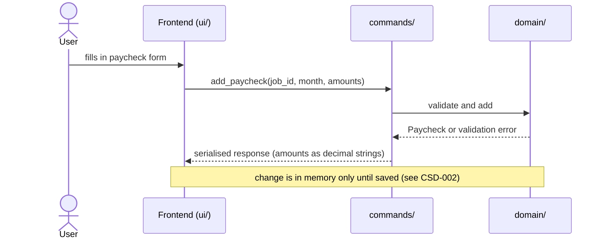
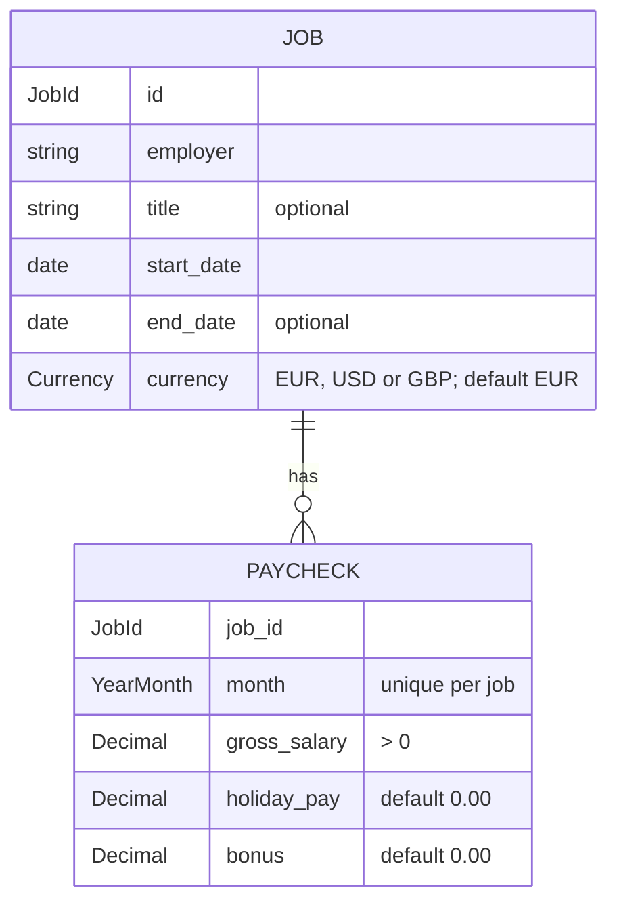

# CSD-001: Employment income tracking

## 1. Intent
The app tracks wealth but has no view of what comes in. This capability lets the user record employment income over time: any number of jobs, each with one monthly paycheck made up of gross salary, holiday pay and bonus. It is for a single person keeping a private, local history of their employment earnings. Scope is employment only. The result is a month-by-month record per job and yearly totals, which later features (net-worth linkage, income charts) can build on.

## 2. Scope
### 2.1 In scope
- Create, edit, end and delete jobs.
- Create, edit and delete one paycheck per job per calendar month.
- One employment view with the jobs, the yearly totals over all jobs and the paychecks of all jobs.
- Income data is part of the project file. Saving and loading is specified in CSD-002.

### 2.2 Non-goals
- NG-1: Net pay, income tax, pension and other deductions.
- NG-2: Freelance and self-employment income, and other income (rental, dividends, etc.).
- NG-3: Automatic payslip import (PDF, bank) and bulk import of paychecks.
- NG-4: Forecasting future income.
- NG-5: Integration with net worth.
- NG-6: A chart or other income-over-time visualisation (candidate for a later CSD). Yearly totals over all jobs are in scope (REQ-11).
- NG-7: Automatic calculation of holiday pay or any other amount. All amounts are entered manually.
- NG-8: (moved to CSD-002 NG-1 in v0.4)

## 3. Definitions
| Term | Meaning |
|---|---|
| **Job** | One employment relationship, identified by an employer name and start date. |
| **Paycheck** | The record of one job for one calendar month (`YYYY-MM`). |
| **Date format** | Dates are shown and typed as dd/mm/yyyy (for example 01/03/2024). Months stay `YYYY-MM`. |
| **Total gross** | Gross salary + holiday pay + bonus of one paycheck. |
| **Project file** | The single user-chosen file holding all app data. Income is its first section. See CSD-002. |

## 4. Requirements

### 4.0 Overview flow


### 4.1 Jobs

**REQ-1: Add a job** *(event-driven)*
When the user submits a new job with an employer name and a start date, the app shall create the job with currency EUR unless USD or GBP is chosen.

```gherkin
@AC-1.1
Scenario: Job created with defaults
  Given no jobs exist
  When the user adds a job with employer "Example Employer" and start date 01/03/2024
  Then one job exists with employer "Example Employer", start date 01/03/2024 and currency "EUR"
  And the job has no title and no end date

@AC-1.2
Scenario Outline: Invalid job is rejected
  Given no jobs exist
  When the user adds a job with employer "<employer>", start date "<start>" and end date "<end>"
  Then the job is rejected with error code "<code>"
  And no job exists

  Examples:
    | employer         | start      | end        | code                |
    |                  | 01/03/2024 |            | JOB_EMPLOYER_REQUIRED |
    | Example Employer |            |            | JOB_START_REQUIRED    |
    | Example Employer | 01/03/2024 | 29/02/2024 | JOB_END_BEFORE_START  |

@AC-1.3
Scenario: Supported non-default currency
  Given no jobs exist
  When the user adds a job with employer "Example Employer", start date 01/03/2024 and currency "GBP"
  Then the job has currency "GBP"

@AC-1.4
Scenario: Unsupported currency is rejected
  Given no jobs exist
  When the user adds a job with employer "Example Employer", start date 01/03/2024 and currency "CHF"
  Then the job is rejected with error code "JOB_CURRENCY_UNSUPPORTED"
  And no job exists
```

**REQ-2: Edit a job** *(event-driven)*
When the user edits a job's employer, title, start date or end date, the app shall apply the change regardless of existing paychecks.

```gherkin
@AC-2.1
Scenario: Dates change freely with paychecks present
  Given a job "Example Employer" starting 01/03/2024 with a paycheck for 2024-03
  When the user sets the job's start date to 01/06/2024 and its end date to 31/01/2025
  Then the job has start date 01/06/2024 and end date 31/01/2025
  And the paycheck for 2024-03 still exists

@AC-2.2
Scenario: End date before start date is rejected on edit
  Given a job "Example Employer" starting 01/03/2024
  When the user sets the job's end date to 01/02/2024
  Then the edit is rejected with error code "JOB_END_BEFORE_START"
  And the job has no end date
```

**REQ-3: Currency is locked once paychecks exist** *(unwanted behaviour)*
If the user changes the currency of a job that has at least one paycheck, then the app shall reject the change.

```gherkin
@AC-3.1
Scenario: Currency change rejected
  Given a job in "EUR" with one paycheck
  When the user changes the job's currency to "USD"
  Then the change is rejected with error code "JOB_CURRENCY_LOCKED"
  And the job currency is "EUR"

@AC-3.2
Scenario: Currency change allowed without paychecks
  Given a job in "EUR" with no paychecks
  When the user changes the job's currency to "USD"
  Then the job currency is "USD"
```

**REQ-4: Delete a job** *(event-driven)*
When the user confirms deletion of a job, the app shall remove the job and all of its paychecks.

```gherkin
@AC-4.1
Scenario: Deletion cascades
  Given a job "Example Employer" with 3 paychecks
  When the user deletes the job and confirms
  Then the job no longer exists
  And none of its 3 paychecks exist

@AC-4.2
Scenario: Cancelled deletion changes nothing
  Given a job "Example Employer" with 3 paychecks
  When the user starts deleting the job and cancels
  Then the job and its 3 paychecks still exist
```

### 4.2 Paychecks

**REQ-5: Add a paycheck** *(event-driven)*
When the user submits a paycheck for the job chosen in the add form and a calendar month with a gross salary, the app shall store it, with holiday pay and bonus defaulting to 0.00, and shall accept any month that is not later than the current month, including months outside the job's start and end dates.

```gherkin
@AC-5.1
Scenario: Paycheck with defaults
  Given the current date is 25/10/2026
  And an EUR job "Example Employer" starting 01/03/2024
  When the user adds a paycheck for 2026-09 with gross salary 3000.00
  Then the paycheck has gross salary 3000.00, holiday pay 0.00, bonus 0.00 and total gross 3000.00

@AC-5.2
Scenario: Month before the job start date is accepted
  Given an EUR job "Example Employer" starting 01/03/2024
  When the user adds a paycheck for 2024-01 with gross salary 2800.00
  Then the paycheck for 2024-01 exists

@AC-5.3
Scenario: Month after the job end date is accepted
  Given an EUR job "Example Employer" ending 31/01/2025
  When the user adds a paycheck for 2025-03 with gross salary 1500.00
  Then the paycheck for 2025-03 exists

@AC-5.4
Scenario: Month later than the current month is rejected
  Given the current date is 25/10/2026
  When the user adds a paycheck for 2026-11 with gross salary 3000.00
  Then the paycheck is rejected with error code "PAYCHECK_MONTH_IN_FUTURE"

@AC-5.5
Scenario: Current month is accepted
  Given the current date is 25/10/2026
  When the user adds a paycheck for 2026-10 with gross salary 3000.00
  Then the paycheck for 2026-10 exists

@AC-5.6
Scenario: The add form chooses the job
  Given jobs "Example Employer" starting 01/03/2024 and "Older Example Employer" starting 01/01/2020
  When the user opens the add paycheck form
  Then the job shown is "Example Employer", the job with the newest start date
  And the user can choose "Older Example Employer" instead
```

**REQ-6: One paycheck per job per month** *(unwanted behaviour)*
If the user adds a paycheck for a job and month that already has one, then the app shall reject it and leave the existing paycheck unchanged.

```gherkin
@AC-6.1
Scenario: Duplicate month rejected
  Given a job with a paycheck for 2026-09 with gross salary 3000.00
  When the user adds another paycheck for 2026-09 with gross salary 3100.00
  Then it is rejected with error code "PAYCHECK_DUPLICATE_MONTH"
  And the paycheck for 2026-09 still has gross salary 3000.00

@AC-6.2
Scenario: Same month on a different job is allowed
  Given two jobs, and the first has a paycheck for 2026-09
  When the user adds a paycheck for 2026-09 to the second job
  Then both jobs have a paycheck for 2026-09
```

**REQ-7: Amount validation** *(unwanted behaviour)*
If a paycheck amount is negative, has more than two decimal places or exceeds 1,000,000.00, or if gross salary is not greater than 0.00, then the app shall reject the paycheck without rounding or storing it.

```gherkin
@AC-7.1
Scenario Outline: Invalid amounts rejected
  Given an EUR job and the current date 25/10/2026
  When the user adds a paycheck for 2026-09 with gross "<gross>", holiday pay "<holiday>" and bonus "<bonus>"
  Then it is rejected with error code "<code>"
  And no paycheck for 2026-09 exists

  Examples:
    | gross      | holiday | bonus   | code                   |
    | 0.00       | 0.00    | 0.00    | PAYCHECK_GROSS_INVALID |
    | -100.00    | 0.00    | 0.00    | PAYCHECK_AMOUNT_NEGATIVE |
    | 3000.00    | -1.00   | 0.00    | PAYCHECK_AMOUNT_NEGATIVE |
    | 3000.00    | 0.00    | -5.00   | PAYCHECK_AMOUNT_NEGATIVE |
    | 3000.999   | 0.00    | 0.00    | PAYCHECK_AMOUNT_PRECISION |
    | 1000000.01 | 0.00    | 0.00    | PAYCHECK_AMOUNT_TOO_LARGE |

@AC-7.2
Scenario: Boundary amount accepted
  Given an EUR job and the current date 25/10/2026
  When the user adds a paycheck for 2026-09 with gross 1000000.00, holiday pay 0.00 and bonus 0.00
  Then the paycheck for 2026-09 exists
```

**REQ-8: Edit and delete a paycheck** *(event-driven)*
When the user edits the amounts of an existing paycheck or deletes it, the app shall apply the change without asking for confirmation, validating edited amounts under REQ-7. The month of an existing paycheck shall not be editable.

```gherkin
@AC-8.1
Scenario: Edit amounts
  Given a paycheck for 2026-05 with gross 3000.00, holiday pay 0.00 and bonus 0.00
  When the user sets holiday pay to 2400.00
  Then the paycheck has holiday pay 2400.00 and total gross 5400.00

@AC-8.2
Scenario: Invalid edit rejected
  Given a paycheck for 2026-05 with gross 3000.00
  When the user sets gross salary to -1.00
  Then the edit is rejected with error code "PAYCHECK_AMOUNT_NEGATIVE"
  And the paycheck still has gross 3000.00

@AC-8.3
Scenario: Delete paycheck
  Given a job with paychecks for 2026-04 and 2026-05
  When the user deletes the paycheck for 2026-05
  Then only the paycheck for 2026-04 exists
  And no confirmation was asked

@AC-8.4
Scenario: Month stays fixed on edit
  Given a paycheck for 2026-05 with gross 3000.00
  When the user edits its amounts
  Then the edit offers no month field
  And the paycheck is still for 2026-05
```

**REQ-9: Copy previous month** *(event-driven)*
When the user chooses "copy previous month" in the add paycheck form, the app shall pre-fill the gross salary with that of the most recent paycheck of the job chosen in the form and holiday pay and bonus with 0.00, and shall not store anything until the user confirms.

```gherkin
@AC-9.1
Scenario: Form pre-filled from latest paycheck
  Given a job with paychecks for 2026-07 (gross 3000.00) and 2026-08 (gross 3100.00, bonus 500.00)
  When the user chooses "copy previous month" in the add form for that job
  Then the form shows gross 3100.00, holiday pay 0.00 and bonus 0.00
  And no new paycheck exists

@AC-9.2
Scenario: No paycheck to copy
  Given a job with no paychecks
  When the user chooses "copy previous month" in the add form for that job
  Then the form shows gross empty, holiday pay 0.00 and bonus 0.00

@AC-9.3
Scenario: The copy follows the chosen job
  Given job "Example Employer" with a latest paycheck of gross 3000.00
  And job "Older Example Employer" with a latest paycheck of gross 1000.00
  When the user chooses "Older Example Employer" in the add form and then "copy previous month"
  Then the form shows gross 1000.00
```

**REQ-10: Total gross is derived** *(ubiquitous)*
The app shall compute a paycheck's total gross as gross salary plus holiday pay plus bonus, and shall not store or accept it as input.

```gherkin
@AC-10.1
Scenario: Total is the sum
  Given a paycheck with gross 3000.00, holiday pay 240.00 and bonus 500.00
  Then its total gross is 3740.00
```

### 4.3 Views

**REQ-11: Yearly totals** *(event-driven)*
When the user views the employment overview, the app shall show, for each calendar year with at least one paycheck of any job, the sums over all jobs of gross salary, holiday pay, bonus and total gross and the number of paychecks, without extrapolating partial years and without converting currencies.

```gherkin
@AC-11.1
Scenario: Totals per calendar year
  Given a job with paychecks 2025-11 (gross 3000.00), 2025-12 (gross 3000.00, bonus 1000.00) and 2026-05 (gross 3000.00, holiday pay 2400.00)
  When the user views the yearly totals
  Then 2026 shows gross 3000.00, holiday pay 2400.00, bonus 0.00, total 5400.00, count 1
  And 2025 shows gross 6000.00, holiday pay 0.00, bonus 1000.00, total 7000.00, count 2

@AC-11.2
Scenario: No paychecks
  Given a job with no paychecks
  When the user views the yearly totals
  Then the totals list is empty
  And a short note says there are no totals yet

@AC-11.3
Scenario: Totals add up all jobs
  Given job "Example Employer" with paychecks 2026-08 (gross 3000.00) and 2026-09 (gross 3000.00, bonus 500.00)
  And job "Older Example Employer" with paycheck 2026-09 (gross 1000.00)
  When the user views the yearly totals
  Then there is one row for 2026 with gross 7000.00, holiday pay 0.00, bonus 500.00, total 7500.00, count 3

@AC-11.4
Scenario: Currencies are not converted
  Given an EUR job with paycheck 2026-09 (gross 3000.00)
  And a USD job with paycheck 2026-09 (gross 1000.00)
  When the user views the yearly totals
  Then the row for 2026 shows gross 4000.00
```

**REQ-12: Ordering** *(ubiquitous)*
The app shall list jobs by start date, newest first, the paychecks of all jobs by month, newest first and, within a month, by job in job order, and the yearly totals by year, newest first.

```gherkin
@AC-12.1
Scenario: Newest first
  Given jobs starting 01/01/2020 and 01/03/2024, and a job with paychecks for 2026-07 and 2026-09
  Then jobs are listed 01/03/2024 before 01/01/2020
  And paychecks are listed 2026-09 before 2026-07

@AC-12.2
Scenario: Same month is ordered by job
  Given job "Example Employer" starting 01/03/2024 and job "Older Example Employer" starting 01/01/2020
  And both have a paycheck for 2026-09
  Then the paycheck of "Example Employer" is listed before that of "Older Example Employer"

@AC-12.3
Scenario: Yearly totals newest year first
  Given paychecks in 2024, 2026 and 2025
  Then the yearly totals are listed 2026, 2025, 2024
```

**REQ-13: Empty states** *(state-driven)*
While no jobs exist, the app shall show an "add your first job" prompt, and while jobs exist but have no paychecks, the app shall show a short note in the yearly totals and paychecks sections, with no totals rows and no error.

```gherkin
@AC-13.1
Scenario: No jobs
  Given no jobs exist
  Then the income view shows an "add your first job" prompt

@AC-13.2
Scenario: Jobs without paychecks
  Given a job with no paychecks
  Then the yearly totals and the paychecks show a short note
  And no error is shown
```

**REQ-22: Date format** *(ubiquitous)*
The app shall show and accept job start and end dates as dd/mm/yyyy with a two-digit day and month, and shall reject any other date format.

```gherkin
@AC-22.1
Scenario: Dates are shown as dd/mm/yyyy
  Given a job "Example Employer" starting 01/03/2024 and ending 31/01/2025
  Then the job list and the job details show "01/03/2024" and "31/01/2025"

@AC-22.2
Scenario Outline: Other formats are rejected
  Given no jobs exist
  When the user adds a job with employer "Example Employer" and start date "<start>"
  Then the job is rejected with error code "JOB_DATE_INVALID"
  And no job exists

  Examples:
    | start      | reason                  |
    | 2024-03-01 | year first              |
    | 1/3/2024   | no two-digit day/month  |
    | 03-01-2024 | wrong separator         |
    | 31/02/2024 | not a calendar date     |
    | 01/03/24   | two-digit year          |

@AC-22.3
Scenario: Month stays YYYY-MM
  Given an EUR job "Example Employer"
  When the user adds a paycheck for "2026-09" with gross salary 3000.00
  Then the paycheck is stored for the month "2026-09"
```

**REQ-23: Employment view layout** *(ubiquitous)*
The app shall show the employment view as the sections Jobs, Yearly totals and Paychecks in that order, with Edit job and Delete job on each job in the Jobs section, a Job column and a Currency column in the paychecks, and no job selection that changes what the sections show.

```gherkin
@AC-23.1
Scenario: Sections in order
  Given a job with a paycheck
  Then the sections appear in the order Jobs, Yearly totals, Paychecks
  And there is no section that only describes one selected job

@AC-23.2
Scenario: Job rows carry their actions and paycheck count
  Given job "Example Employer" with 2 paychecks
  Then its row in the Jobs section shows the employer, dates, currency and "2 paychecks"
  And the row has the buttons "Edit job" and "Delete job"

@AC-23.3
Scenario: Paychecks of all jobs with their job
  Given job "Example Employer" with a paycheck for 2026-09 (EUR) and job "Older Example Employer" with a paycheck for 2026-08 (USD)
  Then the Paychecks section lists both paychecks
  And the Job column shows "Example Employer" and "Older Example Employer" and the Currency column shows "EUR" and "USD"

@AC-23.4
Scenario: Clicking a job changes nothing
  Given two jobs with paychecks
  When the user clicks a job row
  Then the yearly totals and the paychecks are unchanged
```

### 4.4 Saving and loading
REQ-14 to REQ-21 (removed in v0.4): moved to CSD-002 (Project file). Income data is saved and loaded as one section of that project file.

## 5. Interfaces and contracts

Dates: the job start and end dates are shown and typed as dd/mm/yyyy (REQ-22). Rust validates the dates as typed. Dates returned by the commands and stored in the project file are ISO 8601 (`YYYY-MM-DD`), and the frontend formats them as dd/mm/yyyy for display. Months are `YYYY-MM` everywhere.



Commands (all inputs validated in Rust; amounts cross IPC as decimal strings):
`list_jobs`, `create_job`, `update_job`, `delete_job`, `list_paychecks()` (all jobs, each with its employer and currency), `add_paycheck`, `update_paycheck`, `delete_paycheck`, `copy_previous_paycheck(job_id)`, `yearly_totals()` (over all jobs). Project commands (save, open, new) are in CSD-002. The income data is stored as one section of the project file defined there.

Error codes (returned as code plus safe message): `JOB_EMPLOYER_REQUIRED`, `JOB_START_REQUIRED`, `JOB_END_BEFORE_START`, `JOB_CURRENCY_UNSUPPORTED`, `JOB_CURRENCY_LOCKED`, `PAYCHECK_MONTH_IN_FUTURE`, `PAYCHECK_DUPLICATE_MONTH`, `PAYCHECK_GROSS_INVALID`, `PAYCHECK_AMOUNT_NEGATIVE`, `PAYCHECK_AMOUNT_PRECISION`, `PAYCHECK_AMOUNT_TOO_LARGE`, `JOB_DATE_INVALID`. Project error codes are in CSD-002.

## 6. Constraints
- CON-1: Amounts use `rust_decimal::Decimal` and carry the job's currency. Temporary exception (v0.7): the yearly totals add the amounts of all jobs without converting currencies (REQ-11, AC-11.4). Rationale: `CLAUDE.md` money rules apply, except that the owner will make the whole project file single-currency (OQ-8), which removes the exception.
- CON-2: The frontend displays figures computed in Rust and computes none itself. Rationale: `CLAUDE.md` layout rule.
- CON-3: No network access. Rationale: `CLAUDE.md` Tauri security rules.
- CON-4: Errors shown to the user never contain file paths or OS details. Rationale: `CLAUDE.md` error rules.
- CON-5: Amounts, employer names and balances are not logged at `info` or above. Rationale: `CLAUDE.md` privacy rules.
- CON-6: Tests and fixtures use synthetic data only ("Example Employer", round amounts). Rationale: the repo is public.
- CON-7: (moved to CSD-002 CON-1 in v0.4)
- CON-8: (moved to CSD-002 CON-2 in v0.4)
- CON-9: (moved to CSD-002 CON-3 in v0.4)

## 7. Verification
All ACs are proven by `cargo test`, with domain logic tested in `domain/`. Tests are named `test_csd001_ac_<n>_<m>_<description>` (CSD-000 REQ-6).

| Requirement | Command |
|---|---|
| All of REQ-1 to REQ-13, and AC-22.2 and AC-22.3 | `cargo test test_csd001_` |
| AC-5.6, AC-22.1, REQ-23 (AC-23.1, AC-23.2, AC-23.4) and the display parts of AC-9.3, AC-11.2, AC-13.2 | Manual checklist: section order and contents, job buttons and paycheck counts, no selection, dd/mm/yyyy dates, default job in the add form. There is no frontend test setup |
| AC-23.3 (data) | `cargo test test_csd001_ac_23_` covers the data of the paychecks table (all jobs, employer, currency) |
| One requirement, e.g. REQ-5 | `cargo test test_csd001_ac_5_` |

Done means fmt, clippy (`-D warnings`) and `cargo test --all-features` pass.

## 8. Open questions
- OQ-1: (moved to CSD-002 in v0.4) File format, resolved there.
- OQ-2: (moved to CSD-002 in v0.4) Dialog plugin and permissions, resolved there.
- OQ-3: (moved to CSD-002 OQ-2 in v0.4) The `CLAUDE.md` update at approval.
- OQ-4: (resolved in v0.2) Currencies are EUR, USD and GBP.
- OQ-5: (moved to CSD-002 in v0.4) Testing the unsaved state, resolved there.
- OQ-6: (resolved in v0.2) The month of an existing paycheck is not editable.
- OQ-7: (resolved in v0.2) Deleting a single paycheck needs no confirmation.
- OQ-8: The project file will become single-currency. Then the per-job currency, `JOB_CURRENCY_*` codes, the Currency column and the CON-1 exception are removed in a later version. Owner: Thijs. Blocks: nothing now.

## 9. Changelog
- 0.7 (25/10/2026): The employment view no longer has a selected job. Yearly totals are summed over all jobs (REQ-11, AC-11.3, AC-11.4), the paychecks of all jobs are listed together with Job and Currency columns (REQ-12, REQ-23), the job is chosen in the add form and "copy previous month" moves into it (REQ-5, AC-5.6, REQ-9, AC-9.3). NG-6 narrowed to charts. CON-1 gets a temporary exception for summing mixed currencies (OQ-8). Commands `list_paychecks()` and `yearly_totals()` no longer take a job.
- 0.6 (25/10/2026): Dates are written dd/mm/yyyy (CSD-000 2.2, CON-7). New REQ-22 (date format, AC-22.1 to AC-22.3), error code `JOB_DATE_INVALID` listed, existing examples converted. Months stay YYYY-MM; the file and commands keep ISO 8601 internally.
- 0.5 (25/10/2026): Verification uses the `test_csd001_` filter (CSD-000 2.1 naming).
- 0.4 (25/10/2026): Split persistence into CSD-002. REQ-14 to REQ-21, NG-8, CON-7 to CON-9, AC-14.* to AC-21.*, the project commands and error codes, and OQ-1, OQ-2, OQ-3, OQ-5 moved there (IDs kept as removed markers per CSD-000 CON-6). No change to income behaviour.
- 0.3 (25/10/2026): Resolved OQ-1, OQ-2, OQ-3, OQ-5. Added NG-8, REQ-18 to REQ-21 and AC-14.3, AC-14.4, AC-15.3. REQ-14 and REQ-15 use native dialogs and the commands no longer take a path. Added CON-7 to CON-9, the project file description, and the revised verification table.
- 0.2 (25/10/2026): Resolved OQ-4, OQ-6, OQ-7. REQ-1 restricts currency to EUR, USD, GBP (AC-1.3, AC-1.4, new code `JOB_CURRENCY_UNSUPPORTED`). REQ-8 fixes the paycheck month and removes delete confirmation (AC-8.3 amended, AC-8.4 added).
- 0.1 (25/10/2026): initial draft.
