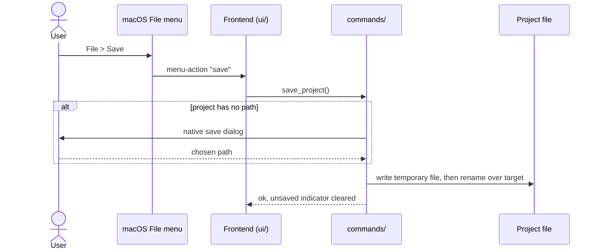

# CSD-002: Project file (save, open, new)

## 1. Intent
The app keeps all of the user's data in one local project file instead of a database. Without a clear save model, users can lose edits or overwrite good data with bad. This capability defines how a project is created, opened, saved and protected against accidental loss. It applies to all app data, starting with the employment income of CSD-001, and it is for a single user working on one project at a time.

## 2. Scope
### 2.1 In scope
- New, Open, Save and Save As for the project file, as items of the native macOS File menu.
- Unsaved-changes tracking and the confirmations that protect unsaved data.
- Safe writing, so a failed save never damages an existing file.
- The project file format and its versioning.
- Reopening the last used project when the app starts.

### 2.2 Non-goals
- NG-1: Encryption of the project file. (Remembering the last used file moved into scope in v0.4: REQ-8, REQ-10, REQ-11.)
- NG-2: Autosave and backup or recovery copies.
- NG-3: Multiple projects open at once.
- NG-4: Cloud sync or sharing of the file.
- NG-5: Buttons for these actions inside the app window, and an Open Recent list.
- NG-6: Remembering more than one file, and opening a file by double-clicking it in Finder.

## 3. Definitions
| Term | Meaning |
|---|---|
| **Project** | All app data held in memory, plus an optional path to its file. |
| **Project file** | A JSON file with the extension `.wealth` holding the project. |
| **Unsaved changes** | The in-memory project differs from the last saved or opened state. |

## 4. Requirements

### 4.0 Overview flow


**REQ-1: Save** *(event-driven)*
When the user saves, the app shall write all project data to the project file and clear the unsaved indicator, asking for a path in a native save dialog when the project has no path yet or when the user chose Save As.

```gherkin
@AC-1.1
Scenario: Save and reload round-trips
  Given 2 jobs with 5 paychecks in total
  When the user saves to a chosen path and then opens that file in a fresh session
  Then the same 2 jobs and 5 paychecks exist with identical values

@AC-1.2
Scenario: Write failure keeps changes unsaved
  Given unsaved changes
  And the chosen path is not writable
  When the user saves
  Then an error with code "PROJECT_SAVE_FAILED" and no file path or OS detail is shown
  And the unsaved indicator remains

@AC-1.3
Scenario: Path is asked once, then reused
  Given a new project with a job and no path
  When the user saves
  Then a native save dialog is shown and the file is written to the chosen path
  When the user adds a second job and saves again
  Then no dialog is shown and the same file is overwritten

@AC-1.4
Scenario: Save As asks again
  Given a project saved to "example-a.wealth"
  When the user chooses Save As and picks "example-b.wealth"
  Then "example-b.wealth" contains the data
  And later saves go to "example-b.wealth"

@AC-1.5
Scenario: Cancelling the dialog saves nothing
  Given a new project with a job and no path
  When the user saves and cancels the native save dialog
  Then no file is written
  And the unsaved indicator remains
```

**REQ-2: Open** *(event-driven)*
When the user opens a project file through a native open dialog, the app shall replace the in-memory project with the file's contents.

```gherkin
@AC-2.1
Scenario: Open valid file
  Given a valid project file with 1 job and 2 paychecks
  When the user opens it
  Then 1 job and 2 paychecks are shown

@AC-2.2
Scenario: Invalid file is rejected
  Given a file that is not a valid project file
  And the app holds 1 job in memory
  When the user opens it
  Then an error with code "PROJECT_INVALID_FILE" is shown
  And the 1 job in memory is unchanged

@AC-2.3
Scenario: File from a newer app version is rejected
  Given a project file with "format_version" 2 and the app understands version 1
  When the user opens it
  Then an error with code "PROJECT_INVALID_FILE" is shown
  And the data in memory is unchanged
```

**REQ-3: Unsaved-changes indicator** *(state-driven)*
While the in-memory project differs from the last saved or opened state, the app shall show an unsaved-changes indicator.

```gherkin
@AC-3.1
Scenario: Indicator follows edits
  Given a freshly opened project
  Then no unsaved indicator is shown
  When the user adds a job
  Then the unsaved indicator is shown
  When the user saves
  Then the unsaved indicator is cleared
```

**REQ-4: Confirm close with unsaved changes** *(event-driven)*
When the user closes the app while the unsaved-changes indicator is shown, the app shall ask for confirmation before closing.

```gherkin
@AC-4.1
Scenario: Close prompts
  Given unsaved changes
  When the user closes the app
  Then a confirmation is asked
  And choosing "cancel" keeps the app open with its data

@AC-4.2
Scenario: Close without changes
  Given no unsaved changes
  When the user closes the app
  Then the app closes without asking
```

**REQ-5: Failed save leaves the file intact** *(unwanted behaviour)*
If writing the project file fails, then the app shall leave any existing file at that path unchanged.

```gherkin
@AC-5.1
Scenario: Interrupted write does not corrupt the file
  Given "example-a.wealth" holds 1 job
  And the project in memory has 2 jobs
  When the write fails part-way
  Then "example-a.wealth" still holds exactly 1 job
  And the error code "PROJECT_SAVE_FAILED" is shown
```

**REQ-6: New project** *(event-driven)*
When the user starts a new project, the app shall replace the in-memory project with an empty one that has no path.

```gherkin
@AC-6.1
Scenario: New project is empty
  Given a project with 1 job saved to "example-a.wealth"
  When the user starts a new project
  Then no jobs exist
  And the next save asks for a path

@AC-6.2
Scenario: Saved file is untouched by New
  Given a project with 1 job saved to "example-a.wealth"
  When the user starts a new project and then closes it without saving
  Then "example-a.wealth" still holds 1 job
```

**REQ-7: Confirm before replacing unsaved data** *(event-driven)*
When the user starts a new project or opens a file while the unsaved-changes indicator is shown, the app shall ask for confirmation before replacing the in-memory project.

```gherkin
@AC-7.1
Scenario: Open prompts when unsaved
  Given unsaved changes
  When the user chooses Open
  Then a confirmation is asked before the open dialog
  And choosing "cancel" keeps the current data

@AC-7.2
Scenario: New project without unsaved changes
  Given no unsaved changes
  When the user starts a new project
  Then no confirmation is asked
```

**REQ-8: Reopen last project** *(event-driven)*
When the app starts, the app shall open the project file that was last opened or saved, or start with an empty project that has no path if there is none.

```gherkin
@AC-8.1
Scenario: First launch has nothing to reopen
  Given no project file was ever opened or saved
  When the app starts
  Then no jobs exist
  And no path is set

@AC-8.2
Scenario: The last project is reopened
  Given a project with 1 job was saved to "example-a.wealth" in an earlier session
  When the app starts
  Then 1 job exists
  And the path is "example-a.wealth"
  And no unsaved indicator is shown
```

**REQ-9: File menu** *(ubiquitous)*
The app shall offer New, Open, Save and Save As as items of the native macOS File menu with the shortcuts ⌘N, ⌘O, ⌘S and ⇧⌘S, and shall not offer them as buttons in the app window.

```gherkin
@AC-9.1
Scenario: Menu items and shortcuts exist
  Given the app has started
  Then the File menu contains "New" with ⌘N, "Open…" with ⌘O, "Save" with ⌘S and "Save As…" with ⇧⌘S

@AC-9.2
Scenario: Choosing a menu item runs the action
  Given a new project with a job and no path
  When the user chooses File > Save
  Then a native save dialog is shown
  And after choosing a path the unsaved indicator is cleared

@AC-9.3
Scenario: No buttons in the window
  Given the app has started
  Then the app window has no New, Open, Save or Save As buttons
  And the unsaved-changes indicator is still shown in the window

@AC-9.4
Scenario: Menu actions respect unsaved changes
  Given unsaved changes
  When the user chooses File > New or File > Open…
  Then a confirmation is asked before the project is replaced
```

**REQ-10: Remember the last project** *(event-driven)*
When a project is opened, saved or saved under a new name, the app shall remember its path for the next start, and shall leave the remembered path unchanged when the user starts a new project.

```gherkin
@AC-10.1
Scenario: Save remembers the path
  Given a new project with a job
  When the user saves it to "example-a.wealth"
  Then the next start reopens "example-a.wealth"

@AC-10.2
Scenario: Open and Save As move the remembered path
  Given "example-a.wealth" and "example-b.wealth" exist
  When the user opens "example-a.wealth" and then saves it as "example-c.wealth"
  Then the next start reopens "example-c.wealth"

@AC-10.3
Scenario: New project keeps the remembered path
  Given a project saved to "example-a.wealth"
  When the user starts a new project and quits without saving
  Then the next start reopens "example-a.wealth"

@AC-10.4
Scenario: A failed save does not change the remembered path
  Given a project saved to "example-a.wealth"
  When the user chooses a path that is not writable and saving fails
  Then the next start still reopens "example-a.wealth"
```

**REQ-11: Remembered file cannot be reopened** *(unwanted behaviour)*
If the remembered project file cannot be opened at start, then the app shall start with an empty project, show a notice once without the file path, and forget the remembered path.

```gherkin
@AC-11.1
Scenario Outline: Missing, unreadable or invalid file
  Given the remembered file "example-a.wealth" is <problem>
  When the app starts
  Then no jobs exist and no path is set
  And a notice with code "<code>" is available once
  And the notice text does not contain the file path

  Examples:
    | problem                 | code                 |
    | missing                 | PROJECT_OPEN_FAILED  |
    | not a valid project file | PROJECT_INVALID_FILE |

@AC-11.2
Scenario: The error is not repeated
  Given the remembered file was missing at the last start
  When the app starts again
  Then no notice is shown
  And no jobs exist and no path is set
```

## 5. Interfaces and contracts

Menu: Rust builds the File menu items `project-new`, `project-open`, `project-save` and `project-save-as`. Choosing one emits the event `menu-action` with the item id to the frontend, which runs the same flow the buttons used to run, including the confirmations of REQ-7.

Commands: `take_startup_notice()` (returns the REQ-11 notice once, then nothing), `new_project()`, `open_project()`, `save_project()`, `save_project_as()`, `project_status()` (returns whether there are unsaved changes and whether a path is set). The save and open commands show the native dialog themselves and take no path from the frontend.

Project file: JSON with the extension `.wealth`, a top-level integer `format_version` (currently 1) and amounts as decimal strings. Each capability owns one section of the file. Income (CSD-001) is the first, the project settings (CSD-003) the second and the investments (CSD-005) the third and the bank accounts (CSD-009, section `bank_accounts`) the fourth.

Error codes (code plus safe message): `PROJECT_SAVE_FAILED`, `PROJECT_INVALID_FILE`.

## 6. Constraints
- CON-1: The project file is plain, unencrypted JSON, written by writing a temporary file and renaming it over the target. It is never committed (`*.wealth` is git-ignored). Rationale: it holds real financial data and the repo is public. The atomic write backs REQ-5.
- CON-2: File access uses only the Tauri dialog plugin, opened from Rust, so no dialog permission is granted to the webview. There is no `fs` plugin, and file paths never come from the frontend. Rationale: least privilege per `CLAUDE.md`. Adding the plugin still needs approval at implementation time.
- CON-3: Amounts in the file are decimal strings and the file carries `format_version`. A newer version than the app knows is rejected. Rationale: no float rounding, and safe forward compatibility.
- CON-4: Errors shown to the user never contain file paths or OS details. Rationale: `CLAUDE.md` error rules.
- CON-5: Tests use a temporary directory and synthetic data only, never real app data or real financial data. Rationale: `CLAUDE.md` testing and privacy rules, and the repo is public.
- CON-6: The menu uses Tauri's built-in menu API: no plugin and no extra permission. It keeps the standard macOS menus (app, Edit, View, Window), because the Edit menu is what makes copy, paste and undo work in text fields. Rationale: least privilege per `CLAUDE.md`, and no loss of standard behaviour.
- CON-7: The remembered path is kept in `last-project.json` in the app's own config folder, outside the project file, written like the project file (atomic, owner-only). It holds the path only, never project data, and is never committed. Rationale: it must be readable before any project is open, and it can reveal a user name through the path. It uses Tauri's built-in path API: no plugin and no permission. The application preferences of CSD-008 live in a second file, `preferences.json`, in the same folder under the same rules.

## 7. Verification
The unsaved flag and the project state live in Rust, so these are proven by `cargo test`, with file round-trips in a temporary directory.

| Requirement | Command |
|---|---|
| REQ-1, REQ-2, REQ-3, REQ-5, REQ-6, REQ-8, REQ-10, REQ-11 | `cargo test test_csd002_` (tests are named `test_csd002_ac_<n>_<m>_<description>`, CSD-000 REQ-6). One requirement, e.g. REQ-1: `cargo test test_csd002_ac_1_` |
| REQ-9 (AC-9.1) | `cargo test test_csd002_ac_9_` checks the table the menu is built from (ids, labels, shortcuts). Native menus can only be created on the main thread, so the built menu is on the manual checklist |
| REQ-4, REQ-7, REQ-9 | Manual checklist: the real File menu items and shortcuts, AC-9.2 to AC-9.4, confirmation dialogs on close, New and Open with and without unsaved changes, no buttons in the window. There is no frontend test setup and none is added |

Done means fmt, clippy (`-D warnings`) and `cargo test --all-features` pass.

## 8. Open questions
- OQ-1: (resolved) Tests include the CSD number, `test_csd<NNN>_ac_n_m_...`. CSD-000 is now 2.1 and `CLAUDE.md` uses the same naming.
- OQ-2: When approved, `CLAUDE.md` is updated in the same PR: replace "SQLite" with "local project file (JSON), no database", drop the SQLite-crate item from Ask first, and reword the `storage/` layout line. Owner: Thijs. Blocks: approval PR.

## 9. Changelog
- 0.9 (28/10/2026): The project file gets a `bank_accounts` section (CSD-009). `format_version` stays 1: a file without it opens with no bank accounts, as the app is not released yet. Back to `draft` until the owner approves.
- 0.8 (28/10/2026): CON-7 notes that the application preferences of CSD-008 live next to `last-project.json`. No behaviour change.
- 0.7 (26/10/2026): The project file gets an `investments` section (CSD-005). `format_version` stays 1: a file without it opens with no investment accounts, as the app is not released yet.
- 0.6 (25/10/2026): The project file gets a `settings` section (CSD-003). `format_version` stays 1: a file without it opens with the defaults, as the app is not released yet.
- 0.5 (25/10/2026): Dates are written dd/mm/yyyy (CSD-000 2.2, CON-7). No behaviour change: the project file keeps ISO 8601 dates internally.
- 0.4 (25/10/2026): The app reopens the last used project at start. REQ-8 changes from "Start empty" to "Reopen last project" (AC-8.1 reworded, AC-8.2 added), new REQ-10 and REQ-11, NG-1 narrowed, NG-6 and CON-7 added, command `take_startup_notice`.
- 0.3 (25/10/2026): Project actions move from four in-window buttons to the native macOS File menu (REQ-9, NG-5, CON-6, menu event in section 5). Behaviour of REQ-1 to REQ-8 is unchanged. CON-2 reworded: dialogs open from Rust, so no webview permission is needed.
- 0.2 (25/10/2026): Resolved OQ-1. Verification uses the `test_csd002_` filter.
- 0.1 (25/10/2026): initial draft, split out of CSD-001 v0.3 (its REQ-14 to REQ-21 and CON-7 to CON-9).
