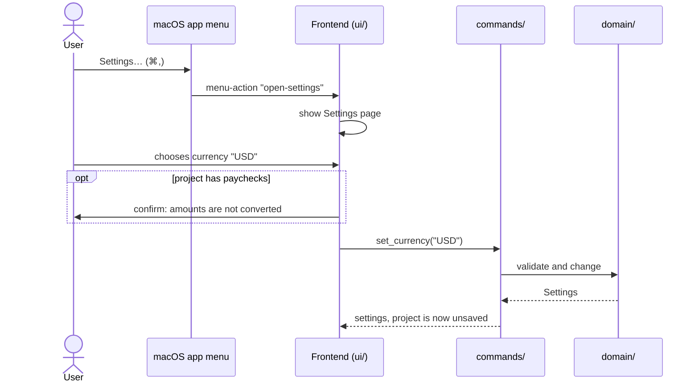

# CSD-003: Project settings

## 1. Intent
Settings that belong to the whole project, such as its currency, need one place in the app. Until now every job carried its own currency, which let the yearly totals add euros to dollars. This capability adds a Settings page where project settings are changed, and its first setting is one currency for the whole project. It is for a single user working on one project file, and the settings are saved in that file so they travel with it.

## 2. Scope
### 2.1 In scope
- A Settings page in the left pane, and a Settings… item with ⌘, in the macOS app menu.
- The project currency (EUR, USD or GBP): choosing, confirming, saving and showing it.
- Saving the settings in the project file.

### 2.2 Non-goals
- NG-1: Converting amounts between currencies, and exchange rates.
- NG-2: A currency per job or per paycheck.
- NG-3: Settings that live outside the project file (application preferences). They are specified in CSD-008, and appear on the same page in their own panel.
- NG-4: Currencies other than EUR, USD and GBP.
- NG-5: Migrating project files made before this capability. Such a file opens with the default settings and its per-job currencies are ignored. The owner recreates old files.

## 3. Definitions
| Term | Meaning |
|---|---|
| **Project currency** | The one currency of every amount in the project. |
| **Settings page** | The page "Settings", reached from the left pane or the app menu. Its "General" panel holds the project settings, and its "Appearance" panel holds an application preference (CSD-008). |

## 4. Requirements

### 4.0 Overview flow


**REQ-1: Settings page** *(ubiquitous)*
The app shall offer a page "Settings" as the last navigation item of the left pane, above the project status indicator.

```gherkin
@AC-1.1
Scenario: Settings is the last item in the left pane
  Given the app has started
  Then the left pane shows "Settings" below the other navigation items
  And it is above the project status indicator

@AC-1.2
Scenario: The page shows the currency setting
  Given the app has started
  When the user opens Settings
  Then the page "Settings" shows a "General" panel with a "Currency" choice with the current project currency
```

**REQ-2: Settings in the app menu** *(ubiquitous)*
The app shall offer "Settings…" as an item of the macOS app menu, directly below "About", with the shortcut ⌘, and shall open the Settings page when it is chosen.

```gherkin
@AC-2.1
Scenario: Menu item and shortcut exist
  Given the app has started
  Then the app menu contains "Settings…" with ⌘, below "About"

@AC-2.2
Scenario Outline: Opening Settings from anywhere
  Given the user is viewing "<page>"
  When the user chooses Settings… from the app menu or presses ⌘,
  Then the Settings page is shown

  Examples:
    | page      |
    | Dashboard |
    | Income    |
```

**REQ-3: One project currency** *(ubiquitous)*
The project shall have exactly one currency, EUR, USD or GBP, used for every amount in the app, and a new project shall start in EUR.

```gherkin
@AC-3.1
Scenario: A new project uses EUR
  When the user starts a new project
  Then the project currency is "EUR"

@AC-3.2
Scenario: Jobs and paychecks have no currency of their own
  Given a project in "USD" with a job and a paycheck for 2026-09 with gross salary 3000.00
  Then the amounts of the paycheck are in "USD"
  And the job and the paycheck carry no currency
```

**REQ-4: Change the currency** *(event-driven)*
When the user chooses another currency on the Settings page, the app shall change the project currency without converting any amount and show the project as having unsaved changes.

```gherkin
@AC-4.1
Scenario: Amounts keep their value
  Given a project in "EUR" with a paycheck for 2026-09 with gross salary 3000.00
  When the user changes the currency to "USD"
  Then the project currency is "USD"
  And the paycheck still has gross salary 3000.00

@AC-4.2
Scenario: The change is an unsaved change
  Given a saved project in "EUR"
  When the user changes the currency to "GBP"
  Then the unsaved indicator is shown

@AC-4.3
Scenario: Choosing the current currency changes nothing
  Given a saved project in "EUR"
  When the user chooses "EUR"
  Then the project currency is "EUR"
  And the unsaved indicator is not shown
```

**REQ-5: Confirm when amounts exist** *(event-driven)*
While the project has entries (paychecks, annual statements or investment statements), when the user chooses another currency, the app shall ask for confirmation, explaining that amounts are not converted, before changing the currency.

```gherkin
@AC-5.1
Scenario: Confirmation with paychecks
  Given a project in "EUR" with 1 paycheck
  When the user chooses "USD"
  Then a confirmation says the amounts are not converted
  And choosing "Cancel" keeps "EUR" and shows "EUR" on the page

@AC-5.2
Scenario: Confirming applies the change
  Given a project in "EUR" with 1 paycheck
  When the user chooses "USD" and confirms
  Then the project currency is "USD"

@AC-5.3
Scenario: No confirmation without paychecks
  Given a project in "EUR" with a job and no entries
  When the user chooses "USD"
  Then no confirmation is asked
  And the project currency is "USD"

@AC-5.4
Scenario: Confirmation with only an annual statement
  Given a project in "EUR" with a yearly job and 1 annual statement
  When the user chooses "USD"
  Then a confirmation says the amounts are not converted

@AC-5.5
Scenario: Confirmation with only an investment statement
  Given a project in "EUR" with no jobs and an investment account with 1 statement for 2026-09 with balance 12500.00
  When the user chooses "USD"
  Then a confirmation says the amounts are not converted
  And choosing "Cancel" keeps "EUR" and the balance 12500.00

@AC-5.6
Scenario: An investment account without statements needs no confirmation
  Given a project in "EUR" with an investment account and no statements
  When the user chooses "USD"
  Then no confirmation is asked
  And the project currency is "USD"
```

**REQ-6: Unsupported currency** *(unwanted behaviour)*
If a currency other than EUR, USD or GBP is requested, then the app shall reject it with the error code `PROJECT_CURRENCY_UNSUPPORTED` and keep the project currency.

```gherkin
@AC-6.1
Scenario Outline: Unsupported currencies are rejected
  Given a project in "EUR"
  When the currency "<currency>" is requested
  Then it is rejected with error code "PROJECT_CURRENCY_UNSUPPORTED"
  And the project currency is "EUR"

  Examples:
    | currency |
    | CHF      |
    | euro     |
    |          |
```

**REQ-7: Settings are saved with the project** *(ubiquitous)*
The app shall save the project settings in the project file and restore them when the file is opened.

```gherkin
@AC-7.1
Scenario: Currency survives save and open
  Given a project in "GBP" saved to "example-a.wealth"
  When the file is opened in a fresh session
  Then the project currency is "GBP"

@AC-7.2
Scenario: A file without settings opens with the defaults
  Given a project file that has no settings section
  When the user opens it
  Then the project currency is "EUR"

@AC-7.3
Scenario: The settings are in their own section
  Given a project in "USD" saved to "example-a.wealth"
  Then the file has a settings section with the currency "USD"
```

**REQ-8: The currency is shown only in Settings** *(ubiquitous)*
The app shall show the project currency only on the Settings page, and shall show no currency in any other view: not in section titles, on the jobs or accounts, or in the tables.

```gherkin
@AC-8.1
Scenario: Other views show no currency
  Given a project in "USD" with a job and a paycheck
  Then the sections are titled "Yearly totals" and "Paychecks and statements"
  And the Jobs section and the paychecks table show no currency
  And only the Settings page shows "USD"
```

## 5. Interfaces and contracts

Commands: `get_settings()` returns `{ currency, entry_count }` (the frontend reads the currency only for the Settings page), and `set_currency(currency)` returns the same. `entry_count` (paychecks, annual statements and investment statements) lets the frontend decide whether REQ-5 applies.

Menu: the item `open-settings` is added to the app menu, below About, with the accelerator ⌘,. Choosing it emits the event `menu-action` with that id, as the File menu items do (CSD-002 REQ-9).

Project file: a second section `settings` next to `income`, for example `"settings": { "currency": "EUR" }`. The `format_version` stays 1 (NG-5).

Error code: `PROJECT_CURRENCY_UNSUPPORTED`.

## 6. Constraints
- CON-1: Amounts are never converted between currencies. Changing the project currency only changes the label. Rationale: no exchange rates exist in the app (NG-1), and `CLAUDE.md` forbids adding amounts across currencies without a conversion.
- CON-2: The settings are stored only in the project file. Rationale: the currency must travel with the data it describes.
- CON-3: The menu item uses Tauri's built-in menu API: no plugin and no extra permission. Rationale: least privilege per `CLAUDE.md`.
- CON-4: The frontend displays the currency it is given and decides nothing about amounts. Rationale: `CLAUDE.md` layout rule.
- CON-5: Tests use synthetic data only. Rationale: the repo is public.

## 7. Verification
All behaviour except the screens is proven by `cargo test`. Tests are named `test_csd003_ac_<n>_<m>_<description>` (CSD-000 REQ-6).

| Requirement | Command |
|---|---|
| REQ-3, REQ-4, REQ-6, REQ-7, and the data of REQ-5 and REQ-8 | `cargo test test_csd003_` |
| AC-2.1 | `cargo test test_csd003_ac_2_1` checks the table the menu item is built from. Native menus can only be created on the main thread, so the built menu is on the manual checklist |
| AC-1.1, AC-1.2, AC-2.2, AC-3.2 (display), AC-4.2 (indicator), AC-5.1 to AC-5.6 (dialogs), AC-8.1 | Manual checklist: the left pane order, the Settings page, ⌘, and the app menu item, the confirmation, and the titles without a currency. There is no frontend test setup |

Done means fmt, clippy (`-D warnings`) and `cargo test --all-features` pass.

## 8. Open questions
None.

## 9. Changelog
- 0.5 (28/10/2026): The page is called "Settings" instead of "Project settings" and its currency sits in a "General" panel (definition, REQ-1, AC-1.2), because CSD-008 adds an "Appearance" panel with an application preference. NG-3 points to CSD-008.
- 0.4 (26/10/2026): REQ-8 reversed: the currency is shown only on the Settings page, no longer in section titles (AC-8.1 rewritten).
- 0.3 (26/10/2026): Investment statements (CSD-005) also count as entries for the currency confirmation: REQ-5 reworded, AC-5.5 and AC-5.6 added, `entry_count` counts them. REQ-8 points to the currency in the Investments section titles (CSD-005 REQ-20).
- 0.2 (26/10/2026): The currency confirmation also applies to annual statements (CSD-001 0.9): REQ-5 says entries, AC-5.4 added, `paycheck_count` becomes `entry_count`.
- 0.1 (25/10/2026): initial draft.
