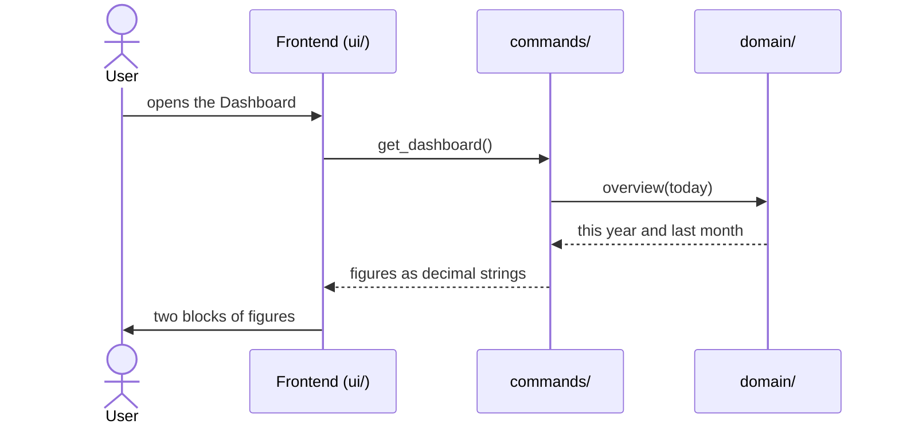

# CSD-004: Income dashboard

## 1. Intent
The dashboard is the first page of the app, and today it shows example data that has nothing to do with the user's project. The app only tracks employment income so far, so the dashboard should answer two questions at a glance: how much has been earned this year, and how much last month. This capability replaces the example content with those two views, computed from the project, and removes the example pages (accounts, transactions, budget) that have no function yet.

## 2. Scope
### 2.1 In scope
- The dashboard page: income this year to date and income last month, over all jobs.
- Its empty states.
- The left pane: its groups, the order of its items, and offering only the pages that work.

### 2.2 Non-goals
- NG-1: Comparisons with an earlier period (such as last year) and percentages.
- NG-2: Charts and other visualisations (as CSD-001 NG-6).
- NG-3: A breakdown per job.
- NG-4: Forecasts and net pay (CSD-001 NG-1, NG-4).
- NG-5: Any page in the Insights group other than the Net worth page of CSD-017 and the Ratios page of CSD-018.

## 3. Definitions
| Term | Meaning |
|---|---|
| **Today** | The current date in local time. |
| **This year** | The current calendar year, from January up to and including the current month. |
| **Last month** | The calendar month before the current month. For January this is December of the previous year. |
| **Entry** | A paycheck of a monthly job or an annual statement of a yearly job (CSD-001). |
| **Period totals** | The sums over all jobs of gross salary, holiday pay, bonus and total gross of the entries in a period. |

## 4. Requirements

### 4.0 Overview flow


**REQ-1: Structure of the left pane** *(ubiquitous)*
The app shall group the pages in the left pane under plain, non-collapsible headings, in this order: Overview (Dashboard), Finance (Income, Expenses), Wealth (Bank accounts, Investments, Houses), Liabilities (Debts) and Insights (Net worth, Ratios), with Settings and the project status pinned at the bottom (CSD-003), and shall not offer Accounts, Transactions or Budget. This requirement is the one place that states the order; the capabilities that add a page do not repeat it. The app opens on the Dashboard.

```gherkin
@AC-1.1
Scenario: Only working pages are offered
  Given the app has started
  Then the left pane shows the headings "Overview", "Finance", "Wealth", "Liabilities" and "Insights" in that order
  And "Overview" holds "Dashboard", "Finance" holds "Income" and "Expenses", "Wealth" holds "Bank accounts", "Investments" and "Houses", "Liabilities" holds "Debts" and "Insights" holds "Net worth" and "Ratios", each in that order
  And "Settings" and the project status are pinned at the bottom
  And there is no "Accounts", "Transactions" or "Budget"

@AC-1.2
Scenario: No example data
  Given the app has started
  Then no page shows example transactions, accounts or budgets
```

**REQ-2: This year** *(event-driven)*
When the user views the dashboard, the app shall show the period totals of this year, summed over all jobs, labelled with the year. An annual statement of this year counts in full. The dashboard shows no count of entries and has no "Entries" card.

```gherkin
@AC-2.1
Scenario: Year to date over all jobs
  Given today is 25/10/2026
  And job "Example Employer" has paychecks 2026-08 (gross 3000.00), 2026-09 (gross 3000.00, bonus 500.00) and 2026-10 (gross 3000.00)
  And job "Older Example Employer" has a paycheck 2026-09 (gross 1000.00)
  When the user views the dashboard
  Then "This year" for 2026 shows gross 10000.00, holiday pay 0.00, bonus 500.00, total 10500.00 and no count of entries

@AC-2.2
Scenario: Other years are not counted
  Given today is 25/10/2026
  And a paycheck 2025-12 (gross 3000.00) and a paycheck 2026-09 (gross 1000.00)
  When the user views the dashboard
  Then "This year" shows gross 1000.00

@AC-2.3
Scenario: Months after the current month are not counted
  Given today is 25/10/2026
  And a paycheck 2026-10 (gross 3000.00) and a paycheck 2026-12 (gross 3000.00) read from a project file
  When the user views the dashboard
  Then "This year" shows gross 3000.00

@AC-2.4
Scenario: An annual statement counts in full
  Given today is 25/10/2026
  And a yearly job with an annual statement for 2026 (gross 40000.00, bonus 3000.00)
  And a monthly job with a paycheck 2026-09 (gross 3000.00)
  When the user views the dashboard
  Then "This year" shows gross 43000.00, holiday pay 0.00, bonus 3000.00, total 46000.00

@AC-2.5
Scenario: Annual statements of other years are not counted
  Given today is 25/10/2026
  And a yearly job with an annual statement for 2025 (gross 40000.00)
  When the user views the dashboard
  Then "This year" says there are no entries yet in 2026
```

**REQ-3: Last month** *(event-driven)*
When the user views the dashboard, the app shall show the period totals of last month, summed over all monthly jobs, labelled with that month as YYYY-MM. Annual statements are not counted, because they belong to no month.

```gherkin
@AC-3.1
Scenario: Previous calendar month
  Given today is 25/10/2026
  And the paychecks of AC-2.1
  When the user views the dashboard
  Then "Last month" for 2026-09 shows gross 4000.00, holiday pay 0.00, bonus 500.00, total 4500.00

@AC-3.2
Scenario: January looks back to December
  Given today is 15/01/2027
  And a paycheck 2026-12 (gross 3000.00)
  When the user views the dashboard
  Then "Last month" is 2026-12 and shows total 3000.00

@AC-3.3
Scenario: The current month is not last month
  Given today is 25/10/2026
  And a paycheck 2026-10 (gross 3000.00)
  When the user views the dashboard
  Then "Last month" is 2026-09 and has no paychecks

@AC-3.4
Scenario: Annual statements are not last month
  Given today is 25/10/2026
  And a yearly job with an annual statement for 2026 (gross 40000.00)
  And no paycheck for 2026-09
  When the user views the dashboard
  Then "Last month" is 2026-09 and has no paychecks
```

**REQ-4: Periods without entries** *(unwanted behaviour)*
If there is no entry in a period (for last month: no paycheck), then the dashboard shall say so for that period and shall not show zero amounts.

```gherkin
@AC-4.1
Scenario: Nothing earned this year yet
  Given today is 15/01/2027
  And a paycheck 2026-12 (gross 3000.00)
  When the user views the dashboard
  Then "This year" says there are no entries yet in 2027
  And it shows no amounts

@AC-4.2
Scenario: Nothing earned last month
  Given today is 25/10/2026
  And only a paycheck 2026-10 (gross 3000.00)
  When the user views the dashboard
  Then "Last month" says there is no paycheck for 2026-09
  And it shows no amounts
```

**REQ-5: No jobs** *(state-driven)*
While no jobs exist, the dashboard shall show a prompt to add the first job on the Income page, with a button that opens it, instead of the two blocks.

```gherkin
@AC-5.1
Scenario: Empty project
  Given a new project
  When the user views the dashboard
  Then a prompt asks to add the first job
  And its button opens the Income page
  And neither "This year" nor "Last month" is shown
```

**REQ-6: No currency** *(ubiquitous)*
The dashboard shall show every amount in the project currency (CSD-003) and shall not name that currency, in the title of each block or elsewhere.

```gherkin
@AC-6.1
Scenario: No currency in the titles
  Given a project in "USD" with a job and a paycheck
  When the user views the dashboard
  Then the blocks are titled "This year · 2026" and "Last month · 2026-09"
```

**REQ-7: Current figures** *(ubiquitous)*
The dashboard shall show figures computed from the project as it is now, including changes that are not saved yet.

```gherkin
@AC-7.1
Scenario: A new paycheck shows up
  Given the dashboard shows "Last month" with total 4500.00
  When the user adds a paycheck for last month with gross salary 500.00 and opens the dashboard
  Then "Last month" shows total 5000.00

@AC-7.2
Scenario: Opening another project refreshes the dashboard
  Given the dashboard shows figures
  When the user starts a new project
  Then the dashboard shows the prompt to add the first job
```

## 5. Interfaces and contracts

Command: `get_dashboard()` returns whether jobs exist, and the two blocks:

```json
{
  "has_jobs": true,
  "year": 2026,
  "year_to_date": { "gross_salary": "10000.00", "holiday_pay": "0.00", "bonus": "500.00", "total_gross": "10500.00", "entry_count": 4 },
  "last_month": "2026-09",
  "last_month_totals": null
}
```

`year_to_date` and `last_month_totals` are `null` when the period has no entries. `entry_count` counts paychecks and annual statements; it stays in the payload (Rust uses it to decide whether a period has entries) but the dashboard does not display it. Amounts are decimal strings. Rust decides "today" (local time) and the periods, and the frontend only displays what it receives.

## 6. Constraints
- CON-1: The figures are computed in Rust and displayed as received. Rationale: `CLAUDE.md` layout rule.
- CON-2: Amounts use `rust_decimal::Decimal`. Rationale: `CLAUDE.md` money rules.
- CON-3: No network access. Rationale: `CLAUDE.md` Tauri security rules.
- CON-4: Tests and fixtures use synthetic data only. Rationale: the repo is public.

## 7. Verification
The figures are proven by `cargo test`. Tests are named `test_csd004_ac_<n>_<m>_<description>` (CSD-000 REQ-6).

| Requirement | Command |
|---|---|
| REQ-2, REQ-3, REQ-4, REQ-6 and REQ-7 (data), REQ-5 (data) | `cargo test test_csd004_` |
| AC-1.1, AC-1.2, AC-4.1 and AC-4.2 (wording), AC-5.1 (button), AC-6.1 (titles), AC-7.1, AC-7.2 (display) | Manual checklist: left pane items, no "Entries" card or count (AC-2.1), no example data, the blocks and their titles, the empty prompts, the button to Income, refresh after changes. There is no frontend test setup |

Done means fmt, clippy (`-D warnings`) and `cargo test --all-features` pass.

## 8. Open questions
None.

## 9. Changelog
- 0.8 (30/10/2026): The left-pane entry Assets is renamed Houses: wording only. Back to `draft` until re-approved (GitHub issue 31).
- 0.7 (29/10/2026): The Insights group holds the Ratios page of CSD-018 after Net worth (REQ-1, AC-1.1, NG-5; GitHub issue 25).
- 0.6 (29/10/2026): The Insights group holds the Net worth page of CSD-017 in place of the Reports placeholder (REQ-1, AC-1.1, NG-5; GitHub issue 24).
- 0.5 (29/10/2026): The left pane is grouped under Overview, Finance, Wealth, Liabilities and Insights (REQ-1, AC-1.1), and REQ-1 is the one place that states the order (GitHub issue 21).
- 0.4 (29/10/2026): Entry counts are no longer displayed: the "Entries" card is removed (REQ-2) and the counts are removed from AC-2.1 to AC-2.4, AC-3.1 and AC-3.2. `entry_count` stays in the payload.
- 0.3 (26/10/2026): REQ-6 reversed: the dashboard names no currency (AC-6.1 rewritten). `get_dashboard()` no longer returns `currency`.
- 0.2 (26/10/2026): Annual statements (CSD-001 0.9). "This year" counts the statement of the current year in full (AC-2.4, AC-2.5), "Last month" counts monthly paychecks only (AC-3.4), the count becomes "entries" (`entry_count`, card "Entries").
- 0.1 (25/10/2026): initial draft.
