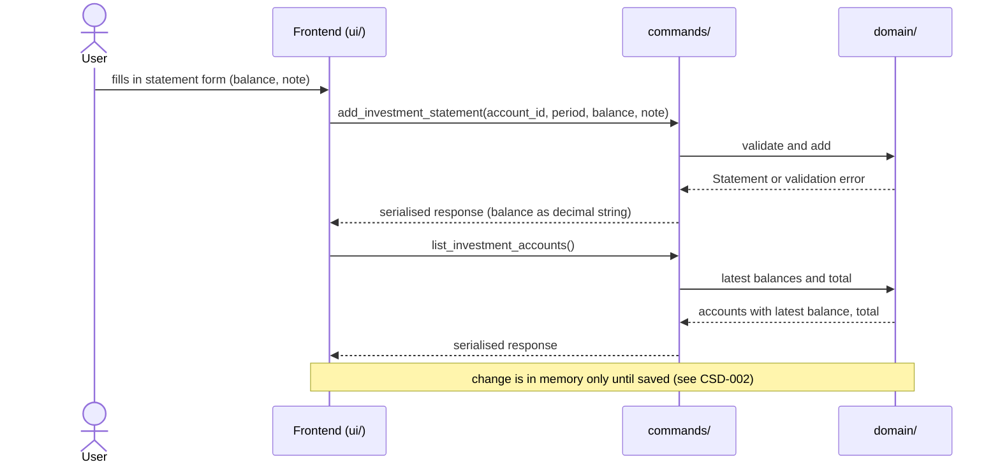
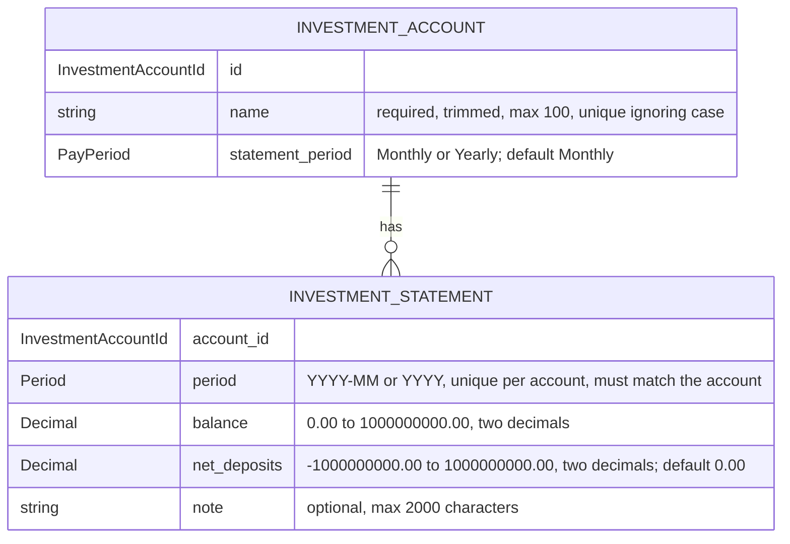

# CSD-005: Investments

## 1. Intent
The app tracks wealth but has no view of what the user has invested. This capability lets the user record investment accounts (a brokerage, a pension, a crypto exchange) and, per account, one closing balance per month or per year, with the net deposits of that period and a note. From these the app derives the capital growth of the period and, per calendar year, the yearly totals. It is for a single person keeping a private, local history of their investments. It records balances as the user reads them off a statement. It does not track individual stocks, prices or trades. The result is a balance history per account, the growth per period and a total of the latest balances, which later features (net-worth linkage, returns percentages, charts) can build on.

## 2. Scope
### 2.1 In scope
- Create, edit and delete investment accounts, each with a name and a statement period (Monthly or Yearly).
- Create, edit and delete one statement per account per period: a closing balance, optional net deposits (default 0.00) and an optional note.
- Change the period of an existing statement (REQ-28).
- Capital growth per statement, derived from the balance, the previous statement and the net deposits, and shown in the Statements section.
- A statement form that calculates the balance or the capital growth from the other, given the net deposits.
- Yearly totals per calendar year over all accounts: closing balance, net deposits and capital growth, like the yearly totals of employment income (CSD-001 REQ-11). Rust also returns the number of statements per year, but the app does not display it.
- One Investments view with the accounts, their latest balances, the total of the latest balances and the statements of all accounts.
- Investment data is part of the project file. Saving and loading is specified in CSD-002.

### 2.2 Non-goals
- NG-1: Individual positions: tickers, share counts, buy and sell trades, dividends.
- NG-2: Live or historical market prices, and any other data fetched from the network.
- NG-3: Individual deposits and withdrawals (only their net sum per statement is recorded, see REQ-21), returns percentages, annualised returns, an all-time total of net deposits or capital growth (only per-year totals are in scope, REQ-26), and any other performance figure. The one exception is the growth percentage of the Insights chart of CSD-007.
- NG-4: Integration with net worth, and a chart or other balance-over-time visualisation (candidates for a later CSD together with CSD-004). The yearly Insights chart of CSD-007 is the one exception.
- NG-5: Negative balances, such as margin debt.
- NG-6: A currency per account. All amounts are in the project currency (CSD-003).
- NG-7: Aligning the latest balances of different accounts to one date, or estimating a balance for a period without a statement.
- NG-8: A note on the account itself, an account type and an institution name.
- NG-9: Import of statements (PDF, CSV, broker export).
- NG-10: Rich text or attachments in notes.
- NG-11: Moving a statement to another account. Only the period of a statement can change (REQ-28).
- NG-12: Changing the periods of several statements at once.

## 3. Definitions
| Term | Meaning |
|---|---|
| **Investment account** | One place where the user holds investments, identified by a name. |
| **Statement period** | How an account is recorded: **Monthly** (one statement per calendar month, `YYYY-MM`) or **Yearly** (one statement per calendar year, `YYYY`). An account is Monthly unless Yearly is chosen. |
| **Statement** | The record of one account for one period: the closing balance, the net deposits and an optional note. |
| **Balance** | The value of the account at the end of the period, as one amount in the project currency. |
| **Net deposits** | The money the user put into the account minus the money taken out of it during the period, as one signed amount. A negative amount is a net withdrawal. 0.00 unless the user enters another amount. |
| **Previous statement** | The statement of the same account with the latest period before that of the statement at hand, also when periods in between have none. When there is none, the account is taken to start at 0.00: the balance before its first statement is 0.00. |
| **Yearly total** | One row per calendar year: the closing balance, the net deposits, and the capital growth of that year, over all accounts. Rust also returns the number of statements of that year, which is not displayed. See REQ-26. |
| **Closing balance (of a year)** | The sum, over the accounts that have a statement in that year, of the balance of each account's latest statement in that year. |
| **Capital growth** | The gain or loss of the account over the period: balance, minus the balance of the previous statement, minus the net deposits. A signed amount. It is derived and never stored. For the first statement of an account the balance of the previous statement is 0.00. |
| **Note** | Optional plain text, up to 2,000 characters, that goes with one statement. |
| **Latest balance** | The balance of the statement with the most recent period of an account. |
| **Total** | The sum of the latest balances of all accounts that have at least one statement. |
| **Project file** | The single user-chosen file holding all app data. Investments are one of its sections. See CSD-002. |

## 4. Requirements

### 4.0 Overview flow


### 4.1 Accounts

**REQ-1: Add an account** *(event-driven)*
When the user submits a new investment account with a name and a statement period, the app shall create the account, with statement period Monthly unless Yearly is chosen.

```gherkin
@AC-1.1
Scenario: Account created with the default period
  Given no investment accounts exist
  When the user adds an account named "Example Brokerage" without choosing a period
  Then the account "Example Brokerage" exists with statement period "Monthly"
  And it has no statements

@AC-1.2
Scenario: Yearly account
  Given no investment accounts exist
  When the user adds an account named "Example Pension" with statement period "Yearly"
  Then the account "Example Pension" exists with statement period "Yearly"

@AC-1.3
Scenario: Unknown period rejected
  When the user adds an account named "Example Brokerage" with statement period "Weekly"
  Then it is rejected with error code "INVESTMENT_PERIOD_UNSUPPORTED"
  And no account exists
```

**REQ-2: Account name rules** *(unwanted behaviour)*
If the name of an investment account is empty after trimming, is longer than 100 characters, or equals the name of another account when case is ignored, then the app shall reject the account without storing or changing it.

```gherkin
@AC-2.1
Scenario Outline: Invalid names rejected
  Given an account named "Example Brokerage"
  When the user adds an account named "<name>"
  Then it is rejected with error code "<code>"
  And only the account "Example Brokerage" exists

  Examples:
    | name                | code                                |
    | (empty)             | INVESTMENT_ACCOUNT_NAME_REQUIRED    |
    | (three spaces)      | INVESTMENT_ACCOUNT_NAME_REQUIRED    |
    | EXAMPLE BROKERAGE   | INVESTMENT_ACCOUNT_NAME_DUPLICATE   |
    | example brokerage   | INVESTMENT_ACCOUNT_NAME_DUPLICATE   |

@AC-2.2
Scenario: Name length boundary
  When the user adds an account with a name of 100 characters
  Then the account exists
  When the user adds an account with a name of 101 characters
  Then it is rejected with error code "INVESTMENT_ACCOUNT_NAME_TOO_LONG"

@AC-2.3
Scenario: The name is stored trimmed
  When the user adds an account named "  Example Brokerage  "
  Then the account is named "Example Brokerage"

@AC-2.4
Scenario: Renaming to an existing name is rejected
  Given accounts "Example Brokerage" and "Example Pension"
  When the user renames "Example Pension" to "example brokerage"
  Then the edit is rejected with error code "INVESTMENT_ACCOUNT_NAME_DUPLICATE"

@AC-2.5
Scenario: Changing only the case of its own name is allowed
  Given an account "Example Brokerage"
  When the user renames it to "EXAMPLE BROKERAGE"
  Then the account is named "EXAMPLE BROKERAGE"
```

**REQ-3: Edit an account** *(event-driven)*
When the user edits an investment account, the app shall apply a changed name under REQ-2 and a changed statement period under REQ-4, and shall keep the account's statements.

```gherkin
@AC-3.1
Scenario: Rename keeps statements
  Given an account "Example Brokerage" with 2 statements
  When the user renames it to "Example Broker"
  Then the account is named "Example Broker"
  And it still has 2 statements

@AC-3.2
Scenario: Period of an account without statements can change
  Given a "Monthly" account "Example Brokerage" with no statements
  When the user changes its statement period to "Yearly"
  Then the account has statement period "Yearly"
```

**REQ-4: Statement period is locked once statements exist** *(unwanted behaviour)*
If the user changes the statement period of an investment account that has at least one statement, then the app shall reject the change with the error code `INVESTMENT_PERIOD_LOCKED`.

```gherkin
@AC-4.1
Scenario: Period change rejected
  Given a "Monthly" account "Example Brokerage" with a statement for 2026-09
  When the user changes its statement period to "Yearly"
  Then the change is rejected with error code "INVESTMENT_PERIOD_LOCKED"
  And the account still has statement period "Monthly"

@AC-4.2
Scenario: Period change allowed again after deleting the last statement
  Given a "Monthly" account "Example Brokerage" with one statement
  When the user deletes the statement
  And changes the statement period to "Yearly"
  Then the account has statement period "Yearly"
```

**REQ-5: Delete an account** *(event-driven)*
When the user confirms deletion of an investment account, the app shall remove the account and all of its statements. The confirmation reads "This account and all its statements will be deleted.", the same whether or not the account has statements, and states no number.

```gherkin
@AC-5.1
Scenario: Deletion cascades
  Given an account "Example Brokerage" with 3 statements
  When the user deletes the account and confirms
  Then the account no longer exists
  And none of its 3 statements exist

@AC-5.2
Scenario: Cancelled deletion changes nothing
  Given an account "Example Brokerage" with 3 statements
  When the user starts deleting the account and cancels
  Then the account and its 3 statements still exist

@AC-5.3
Scenario Outline: The deletion confirmation states no count
  Given an account "Example Brokerage" with <statements> statements
  When the user starts deleting the account
  Then the confirmation reads "This account and all its statements will be deleted."
  And it shows no number

  Examples:
    | statements |
    | 0          |
    | 3          |
```

### 4.2 Statements

**REQ-6: Add a statement** *(event-driven)*
When the user submits a statement for the account chosen in the add form, a period and a balance, the app shall store it with the given note, or with an empty note if none is given, and shall accept any period that is not later than the current month (monthly account) or the current year (yearly account), including periods before the account existed in the app.

```gherkin
@AC-6.1
Scenario: Monthly statement with a note
  Given the current date is 26/10/2026
  And a monthly account "Example Brokerage"
  When the user adds a statement for 2026-09 with balance 12500.00 and note "Bought example fund"
  Then the statement for 2026-09 has balance 12500.00 and note "Bought example fund"

@AC-6.2
Scenario: Yearly statement without a note
  Given the current date is 26/10/2026
  And a yearly account "Example Pension"
  When the user adds a statement for 2025 with balance 80000.00 and no note
  Then the statement for 2025 has balance 80000.00 and an empty note

@AC-6.3
Scenario: Old periods are accepted
  Given a monthly account "Example Brokerage"
  When the user adds a statement for 2019-01 with balance 1000.00
  Then the statement for 2019-01 exists

@AC-6.4
Scenario Outline: Current period accepted, later period rejected
  Given the current date is 26/10/2026
  And a <period_type> account "Example Account"
  When the user adds a statement for "<period>" with balance 1000.00
  Then <outcome>

  Examples:
    | period_type | period  | outcome                                                           |
    | monthly     | 2026-10 | the statement for 2026-10 exists                                  |
    | monthly     | 2026-11 | it is rejected with error code "INVESTMENT_STATEMENT_IN_FUTURE"   |
    | yearly      | 2026    | the statement for 2026 exists                                     |
    | yearly      | 2027    | it is rejected with error code "INVESTMENT_STATEMENT_IN_FUTURE"   |

@AC-6.5
Scenario Outline: Invalid period rejected
  Given a <period_type> account "Example Account"
  When the user adds a statement for "<period>" with balance 1000.00
  Then it is rejected with error code "INVESTMENT_STATEMENT_PERIOD_INVALID"

  Examples:
    | period_type | period   |
    | monthly     | 2026-13  |
    | monthly     | 2026-9   |
    | monthly     | abcd     |
    | yearly      | 26       |
    | yearly      | abcd     |
    | yearly      | 1899     |
```

**REQ-7: One statement per account per period** *(unwanted behaviour)*
If the user adds a statement for an account and period that already has one, then the app shall reject it with the error code `INVESTMENT_STATEMENT_DUPLICATE` and leave the existing statement unchanged.

```gherkin
@AC-7.1
Scenario: Duplicate period rejected
  Given a monthly account with a statement for 2026-09 with balance 12500.00 and note "First"
  When the user adds another statement for 2026-09 with balance 13000.00
  Then it is rejected with error code "INVESTMENT_STATEMENT_DUPLICATE"
  And the statement for 2026-09 still has balance 12500.00 and note "First"

@AC-7.2
Scenario: Same period on a different account is allowed
  Given two monthly accounts, and the first has a statement for 2026-09
  When the user adds a statement for 2026-09 to the second account
  Then both accounts have a statement for 2026-09
```

**REQ-8: Statements match the statement period** *(unwanted behaviour)*
If the user adds a monthly statement to a yearly account or a yearly statement to a monthly account, then the app shall reject it with the error code `INVESTMENT_PERIOD_MISMATCH`.

```gherkin
@AC-8.1
Scenario: Monthly statement for a yearly account rejected
  Given a "Yearly" account
  When a statement for 2026-09 with balance 1000.00 is added to it
  Then it is rejected with error code "INVESTMENT_PERIOD_MISMATCH"

@AC-8.2
Scenario: Yearly statement for a monthly account rejected
  Given a "Monthly" account
  When a statement for 2025 with balance 1000.00 is added to it
  Then it is rejected with error code "INVESTMENT_PERIOD_MISMATCH"
```

**REQ-9: Balance validation** *(unwanted behaviour)*
If the balance of a statement is not a plain number such as 12500.00, is negative, has more than two decimal places or exceeds 1,000,000,000.00, then the app shall reject the statement or edit without rounding or storing it. A balance of 0.00 is valid.

```gherkin
@AC-9.1
Scenario Outline: Invalid balances rejected
  Given a monthly account "Example Brokerage" and the current date 26/10/2026
  When the user adds a statement for 2026-09 with balance "<balance>"
  Then it is rejected with error code "<code>"
  And no statement for 2026-09 exists

  Examples:
    | balance          | code                          |
    | -0.01            | INVESTMENT_BALANCE_NEGATIVE   |
    | 1000.999         | INVESTMENT_BALANCE_PRECISION  |
    | 1000000000.01    | INVESTMENT_BALANCE_TOO_LARGE  |

@AC-9.2
Scenario Outline: Boundary balances accepted
  Given a monthly account "Example Brokerage" and the current date 26/10/2026
  When the user adds a statement for 2026-09 with balance "<balance>"
  Then the statement for 2026-09 has balance <balance>

  Examples:
    | balance          |
    | 0.00             |
    | 1000000000.00    |

@AC-9.3
Scenario: Invalid balance in an edit rejected
  Given a statement for 2026-09 with balance 12500.00
  When the user sets the balance to -1.00
  Then the edit is rejected with error code "INVESTMENT_BALANCE_NEGATIVE"
  And the statement still has balance 12500.00

@AC-9.4
Scenario Outline: Text that is not a plain number rejected
  Given a monthly account "Example Brokerage" and the current date 26/10/2026
  When the user adds a statement for 2026-09 with balance "<balance>"
  Then it is rejected with error code "INVESTMENT_BALANCE_INVALID"
  And no statement for 2026-09 exists

  Examples:
    | balance  |
    | (empty)  |
    | abc      |
    | 1e3      |
    | 12500,50 |
```

**REQ-10: Note validation** *(unwanted behaviour)*
If the note of a statement is longer than 2,000 characters, then the app shall reject the statement or edit with the error code `INVESTMENT_NOTE_TOO_LONG`, without shortening or storing it. Line breaks in a note are kept as typed.

```gherkin
@AC-10.1
Scenario: Note length boundary
  Given a monthly account "Example Brokerage" and the current date 26/10/2026
  When the user adds a statement for 2026-08 with balance 1000.00 and a note of 2000 characters
  Then the statement for 2026-08 exists with that note
  When the user adds a statement for 2026-09 with balance 1000.00 and a note of 2001 characters
  Then it is rejected with error code "INVESTMENT_NOTE_TOO_LONG"
  And no statement for 2026-09 exists

@AC-10.2
Scenario: Line breaks are kept
  Given a monthly account "Example Brokerage"
  When the user adds a statement for 2026-09 with balance 1000.00 and the note "line one" and "line two" on two lines
  Then the note of the statement has two lines
```

**REQ-11: Edit a statement** *(event-driven)*
When the user edits an existing statement, the app shall change its balance, net deposits and note under REQ-9, REQ-22 and REQ-10. Changing the period of a statement is specified in REQ-28.

```gherkin
@AC-11.1
Scenario: Edit balance and note
  Given a statement for 2026-09 with balance 12500.00 and note "First"
  When the user sets the balance to 12750.00 and the note to "Corrected"
  Then the statement has balance 12750.00 and note "Corrected"

@AC-11.2
Scenario: Clear a note
  Given a statement for 2026-09 with balance 12500.00 and note "First"
  When the user empties the note
  Then the statement has an empty note

# @AC-11.3 (removed in v0.9): the period of a statement is editable now, see AC-28.6.
```

**REQ-28: Change the period of a statement** *(event-driven)*
When the user changes the period of an existing statement in the edit form and saves, the app shall give the statement the new period together with any balance, net deposits and note edited at the same time, without asking for confirmation. The statement stays with its account, and the capital growth, the latest balances, the yearly totals and the insights show it under its new period.

```gherkin
@AC-28.1
Scenario: Move a statement to another month
  Given a monthly account with a statement for 2026-09 with balance 12500.00 and note "First"
  When the user changes its period to 2026-08
  Then the account has a statement for 2026-08 with balance 12500.00 and note "First"
  And the account has no statement for 2026-09
  And no confirmation was asked

@AC-28.2
Scenario: Change the period and the balance together
  Given a monthly account with a statement for 2026-09 with balance 12500.00
  When the user changes its period to 2026-08 and sets the balance to 12750.00
  Then the statement for 2026-08 has balance 12750.00
  And there is no statement for 2026-09

@AC-28.3
Scenario: Move a yearly statement
  Given a yearly account with a statement for 2025 with balance 12500.00
  When the user changes its period to 2024
  Then the account has a statement for 2024 with balance 12500.00
  And the account has no statement for 2025

@AC-28.4
Scenario: The capital growth follows the move
  Given the current date is 26/10/2026
  And a monthly account with statements 2026-07 (balance 10000.00, net deposits 10000.00), 2026-08 (balance 10500.00) and 2026-09 (balance 11000.00)
  When the user changes the period of the statement for 2026-08 to 2026-10
  Then the capital growth of 2026-07 is 0.00
  And the capital growth of 2026-09 is 1000.00
  And the capital growth of 2026-10 is -500.00

@AC-28.5
Scenario: The yearly totals follow the move
  Given a monthly account with statements 2025-11 (balance 11000.00, net deposits 11000.00), 2025-12 (balance 11500.00, net deposits 200.00) and 2026-05 (balance 12500.00, net deposits 300.00)
  When the user changes the period of the statement for 2025-12 to 2026-01
  Then 2025 shows closing balance 11000.00, net deposits 11000.00, capital growth 0.00, statements 1
  And 2026 shows closing balance 12500.00, net deposits 500.00, capital growth 1000.00, statements 2

@AC-28.6
Scenario Outline: The edit form offers the period
  Given <statement>
  When the user opens it for editing
  Then the form shows the <field> "<value>" and the account, which cannot be changed

  Examples:
    | statement                                  | field | value   |
    | a monthly statement for 2026-09            | month | 2026-09 |
    | a yearly statement for 2025                | year  | 2025    |

@AC-28.7
Scenario: Keeping the period changes only the values
  Given a monthly account with a statement for 2026-09 with balance 12500.00
  When the user saves it with the period 2026-09 and balance 12750.00
  Then the statement for 2026-09 has balance 12750.00
  And no error about a duplicate period is shown

@AC-28.8
Scenario: A move is an unsaved change
  Given a saved project with a monthly statement for 2026-09
  When the user changes its period to 2026-08
  Then the unsaved indicator is shown
```

**REQ-29: Invalid new period** *(unwanted behaviour)*
If the new period of an edited statement is later than the current month (monthly account) or the current year (yearly account), or the account already has another statement for it, or it does not match the statement period of the account, or the edit also has an invalid value, then the app shall reject the whole edit with the error code of the violated rule and leave the statement, with its period and its values, as it was. Another account may have a statement for the same period.

```gherkin
@AC-29.1
Scenario Outline: A period in the future is rejected
  Given the current date is 26/10/2026
  And <account> with a statement for <old> with balance 12500.00
  When the user changes its period to "<new>"
  Then the edit is rejected with error code "INVESTMENT_STATEMENT_IN_FUTURE"
  And the statement for <old> still has balance 12500.00

  Examples:
    | account         | old     | new     |
    | a monthly account | 2026-09 | 2026-11 |
    | a yearly account  | 2025    | 2027    |

@AC-29.2
Scenario: A period that already has a statement is rejected
  Given a monthly account with a statement for 2026-08 with balance 12000.00 and one for 2026-09 with balance 12500.00
  When the user changes the period of the statement for 2026-09 to 2026-08 and sets the balance to 13000.00
  Then the edit is rejected with error code "INVESTMENT_STATEMENT_DUPLICATE"
  And the statement for 2026-08 still has balance 12000.00
  And the statement for 2026-09 still has balance 12500.00

@AC-29.3
Scenario Outline: A period of the wrong kind is rejected
  Given <account> with a statement for <old>
  When the user changes its period to "<new>"
  Then the edit is rejected with error code "INVESTMENT_PERIOD_MISMATCH"
  And the statement is still for <old>

  Examples:
    | account           | old     | new     |
    | a monthly account | 2026-09 | 2026    |
    | a yearly account  | 2025    | 2024-12 |

@AC-29.4
Scenario: An invalid value rejects the whole edit
  Given a monthly account with a statement for 2026-09 with balance 12500.00
  When the user changes its period to 2026-08 and sets the balance to -1.00
  Then the edit is rejected with error code "INVESTMENT_BALANCE_NEGATIVE"
  And the statement is still for 2026-09 with balance 12500.00
  And the unsaved indicator is not shown

@AC-29.5
Scenario: Another account may have the same period
  Given two monthly accounts, the first with a statement for 2026-08 and the second with one for 2026-09
  When the user changes the period of the second account's statement to 2026-08
  Then both accounts have a statement for 2026-08
```

**REQ-12: Delete a statement** *(event-driven)*
When the user confirms deletion of a statement, the app shall remove that statement and no other data.

```gherkin
@AC-12.1
Scenario: Confirmed deletion
  Given a monthly account with statements for 2026-08 and 2026-09
  When the user deletes the statement for 2026-09 and confirms
  Then only the statement for 2026-08 remains

@AC-12.2
Scenario: Cancelled deletion changes nothing
  Given a monthly account with statements for 2026-08 and 2026-09
  When the user starts deleting the statement for 2026-09 and cancels
  Then both statements still exist
```

**REQ-13: Copy the previous period** *(event-driven)*
When the user chooses "copy previous month" (monthly account) or "copy previous year" (yearly account) in the add form, the app shall pre-fill the balance with that of the account's most recent statement and leave the note empty, and shall not store anything until the user confirms.

```gherkin
@AC-13.1
Scenario: Form pre-filled from the latest statement
  Given a monthly account with statements for 2026-07 (balance 12000.00) and 2026-08 (balance 12500.00, note "Bought example fund")
  When the user chooses "copy previous month" in the add form for that account
  Then the form shows balance 12500.00 and an empty note
  And no new statement exists

@AC-13.2
Scenario: Account without statements
  Given a monthly account with no statements
  When the user chooses "copy previous month" in the add form for that account
  Then the form is left empty
  And no error is shown

@AC-13.3
Scenario: Net deposits are not copied
  Given a monthly account with a statement for 2026-08 with balance 12500.00 and net deposits 300.00
  When the user chooses "copy previous month" in the add form for that account
  Then the form shows balance 12500.00 and net deposits 0.00
```

**REQ-14: The add form follows the statement period** *(event-driven)*
When the user chooses an account in the add form, the app shall ask for a month if the account is monthly and for a year if it is yearly, and shall label the copy button "Copy previous month" or "Copy previous year" accordingly.

```gherkin
@AC-14.1
Scenario: Monthly account
  Given a "Monthly" account
  When the user chooses it in the add form
  Then the form asks for "Month (YYYY-MM)"
  And the copy button reads "Copy previous month"

@AC-14.2
Scenario: Yearly account
  Given a "Yearly" account
  When the user chooses it in the add form
  Then the form asks for "Year (YYYY)"
  And the copy button reads "Copy previous year"

@AC-14.3
Scenario: Switching account switches the form
  Given a "Monthly" account and a "Yearly" account
  When the user chooses the yearly account and then the monthly account in the add form
  Then the form asks for a year and then for a month again
```

### 4.3 Views

**REQ-15: Latest balance and total** *(ubiquitous)*
The app shall show for each account the balance of its most recent statement together with that statement's period, and shall show the total of the latest balances of all accounts that have a statement, as computed in Rust, without converting or aligning the periods.

```gherkin
@AC-15.1
Scenario: Latest balance per account
  Given a monthly account with statements for 2026-07 (balance 12000.00) and 2026-09 (balance 12500.00)
  Then the account shows latest balance 12500.00 for 2026-09

@AC-15.2
Scenario: Total over accounts with different periods
  Given a monthly account with latest statement 2026-09 (balance 12500.50)
  And a yearly account with latest statement 2025 (balance 80000.00)
  Then the total is 92500.50
  And the accounts show the periods 2026-09 and 2025

@AC-15.3
Scenario: Accounts without statements do not count
  Given a monthly account with latest statement 2026-09 (balance 12500.00)
  And a monthly account with no statements
  Then the total is 12500.00

@AC-15.4
Scenario: A new latest statement updates the total
  Given a monthly account with a statement for 2026-09 (balance 12500.00)
  When the user adds a statement for 2026-10 with balance 13000.00
  Then the account shows latest balance 13000.00 for 2026-10
  And the total is 13000.00

@AC-15.5
Scenario: An older statement does not change the latest balance
  Given a monthly account with a statement for 2026-09 (balance 12500.00)
  When the user adds a statement for 2026-01 with balance 9000.00
  Then the account still shows latest balance 12500.00 for 2026-09
```

**REQ-16: Ordering** *(ubiquitous)*
The app shall list accounts alphabetically by name ignoring case, and the statements of all accounts by period, newest first, with a yearly statement counting as December of its year and, within a period, by account in the alphabetical order of the accounts.

```gherkin
@AC-16.1
Scenario: Accounts alphabetical
  Given accounts "example pension", "Example Brokerage" and "Example Crypto"
  Then the accounts are listed "Example Brokerage", "Example Crypto", "example pension"

@AC-16.2
Scenario: Newest statement first
  Given a monthly account with statements for 2026-07 and 2026-09
  Then the statement for 2026-09 is listed before the statement for 2026-07

@AC-16.3
Scenario: Yearly statement counts as December
  Given a monthly account with statements for 2025-11 and 2025-12 and a yearly account with a statement for 2025
  Then the statement for 2025-12 and the statement for 2025 are listed before the statement for 2025-11

@AC-16.4
Scenario: Same period is ordered by account
  Given monthly accounts "Example Crypto" and "Example Brokerage", both with a statement for 2026-09
  Then the statement of "Example Brokerage" is listed before that of "Example Crypto"
```

**REQ-17: Investments view layout** *(ubiquitous)*
The app shall offer Investments as its own item in the left pane (CSD-004 REQ-1), and shall show the view as the sections Accounts, Yearly totals and Statements in that order, with the statement period (and no statement count), the latest balance with its period and the icon buttons Edit (pencil) and Delete (trash) (flush right) on each account row, the button "Add account" in the header of the Accounts section, the icon buttons Edit (pencil) and Delete (trash) flush right on each statement row, the total in a footer row of the Accounts section, the columns Year, Closing balance, Net deposits, Capital growth and no actions in the Yearly totals section, the columns Period, Account, Balance, Net deposits, Capital growth and Note in the Statements section, and no account selection that changes what the sections show. A note longer than one line is cut to one line in the table and shown in full when the statement is edited. The app shall display no count of statements anywhere on the page: not in the yearly totals, on the account rows, in a confirmation, in a chart tooltip or in the screen-reader description of a chart.

```gherkin
@AC-17.1
Scenario: Sections in order
  Given an account with a statement
  Then the sections appear in the order Accounts, Yearly totals, Statements
  And Investments is an item in the left pane (CSD-004 REQ-1)

@AC-17.2
Scenario: Account rows carry their period, latest balance and actions
  Given monthly account "Example Brokerage" with 2 statements, the latest for 2026-09 with balance 12500.00
  And yearly account "Example Pension" with 1 statement for 2025 with balance 80000.00
  Then the row of "Example Brokerage" shows "Monthly" and "12500.00" for 2026-09
  And the row of "Example Pension" shows "Yearly" and "80000.00" for 2025
  And no row shows a number of statements
  And each row has the icon buttons Edit (pencil) and Delete (trash) at its right edge, each named for screen readers and in a tooltip, such as "Edit Example Employer"
  And the footer row shows the total "92500.00"

@AC-17.3
Scenario: Statements of all accounts with their period and account
  Given monthly account "Example Brokerage" with a statement for 2026-09 and yearly account "Example Pension" with a statement for 2025
  Then the Statements section lists both
  And the Period column shows "2026-09" and "2025"
  And the Account column shows "Example Brokerage" and "Example Pension"

@AC-17.4
Scenario: Long note cut to one line
  Given a statement with a note of three lines
  Then the Note column shows one line of it
  And editing the statement shows the whole note

@AC-17.5
Scenario: Clicking an account changes nothing
  Given two accounts with statements
  When the user clicks an account row
  Then the totals and the statements are unchanged

@AC-17.6
Scenario: Notes are shown as plain text
  Given a statement with the note "<b>bold</b>"
  Then the Note column shows the characters "<b>bold</b>" and no formatting

@AC-17.7
Scenario: Add buttons sit in the section headers
  Given an account
  Then the header of the Accounts section holds the button "Add account" at its right edge
  And the header of the Statements section holds the button "Add statement" at its right edge
  And the page title row holds no button

@AC-17.8
Scenario: Net deposits and capital growth columns
  Given a monthly account "Example Brokerage" with a statement for 2026-08 (balance 12000.00, net deposits 12000.00) and one for 2026-09 (balance 12500.00, net deposits 300.00)
  Then the Statements section shows the columns Period, Account, Balance, Net deposits, Capital growth and Note in that order
  And the row for 2026-09 shows net deposits "300.00" and capital growth "200.00"
  And the row for 2026-08 shows net deposits "12000.00" and capital growth "0.00"
  And the Accounts section shows no total of net deposits or capital growth

@AC-17.9
Scenario: Yearly totals section
  Given a monthly account "Example Brokerage" with a statement for 2026-09
  Then the Yearly totals section shows the columns Year, Closing balance, Net deposits and Capital growth in that order
  And it shows no column with a number of statements
  And its header holds no button and its rows hold no Edit or Delete button
  And the section is not shown while no accounts exist
```

**REQ-18: Empty states** *(state-driven)*
While no investment accounts exist, the app shall show an "add your first investment account" prompt and no statement form, while an account has no statements, the app shall show "No statements yet" and a dash as its latest balance, and while no account has a statement, the app shall show "No totals yet. Totals appear once there is a statement." in the Yearly totals section, with no error.

```gherkin
@AC-18.1
Scenario: No accounts
  Given no investment accounts exist
  Then the Investments view shows an "add your first investment account" prompt
  And there is no statement form

@AC-18.2
Scenario: Account without statements
  Given an account with no statements
  Then its row shows a dash as latest balance and only its period as meta, without "No statements yet"
  And the Statements section shows "No statements yet"
  And no error is shown

@AC-18.3
Scenario: No statements in any account
  Given an account with no statements
  Then the Yearly totals section shows "No totals yet. Totals appear once there is a statement."
  And it shows no table and no error
```

**REQ-20: No currency outside Settings** *(ubiquitous)*
The app shall show no currency in the Accounts, Yearly totals and Statements sections: not in their titles, on the account rows, in the yearly totals table or in the statements table.

```gherkin
@AC-20.1
Scenario: No currency in the sections
  Given a project in "EUR" with an account and a statement
  Then the sections are titled "Accounts", "Yearly totals" and "Statements"
  And the account rows, the yearly totals table and the statements table show no currency

@AC-20.2
Scenario: Changing the currency changes no title
  Given a project in "EUR" with an account and a statement
  When the user changes the project currency to "USD" and confirms
  Then the sections are still titled "Accounts", "Yearly totals" and "Statements"
  And the balances are unchanged
```

### 4.4 Saving and loading

**REQ-19: Investments are part of the project file** *(event-driven)*
When the user saves and later opens a project, the app shall restore all investment accounts and statements exactly, including net deposits and notes. When the project file has no `investments` section, the app shall open the project with no investment accounts, and when a statement in the file has no net deposits, the app shall open it with net deposits 0.00.

```gherkin
@AC-19.1
Scenario: Round trip
  Given a project with a yearly account "Example Pension" with a statement for 2025 (balance 80000.00, note "Line one" and "Line two" on two lines)
  When the user saves the project and opens it again
  Then the account and the statement exist unchanged, including the two-line note

@AC-19.2
Scenario: File without the section
  Given a project file made before this capability, without an "investments" section
  When the user opens it
  Then it opens with no investment accounts and no error

@AC-19.3
Scenario: Net deposits round trip
  Given a statement for 2026-09 with balance 12500.00 and net deposits -250.00
  When the user saves the project and opens it again
  Then the statement has balance 12500.00 and net deposits -250.00

@AC-19.4
Scenario: Statement without net deposits in the file
  Given a project file with a statement for 2026-09 with balance 12500.00 and no net deposits
  When the user opens it
  Then the statement has net deposits 0.00
  And no error is shown
```

### 4.5 Net deposits and capital growth

**REQ-21: Net deposits on a statement** *(event-driven)*
When the user adds or edits a statement with net deposits, the app shall store the net deposits with the statement, and shall store 0.00 when none is given.

```gherkin
@AC-21.1
Scenario: Net deposits default to 0.00
  Given a monthly account "Example Brokerage" and the current date 26/10/2026
  When the user adds a statement for 2026-09 with balance 12500.00 and no net deposits
  Then the statement for 2026-09 has net deposits 0.00

@AC-21.2
Scenario: A deposit is stored
  Given a monthly account "Example Brokerage" and the current date 26/10/2026
  When the user adds a statement for 2026-09 with balance 12500.00 and net deposits 300.00
  Then the statement for 2026-09 has net deposits 300.00

@AC-21.3
Scenario: A net withdrawal is stored
  Given a monthly account "Example Brokerage" and the current date 26/10/2026
  When the user adds a statement for 2026-09 with balance 12500.00 and net deposits -250.00
  Then the statement for 2026-09 has net deposits -250.00

@AC-21.4
Scenario: Edit net deposits
  Given a statement for 2026-09 with balance 12500.00 and net deposits 300.00
  When the user sets the net deposits to 0.00
  Then the statement has balance 12500.00 and net deposits 0.00
```

**REQ-22: Net deposits validation** *(unwanted behaviour)*
If the net deposits of a statement is not a plain number such as 300.00 or -250.00, has more than two decimal places or has an absolute value above 1,000,000,000.00, then the app shall reject the statement or edit without rounding or storing it. A value of 0.00 and a negative value are valid.

```gherkin
@AC-22.1
Scenario Outline: Invalid net deposits rejected
  Given a monthly account "Example Brokerage" and the current date 26/10/2026
  When the user adds a statement for 2026-09 with balance 1000.00 and net deposits "<net_deposits>"
  Then it is rejected with error code "<code>"
  And no statement for 2026-09 exists

  Examples:
    | net_deposits     | code                                |
    | abc              | INVESTMENT_NET_DEPOSITS_INVALID     |
    | 1e3              | INVESTMENT_NET_DEPOSITS_INVALID     |
    | 300,50           | INVESTMENT_NET_DEPOSITS_INVALID     |
    | 100.999          | INVESTMENT_NET_DEPOSITS_PRECISION   |
    | -100.999         | INVESTMENT_NET_DEPOSITS_PRECISION   |
    | 1000000000.01    | INVESTMENT_NET_DEPOSITS_TOO_LARGE   |
    | -1000000000.01   | INVESTMENT_NET_DEPOSITS_TOO_LARGE   |

@AC-22.2
Scenario Outline: Boundary net deposits accepted
  Given a monthly account "Example Brokerage" and the current date 26/10/2026
  When the user adds a statement for 2026-09 with balance 1000.00 and net deposits "<net_deposits>"
  Then the statement for 2026-09 has net deposits <net_deposits>

  Examples:
    | net_deposits     |
    | 0.00             |
    | 1000000000.00    |
    | -1000000000.00   |

@AC-22.3
Scenario: Invalid net deposits in an edit rejected
  Given a statement for 2026-09 with balance 12500.00 and net deposits 300.00
  When the user sets the net deposits to "100.999"
  Then the edit is rejected with error code "INVESTMENT_NET_DEPOSITS_PRECISION"
  And the statement still has net deposits 300.00
```

**REQ-23: Capital growth is derived** *(ubiquitous)*
The app shall compute the capital growth of a statement in Rust as its balance minus the balance of the previous statement of the same account minus its net deposits, taking 0.00 as that balance for the first statement of an account, and shall not store capital growth.

```gherkin
@AC-23.1
Scenario: Growth with a deposit
  Given a monthly account with a statement for 2026-08 (balance 12000.00)
  And a statement for 2026-09 with balance 12500.00 and net deposits 300.00
  Then the capital growth of 2026-09 is 200.00

@AC-23.2
Scenario: A loss is a negative growth
  Given a monthly account with a statement for 2026-08 (balance 12000.00)
  And a statement for 2026-09 with balance 11000.00 and net deposits 0.00
  Then the capital growth of 2026-09 is -1000.00

@AC-23.3
Scenario: First statement of an account
  Given a monthly account with only a statement for 2026-09 with balance 1020.00 and net deposits 1000.00
  Then the capital growth of 2026-09 is 20.00

@AC-23.9
Scenario: A first statement with an existing balance and no net deposits
  Given a monthly account with only a statement for 2026-09 with balance 12500.00 and net deposits 0.00
  Then the capital growth of 2026-09 is 12500.00

@AC-23.10
Scenario: An existing balance entered as net deposits
  Given a monthly account with only a statement for 2026-09 with balance 12500.00 and net deposits 12500.00
  Then the capital growth of 2026-09 is 0.00

@AC-23.4
Scenario: Skipped periods are bridged
  Given a monthly account with a statement for 2026-06 (balance 10000.00)
  And a statement for 2026-09 with balance 10900.00 and net deposits 600.00
  Then the capital growth of 2026-09 is 300.00

@AC-23.5
Scenario: Yearly account
  Given a yearly account with a statement for 2024 (balance 70000.00)
  And a statement for 2025 with balance 80000.00 and net deposits 6000.00
  Then the capital growth of 2025 is 4000.00

@AC-23.6
Scenario: Editing an earlier balance changes the later growth
  Given a monthly account with statements for 2026-08 (balance 12000.00) and 2026-09 (balance 12500.00, net deposits 300.00)
  When the user sets the balance of 2026-08 to 12100.00
  Then the capital growth of 2026-09 is 100.00

@AC-23.7
Scenario: A statement added before the first one gives it a previous statement
  Given a monthly account with only a statement for 2026-09 with balance 12500.00 and net deposits 0.00
  When the user adds a statement for 2026-07 with balance 12000.00 and net deposits 12000.00
  Then the capital growth of 2026-07 is 0.00
  And the capital growth of 2026-09 is 500.00

@AC-23.8
Scenario: Deleting the previous statement changes the growth
  Given a monthly account with statements for 2026-07 (balance 12000.00), 2026-08 (balance 12200.00) and 2026-09 (balance 12500.00, net deposits 0.00)
  When the user deletes the statement for 2026-08 and confirms
  Then the capital growth of 2026-09 is 500.00
```

**REQ-24: Calculate balance or capital growth in the form** *(event-driven)*
When the user enters a balance or a capital growth, or changes the net deposits, in the statement form for an account and a period, the app shall calculate, in Rust, the other one of balance and capital growth from the previous statement of that account (0.00 when there is none; the statement being edited never counts as a previous statement) and the net deposits, and shall show it marked as calculated. The form shall start with net deposits 0.00, shall treat the last of balance and capital growth that the user typed in as the input, and shall store only the balance and the net deposits.

```gherkin
@AC-24.1
Scenario: Balance entered, growth calculated
  Given a monthly account with a statement for 2026-08 (balance 12000.00)
  When the user opens the add form for 2026-09 and enters balance 12500.00
  Then the form shows net deposits 0.00
  And the capital growth is calculated as 500.00 and marked as calculated

@AC-24.2
Scenario: Growth entered, balance calculated
  Given a monthly account with a statement for 2026-08 (balance 12000.00)
  When the user opens the add form for 2026-09, enters net deposits 300.00 and enters capital growth 200.00
  Then the balance is calculated as 12500.00 and marked as calculated

@AC-24.3
Scenario: Changing net deposits recalculates the calculated field
  Given the add form for 2026-09 of an account with a statement for 2026-08 (balance 12000.00), with balance 12500.00 entered
  When the user enters net deposits 300.00
  Then the capital growth is recalculated as 200.00
  And the balance is still 12500.00

@AC-24.4
Scenario: Changing net deposits recalculates the balance when growth was entered
  Given the add form for 2026-09 of an account with a statement for 2026-08 (balance 12000.00), with capital growth 200.00 entered
  When the user enters net deposits 300.00
  Then the balance is recalculated as 12500.00
  And the capital growth is still 200.00

@AC-24.5
Scenario: Typing in the calculated field makes it the input
  Given the add form with balance 12500.00 entered and the capital growth calculated
  When the user enters a capital growth
  Then the balance becomes the calculated field

@AC-24.6
Scenario: No period yet, nothing calculated
  Given an account with a statement for 2026-08 (balance 12000.00)
  When the user enters balance 12500.00 in the add form without a period
  Then no capital growth is calculated

@AC-24.7
Scenario: First statement of an account
  Given an account without statements
  When the user opens the add form for the account, enters net deposits 1000.00 and balance 1020.00
  Then the capital growth field is enabled
  And the capital growth is calculated as 20.00 and marked as calculated

@AC-24.8
Scenario: A statement added before the existing ones
  Given a monthly account with only a statement for 2026-09
  When the user opens the add form for 2026-07, enters net deposits 1000.00 and capital growth 20.00
  Then the balance is calculated as 1020.00

@AC-24.9
Scenario: Only balance and net deposits are stored
  Given the add form for 2026-09 with capital growth 200.00 and net deposits 300.00 entered and the balance calculated as 12500.00
  When the user submits the form
  Then the statement for 2026-09 has balance 12500.00 and net deposits 300.00
  And no capital growth is stored with it

@AC-24.10
Scenario: Edit form
  Given a statement for 2026-09 with balance 12500.00 and net deposits 300.00 after a statement for 2026-08 (balance 12000.00)
  When the user opens it for editing
  Then the form shows balance 12500.00 and net deposits 300.00 and the capital growth 200.00 calculated

@AC-24.11
Scenario: Yearly account
  Given a yearly account with a statement for 2024 (balance 70000.00)
  When the user opens the add form for 2025, enters net deposits 6000.00 and balance 80000.00
  Then the capital growth is calculated as 4000.00

@AC-24.12
Scenario: Growth entered for a first statement
  Given a monthly account without statements
  When a capital growth of 200.00 with net deposits 1000.00 is submitted for calculation for 2026-09
  Then the balance is calculated as 1200.00

@AC-24.13
Scenario: The statement being edited is not its own previous statement
  Given a monthly account with statements for 2026-07 (balance 10000.00) and 2026-08 (balance 10500.00)
  When the user opens the edit form of the statement for 2026-08, changes its period to 2026-09 and enters balance 11000.00
  Then the capital growth is calculated as 1000.00 and marked as calculated

@AC-24.14
Scenario: Editing without a period change uses the earlier statement
  Given a monthly account with statements for 2026-07 (balance 10000.00) and 2026-08 (balance 10500.00)
  When the user opens the edit form of the statement for 2026-08 and enters balance 10700.00
  Then the capital growth is calculated as 700.00 and marked as calculated
```

**REQ-25: Invalid values in the calculation** *(unwanted behaviour)*
If a capital growth or net deposits entered in the statement form is invalid under REQ-22 or REQ-9, or gives a negative or too large balance, then the app shall show the error code of the violated rule next to the form, shall leave the calculated field empty and shall not store the statement. Capital growth the user enters is limited like net deposits (absolute value up to 1,000,000,000.00, two decimal places).

```gherkin
@AC-25.1
Scenario: Growth that gives a negative balance
  Given the add form for 2026-09 of an account with a statement for 2026-08 (balance 12000.00)
  When the user enters net deposits 0.00 and capital growth -12500.00
  Then the form shows error code "INVESTMENT_BALANCE_NEGATIVE"
  And the balance is left empty
  And no statement is stored

@AC-25.2
Scenario Outline: Invalid capital growth
  Given the add form for 2026-09 of an account with a statement for 2026-08 (balance 12000.00)
  When the user enters capital growth "<growth>"
  Then the form shows error code "<code>"
  And the balance is left empty

  Examples:
    | growth           | code                         |
    | abc              | INVESTMENT_GROWTH_INVALID    |
    | 100.999          | INVESTMENT_GROWTH_PRECISION  |
    | 1000000000.01    | INVESTMENT_GROWTH_TOO_LARGE  |
    | -1000000000.01   | INVESTMENT_GROWTH_TOO_LARGE  |

@AC-25.3
Scenario: Growth that gives a balance above the limit
  Given the add form for 2026-09 of an account with a statement for 2026-08 (balance 999999999.00)
  When the user enters net deposits 0.00 and capital growth 2.00
  Then the form shows error code "INVESTMENT_BALANCE_TOO_LARGE"
  And the balance is left empty

@AC-25.4
Scenario: Invalid net deposits in the form
  Given the add form for 2026-09 of an account with a statement for 2026-08 (balance 12000.00), with balance 12500.00 entered
  When the user enters net deposits "100.999"
  Then the form shows error code "INVESTMENT_NET_DEPOSITS_PRECISION"
  And the capital growth is left empty
```

**REQ-27: Note when there is no earlier statement** *(state-driven)*
While the statement form has no statement of the chosen account before the chosen period, the form shall show the note "No earlier statement, so the account is taken to start at 0.00. Enter money that was already in the account as net deposits."

```gherkin
@AC-27.1
Scenario: Account without statements
  Given an account without statements
  When the user opens the add form for the account
  Then the note is shown

@AC-27.2
Scenario: Period before all statements
  Given a monthly account with only a statement for 2026-09
  When the user enters 2026-07 as the period in the add form
  Then the note is shown

@AC-27.3
Scenario: An earlier statement exists
  Given a monthly account with a statement for 2026-08
  When the user enters 2026-09 as the period in the add form
  Then the note is not shown

@AC-27.4
Scenario: Editing the first statement
  Given a monthly account with statements for 2026-08 and 2026-09
  When the user opens the statement for 2026-08 for editing
  Then the note is shown
```

### 4.6 Yearly totals

**REQ-26: Yearly totals** *(event-driven)*
When the user views the Investments overview, the app shall show, for each calendar year with at least one statement of any account and newest year first, in Rust: the closing balance, the sum of the net deposits and the sum of the capital growth of the statements of that year, and shall return the number of those statements without displaying it, without extrapolating partial years and without carrying balances forward. A statement counts in the year of its own period only. In the ACs of this requirement and in AC-28.5, "statements" is that returned count field, which the screen does not show.

```gherkin
@AC-26.1
Scenario: Totals per calendar year
  Given a monthly account with statements 2025-11 (balance 11000.00, net deposits 11000.00), 2025-12 (balance 11500.00, net deposits 200.00) and 2026-05 (balance 12500.00, net deposits 300.00)
  When the user views the yearly totals
  Then 2026 shows closing balance 12500.00, net deposits 300.00, capital growth 700.00, statements 1
  And 2025 shows closing balance 11500.00, net deposits 11200.00, capital growth 300.00, statements 2

@AC-26.2
Scenario: No statements
  Given an account with no statements
  When the user views the yearly totals
  Then the yearly totals list is empty

@AC-26.3
Scenario: Totals add up all accounts
  Given account "Example Brokerage" with statements 2026-08 (balance 12000.00, net deposits 12000.00) and 2026-09 (balance 12500.00, net deposits 300.00)
  And account "Example Crypto" with a statement 2026-09 (balance 500.00, net deposits 500.00)
  When the user views the yearly totals
  Then there is one row for 2026 with closing balance 13000.00, net deposits 12800.00, capital growth 200.00, statements 3

@AC-26.4
Scenario: Closing balance is the latest balance of the year, not a sum over months
  Given a monthly account with statements 2026-03 (balance 10000.00) and 2026-09 (balance 12000.00)
  When the user views the yearly totals
  Then 2026 shows closing balance 12000.00

@AC-26.5
Scenario: Monthly and yearly accounts add up together
  Given a monthly account "Example Brokerage" with a statement 2025-12 (balance 12000.00, net deposits 12000.00)
  And a yearly account "Example Pension" with statements 2024 (balance 70000.00, net deposits 70000.00) and 2025 (balance 80000.00, net deposits 6000.00)
  When the user views the yearly totals
  Then 2025 shows closing balance 92000.00, net deposits 18000.00, capital growth 4000.00, statements 2
  And 2024 shows closing balance 70000.00, net deposits 70000.00, capital growth 0.00, statements 1

@AC-26.6
Scenario: An account without a statement in a year does not count in it
  Given a monthly account "Example Brokerage" with statements 2025-12 (balance 12000.00) and 2026-03 (balance 12500.00)
  And a yearly account "Example Pension" with a statement 2025 (balance 80000.00)
  When the user views the yearly totals
  Then 2026 shows closing balance 12500.00, statements 1
  And 2025 shows closing balance 92000.00

@AC-26.7
Scenario: Growth after a gap counts in the later year
  Given a monthly account with statements 2025-12 (balance 12000.00, net deposits 12000.00) and 2026-03 (balance 12500.00, net deposits 100.00)
  When the user views the yearly totals
  Then 2026 shows capital growth 400.00
  And 2025 shows capital growth 0.00

@AC-26.11
Scenario: A first statement adds its growth
  Given a monthly account with a statement 2026-03 (balance 1020.00, net deposits 1000.00)
  When the user views the yearly totals
  Then 2026 shows net deposits 1000.00, capital growth 20.00

@AC-26.8
Scenario: A net withdrawal and a loss are negative
  Given a monthly account with statements 2025-12 (balance 12000.00) and 2026-03 (balance 11000.00, net deposits -500.00)
  When the user views the yearly totals
  Then 2026 shows net deposits -500.00 and capital growth -500.00

@AC-26.9
Scenario: A new statement updates the totals
  Given a monthly account with a statement 2026-09 (balance 12500.00, net deposits 12500.00)
  When the user adds a statement for 2026-10 with balance 13000.00 and net deposits 100.00
  Then 2026 shows closing balance 13000.00, net deposits 12600.00, capital growth 400.00, statements 2

@AC-26.10
Scenario: Newest year first
  Given a yearly account with statements 2024, 2025 and 2026
  When the user views the yearly totals
  Then the rows are listed 2026, 2025, 2024
```

## 5. Interfaces and contracts

Periods: a monthly statement has period `YYYY-MM` and a yearly one `YYYY`, everywhere (UI, commands, project file). The year must be 1900 or later, like annual statements in CSD-001. Months are shown to the user as `YYYY-MM` (CSD-000 CON-7).



Capital growth is not part of the model: it is derived (REQ-23).

The project file gets a new section `investments` with the lists `accounts` and `statements`. Balances and net deposits are decimal strings. `format_version` stays 1 and nothing is migrated: a file without the section opens with no accounts, and a statement without `net_deposits` opens with 0.00, as the app is not released yet.

Commands (all inputs validated in Rust; amounts cross IPC as decimal strings): `list_investment_accounts()` (each account with its statement count, which is not displayed, and latest balance and period, plus the total), `create_investment_account`, `update_investment_account`, `delete_investment_account`, `list_investment_statements()` (statements of all accounts, each with its account name, its net deposits and its capital growth), `add_investment_statement` and `update_investment_statement` (both take the net deposits; `update_investment_statement` keeps the period that identifies the statement as an argument and takes the new period as an extra one, equal to it when the period does not change, and applies the edit as a whole or not at all, REQ-29), `delete_investment_statement`, `copy_previous_investment_statement(account_id)`, `yearly_investment_totals()` (over all accounts; each row has the year, closing balance, net deposits, capital growth and statement count, newest year first; the count is not displayed, but the frontend may use it, for example to lock the period or to detect an empty year), and `calculate_investment_statement(account_id, period, net_deposits, input, value, ignore_period)` (`input` is `balance` or `growth`; `ignore_period` is optional: the current period of the statement being edited, which never counts as a previous statement, REQ-24; returns the balance and the capital growth, or an error code; it stores nothing). Project commands (save, open, new) are in CSD-002.

Error codes (returned as code plus safe message): `INVESTMENT_ACCOUNT_NAME_REQUIRED`, `INVESTMENT_ACCOUNT_NAME_TOO_LONG`, `INVESTMENT_ACCOUNT_NAME_DUPLICATE`, `INVESTMENT_PERIOD_UNSUPPORTED`, `INVESTMENT_PERIOD_LOCKED`, `INVESTMENT_PERIOD_MISMATCH`, `INVESTMENT_STATEMENT_IN_FUTURE`, `INVESTMENT_STATEMENT_PERIOD_INVALID`, `INVESTMENT_STATEMENT_DUPLICATE`, `INVESTMENT_BALANCE_INVALID`, `INVESTMENT_BALANCE_NEGATIVE`, `INVESTMENT_BALANCE_PRECISION`, `INVESTMENT_BALANCE_TOO_LARGE`, `INVESTMENT_NOTE_TOO_LONG`, `INVESTMENT_NET_DEPOSITS_INVALID`, `INVESTMENT_NET_DEPOSITS_PRECISION`, `INVESTMENT_NET_DEPOSITS_TOO_LARGE`, `INVESTMENT_GROWTH_INVALID`, `INVESTMENT_GROWTH_PRECISION`, `INVESTMENT_GROWTH_TOO_LARGE`, `INVESTMENT_ACCOUNT_NOT_FOUND`, `INVESTMENT_STATEMENT_NOT_FOUND`. The last two are returned for an account or a statement that does not exist (a stale screen). Project error codes are in CSD-002.

## 6. Constraints
- CON-1: Amounts use `rust_decimal::Decimal` and are in the project currency (CSD-003), so adding balances across accounts never mixes currencies. Rationale: `CLAUDE.md` money rules.
- CON-2: The frontend displays figures computed in Rust, including the latest balances and the total, and computes none itself. Rationale: `CLAUDE.md` layout rule.
- CON-3: No network access. Rationale: `CLAUDE.md` Tauri security rules, and NG-2.
- CON-4: Errors shown to the user never contain file paths or OS details. Rationale: `CLAUDE.md` error rules.
- CON-5: Balances, account names and notes are not logged at `info` or above. Rationale: `CLAUDE.md` privacy rules.
- CON-6: Tests and fixtures use synthetic data only ("Example Brokerage", round amounts). Rationale: the repo is public.
- CON-7: Notes are stored as typed and displayed as plain text, never as HTML. Rationale: the frontend must not run markup typed into a note.
- CON-8: The length of a name or a note is counted in characters (Unicode scalar values), not bytes. Rationale: names and notes in any language must fit the stated limits.
- CON-9: Capital growth is computed from the stored balances and net deposits each time it is needed, and is never stored in the project file. Rationale: a stored growth would be wrong after an earlier statement is edited, added or deleted (AC-23.6 to AC-23.8).
- CON-10: The form calculation (REQ-24) runs in Rust through a command, and the frontend computes no amounts. Rationale: CON-2.
- CON-11: The yearly totals are computed in Rust each time they are needed and are never stored in the project file. Rationale: CON-2, and stored totals would go stale when a statement changes.

## 7. Verification
All ACs are proven by `cargo test`, with domain logic tested in `domain/`. Tests are named `test_csd005_ac_<n>_<m>_<description>` (CSD-000 REQ-6).

| Requirement | Command |
|---|---|
| All of REQ-1 to REQ-13 (except AC-5.3), REQ-15, REQ-16, REQ-19, REQ-21 to REQ-23, REQ-26, REQ-28 (except AC-28.6) and REQ-29 | `cargo test test_csd005_` |
| AC-24.1 to AC-24.5, AC-24.9, AC-24.11 to AC-24.14, AC-25.1 to AC-25.4 (the calculation itself) | `cargo test test_csd005_ac_24_` and `cargo test test_csd005_ac_25_` cover the `calculate_investment_statement` command and the domain logic behind it |
| AC-5.3 (confirmation text), AC-14.1 to AC-14.3, REQ-17 (all ACs, with AC-17.9, including that no count is displayed), REQ-18 (with AC-18.3), REQ-20 and AC-28.6 (the period field in the edit form), AC-17.4, AC-17.7, AC-24.6 to AC-24.8, AC-24.10, REQ-27 (form behaviour) | Manual checklist: form labels, section order and contents, section titles without a currency, button placement, left-pane item, empty states, note cut-off, plain-text note, no statement counts anywhere, the delete confirmation text, the calculated marking, the enabled growth field and the note when there is no earlier statement. There is no frontend test setup |
| The currency confirmation for investment statements | Governed by CSD-003 REQ-5 (AC-5.5, AC-5.6), verified there |
| AC-17.2, AC-17.3 (data) | `cargo test test_csd005_ac_17_` covers the data of the accounts and statements tables |
| One requirement, e.g. REQ-6 | `cargo test test_csd005_ac_6_` |

Done means fmt, clippy (`-D warnings`) and `cargo test --all-features` pass.

## 8. Open questions
- OQ-1: (resolved in v0.2) Investment statements count as entries for the currency confirmation: CSD-003 0.3 (REQ-5, AC-5.5, AC-5.6).
- OQ-2: (resolved in v0.2) The Investments section titles show the project currency, "Accounts · EUR" and "Statements · EUR": REQ-20.
- OQ-3: (resolved in v0.2) Deleting a statement asks for a confirmation, unlike CSD-001 REQ-8, on purpose: the note of a statement cannot be recreated by copying the previous period (REQ-13). CSD-001 is unchanged.

## 9. Changelog
- 0.11 (29/10/2026): The position in the left pane is stated in CSD-004 REQ-1 and no longer repeated here (GitHub issue 21).
- 0.10 (29/10/2026): Statement counts are no longer displayed. REQ-17 drops the count from the account rows and the Statements column from the yearly totals (AC-17.2, AC-17.9 amended) and says no count is shown anywhere, REQ-5 gets a fixed delete confirmation text without a number (AC-5.3 added), AC-18.2 amended, REQ-26 and the definitions say the count is still returned over IPC (used for the period lock and empty-year detection) but not shown. Verification marks AC-5.3 and the amended ACs as manual checklist items.
- 0.9 (28/10/2026): The period of a statement can be changed when editing (GitHub issue 12). REQ-11 no longer forbids it, AC-11.3 is removed, new REQ-28 (AC-28.1 to AC-28.8) and REQ-29 (AC-29.1 to AC-29.5) reuse the add rules and error codes, REQ-24 ignores the statement being edited as a previous statement (AC-24.13, AC-24.14), NG-11 and NG-12 added, `update_investment_statement` takes a new period and `calculate_investment_statement` an optional `ignore_period`. Back to `draft` until the owner approves.
- 0.8 (27/10/2026): The first statement of an account has a capital growth. The account is taken to start at 0.00 before its first statement, so growth = balance − net deposits (REQ-23: AC-23.3 rewritten, AC-23.7 amended, AC-23.9 and AC-23.10 added). The growth field of the form is no longer disabled (REQ-24: AC-24.7, AC-24.8, AC-24.12 rewritten), a note explains the convention (new REQ-27, AC-27.1 to AC-27.4), the yearly totals add the growth of first statements (REQ-26: AC-26.1, 26.3, 26.5, 26.7, 26.9 amended, AC-26.11 added) and AC-17.8 shows a growth instead of a dash. `INVESTMENT_GROWTH_UNAVAILABLE` is removed. Approved by the owner.
- 0.7 (27/10/2026): NG-3 and NG-4 each get a one-line exception for the Insights chart of CSD-007 (the growth percentage of that chart, and the chart itself). No other behaviour changes.
- 0.6 (26/10/2026): Yearly totals. NG-3 narrowed: per-year totals of closing balance, net deposits and capital growth are in scope, an all-time total is not. New section 4.6 with REQ-26 (AC-26.1 to AC-26.10), CON-11 and the command `yearly_investment_totals`. REQ-17 (section order, AC-17.1, AC-17.9), REQ-18 (AC-18.3) and REQ-20 (AC-20.1, AC-20.2) amended. Approved by the owner.
- 0.5 (26/10/2026): Net deposits and capital growth. NG-3 narrowed: the optional net deposits per statement and the derived capital growth are in scope, totals and returns percentages are not. New section 4.5 with REQ-21 to REQ-25 (AC-21.1 to AC-25.4), CON-9 and CON-10, the command `calculate_investment_statement` and seven error codes. REQ-11, REQ-13 (AC-13.3), REQ-17 (AC-17.8) and REQ-19 (AC-19.3, AC-19.4) amended. Approved by the owner.
- 0.4 (26/10/2026): Consistent action layout and no currency outside Settings. REQ-17: "Add account" moves to the Accounts section header, the row actions become the icon buttons Edit (pencil) and Delete (trash), flush right (AC-17.2 amended, AC-17.7 added). REQ-20 now says the sections show no currency (AC-20.1, AC-20.2 rewritten).
- 0.3 (26/10/2026): Found while implementing (CSD-000 REQ-14): the error codes `INVESTMENT_BALANCE_INVALID` (text that is not a plain number, REQ-9, AC-9.4), `INVESTMENT_ACCOUNT_NOT_FOUND` and `INVESTMENT_STATEMENT_NOT_FOUND` were missing from section 5. No other behaviour changes.
- 0.2 (26/10/2026): Resolved OQ-1 to OQ-3. New REQ-20 (the project currency in the section titles, AC-20.1, AC-20.2). Investment statements count for the currency confirmation of CSD-003 0.3.
- 0.1 (26/10/2026): initial draft.
