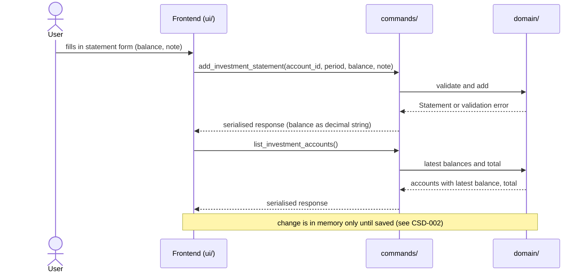
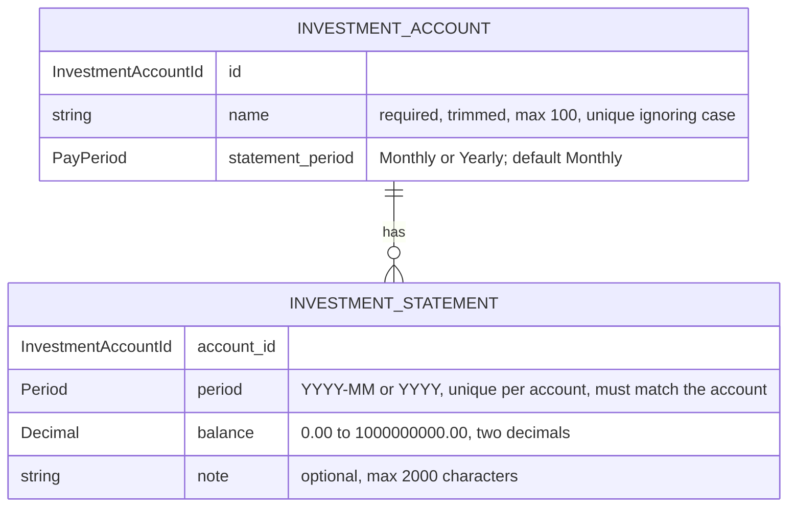

# CSD-005: Investments

## 1. Intent
The app tracks wealth but has no view of what the user has invested. This capability lets the user record investment accounts (a brokerage, a pension, a crypto exchange) and, per account, one closing balance per month or per year, with a note per balance. It is for a single person keeping a private, local history of their investments. It records balances as the user reads them off a statement. It does not track individual stocks, prices or trades. The result is a balance history per account and a total of the latest balances, which later features (net-worth linkage, returns, charts) can build on.

## 2. Scope
### 2.1 In scope
- Create, edit and delete investment accounts, each with a name and a statement period (Monthly or Yearly).
- Create, edit and delete one statement per account per period: a closing balance and an optional note.
- One Investments view with the accounts, their latest balances, the total of the latest balances and the statements of all accounts.
- Investment data is part of the project file. Saving and loading is specified in CSD-002.

### 2.2 Non-goals
- NG-1: Individual positions: tickers, share counts, buy and sell trades, dividends.
- NG-2: Live or historical market prices, and any other data fetched from the network.
- NG-3: Deposits, withdrawals, returns and performance figures. (Candidate for a later CSD, possibly with an optional "net deposits" field.)
- NG-4: Integration with net worth, and a chart or other balance-over-time visualisation (candidates for a later CSD together with CSD-004).
- NG-5: Negative balances, such as margin debt.
- NG-6: A currency per account. All amounts are in the project currency (CSD-003).
- NG-7: Aligning the latest balances of different accounts to one date, or estimating a balance for a period without a statement.
- NG-8: A note on the account itself, an account type and an institution name.
- NG-9: Import of statements (PDF, CSV, broker export).
- NG-10: Rich text or attachments in notes.

## 3. Definitions
| Term | Meaning |
|---|---|
| **Investment account** | One place where the user holds investments, identified by a name. |
| **Statement period** | How an account is recorded: **Monthly** (one statement per calendar month, `YYYY-MM`) or **Yearly** (one statement per calendar year, `YYYY`). An account is Monthly unless Yearly is chosen. |
| **Statement** | The record of one account for one period: the closing balance and an optional note. |
| **Balance** | The value of the account at the end of the period, as one amount in the project currency. |
| **Note** | Optional plain text, up to 2,000 characters, that goes with one statement. |
| **Latest balance** | The balance of the statement with the most recent period of an account. |
| **Total** | The sum of the latest balances of all accounts that have at least one statement. |
| **Project file** | The single user-chosen file holding all app data. Investments are one of its sections. See CSD-002. |

## 4. Requirements

### 4.0 Overview flow


### 4.1 Accounts

**REQ-1: Add an account** *(event-driven)*
When the user submits a new investment account with a name and a statement period, the app shall create the account, with statement period Monthly unless Yearly is chosen.

```gherkin
@AC-1.1
Scenario: Account created with the default period
  Given no investment accounts exist
  When the user adds an account named "Example Brokerage" without choosing a period
  Then the account "Example Brokerage" exists with statement period "Monthly"
  And it has no statements

@AC-1.2
Scenario: Yearly account
  Given no investment accounts exist
  When the user adds an account named "Example Pension" with statement period "Yearly"
  Then the account "Example Pension" exists with statement period "Yearly"

@AC-1.3
Scenario: Unknown period rejected
  When the user adds an account named "Example Brokerage" with statement period "Weekly"
  Then it is rejected with error code "INVESTMENT_PERIOD_UNSUPPORTED"
  And no account exists
```

**REQ-2: Account name rules** *(unwanted behaviour)*
If the name of an investment account is empty after trimming, is longer than 100 characters, or equals the name of another account when case is ignored, then the app shall reject the account without storing or changing it.

```gherkin
@AC-2.1
Scenario Outline: Invalid names rejected
  Given an account named "Example Brokerage"
  When the user adds an account named "<name>"
  Then it is rejected with error code "<code>"
  And only the account "Example Brokerage" exists

  Examples:
    | name                | code                                |
    | (empty)             | INVESTMENT_ACCOUNT_NAME_REQUIRED    |
    | (three spaces)      | INVESTMENT_ACCOUNT_NAME_REQUIRED    |
    | EXAMPLE BROKERAGE   | INVESTMENT_ACCOUNT_NAME_DUPLICATE   |
    | example brokerage   | INVESTMENT_ACCOUNT_NAME_DUPLICATE   |

@AC-2.2
Scenario: Name length boundary
  When the user adds an account with a name of 100 characters
  Then the account exists
  When the user adds an account with a name of 101 characters
  Then it is rejected with error code "INVESTMENT_ACCOUNT_NAME_TOO_LONG"

@AC-2.3
Scenario: The name is stored trimmed
  When the user adds an account named "  Example Brokerage  "
  Then the account is named "Example Brokerage"

@AC-2.4
Scenario: Renaming to an existing name is rejected
  Given accounts "Example Brokerage" and "Example Pension"
  When the user renames "Example Pension" to "example brokerage"
  Then the edit is rejected with error code "INVESTMENT_ACCOUNT_NAME_DUPLICATE"

@AC-2.5
Scenario: Changing only the case of its own name is allowed
  Given an account "Example Brokerage"
  When the user renames it to "EXAMPLE BROKERAGE"
  Then the account is named "EXAMPLE BROKERAGE"
```

**REQ-3: Edit an account** *(event-driven)*
When the user edits an investment account, the app shall apply a changed name under REQ-2 and a changed statement period under REQ-4, and shall keep the account's statements.

```gherkin
@AC-3.1
Scenario: Rename keeps statements
  Given an account "Example Brokerage" with 2 statements
  When the user renames it to "Example Broker"
  Then the account is named "Example Broker"
  And it still has 2 statements

@AC-3.2
Scenario: Period of an account without statements can change
  Given a "Monthly" account "Example Brokerage" with no statements
  When the user changes its statement period to "Yearly"
  Then the account has statement period "Yearly"
```

**REQ-4: Statement period is locked once statements exist** *(unwanted behaviour)*
If the user changes the statement period of an investment account that has at least one statement, then the app shall reject the change with the error code `INVESTMENT_PERIOD_LOCKED`.

```gherkin
@AC-4.1
Scenario: Period change rejected
  Given a "Monthly" account "Example Brokerage" with a statement for 2026-09
  When the user changes its statement period to "Yearly"
  Then the change is rejected with error code "INVESTMENT_PERIOD_LOCKED"
  And the account still has statement period "Monthly"

@AC-4.2
Scenario: Period change allowed again after deleting the last statement
  Given a "Monthly" account "Example Brokerage" with one statement
  When the user deletes the statement
  And changes the statement period to "Yearly"
  Then the account has statement period "Yearly"
```

**REQ-5: Delete an account** *(event-driven)*
When the user confirms deletion of an investment account, the app shall remove the account and all of its statements.

```gherkin
@AC-5.1
Scenario: Deletion cascades
  Given an account "Example Brokerage" with 3 statements
  When the user deletes the account and confirms
  Then the account no longer exists
  And none of its 3 statements exist

@AC-5.2
Scenario: Cancelled deletion changes nothing
  Given an account "Example Brokerage" with 3 statements
  When the user starts deleting the account and cancels
  Then the account and its 3 statements still exist
```

### 4.2 Statements

**REQ-6: Add a statement** *(event-driven)*
When the user submits a statement for the account chosen in the add form, a period and a balance, the app shall store it with the given note, or with an empty note if none is given, and shall accept any period that is not later than the current month (monthly account) or the current year (yearly account), including periods before the account existed in the app.

```gherkin
@AC-6.1
Scenario: Monthly statement with a note
  Given the current date is 26/10/2026
  And a monthly account "Example Brokerage"
  When the user adds a statement for 2026-09 with balance 12500.00 and note "Bought example fund"
  Then the statement for 2026-09 has balance 12500.00 and note "Bought example fund"

@AC-6.2
Scenario: Yearly statement without a note
  Given the current date is 26/10/2026
  And a yearly account "Example Pension"
  When the user adds a statement for 2025 with balance 80000.00 and no note
  Then the statement for 2025 has balance 80000.00 and an empty note

@AC-6.3
Scenario: Old periods are accepted
  Given a monthly account "Example Brokerage"
  When the user adds a statement for 2019-01 with balance 1000.00
  Then the statement for 2019-01 exists

@AC-6.4
Scenario Outline: Current period accepted, later period rejected
  Given the current date is 26/10/2026
  And a <period_type> account "Example Account"
  When the user adds a statement for "<period>" with balance 1000.00
  Then <outcome>

  Examples:
    | period_type | period  | outcome                                                           |
    | monthly     | 2026-10 | the statement for 2026-10 exists                                  |
    | monthly     | 2026-11 | it is rejected with error code "INVESTMENT_STATEMENT_IN_FUTURE"   |
    | yearly      | 2026    | the statement for 2026 exists                                     |
    | yearly      | 2027    | it is rejected with error code "INVESTMENT_STATEMENT_IN_FUTURE"   |

@AC-6.5
Scenario Outline: Invalid period rejected
  Given a <period_type> account "Example Account"
  When the user adds a statement for "<period>" with balance 1000.00
  Then it is rejected with error code "INVESTMENT_STATEMENT_PERIOD_INVALID"

  Examples:
    | period_type | period   |
    | monthly     | 2026-13  |
    | monthly     | 2026-9   |
    | monthly     | abcd     |
    | yearly      | 26       |
    | yearly      | abcd     |
    | yearly      | 1899     |
```

**REQ-7: One statement per account per period** *(unwanted behaviour)*
If the user adds a statement for an account and period that already has one, then the app shall reject it with the error code `INVESTMENT_STATEMENT_DUPLICATE` and leave the existing statement unchanged.

```gherkin
@AC-7.1
Scenario: Duplicate period rejected
  Given a monthly account with a statement for 2026-09 with balance 12500.00 and note "First"
  When the user adds another statement for 2026-09 with balance 13000.00
  Then it is rejected with error code "INVESTMENT_STATEMENT_DUPLICATE"
  And the statement for 2026-09 still has balance 12500.00 and note "First"

@AC-7.2
Scenario: Same period on a different account is allowed
  Given two monthly accounts, and the first has a statement for 2026-09
  When the user adds a statement for 2026-09 to the second account
  Then both accounts have a statement for 2026-09
```

**REQ-8: Statements match the statement period** *(unwanted behaviour)*
If the user adds a monthly statement to a yearly account or a yearly statement to a monthly account, then the app shall reject it with the error code `INVESTMENT_PERIOD_MISMATCH`.

```gherkin
@AC-8.1
Scenario: Monthly statement for a yearly account rejected
  Given a "Yearly" account
  When a statement for 2026-09 with balance 1000.00 is added to it
  Then it is rejected with error code "INVESTMENT_PERIOD_MISMATCH"

@AC-8.2
Scenario: Yearly statement for a monthly account rejected
  Given a "Monthly" account
  When a statement for 2025 with balance 1000.00 is added to it
  Then it is rejected with error code "INVESTMENT_PERIOD_MISMATCH"
```

**REQ-9: Balance validation** *(unwanted behaviour)*
If the balance of a statement is negative, has more than two decimal places or exceeds 1,000,000,000.00, then the app shall reject the statement or edit without rounding or storing it. A balance of 0.00 is valid.

```gherkin
@AC-9.1
Scenario Outline: Invalid balances rejected
  Given a monthly account "Example Brokerage" and the current date 26/10/2026
  When the user adds a statement for 2026-09 with balance "<balance>"
  Then it is rejected with error code "<code>"
  And no statement for 2026-09 exists

  Examples:
    | balance          | code                          |
    | -0.01            | INVESTMENT_BALANCE_NEGATIVE   |
    | 1000.999         | INVESTMENT_BALANCE_PRECISION  |
    | 1000000000.01    | INVESTMENT_BALANCE_TOO_LARGE  |

@AC-9.2
Scenario Outline: Boundary balances accepted
  Given a monthly account "Example Brokerage" and the current date 26/10/2026
  When the user adds a statement for 2026-09 with balance "<balance>"
  Then the statement for 2026-09 has balance <balance>

  Examples:
    | balance          |
    | 0.00             |
    | 1000000000.00    |

@AC-9.3
Scenario: Invalid balance in an edit rejected
  Given a statement for 2026-09 with balance 12500.00
  When the user sets the balance to -1.00
  Then the edit is rejected with error code "INVESTMENT_BALANCE_NEGATIVE"
  And the statement still has balance 12500.00
```

**REQ-10: Note validation** *(unwanted behaviour)*
If the note of a statement is longer than 2,000 characters, then the app shall reject the statement or edit with the error code `INVESTMENT_NOTE_TOO_LONG`, without shortening or storing it. Line breaks in a note are kept as typed.

```gherkin
@AC-10.1
Scenario: Note length boundary
  Given a monthly account "Example Brokerage" and the current date 26/10/2026
  When the user adds a statement for 2026-08 with balance 1000.00 and a note of 2000 characters
  Then the statement for 2026-08 exists with that note
  When the user adds a statement for 2026-09 with balance 1000.00 and a note of 2001 characters
  Then it is rejected with error code "INVESTMENT_NOTE_TOO_LONG"
  And no statement for 2026-09 exists

@AC-10.2
Scenario: Line breaks are kept
  Given a monthly account "Example Brokerage"
  When the user adds a statement for 2026-09 with balance 1000.00 and the note "line one" and "line two" on two lines
  Then the note of the statement has two lines
```

**REQ-11: Edit a statement** *(event-driven)*
When the user edits an existing statement, the app shall change its balance and note under REQ-9 and REQ-10. The period of an existing statement shall not be editable.

```gherkin
@AC-11.1
Scenario: Edit balance and note
  Given a statement for 2026-09 with balance 12500.00 and note "First"
  When the user sets the balance to 12750.00 and the note to "Corrected"
  Then the statement has balance 12750.00 and note "Corrected"

@AC-11.2
Scenario: Clear a note
  Given a statement for 2026-09 with balance 12500.00 and note "First"
  When the user empties the note
  Then the statement has an empty note

@AC-11.3
Scenario: The period cannot be edited
  Given a statement for 2026-09
  When the user opens it for editing
  Then the period is shown but cannot be changed
```

**REQ-12: Delete a statement** *(event-driven)*
When the user confirms deletion of a statement, the app shall remove that statement and no other data.

```gherkin
@AC-12.1
Scenario: Confirmed deletion
  Given a monthly account with statements for 2026-08 and 2026-09
  When the user deletes the statement for 2026-09 and confirms
  Then only the statement for 2026-08 remains

@AC-12.2
Scenario: Cancelled deletion changes nothing
  Given a monthly account with statements for 2026-08 and 2026-09
  When the user starts deleting the statement for 2026-09 and cancels
  Then both statements still exist
```

**REQ-13: Copy the previous period** *(event-driven)*
When the user chooses "copy previous month" (monthly account) or "copy previous year" (yearly account) in the add form, the app shall pre-fill the balance with that of the account's most recent statement and leave the note empty, and shall not store anything until the user confirms.

```gherkin
@AC-13.1
Scenario: Form pre-filled from the latest statement
  Given a monthly account with statements for 2026-07 (balance 12000.00) and 2026-08 (balance 12500.00, note "Bought example fund")
  When the user chooses "copy previous month" in the add form for that account
  Then the form shows balance 12500.00 and an empty note
  And no new statement exists

@AC-13.2
Scenario: Account without statements
  Given a monthly account with no statements
  When the user chooses "copy previous month" in the add form for that account
  Then the form is left empty
  And no error is shown
```

**REQ-14: The add form follows the statement period** *(event-driven)*
When the user chooses an account in the add form, the app shall ask for a month if the account is monthly and for a year if it is yearly, and shall label the copy button "Copy previous month" or "Copy previous year" accordingly.

```gherkin
@AC-14.1
Scenario: Monthly account
  Given a "Monthly" account
  When the user chooses it in the add form
  Then the form asks for "Month (YYYY-MM)"
  And the copy button reads "Copy previous month"

@AC-14.2
Scenario: Yearly account
  Given a "Yearly" account
  When the user chooses it in the add form
  Then the form asks for "Year (YYYY)"
  And the copy button reads "Copy previous year"

@AC-14.3
Scenario: Switching account switches the form
  Given a "Monthly" account and a "Yearly" account
  When the user chooses the yearly account and then the monthly account in the add form
  Then the form asks for a year and then for a month again
```

### 4.3 Views

**REQ-15: Latest balance and total** *(ubiquitous)*
The app shall show for each account the balance of its most recent statement together with that statement's period, and shall show the total of the latest balances of all accounts that have a statement, as computed in Rust, without converting or aligning the periods.

```gherkin
@AC-15.1
Scenario: Latest balance per account
  Given a monthly account with statements for 2026-07 (balance 12000.00) and 2026-09 (balance 12500.00)
  Then the account shows latest balance 12500.00 for 2026-09

@AC-15.2
Scenario: Total over accounts with different periods
  Given a monthly account with latest statement 2026-09 (balance 12500.50)
  And a yearly account with latest statement 2025 (balance 80000.00)
  Then the total is 92500.50
  And the accounts show the periods 2026-09 and 2025

@AC-15.3
Scenario: Accounts without statements do not count
  Given a monthly account with latest statement 2026-09 (balance 12500.00)
  And a monthly account with no statements
  Then the total is 12500.00

@AC-15.4
Scenario: A new latest statement updates the total
  Given a monthly account with a statement for 2026-09 (balance 12500.00)
  When the user adds a statement for 2026-10 with balance 13000.00
  Then the account shows latest balance 13000.00 for 2026-10
  And the total is 13000.00

@AC-15.5
Scenario: An older statement does not change the latest balance
  Given a monthly account with a statement for 2026-09 (balance 12500.00)
  When the user adds a statement for 2026-01 with balance 9000.00
  Then the account still shows latest balance 12500.00 for 2026-09
```

**REQ-16: Ordering** *(ubiquitous)*
The app shall list accounts alphabetically by name ignoring case, and the statements of all accounts by period, newest first, with a yearly statement counting as December of its year and, within a period, by account in the alphabetical order of the accounts.

```gherkin
@AC-16.1
Scenario: Accounts alphabetical
  Given accounts "example pension", "Example Brokerage" and "Example Crypto"
  Then the accounts are listed "Example Brokerage", "Example Crypto", "example pension"

@AC-16.2
Scenario: Newest statement first
  Given a monthly account with statements for 2026-07 and 2026-09
  Then the statement for 2026-09 is listed before the statement for 2026-07

@AC-16.3
Scenario: Yearly statement counts as December
  Given a monthly account with statements for 2025-11 and 2025-12 and a yearly account with a statement for 2025
  Then the statement for 2025-12 and the statement for 2025 are listed before the statement for 2025-11

@AC-16.4
Scenario: Same period is ordered by account
  Given monthly accounts "Example Crypto" and "Example Brokerage", both with a statement for 2026-09
  Then the statement of "Example Brokerage" is listed before that of "Example Crypto"
```

**REQ-17: Investments view layout** *(ubiquitous)*
The app shall offer Investments as its own item in the left pane next to Employment, and shall show the view as the sections Accounts and Statements in that order, with the statement period, the statement count, the latest balance with its period and the buttons "Edit account" and "Delete account" on each account row, the total in a footer row of the Accounts section, the columns Period, Account, Balance and Note in the Statements section, and no account selection that changes what the sections show. A note longer than one line is cut to one line in the table and shown in full when the statement is edited.

```gherkin
@AC-17.1
Scenario: Sections in order
  Given an account with a statement
  Then the sections appear in the order Accounts, Statements
  And Investments is an item in the left pane next to Employment

@AC-17.2
Scenario: Account rows carry their period, count, latest balance and actions
  Given monthly account "Example Brokerage" with 2 statements, the latest for 2026-09 with balance 12500.00
  And yearly account "Example Pension" with 1 statement for 2025 with balance 80000.00
  Then the row of "Example Brokerage" shows "Monthly", "2 statements" and "12500.00" for 2026-09
  And the row of "Example Pension" shows "Yearly", "1 statement" and "80000.00" for 2025
  And each row has the buttons "Edit account" and "Delete account"
  And the footer row shows the total "92500.00"

@AC-17.3
Scenario: Statements of all accounts with their period and account
  Given monthly account "Example Brokerage" with a statement for 2026-09 and yearly account "Example Pension" with a statement for 2025
  Then the Statements section lists both
  And the Period column shows "2026-09" and "2025"
  And the Account column shows "Example Brokerage" and "Example Pension"

@AC-17.4
Scenario: Long note cut to one line
  Given a statement with a note of three lines
  Then the Note column shows one line of it
  And editing the statement shows the whole note

@AC-17.5
Scenario: Clicking an account changes nothing
  Given two accounts with statements
  When the user clicks an account row
  Then the totals and the statements are unchanged

@AC-17.6
Scenario: Notes are shown as plain text
  Given a statement with the note "<b>bold</b>"
  Then the Note column shows the characters "<b>bold</b>" and no formatting
```

**REQ-18: Empty states** *(state-driven)*
While no investment accounts exist, the app shall show an "add your first investment account" prompt and no statement form, and while an account has no statements, the app shall show "No statements yet" and a dash as its latest balance, with no error.

```gherkin
@AC-18.1
Scenario: No accounts
  Given no investment accounts exist
  Then the Investments view shows an "add your first investment account" prompt
  And there is no statement form

@AC-18.2
Scenario: Account without statements
  Given an account with no statements
  Then its row shows a dash as latest balance
  And the Statements section shows "No statements yet"
  And no error is shown
```

**REQ-20: The currency is shown** *(ubiquitous)*
The app shall show the project currency in the titles of the Accounts and Statements sections, and shall show no currency on the account rows or in the statements table.

```gherkin
@AC-20.1
Scenario: Titles show the currency
  Given a project in "EUR" with an account and a statement
  Then the sections are titled "Accounts · EUR" and "Statements · EUR"
  And the account rows and the statements table show no currency

@AC-20.2
Scenario: The titles follow the project currency
  Given a project in "EUR" with an account and a statement
  When the user changes the project currency to "USD" and confirms
  Then the sections are titled "Accounts · USD" and "Statements · USD"
  And the balances are unchanged
```

### 4.4 Saving and loading

**REQ-19: Investments are part of the project file** *(event-driven)*
When the user saves and later opens a project, the app shall restore all investment accounts and statements exactly, including notes. When the project file has no `investments` section, the app shall open the project with no investment accounts.

```gherkin
@AC-19.1
Scenario: Round trip
  Given a project with a yearly account "Example Pension" with a statement for 2025 (balance 80000.00, note "Line one" and "Line two" on two lines)
  When the user saves the project and opens it again
  Then the account and the statement exist unchanged, including the two-line note

@AC-19.2
Scenario: File without the section
  Given a project file made before this capability, without an "investments" section
  When the user opens it
  Then it opens with no investment accounts and no error
```

## 5. Interfaces and contracts

Periods: a monthly statement has period `YYYY-MM` and a yearly one `YYYY`, everywhere (UI, commands, project file). The year must be 1900 or later, like annual statements in CSD-001. Months are shown to the user as `YYYY-MM` (CSD-000 CON-7).



The project file gets a new section `investments` with the lists `accounts` and `statements`. Balances are decimal strings. `format_version` stays 1 and nothing is migrated: a file without the section opens with no accounts, as the app is not released yet.

Commands (all inputs validated in Rust; amounts cross IPC as decimal strings): `list_investment_accounts()` (each account with its statement count and latest balance and period, plus the total), `create_investment_account`, `update_investment_account`, `delete_investment_account`, `list_investment_statements()` (statements of all accounts, each with its account name), `add_investment_statement`, `update_investment_statement`, `delete_investment_statement`, `copy_previous_investment_statement(account_id)`. Project commands (save, open, new) are in CSD-002.

Error codes (returned as code plus safe message): `INVESTMENT_ACCOUNT_NAME_REQUIRED`, `INVESTMENT_ACCOUNT_NAME_TOO_LONG`, `INVESTMENT_ACCOUNT_NAME_DUPLICATE`, `INVESTMENT_PERIOD_UNSUPPORTED`, `INVESTMENT_PERIOD_LOCKED`, `INVESTMENT_PERIOD_MISMATCH`, `INVESTMENT_STATEMENT_IN_FUTURE`, `INVESTMENT_STATEMENT_PERIOD_INVALID`, `INVESTMENT_STATEMENT_DUPLICATE`, `INVESTMENT_BALANCE_NEGATIVE`, `INVESTMENT_BALANCE_PRECISION`, `INVESTMENT_BALANCE_TOO_LARGE`, `INVESTMENT_NOTE_TOO_LONG`. Project error codes are in CSD-002.

## 6. Constraints
- CON-1: Amounts use `rust_decimal::Decimal` and are in the project currency (CSD-003), so adding balances across accounts never mixes currencies. Rationale: `CLAUDE.md` money rules.
- CON-2: The frontend displays figures computed in Rust, including the latest balances and the total, and computes none itself. Rationale: `CLAUDE.md` layout rule.
- CON-3: No network access. Rationale: `CLAUDE.md` Tauri security rules, and NG-2.
- CON-4: Errors shown to the user never contain file paths or OS details. Rationale: `CLAUDE.md` error rules.
- CON-5: Balances, account names and notes are not logged at `info` or above. Rationale: `CLAUDE.md` privacy rules.
- CON-6: Tests and fixtures use synthetic data only ("Example Brokerage", round amounts). Rationale: the repo is public.
- CON-7: Notes are stored as typed and displayed as plain text, never as HTML. Rationale: the frontend must not run markup typed into a note.
- CON-8: The length of a name or a note is counted in characters (Unicode scalar values), not bytes. Rationale: names and notes in any language must fit the stated limits.

## 7. Verification
All ACs are proven by `cargo test`, with domain logic tested in `domain/`. Tests are named `test_csd005_ac_<n>_<m>_<description>` (CSD-000 REQ-6).

| Requirement | Command |
|---|---|
| All of REQ-1 to REQ-13, REQ-15, REQ-16 and REQ-19 | `cargo test test_csd005_` |
| AC-14.1 to AC-14.3, REQ-17 (all ACs), REQ-18, REQ-20 and AC-11.3, AC-17.4 | Manual checklist: form labels, section order and contents, section titles with the currency, left-pane item, empty states, note cut-off, plain-text note. There is no frontend test setup |
| The currency confirmation for investment statements | Governed by CSD-003 REQ-5 (AC-5.5, AC-5.6), verified there |
| AC-17.2, AC-17.3 (data) | `cargo test test_csd005_ac_17_` covers the data of the accounts and statements tables |
| One requirement, e.g. REQ-6 | `cargo test test_csd005_ac_6_` |

Done means fmt, clippy (`-D warnings`) and `cargo test --all-features` pass.

## 8. Open questions
- OQ-1: (resolved in v0.2) Investment statements count as entries for the currency confirmation: CSD-003 0.3 (REQ-5, AC-5.5, AC-5.6).
- OQ-2: (resolved in v0.2) The Investments section titles show the project currency, "Accounts · EUR" and "Statements · EUR": REQ-20.
- OQ-3: (resolved in v0.2) Deleting a statement asks for a confirmation, unlike CSD-001 REQ-8, on purpose: the note of a statement cannot be recreated by copying the previous period (REQ-13). CSD-001 is unchanged.

## 9. Changelog
- 0.2 (26/10/2026): Resolved OQ-1 to OQ-3. New REQ-20 (the project currency in the section titles, AC-20.1, AC-20.2). Investment statements count for the currency confirmation of CSD-003 0.3.
- 0.1 (26/10/2026): initial draft.
