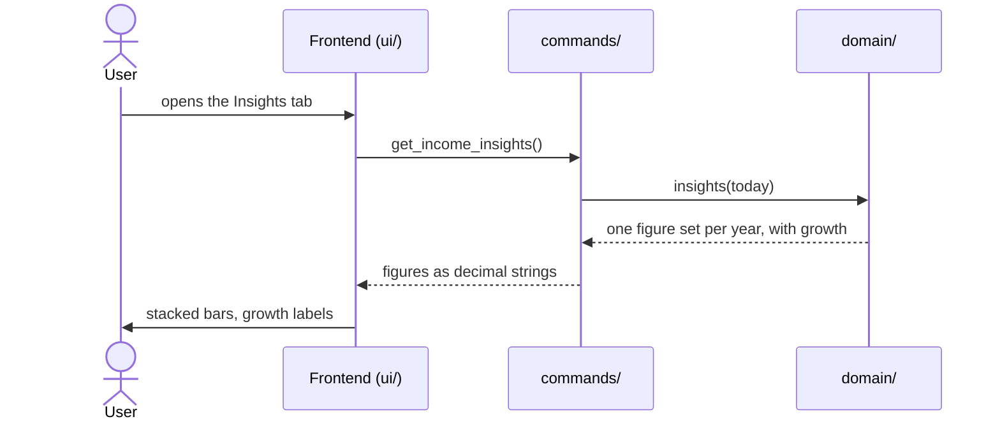

# CSD-006: Income insights

## 1. Intent
The Income page lists jobs, paychecks and a table of yearly totals, but a table does not show whether income is growing. This capability adds an insights layer to the Income page: a chart of income per year, split into gross salary, holiday pay and bonus, with the year-over-year growth of total gross. It is for the owner looking back over their own employment history. It supersedes CSD-001 NG-6 for this view only.

## 2. Scope
### 2.1 In scope
- An "Insights" tab on the Income page, next to the existing content ("Overview").
- A yearly stacked bar chart over all jobs, with growth per year and a tooltip.
- Its empty states.

### 2.2 Non-goals
- NG-1: A monthly view, or any granularity other than a calendar year.
- NG-2: A job filter or a breakdown per job.
- NG-3: Summary growth figures such as the compound annual growth rate, and forecasts (CSD-001 NG-4).
- NG-4: Like-for-like comparison of the current year to date with the same months of last year.
- NG-5: Click-through, zooming, or exporting the chart.
- NG-6: Charts on the Dashboard (CSD-004 NG-2 stays) or on the Reports page.
- NG-7: A chart library or any other new dependency.

## 3. Definitions
| Term | Meaning |
|---|---|
| **Year** | A calendar year. Entries are summed per year over all jobs, as in the yearly totals (CSD-001 REQ-11). |
| **Current year** | The calendar year of today, in local time. Its figures run up to and including the current month, and are therefore partial. |
| **Growth** | The change in total gross of a year against the year before, in percent. |
| **Entry** | A paycheck of a monthly job or an annual statement of a yearly job (CSD-001). |

## 4. Requirements

### 4.0 Overview flow


**REQ-1: Tabs on the Income page** *(ubiquitous)*
The Income page shall offer the tabs "Overview" and "Insights", with Overview, which holds the existing content, shown first.

```gherkin
@AC-1.1
Scenario: Overview is shown first
  Given a project with one job
  When the user opens the Income page
  Then the Overview tab is selected
  And it shows the Jobs, Yearly totals and Paychecks and statements sections

@AC-1.2
Scenario: Switching to Insights
  Given the Income page shows the Overview tab
  When the user selects the Insights tab
  Then the Overview sections are hidden
  And the insights chart is shown

@AC-1.3
Scenario: No jobs yet
  Given a project without jobs
  When the user opens the Income page
  Then the prompt to add the first job is shown
  And there are no tabs
```

**REQ-2: Year series** *(ubiquitous)*
The app shall return one set of figures for every calendar year from the year of the earliest entry up to and including the current year, oldest year first, holding the sums over all jobs of gross salary, holiday pay, bonus and total gross, and the number of entries.

```gherkin
@AC-2.1
Scenario: Series runs from the first entry to the current year
  Given today is 26/10/2026
  And the earliest entry is a paycheck for 2024-03
  And there are entries in 2025 and 2026
  When the insights are requested
  Then the series holds the years 2024, 2025 and 2026 in that order

@AC-2.2
Scenario: Two jobs are summed
  Given today is 26/10/2026
  And "Example Employer" has an annual statement for 2025 of salary 30000.00, holiday pay 2400.00 and bonus 0.00
  And "Example Agency" has an annual statement for 2025 of salary 5000.00, holiday pay 0.00 and bonus 1000.00
  When the insights are requested
  Then the year 2025 has gross salary 35000.00, holiday pay 2400.00, bonus 1000.00, total gross 38400.00 and 2 entries

@AC-2.3
Scenario: A single year
  Given today is 26/10/2026
  And the only entry is a paycheck for 2026-09
  When the insights are requested
  Then the series holds only the year 2026
```

**REQ-3: Years without entries** *(unwanted behaviour)*
If a year in the series has no entries, then the app shall return that year with all amounts 0.00 and 0 entries.

```gherkin
@AC-3.1
Scenario: Gap year
  Given today is 26/10/2026
  And there are entries in 2022 and 2024 but none in 2023
  When the insights are requested
  Then the year 2023 has total gross 0.00 and 0 entries
  And the series holds the years 2022, 2023, 2024, 2025 and 2026
```

**REQ-4: Current year is partial** *(state-driven)*
While a year is the current year, the app shall mark it as partial.

```gherkin
@AC-4.1
Scenario: Current year is marked
  Given today is 26/10/2026
  And there are entries in 2025 and 2026
  When the insights are requested
  Then the year 2026 is marked partial
  And the year 2025 is not
```

**REQ-5: Growth** *(ubiquitous)*
The app shall calculate the growth of a year as (total gross − total gross of the year before) ÷ total gross of the year before × 100, rounded to one decimal place with banker's rounding.

```gherkin
@AC-5.1
Scenario Outline: Growth per year
  Given today is 26/10/2026
  And the total gross of 2023 is <previous>
  And the total gross of 2024 is <current>
  When the insights are requested
  Then the growth of 2024 is "<growth>"

  Examples:
    | previous | current  | growth |
    | 32400.00 | 34480.00 | 6.4    |
    | 40000.00 | 39000.00 | -2.5   |
    | 20000.00 | 20090.00 | 0.4    |
    | 20000.00 | 20000.00 | 0.0    |
```

**REQ-6: No growth available** *(unwanted behaviour)*
If a year is the first in the series, is partial, has no entries, or follows a year with total gross 0.00, then the app shall give it no growth.

```gherkin
@AC-6.1
Scenario: First year has no growth
  Given today is 26/10/2026
  And the earliest entry is in 2024
  When the insights are requested
  Then the year 2024 has no growth

@AC-6.2
Scenario: Current year has no growth
  Given today is 26/10/2026
  And the total gross of 2025 is 34480.00 and of 2026 so far 28000.00
  When the insights are requested
  Then the year 2026 has no growth

@AC-6.3
Scenario: Year after a gap has no growth
  Given today is 26/10/2026
  And there are entries in 2022 and 2024 but none in 2023
  When the insights are requested
  Then the years 2023 and 2024 have no growth
```

**REQ-7: Chart** *(ubiquitous)*
The Insights tab shall draw one stacked bar per year in the order received, built from gross salary, holiday pay and bonus, on a y-axis from 0 to a rounded-up value of at least the largest total gross, with gridlines, compact axis labels (such as "10k"), a legend naming the three amounts, and no currency.

```gherkin
@AC-7.1
Scenario: Stacked bars per year
  Given the series holds the years 2024, 2025 and 2026
  When the user opens the Insights tab
  Then three bars are drawn, 2024 on the left and 2026 on the right
  And each bar is stacked from gross salary, holiday pay and bonus
  And the legend names Gross salary, Holiday pay and Bonus

@AC-7.2
Scenario: Axis covers the largest year
  Given the largest total gross is 38400.00
  When the user opens the Insights tab
  Then the top of the y-axis is at least 38400.00
  And the axis starts at 0

@AC-7.3
Scenario: Gap year is an empty slot
  Given the year 2023 has total gross 0.00
  When the user opens the Insights tab
  Then 2023 has a labelled slot without a bar

@AC-7.4
Scenario: Current year is marked
  Given the year 2026 is partial
  When the user opens the Insights tab
  Then the 2026 bar has a lighter fill
  And its label reads "2026 YTD"
```

**REQ-8: Growth labels** *(ubiquitous)*
The Insights tab shall show the growth of each year with a growth value next to its bar as "+x.x%" or "−x.x%", "0.0%" for no change and "–" for no growth, using the negative colour only for decreases.

```gherkin
@AC-8.1
Scenario Outline: Growth label
  Given the growth of a year is <growth>
  When the user opens the Insights tab
  Then the label of that year reads "<label>"

  Examples:
    | growth | label |
    | 6.4    | +6.4% |
    | -2.5   | −2.5% |
    | 0.0    | 0.0%  |
    | none   | –     |

@AC-8.2
Scenario: Only decreases are red
  Given the growth of 2023 is -2.5 and of 2024 is 6.4
  When the user opens the Insights tab
  Then the label of 2023 uses the negative colour
  And the label of 2024 does not
```

**REQ-9: Details of a year** *(event-driven)*
When the user hovers over or moves keyboard focus to a year, the Insights tab shall show a tooltip with the year's gross salary, holiday pay, bonus, total gross and growth.

```gherkin
@AC-9.1
Scenario: Tooltip on hover
  Given the year 2025 has gross salary 31000.00, holiday pay 2480.00, bonus 1000.00 and total gross 34480.00
  When the user hovers over the 2025 bar
  Then a tooltip shows those four amounts and the growth of 2025

@AC-9.2
Scenario: Tooltip on keyboard focus
  Given the Insights tab shows the chart
  When the user moves focus to the 2025 bar with the Tab key
  Then the same tooltip is shown
  And the tooltip disappears when focus leaves the bar

@AC-9.3
Scenario: Accessible label
  Given the year 2025 has total gross 34480.00 and growth 6.4
  When a screen reader reads the 2025 bar
  Then it announces the year, the four amounts and the growth
```

**REQ-10: No entries yet** *(state-driven)*
While the project has jobs but no entries, the Insights tab shall show a note instead of a chart.

```gherkin
@AC-10.1
Scenario: Jobs without entries
  Given a project with one job and no paychecks or statements
  When the user opens the Insights tab
  Then the note "No income yet. The chart appears once there is a paycheck or an annual statement." is shown
  And no chart is drawn
```

**REQ-11: Current figures** *(event-driven)*
When the user opens the Insights tab, the app shall show figures computed from the project at that moment.

```gherkin
@AC-11.1
Scenario: Figures follow changes
  Given the Insights tab showed total gross 34480.00 for 2025
  And the user added a bonus of 500.00 to a paycheck of 2025 on the Overview tab
  When the user opens the Insights tab again
  Then the 2025 bar shows total gross 34980.00

@AC-11.2
Scenario: Last entry deleted
  Given the Insights tab showed a chart
  And the user deleted the only entry on the Overview tab
  When the user opens the Insights tab again
  Then the note of AC-10.1 is shown and no chart is drawn
```

## 5. Interfaces and contracts

Command: `get_income_insights()` returns the series, oldest year first:

```json
{
  "years": [
    { "year": 2024, "gross_salary": "30000.00", "holiday_pay": "2400.00", "bonus": "0.00", "total_gross": "32400.00", "entry_count": 12, "is_partial": false, "growth_percent": null },
    { "year": 2025, "gross_salary": "31000.00", "holiday_pay": "2480.00", "bonus": "1000.00", "total_gross": "34480.00", "entry_count": 12, "is_partial": false, "growth_percent": "6.4" },
    { "year": 2026, "gross_salary": "26000.00", "holiday_pay": "0.00", "bonus": "0.00", "total_gross": "26000.00", "entry_count": 10, "is_partial": true, "growth_percent": null }
  ]
}
```

`years` is empty when there are no entries. `growth_percent` is a decimal string or `null`. Amounts are decimal strings. Rust decides "today" (local time), the years, the partial flag and the growth, and the frontend only displays what it receives.

## 6. Constraints
- CON-1: Figures and growth are computed in Rust and displayed as received; the frontend only scales values to positions on the chart. Rationale: `CLAUDE.md` layout rule.
- CON-2: Amounts and growth use `rust_decimal::Decimal`. Rationale: `CLAUDE.md` money rules.
- CON-3: The chart is plain SVG drawn in `ui/`, with no chart library, no new crate and no network access. Rationale: `CLAUDE.md` dependency and Tauri security rules.
- CON-4: Chart colours come from CSS variables and are legible in light and dark mode. Rationale: the app already supports both.
- CON-5: The Overview tab behaves as before (CSD-001 is unchanged apart from NG-6). Rationale: this capability adds a view and changes no income behaviour.
- CON-6: Tests and fixtures use synthetic data only. Rationale: the repo is public.

## 7. Verification
The figures are proven by `cargo test`. Tests are named `test_csd006_ac_<n>_<m>_<description>` (CSD-000 REQ-6).

| Requirement | Command |
|---|---|
| REQ-2 to REQ-6 (data) | `cargo test test_csd006_` |
| AC-1.1 to AC-1.3, REQ-7, REQ-8, REQ-9, REQ-10, REQ-11 (display) | Manual checklist: tabs, bars and legend, axis, gap and YTD years, growth labels and colours, tooltip by mouse and keyboard, empty note, refresh after a change, light and dark mode. There is no frontend test setup |

Done means fmt, clippy (`-D warnings`) and `cargo test --all-features` pass.

## 8. Open questions
None.

## 9. Changelog
- 0.1 (26/10/2026): initial draft.
