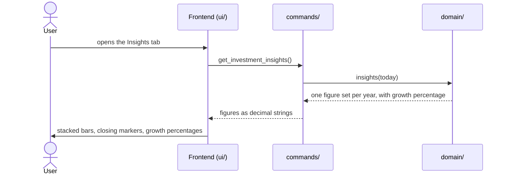

# CSD-007: Investment insights

## 1. Intent
The Investments page lists accounts, statements and a table of yearly totals, but a table does not show how an investment pot grew: how much of the change came from money paid in and how much from the market. This capability adds an insights layer to the Investments page: a chart with one bar per year that starts at the balance the year opened with, adds net deposits, and ends with the capital growth, together with a marker at the closing balance and the growth as a percentage of the opening balance. It is for the owner looking back over their own investments. It follows the Income insights of CSD-006 and supersedes CSD-005 NG-4 for this view only, and CSD-005 NG-3 for the growth percentage of this view only.

## 2. Scope
### 2.1 In scope
- An "Insights" tab on the Investments page, next to the existing content ("Overview").
- A yearly stacked bar chart over all accounts, with a closing-balance marker, a growth percentage per year and a tooltip.
- Its empty state.

### 2.2 Non-goals
- NG-1: A monthly view, or any granularity other than a calendar year.
- NG-2: A filter or a breakdown per account.
- NG-3: Any return figure other than the growth percentage of REQ-6: annualised returns, time-weighted returns, a percentage in the Yearly totals table or anywhere else, and forecasts.
- NG-4: Click-through, zooming, or exporting the chart.
- NG-5: Charts on the Dashboard or on the Net worth page, which has its own chart (CSD-017).
- NG-6: A chart library or any other new dependency.
- NG-7: Estimating balances for years without a statement (CSD-005 NG-7).

## 3. Definitions
| Term | Meaning |
|---|---|
| **Year** | A calendar year. A statement counts in the year of its own period only, as in the yearly totals (CSD-005 REQ-26). |
| **Current year** | The calendar year of today, in local time. Its figures run up to the latest statement so far, and are therefore partial. |
| **Opening balance** | For a year: the sum, over the accounts that have a statement in that year, of the balance of each such account's latest statement before that year. An account without an earlier statement adds nothing: it is taken to start at 0.00 (CSD-005), so its balance shows up as net deposits and capital growth. |
| **Net deposits, capital growth, closing balance** | As in CSD-005: the yearly totals of REQ-26. |
| **Growth percentage** | The capital growth of a year, counting only the accounts that have an opening balance in that year, divided by the opening balance, in percent. It leaves net deposits out and ignores when in the year they arrived, so it is a simple yearly figure and not a time-weighted return. |

## 4. Requirements

### 4.0 Overview flow


**REQ-1: Tabs on the Investments page** *(ubiquitous)*
The Investments page shall offer the tabs "Overview" and "Insights" while at least one investment account exists, with Overview, which holds the existing content, shown first.

```gherkin
@AC-1.1
Scenario: Overview is shown first
  Given a project with one investment account
  When the user opens the Investments page
  Then the Overview tab is selected
  And it shows the Accounts, Yearly totals and Statements sections

@AC-1.2
Scenario: Switching to Insights
  Given the Investments page shows the Overview tab
  When the user selects the Insights tab
  Then the Overview sections are hidden
  And the insights chart is shown

@AC-1.3
Scenario: No accounts yet
  Given a project without investment accounts
  When the user opens the Investments page
  Then the prompt to add the first investment account is shown
  And there are no tabs
```

**REQ-2: Year series** *(ubiquitous)*
The app shall return one set of figures for every calendar year from the year of the earliest statement up to and including the current year, oldest year first, holding the opening balance, the net deposits, the capital growth, the closing balance and the number of statements (returned, never displayed).

```gherkin
@AC-2.1
Scenario: Series runs from the first statement to the current year
  Given today is 26/10/2026
  And the earliest statement is for 2024-03
  And there are statements in 2025 and 2026
  When the insights are requested
  Then the series holds the years 2024, 2025 and 2026 in that order

@AC-2.2
Scenario: A single year
  Given today is 26/10/2026
  And the only statement is for 2026-09
  When the insights are requested
  Then the series holds only the year 2026

@AC-2.3
Scenario: No statements
  Given today is 26/10/2026
  And an account without statements
  When the insights are requested
  Then the series is empty
```

**REQ-3: Years without statements** *(unwanted behaviour)*
If a year in the series has no statement, then the app shall return that year with all amounts 0.00 and 0 statements.

```gherkin
@AC-3.1
Scenario: Gap year
  Given today is 26/10/2026
  And there are statements in 2022 and 2024 but none in 2023
  When the insights are requested
  Then the year 2023 has opening balance 0.00, net deposits 0.00, capital growth 0.00, closing balance 0.00 and 0 statements
  And the series holds the years 2022, 2023, 2024, 2025 and 2026

@AC-3.2
Scenario: The year after a gap still opens with the balance from before the gap
  Given today is 26/10/2026
  And an account with a statement for 2024-12 (balance 10000.00) and one for 2026-06 (balance 11000.00, net deposits 500.00)
  When the insights are requested
  Then the year 2025 has no statements
  And the year 2026 has opening balance 10000.00, net deposits 500.00, capital growth 500.00 and closing balance 11000.00
```

**REQ-4: Current year is partial** *(state-driven)*
While a year is the current year, the app shall mark it as partial.

```gherkin
@AC-4.1
Scenario: Current year is marked
  Given today is 26/10/2026
  And there are statements in 2025 and 2026
  When the insights are requested
  Then the year 2026 is marked partial
  And the year 2025 is not

@AC-4.2
Scenario: Current year without statements is still in the series and marked
  Given today is 26/10/2026
  And the only statement is for 2025-12
  When the insights are requested
  Then the series holds 2025 and 2026
  And 2026 is marked partial and has 0 statements
```

**REQ-5: The parts add up to the closing balance** *(ubiquitous)*
The app shall compute for each year the opening balance as defined in section 3, take the net deposits, the capital growth and the closing balance from the yearly totals of CSD-005 REQ-26, and the opening balance plus the net deposits plus the capital growth shall equal the closing balance.

```gherkin
@AC-5.1
Scenario: Parts of a year
  Given today is 26/10/2026
  And a monthly account with statements 2025-11 (balance 11000.00, net deposits 11000.00), 2025-12 (balance 11500.00, net deposits 200.00) and 2026-05 (balance 12500.00, net deposits 300.00)
  When the insights are requested
  Then 2025 has opening balance 0.00, net deposits 11200.00, capital growth 300.00 and closing balance 11500.00
  And 2026 has opening balance 11500.00, net deposits 300.00, capital growth 700.00 and closing balance 12500.00

@AC-5.6
Scenario: A first statement without net deposits
  Given today is 26/10/2026
  And a monthly account with a statement 2026-03 (balance 1020.00, net deposits 1000.00)
  When the insights are requested
  Then 2026 has opening balance 0.00, net deposits 1000.00, capital growth 20.00 and closing balance 1020.00

@AC-5.2
Scenario: An account that starts in a later year
  Given today is 26/10/2026
  And account "Example Brokerage" with statements 2025-12 (balance 12000.00, net deposits 12000.00) and 2026-03 (balance 12600.00, net deposits 100.00)
  And account "Example Crypto" with a first statement 2026-03 (balance 500.00, net deposits 400.00)
  When the insights are requested
  Then 2026 has opening balance 12000.00, net deposits 500.00, capital growth 600.00 and closing balance 13100.00

@AC-5.3
Scenario: An account without a statement in the year is left out
  Given today is 26/10/2026
  And a monthly account "Example Brokerage" with statements 2025-12 (balance 12000.00, net deposits 12000.00) and 2026-03 (balance 12500.00)
  And a yearly account "Example Pension" with a statement 2025 (balance 80000.00, net deposits 80000.00)
  When the insights are requested
  Then 2025 has opening balance 0.00, net deposits 92000.00 and closing balance 92000.00
  And 2026 has opening balance 12000.00, net deposits 0.00, capital growth 500.00 and closing balance 12500.00

@AC-5.4
Scenario: A net withdrawal and a loss
  Given today is 26/10/2026
  And a monthly account with statements 2025-12 (balance 12000.00, net deposits 12000.00) and 2026-03 (balance 11000.00, net deposits -500.00)
  When the insights are requested
  Then 2026 has opening balance 12000.00, net deposits -500.00, capital growth -500.00 and closing balance 11000.00

@AC-5.5
Scenario: Net deposits and closing balance equal the yearly totals
  Given today is 26/10/2026
  And the statements of AC-5.1 and AC-5.2
  When the insights and the yearly totals are requested
  Then for every year the closing balance, the net deposits and the capital growth of the insights equal those of the yearly totals
```

**REQ-6: Growth percentage** *(ubiquitous)*
The app shall calculate the growth percentage of a year as the capital growth of the accounts that have an opening balance in that year ÷ the opening balance × 100, rounded to one decimal place with banker's rounding.

```gherkin
@AC-6.1
Scenario Outline: Growth percentage per year
  Given today is 26/10/2026
  And the opening balance of 2025 is <opening>
  And the capital growth of 2025 is <growth>, all of it from accounts that are in the opening balance
  When the insights are requested
  Then the growth percentage of 2025 is "<percent>"

  Examples:
    | opening  | growth  | percent |
    | 11500.00 | 700.00  | 6.1     |
    | 40000.00 | -1000.00| -2.5    |
    | 20000.00 | 90.00   | 0.4     |
    | 20000.00 | 0.00    | 0.0     |

@AC-6.2
Scenario: Growth of an account without an opening balance is left out of the percentage
  Given today is 26/10/2026
  And account "Example Brokerage" with statements 2025-12 (balance 12000.00, net deposits 12000.00) and 2026-03 (balance 12600.00, net deposits 100.00)
  And account "Example Crypto" with a first statement 2026-03 (balance 500.00, net deposits 400.00)
  When the insights are requested
  Then the capital growth of 2026 is 600.00
  And the growth percentage of 2026 is "4.2"
```

**REQ-7: No growth percentage available** *(unwanted behaviour)*
If the opening balance of a year is 0.00 or the year has no statements, then the app shall give it no growth percentage.

```gherkin
@AC-7.1
Scenario: First year has no percentage
  Given today is 26/10/2026
  And the earliest statement is in 2025
  When the insights are requested
  Then the year 2025 has no growth percentage

@AC-7.2
Scenario: Gap year has no percentage
  Given today is 26/10/2026
  And there are statements in 2022 and 2024 but none in 2023
  When the insights are requested
  Then the year 2023 has no growth percentage

@AC-7.3
Scenario: The current year has a percentage
  Given today is 26/10/2026
  And the opening balance of 2026 is 12500.00 and the capital growth of 2026 so far is 250.00
  When the insights are requested
  Then the growth percentage of 2026 is "2.0"
  And 2026 is marked partial
```

**REQ-8: Chart** *(ubiquitous)*
The Insights tab shall draw one bar per year in the order received, stacked from the bottom as opening balance, net deposits and capital growth, in which a positive segment rises from the running total and a negative segment hangs down from it, with capital growth in a positive colour when it is positive and a negative colour when it is negative and a negative net deposit in a lighter tint of the net deposits colour with a thin dashed outline, on a y-axis that starts at 0 (or at a rounded-down negative value if a running total is negative) and ends at a rounded-up value of at least the highest running total, with gridlines, compact axis labels (such as "10k"), a legend with one item for each piece (Opening balance, Net deposits, Capital growth (gain), Capital growth (loss)) and one for the closing-balance marker, and no currency.

```gherkin
@AC-8.1
Scenario: Stacked bars per year
  Given the series holds the years 2025 and 2026
  When the user opens the Insights tab
  Then two bars are drawn, 2025 on the left and 2026 on the right
  And each bar is stacked from opening balance, net deposits and capital growth
  And the legend has the items Opening balance, Net deposits, Capital growth (gain), Capital growth (loss) and Closing balance

@AC-8.2
Scenario: Growth colour follows the sign
  Given 2025 has capital growth 300.00 and 2026 has capital growth -500.00
  When the user opens the Insights tab
  Then the growth segment of 2025 uses the positive colour
  And the growth segment of 2026 uses the negative colour

@AC-8.3
Scenario: Negative segments hang down
  Given 2026 has opening balance 12000.00, net deposits -500.00 and capital growth -500.00
  When the user opens the Insights tab
  Then the net deposits segment of 2026 hangs down from 12000.00 to 11500.00 in a lighter tint with a thin dashed outline
  And the growth segment hangs down from 11500.00 to 11000.00 in the negative colour

@AC-8.4
Scenario: Axis covers the highest level
  Given the highest running total of any year is 13100.00
  When the user opens the Insights tab
  Then the top of the y-axis is at least 13100.00
  And the axis starts at 0

@AC-8.5
Scenario: Gap year is an empty slot
  Given the year 2023 has no statements
  When the user opens the Insights tab
  Then 2023 has a labelled slot without a bar

@AC-8.6
Scenario: Current year is marked
  Given the year 2026 is partial
  When the user opens the Insights tab
  Then the 2026 bar has a lighter fill
  And its label reads "2026 YTD"
```

**REQ-9: Closing-balance marker** *(ubiquitous)*
The Insights tab shall draw for each year with statements a horizontal marker line of 2 px with round ends in the muted text colour, wider than the bar, at the closing balance, with its compact value next to it (above the line), not connected to the markers of other years, and dashed for the current year.

```gherkin
@AC-9.1
Scenario: Marker at the closing balance
  Given 2025 has closing balance 11500.00
  When the user opens the Insights tab
  Then a marker line is drawn across the 2025 bar at 11500.00
  And its label reads "11.5k"

@AC-9.2
Scenario: Marker sits at the top of a gaining bar and the bottom of a losing growth segment
  Given 2025 has capital growth 300.00 and 2026 has capital growth -500.00
  When the user opens the Insights tab
  Then the 2025 marker sits at the top of the stack
  And the 2026 marker sits at the lower end of the growth segment

@AC-9.3
Scenario: Markers are not connected and the current year is dashed
  Given the series holds 2024, a gap year 2025 and the partial year 2026
  When the user opens the Insights tab
  Then no line joins the markers
  And the marker of 2026 is dashed
  And 2025 has no marker
```

**REQ-10: Growth percentage labels** *(ubiquitous)*
The Insights tab shall show the growth percentage of each year as a second line under its year label as "+x.x%" or "−x.x%", "0.0%" for no change and "–" for no growth percentage, using the negative colour only for decreases.

```gherkin
@AC-10.1
Scenario Outline: Growth percentage label
  Given the growth percentage of a year is <percent>
  When the user opens the Insights tab
  Then the second line under the label of that year reads "<label>"

  Examples:
    | percent | label |
    | 6.1     | +6.1% |
    | -2.5    | −2.5% |
    | 0.0     | 0.0%  |
    | none    | –     |

@AC-10.2
Scenario: Only decreases are red
  Given the growth percentage of 2025 is -2.5 and of 2026 is 6.1
  When the user opens the Insights tab
  Then the percentage of 2025 uses the negative colour
  And the percentage of 2026 does not
```

**REQ-11: Details of a year** *(event-driven)*
When the user hovers over or moves keyboard focus to a year, the Insights tab shall show a tooltip with the year's opening balance, net deposits, capital growth, growth percentage and closing balance, in the order and with the empty-year note that REQ-14 lays out, and shall give the same values to screen readers. The tooltip and the screen-reader description show no number of statements.

```gherkin
@AC-11.1
Scenario: Tooltip on hover
  Given 2026 has opening balance 11500.00, net deposits 300.00, capital growth 700.00, closing balance 12500.00 and growth percentage 6.1
  When the user hovers over the 2026 bar
  Then a tooltip shows those five values
  And it shows no number of statements

@AC-11.2
Scenario: Tooltip on keyboard focus
  Given the Insights tab shows the chart
  When the user moves focus to the 2026 bar with the Tab key
  Then the same tooltip is shown
  And the tooltip disappears when focus leaves the bar

@AC-11.3
Scenario: Accessible label
  Given 2026 has capital growth -500.00
  When a screen reader reads the 2026 bar
  Then it announces the year, the five values and that the capital growth is negative
  And it announces no number of statements
```

**REQ-12: No statements yet** *(state-driven)*
While at least one account exists but no statement, the Insights tab shall show a note instead of a chart.

```gherkin
@AC-12.1
Scenario: Accounts without statements
  Given a project with one account and no statements
  When the user opens the Insights tab
  Then the note "No statements yet. The chart appears once there is a statement." is shown
  And no chart is drawn
```

**REQ-13: Current figures** *(event-driven)*
When the user opens the Insights tab, the app shall show figures computed from the project at that moment.

```gherkin
@AC-13.1
Scenario: Figures follow changes
  Given the Insights tab showed closing balance 12500.00 for 2026
  And the user added a statement for 2026-09 with balance 13000.00 on the Overview tab
  When the user opens the Insights tab again
  Then the 2026 marker shows 13000.00

@AC-13.2
Scenario: Last statement deleted
  Given the Insights tab showed a chart
  And the user deleted the only statement on the Overview tab
  When the user opens the Insights tab again
  Then the note of AC-12.1 is shown and no chart is drawn
```

### 4.1 Legend and highlight

**REQ-14: Legend with the selected year** *(event-driven)*
When the user hovers over or moves keyboard focus to a year, the Insights tab shall show in the tooltip of that year the colour swatch of the legend on the rows of opening balance, net deposits, capital growth and closing balance, with, on the capital growth row, the swatch of a gain when the capital growth is not negative and the swatch of a loss when it is, and shall list the rows of the tooltip in the order the bar shows them, top to bottom: Capital growth, Net deposits, Opening balance, then Closing balance, then Growth (%), and shall place the tooltip beside the year's bar, to its right with its top aligned to the top of the bar, to its left when there is no room on the right, and inside the chart area, or centred over its slot when the year has no bar, where it shows the note "No statements" in place of the rows. The legend in the panel header stays.

```gherkin
@AC-14.1
Scenario: Swatches match the legend
  Given 2025 has opening balance 10700.00, net deposits 500.00, capital growth 3800.00 and closing balance 15000.00
  When the user hovers over the 2025 bar
  Then the tooltip rows Opening balance, Net deposits, Capital growth and Closing balance each show the swatch of the same colour or line as in the legend
  And the Capital growth row shows the gain swatch
  And the row Growth (%) shows no swatch

@AC-14.2
Scenario: A loss shows the loss swatch
  Given 2023 has capital growth -800.00
  When the user hovers over the 2023 bar
  Then the Capital growth row shows the loss swatch

@AC-14.3
Scenario: Zero growth shows the gain swatch
  Given 2024 has statements and capital growth 0.00
  When the user hovers over the 2024 bar
  Then the Capital growth row shows the gain swatch

@AC-14.4
Scenario: Tooltip beside the bar
  Given the chart shows the years 2024, 2025 and 2026
  When the user hovers over the 2024 bar
  Then the tooltip is shown to the right of that bar
  And its top is level with the top of that bar

@AC-14.5
Scenario: Tooltip flips near the right edge
  Given the chart shows the years 2024, 2025 and 2026
  When the user hovers over the 2026 bar and the tooltip does not fit to its right
  Then the tooltip is shown to the left of that bar
  And it stays inside the chart area

@AC-14.9
Scenario: Rows follow the bar from top to bottom
  Given 2025 has opening balance 10700.00, net deposits 500.00, capital growth 3800.00, closing balance 15000.00 and growth percentage 35.5
  When the user hovers over the 2025 bar
  Then the tooltip rows are listed Capital growth, Net deposits, Opening balance, Closing balance, Growth (%) in that order
  And no row is listed above Capital growth

@AC-14.6
Scenario: Year without a bar
  Given the year 2023 has no statements
  When the user hovers over its slot
  Then the tooltip is centred over that slot
  And it shows no swatch
  And it shows the note "No statements" and no rows

@AC-14.7
Scenario: Header legend stays
  Given the Insights tab shows the chart
  When the user hovers over a year
  Then the legend in the panel header is still shown

@AC-14.8
Scenario: Keyboard focus shows the same tooltip
  Given the Insights tab shows the chart
  When the user moves focus to the 2025 bar with the Tab key
  Then the tooltip is shown beside that bar with the same swatches
```

**REQ-15: Highlight while hovering** *(event-driven)*
When the mouse is over a segment of a bar, a closing-balance marker or an item of the panel header legend, or keyboard focus is on a legend item, the Insights tab shall keep that series (opening balance, net deposits, capital growth as gain, capital growth as loss, or the closing-balance marker) at full colour in every year of the chart and ease the other segments in every year down to 70% opacity (for the marker: thicken it from 2 px to 3 px in every year), set the legend item of that series in the full text colour and a heavier font weight in the tooltip and in the panel header legend, ease the other items of the panel header legend down to 70% opacity, and while the mouse is over no segment, marker or legend item, and no legend item has keyboard focus, or keyboard focus is on a year, the Insights tab shall highlight nothing. Where segments overlap, the one drawn on top is the one hovered.

```gherkin
@AC-15.1
Scenario: Hovering a segment
  Given the 2025 bar is stacked from opening balance, net deposits and capital growth
  When the user hovers over the net deposits segment
  Then the Net deposits item is set in the full text colour and a heavier font weight in the tooltip and in the header legend
  And the other items of the header legend are eased down to 70% opacity
  And the net deposits segments of every year keep their full colour and all other segments of every year are eased down to 70% opacity

@AC-15.2
Scenario: Hovering the closing-balance marker
  Given 2025 has closing balance 15000.00
  When the user hovers over its marker
  Then the Closing balance item is set in the full text colour and a heavier font weight in the tooltip and in the header legend
  And the markers of every year thicken from 2 px to 3 px

@AC-15.3
Scenario: Gain and loss are separate legend items
  Given 2025 has capital growth 3800.00 and 2023 has capital growth -800.00
  When the user hovers over the capital growth segment of 2023
  Then the Capital growth (loss) item is highlighted in the header legend
  And the Capital growth (gain) item is not highlighted
  And only the loss segments, in every year, keep their full colour, so the gain segment of 2025 is eased down to 70% opacity

@AC-15.4
Scenario: Leaving the segment
  Given the user hovers over a segment
  When the user moves the mouse to empty space in the year's column
  Then no legend item is highlighted and no segment is dimmed
  And the tooltip is still shown

@AC-15.5
Scenario: Overlapping segments
  Given 2025 has a net withdrawal that hangs down over the growth segment
  When the user hovers over the overlap
  Then the Net deposits item is highlighted

@AC-15.6
Scenario: Not colour alone
  Given the user hovers over a segment
  Then the highlighted item has a heavier font weight than the other items
  And the other segments are lighter, not differently coloured
  And no outline and no background chip is drawn

@AC-15.7
Scenario: Keyboard focus on a year highlights nothing
  Given the Insights tab shows the chart
  When the user moves focus to the 2025 bar with the Tab key
  Then no legend item is highlighted

@AC-15.8
Scenario: Hovering a legend item highlights that series in every year
  Given the series holds 2024, 2025 and 2026
  When the user hovers over the legend item "Net deposits"
  Then the net deposits segments of 2024, 2025 and 2026 keep their full colour
  And all other segments of those years are eased down to 70% opacity
  And the other legend items are eased down to 70% opacity

@AC-15.9
Scenario: Focusing a legend item
  Given the Insights tab shows the chart
  When the user moves keyboard focus to the legend item "Opening balance"
  Then the highlight is the same as when hovering over it
  And it ends when focus leaves the legend item

@AC-15.10
Scenario: Every legend item highlights
  Given the legend has the items Opening balance, Net deposits, Capital growth (gain), Capital growth (loss) and Closing balance
  When the user hovers over each item in turn
  Then each time the matching series is highlighted in every year
  And hovering the Closing balance item thickens the markers of every year from 2 px to 3 px
```

**REQ-16: Motion** *(event-driven)*
When a tooltip appears or moves to another year, or the highlight of REQ-15 changes, the Insights tab shall animate the change over 120 to 150 ms with an ease-out curve: the tooltip fades in and slides 4 px towards its place, it glides to its new place when the user moves from one year to another, and the opacity of segments, markers and legend items eases.

```gherkin
@AC-16.1
Scenario: Tooltip fades in
  Given the Insights tab shows the chart
  When the user hovers over the 2025 bar
  Then the tooltip fades in over 120 to 150 ms while it slides 4 px towards its place

@AC-16.2
Scenario: Tooltip glides between years
  Given the tooltip of 2025 is shown
  When the user moves the mouse to the 2026 bar
  Then the tooltip glides to its new place over 120 to 150 ms instead of jumping

@AC-16.3
Scenario: Dimming eases
  Given the user hovers over the net deposits segment of 2025
  When the user moves the mouse away from the segment
  Then the other segments and the legend items ease back to full opacity over 120 to 150 ms
```

**REQ-17: Reduced motion** *(state-driven)*
While the user prefers reduced motion, the Insights tab shall show tooltips and highlight changes at once, without fading, sliding or gliding.

```gherkin
@AC-17.1
Scenario: Reduced motion
  Given the user prefers reduced motion
  When the user hovers over the 2025 bar and then over the 2026 bar
  Then each tooltip appears at once at its place without sliding or gliding
  And the dimming of segments, markers and legend items changes at once
```

**REQ-18: Refined look** *(ubiquitous)*
The Insights tab shall draw the chart with bars at most 50% of the width of their slot and at most 44 px wide, with the top corners of the topmost segment rounded by 3 px and a 1 px gap between stacked segments in place of an outline, with 1 px gridlines at 55% opacity of the border colour and a 1 px zero line in the muted text colour at 70% opacity, with a plot height that scales with the height of the window and a year slot at least 64 px wide, the same size and behaviour as every other yearly chart of the app, the zero line always drawn, with axis and year labels in the muted text colour at regular font weight, with marker values in 10 px medium weight, with tooltips of 10 px corner radius, 12 px by 14 px padding, a shadow of at least 16 px blur and at most 12% opacity, a 12 px title in semibold and row labels in the muted text colour, and with series colours of at most 60% HSL saturation and gain and loss colours of at most 55% HSL saturation, in light and in dark mode, in which the opening balance is a neutral slate blue-grey, the net deposits the accent blue, a capital gain green and a capital loss coral red, so that neighbouring series can be told apart.

```gherkin
@AC-18.1
Scenario: Bars
  Given the series holds the years 2024, 2025 and 2026
  When the user opens the Insights tab
  Then no bar is wider than 50% of its slot or 44 px
  And the top corners of each bar are rounded by 3 px
  And stacked segments are separated by a 1 px gap and have no outline

@AC-18.2
Scenario: Gridlines, zero line and labels
  Given the Insights tab shows the chart with a negative running total
  Then the gridlines are 1 px lines at 55% opacity of the border colour
  And the zero line is 1 px in the muted text colour at 70% opacity
  And the axis labels and the year labels are in the muted text colour at regular font weight

@AC-18.3
Scenario: Marker and withdrawals
  Given 2025 has a net withdrawal
  Then its marker is a 2 px line with round ends in the muted text colour
  And its marker value is 10 px in medium weight
  And the net withdrawal segment is a lighter tint of the net deposits colour with a thin dashed outline

@AC-18.4
Scenario: Tooltip
  Given the user hovers over a year
  Then the tooltip has a 10 px corner radius, 12 px by 14 px padding and a soft shadow
  And its title is semibold and its row labels are in the muted text colour

@AC-18.5
Scenario: Colours in both modes
  Given the Insights tab shows the chart
  When the app is in light mode and then in dark mode
  Then the series colours have at most 60% HSL saturation
  And the gain and loss colours have at most 55% HSL saturation

@AC-18.6
Scenario: Colour roles in both modes
  Given the Insights tab shows a chart with a gain year and a loss year
  When the app is in light mode and then in dark mode
  Then the opening balance is drawn in a neutral slate blue-grey
  And the net deposits are drawn in the accent blue
  And the capital gain is drawn in green and the capital loss in coral red
  And each segment is clearly distinguishable from the segment next to it

@AC-18.7
Scenario: Size and zero line
  Given every running total of every year is positive
  When the user opens the Insights tab
  Then the plot height scales with the height of the window and each year slot is at least 64 px wide
  And the 1 px zero line is drawn at 0
```

## 5. Interfaces and contracts

Command: `get_investment_insights()` returns the series, oldest year first:

```json
{
  "years": [
    { "year": 2025, "opening_balance": "0.00", "net_deposits": "11200.00", "capital_growth": "300.00", "growth_percent": null, "closing_balance": "11500.00", "statement_count": 2, "is_partial": false },
    { "year": 2026, "opening_balance": "11500.00", "net_deposits": "300.00", "capital_growth": "700.00", "growth_percent": "6.1", "closing_balance": "12500.00", "statement_count": 1, "is_partial": true }
  ]
}
```

`statement_count` is returned but never displayed. `years` is empty when there are no statements. `growth_percent` is a decimal string or `null`. Amounts are decimal strings. Rust decides "today" (local time), the years, the partial flag and the growth percentage, and the frontend only displays what it receives.

## 6. Constraints
- CON-1: Figures and the growth percentage are computed in Rust and displayed as received; the frontend only scales values to positions on the chart. Rationale: `CLAUDE.md` layout rule.
- CON-2: Amounts and the percentage use `rust_decimal::Decimal`. Rationale: `CLAUDE.md` money rules.
- CON-3: The chart is plain SVG drawn in `ui/`, with no chart library, no new crate and no network access. Rationale: `CLAUDE.md` dependency and Tauri security rules.
- CON-4: Chart colours come from CSS variables and are legible in light and dark mode, and no meaning is carried by colour alone (signs and labels state it as well). Rationale: the app already supports both modes, and colour-blind readers.
- CON-5: The Overview tab behaves as before, and the income insights chart behaves exactly as before; helpers shared by both charts may move into a common `ui/` module without changing the income chart's output. Rationale: this capability adds a view and changes no existing behaviour.
- CON-6: Tests and fixtures use synthetic data only. Rationale: the repo is public.
- CON-7: The figures are computed from the stored statements each time they are needed and are never stored in the project file. Rationale: stored figures would go stale when a statement changes.
- CON-8: The highlight of REQ-15 is drawn with CSS classes and carries no meaning by colour alone. Rationale: readers who cannot tell the colours apart, and no new dependency.
- CON-9: Motion is drawn with CSS transitions only and respects the reduced-motion preference of REQ-17. Rationale: no new dependency, and users who ask for less motion.

## 7. Verification
The figures are proven by `cargo test`. Tests are named `test_csd007_ac_<n>_<m>_<description>` (CSD-000 REQ-6).

| Requirement | Command |
|---|---|
| REQ-2 to REQ-7 (data) | `cargo test test_csd007_` |
| AC-1.1 to AC-1.3, REQ-8 to REQ-18 (display, including AC-14.9, AC-15.8 to AC-15.10, AC-18.6 and AC-18.7) | Manual checklist: tooltip row order and no statement count, legend items and legend hover and focus highlight in every year, colour roles of the series in both modes, plot height scaling with the window, slot width of at least 64 px, zero line always drawn, motion of the tooltip and the dimming, reduced motion, bar shape, gridlines, labels, tooltip look and colours in both modes, tabs, stacked and hanging segments, dashed withdrawal tint, growth colours, axis, gap and YTD years, closing markers, growth percentage labels and colours, tooltip by mouse and keyboard, swatches and placement of the tooltip, legend, segment and marker highlight on hover, no highlight on keyboard focus, empty note, refresh after a change, light and dark mode, and the income chart unchanged. There is no frontend test setup |

Done means fmt, clippy (`-D warnings`) and `cargo test --all-features` pass.

## 8. Open questions
None.

## 9. Changelog
- 0.8 (29/10/2026): The plot height scales with the height of the window instead of being a fixed 390 px: with the page scrolled to the top the chart ends at the bottom of the window, and the plot is never lower than 260 px. It is recomputed when the window is resized.
- 0.7 (29/10/2026): The Reports page is replaced by the Net worth page of CSD-017 (NG-5; GitHub issue 24). No other change.
- 0.6 (29/10/2026): The plot of every yearly chart is 390 px high (was 260 px), 50% taller. No other behaviour change.
- 0.5 (29/10/2026): Statement counts are no longer displayed: REQ-11 (AC-11.1, AC-11.3) and REQ-14 (AC-14.1, AC-14.6) drop the count from the tooltip and the screen-reader description, an empty year shows "No statements"; the count stays in the data (REQ-2, section 5). REQ-14 orders the tooltip rows as the bar shows them, top to bottom (AC-14.9 added). REQ-8 (AC-8.1) and REQ-15 (AC-15.1 to AC-15.3 amended, AC-15.8 to AC-15.10 added): the legend has one hoverable and focusable item per piece, and hovering or focusing a legend item, or hovering a segment, highlights that series in every year. REQ-18 sets the shared chart size, an always-drawn zero line and the colour roles (AC-18.6, AC-18.7 added). New ACs are manual checklist items.
- 0.4 (27/10/2026): Quieter and more refined charts. REQ-8 (AC-8.3) and REQ-9: the hatch becomes a lighter tint with a dashed outline and the marker a 2 px muted line. REQ-15 (AC-15.1, AC-15.2, AC-15.6) replaces the chip and outline by a full-colour segment, eased dimming of the rest and a heavier legend label. New REQ-16 motion, REQ-17 reduced motion, REQ-18 refined look (AC-16.1 to AC-18.5), CON-9. The tooltip placement of REQ-14 is unchanged. Approved by the owner. Same change for the income chart in CSD-006 0.3.
- 0.3 (27/10/2026): The first statement of an account has a capital growth (CSD-005 0.8), so the "New accounts" segment is gone: it is removed from the definitions, REQ-2, REQ-3, REQ-5, REQ-8, REQ-11, REQ-14, REQ-15, the legend, the tooltip and the `get_investment_insights()` payload. REQ-5 gets AC-5.6, the growth percentage counts only accounts with an opening balance (REQ-6, AC-6.2). Approved by the owner.
- 0.2 (27/10/2026): Legend with the selected year and highlight on hover. New section 4.1 with REQ-14 (swatches in the tooltip, tooltip beside the bar, AC-14.1 to AC-14.8) and REQ-15 (AC-15.1 to AC-15.7), CON-8. REQ-11 points to REQ-14. Approved by the owner. Same change for the income chart in CSD-006 0.2.
- 0.1 (27/10/2026): initial draft, approved by the owner. REQ-9 clarified while implementing: the marker value sits above the line, so it never collides with the next year.
