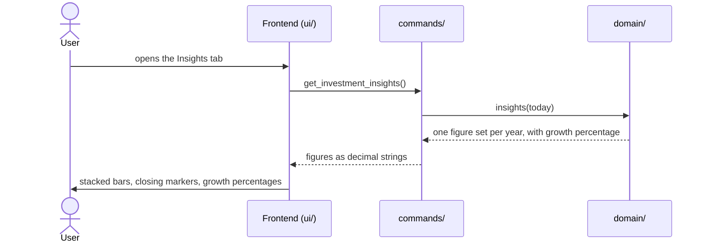

# CSD-007: Investment insights

## 1. Intent
The Investments page lists accounts, statements and a table of yearly totals, but a table does not show how an investment pot grew: how much of the change came from money paid in and how much from the market. This capability adds an insights layer to the Investments page: a chart with one bar per year that starts at the balance the year opened with, adds new accounts and net deposits, and ends with the capital growth, together with a marker at the closing balance and the growth as a percentage of the opening balance. It is for the owner looking back over their own investments. It follows the Income insights of CSD-006 and supersedes CSD-005 NG-4 for this view only, and CSD-005 NG-3 for the growth percentage of this view only.

## 2. Scope
### 2.1 In scope
- An "Insights" tab on the Investments page, next to the existing content ("Overview").
- A yearly stacked bar chart over all accounts, with a closing-balance marker, a growth percentage per year and a tooltip.
- Its empty state.

### 2.2 Non-goals
- NG-1: A monthly view, or any granularity other than a calendar year.
- NG-2: A filter or a breakdown per account.
- NG-3: Any return figure other than the growth percentage of REQ-6: annualised returns, time-weighted returns, a percentage in the Yearly totals table or anywhere else, and forecasts.
- NG-4: Click-through, zooming, or exporting the chart.
- NG-5: Charts on the Dashboard or on the Reports page.
- NG-6: A chart library or any other new dependency.
- NG-7: Estimating balances for years without a statement (CSD-005 NG-7).

## 3. Definitions
| Term | Meaning |
|---|---|
| **Year** | A calendar year. A statement counts in the year of its own period only, as in the yearly totals (CSD-005 REQ-26). |
| **Current year** | The calendar year of today, in local time. Its figures run up to the latest statement so far, and are therefore partial. |
| **Opening balance** | For a year: the sum, over the accounts that have a statement in that year, of the balance of each such account's latest statement before that year. An account without an earlier statement adds nothing. |
| **New accounts** | For a year: the sum, over the accounts whose first statement falls in that year, of that first statement's balance minus its net deposits. |
| **Net deposits, capital growth, closing balance** | As in CSD-005: the yearly totals of REQ-26. |
| **Growth percentage** | The capital growth of a year divided by its opening balance, in percent. It leaves net deposits out and ignores when in the year they arrived, so it is a simple yearly figure and not a time-weighted return. |

## 4. Requirements

### 4.0 Overview flow


**REQ-1: Tabs on the Investments page** *(ubiquitous)*
The Investments page shall offer the tabs "Overview" and "Insights" while at least one investment account exists, with Overview, which holds the existing content, shown first.

```gherkin
@AC-1.1
Scenario: Overview is shown first
  Given a project with one investment account
  When the user opens the Investments page
  Then the Overview tab is selected
  And it shows the Accounts, Yearly totals and Statements sections

@AC-1.2
Scenario: Switching to Insights
  Given the Investments page shows the Overview tab
  When the user selects the Insights tab
  Then the Overview sections are hidden
  And the insights chart is shown

@AC-1.3
Scenario: No accounts yet
  Given a project without investment accounts
  When the user opens the Investments page
  Then the prompt to add the first investment account is shown
  And there are no tabs
```

**REQ-2: Year series** *(ubiquitous)*
The app shall return one set of figures for every calendar year from the year of the earliest statement up to and including the current year, oldest year first, holding the opening balance, the new accounts, the net deposits, the capital growth, the closing balance and the number of statements.

```gherkin
@AC-2.1
Scenario: Series runs from the first statement to the current year
  Given today is 26/10/2026
  And the earliest statement is for 2024-03
  And there are statements in 2025 and 2026
  When the insights are requested
  Then the series holds the years 2024, 2025 and 2026 in that order

@AC-2.2
Scenario: A single year
  Given today is 26/10/2026
  And the only statement is for 2026-09
  When the insights are requested
  Then the series holds only the year 2026

@AC-2.3
Scenario: No statements
  Given today is 26/10/2026
  And an account without statements
  When the insights are requested
  Then the series is empty
```

**REQ-3: Years without statements** *(unwanted behaviour)*
If a year in the series has no statement, then the app shall return that year with all amounts 0.00 and 0 statements.

```gherkin
@AC-3.1
Scenario: Gap year
  Given today is 26/10/2026
  And there are statements in 2022 and 2024 but none in 2023
  When the insights are requested
  Then the year 2023 has opening balance 0.00, new accounts 0.00, net deposits 0.00, capital growth 0.00, closing balance 0.00 and 0 statements
  And the series holds the years 2022, 2023, 2024, 2025 and 2026

@AC-3.2
Scenario: The year after a gap still opens with the balance from before the gap
  Given today is 26/10/2026
  And an account with a statement for 2024-12 (balance 10000.00) and one for 2026-06 (balance 11000.00, net deposits 500.00)
  When the insights are requested
  Then the year 2025 has no statements
  And the year 2026 has opening balance 10000.00, net deposits 500.00, capital growth 500.00 and closing balance 11000.00
```

**REQ-4: Current year is partial** *(state-driven)*
While a year is the current year, the app shall mark it as partial.

```gherkin
@AC-4.1
Scenario: Current year is marked
  Given today is 26/10/2026
  And there are statements in 2025 and 2026
  When the insights are requested
  Then the year 2026 is marked partial
  And the year 2025 is not

@AC-4.2
Scenario: Current year without statements is still in the series and marked
  Given today is 26/10/2026
  And the only statement is for 2025-12
  When the insights are requested
  Then the series holds 2025 and 2026
  And 2026 is marked partial and has 0 statements
```

**REQ-5: The parts add up to the closing balance** *(ubiquitous)*
The app shall compute for each year the opening balance and the new accounts as defined in section 3, take the net deposits, the capital growth and the closing balance from the yearly totals of CSD-005 REQ-26, and the opening balance plus the new accounts plus the net deposits plus the capital growth shall equal the closing balance.

```gherkin
@AC-5.1
Scenario: Parts of a year
  Given today is 26/10/2026
  And a monthly account with statements 2025-11 (balance 11000.00), 2025-12 (balance 11500.00, net deposits 200.00) and 2026-05 (balance 12500.00, net deposits 300.00)
  When the insights are requested
  Then 2025 has opening balance 0.00, new accounts 11000.00, net deposits 200.00, capital growth 300.00 and closing balance 11500.00
  And 2026 has opening balance 11500.00, new accounts 0.00, net deposits 300.00, capital growth 700.00 and closing balance 12500.00

@AC-5.2
Scenario: An account that starts in a later year
  Given today is 26/10/2026
  And account "Example Brokerage" with statements 2025-12 (balance 12000.00) and 2026-03 (balance 12600.00, net deposits 100.00)
  And account "Example Crypto" with a first statement 2026-03 (balance 500.00, net deposits 400.00)
  When the insights are requested
  Then 2026 has opening balance 12000.00, new accounts 100.00, net deposits 500.00, capital growth 500.00 and closing balance 13100.00

@AC-5.3
Scenario: An account without a statement in the year is left out
  Given today is 26/10/2026
  And a monthly account "Example Brokerage" with statements 2025-12 (balance 12000.00) and 2026-03 (balance 12500.00)
  And a yearly account "Example Pension" with a statement 2025 (balance 80000.00)
  When the insights are requested
  Then 2025 has opening balance 0.00, new accounts 92000.00 and closing balance 92000.00
  And 2026 has opening balance 12000.00, new accounts 0.00, capital growth 500.00 and closing balance 12500.00

@AC-5.4
Scenario: A net withdrawal and a loss
  Given today is 26/10/2026
  And a monthly account with statements 2025-12 (balance 12000.00) and 2026-03 (balance 11000.00, net deposits -500.00)
  When the insights are requested
  Then 2026 has opening balance 12000.00, net deposits -500.00, capital growth -500.00 and closing balance 11000.00

@AC-5.5
Scenario: Net deposits and closing balance equal the yearly totals
  Given today is 26/10/2026
  And the statements of AC-5.1 and AC-5.2
  When the insights and the yearly totals are requested
  Then for every year the closing balance and the net deposits of the insights equal those of the yearly totals
```

**REQ-6: Growth percentage** *(ubiquitous)*
The app shall calculate the growth percentage of a year as capital growth ÷ opening balance × 100, rounded to one decimal place with banker's rounding.

```gherkin
@AC-6.1
Scenario Outline: Growth percentage per year
  Given today is 26/10/2026
  And the opening balance of 2025 is <opening>
  And the capital growth of 2025 is <growth>
  When the insights are requested
  Then the growth percentage of 2025 is "<percent>"

  Examples:
    | opening  | growth  | percent |
    | 11500.00 | 700.00  | 6.1     |
    | 40000.00 | -1000.00| -2.5    |
    | 20000.00 | 90.00   | 0.4     |
    | 20000.00 | 0.00    | 0.0     |
```

**REQ-7: No growth percentage available** *(unwanted behaviour)*
If the opening balance of a year is 0.00 or the year has no statements, then the app shall give it no growth percentage.

```gherkin
@AC-7.1
Scenario: First year has no percentage
  Given today is 26/10/2026
  And the earliest statement is in 2025
  When the insights are requested
  Then the year 2025 has no growth percentage

@AC-7.2
Scenario: Gap year has no percentage
  Given today is 26/10/2026
  And there are statements in 2022 and 2024 but none in 2023
  When the insights are requested
  Then the year 2023 has no growth percentage

@AC-7.3
Scenario: The current year has a percentage
  Given today is 26/10/2026
  And the opening balance of 2026 is 12500.00 and the capital growth of 2026 so far is 250.00
  When the insights are requested
  Then the growth percentage of 2026 is "2.0"
  And 2026 is marked partial
```

**REQ-8: Chart** *(ubiquitous)*
The Insights tab shall draw one bar per year in the order received, stacked from the bottom as opening balance, new accounts, net deposits and capital growth, in which a positive segment rises from the running total and a negative segment hangs down from it, with capital growth in a positive colour when it is positive and a negative colour when it is negative and a negative net deposit in a hatched fill, on a y-axis that starts at 0 (or at a rounded-down negative value if a running total is negative) and ends at a rounded-up value of at least the highest running total, with gridlines, compact axis labels (such as "10k"), a legend naming the four segments and the closing-balance marker, and no currency.

```gherkin
@AC-8.1
Scenario: Stacked bars per year
  Given the series holds the years 2025 and 2026
  When the user opens the Insights tab
  Then two bars are drawn, 2025 on the left and 2026 on the right
  And each bar is stacked from opening balance, new accounts, net deposits and capital growth
  And the legend names Opening balance, New accounts, Net deposits, Capital growth and the closing balance marker

@AC-8.2
Scenario: Growth colour follows the sign
  Given 2025 has capital growth 300.00 and 2026 has capital growth -500.00
  When the user opens the Insights tab
  Then the growth segment of 2025 uses the positive colour
  And the growth segment of 2026 uses the negative colour

@AC-8.3
Scenario: Negative segments hang down
  Given 2026 has opening balance 12000.00, net deposits -500.00 and capital growth -500.00
  When the user opens the Insights tab
  Then the net deposits segment of 2026 hangs down from 12000.00 to 11500.00 in a hatched fill
  And the growth segment hangs down from 11500.00 to 11000.00 in the negative colour

@AC-8.4
Scenario: Axis covers the highest level
  Given the highest running total of any year is 13100.00
  When the user opens the Insights tab
  Then the top of the y-axis is at least 13100.00
  And the axis starts at 0

@AC-8.5
Scenario: Gap year is an empty slot
  Given the year 2023 has no statements
  When the user opens the Insights tab
  Then 2023 has a labelled slot without a bar

@AC-8.6
Scenario: Current year is marked
  Given the year 2026 is partial
  When the user opens the Insights tab
  Then the 2026 bar has a lighter fill
  And its label reads "2026 YTD"
```

**REQ-9: Closing-balance marker** *(ubiquitous)*
The Insights tab shall draw for each year with statements a horizontal marker line, wider than the bar, at the closing balance, with its compact value beside it, not connected to the markers of other years, and dashed for the current year.

```gherkin
@AC-9.1
Scenario: Marker at the closing balance
  Given 2025 has closing balance 11500.00
  When the user opens the Insights tab
  Then a marker line is drawn across the 2025 bar at 11500.00
  And its label reads "11.5k"

@AC-9.2
Scenario: Marker sits at the top of a gaining bar and the bottom of a losing growth segment
  Given 2025 has capital growth 300.00 and 2026 has capital growth -500.00
  When the user opens the Insights tab
  Then the 2025 marker sits at the top of the stack
  And the 2026 marker sits at the lower end of the growth segment

@AC-9.3
Scenario: Markers are not connected and the current year is dashed
  Given the series holds 2024, a gap year 2025 and the partial year 2026
  When the user opens the Insights tab
  Then no line joins the markers
  And the marker of 2026 is dashed
  And 2025 has no marker
```

**REQ-10: Growth percentage labels** *(ubiquitous)*
The Insights tab shall show the growth percentage of each year as a second line under its year label as "+x.x%" or "−x.x%", "0.0%" for no change and "–" for no growth percentage, using the negative colour only for decreases.

```gherkin
@AC-10.1
Scenario Outline: Growth percentage label
  Given the growth percentage of a year is <percent>
  When the user opens the Insights tab
  Then the second line under the label of that year reads "<label>"

  Examples:
    | percent | label |
    | 6.1     | +6.1% |
    | -2.5    | −2.5% |
    | 0.0     | 0.0%  |
    | none    | –     |

@AC-10.2
Scenario: Only decreases are red
  Given the growth percentage of 2025 is -2.5 and of 2026 is 6.1
  When the user opens the Insights tab
  Then the percentage of 2025 uses the negative colour
  And the percentage of 2026 does not
```

**REQ-11: Details of a year** *(event-driven)*
When the user hovers over or moves keyboard focus to a year, the Insights tab shall show a tooltip with the year's opening balance, new accounts, net deposits, capital growth, growth percentage, closing balance and number of statements, and shall give the same values to screen readers.

```gherkin
@AC-11.1
Scenario: Tooltip on hover
  Given 2026 has opening balance 11500.00, new accounts 0.00, net deposits 300.00, capital growth 700.00, closing balance 12500.00, 1 statement and growth percentage 6.1
  When the user hovers over the 2026 bar
  Then a tooltip shows those seven values

@AC-11.2
Scenario: Tooltip on keyboard focus
  Given the Insights tab shows the chart
  When the user moves focus to the 2026 bar with the Tab key
  Then the same tooltip is shown
  And the tooltip disappears when focus leaves the bar

@AC-11.3
Scenario: Accessible label
  Given 2026 has capital growth -500.00
  When a screen reader reads the 2026 bar
  Then it announces the year, the seven values and that the capital growth is negative
```

**REQ-12: No statements yet** *(state-driven)*
While at least one account exists but no statement, the Insights tab shall show a note instead of a chart.

```gherkin
@AC-12.1
Scenario: Accounts without statements
  Given a project with one account and no statements
  When the user opens the Insights tab
  Then the note "No statements yet. The chart appears once there is a statement." is shown
  And no chart is drawn
```

**REQ-13: Current figures** *(event-driven)*
When the user opens the Insights tab, the app shall show figures computed from the project at that moment.

```gherkin
@AC-13.1
Scenario: Figures follow changes
  Given the Insights tab showed closing balance 12500.00 for 2026
  And the user added a statement for 2026-09 with balance 13000.00 on the Overview tab
  When the user opens the Insights tab again
  Then the 2026 marker shows 13000.00

@AC-13.2
Scenario: Last statement deleted
  Given the Insights tab showed a chart
  And the user deleted the only statement on the Overview tab
  When the user opens the Insights tab again
  Then the note of AC-12.1 is shown and no chart is drawn
```

## 5. Interfaces and contracts

Command: `get_investment_insights()` returns the series, oldest year first:

```json
{
  "years": [
    { "year": 2025, "opening_balance": "0.00", "new_accounts": "11000.00", "net_deposits": "200.00", "capital_growth": "300.00", "growth_percent": null, "closing_balance": "11500.00", "statement_count": 2, "is_partial": false },
    { "year": 2026, "opening_balance": "11500.00", "new_accounts": "0.00", "net_deposits": "300.00", "capital_growth": "700.00", "growth_percent": "6.1", "closing_balance": "12500.00", "statement_count": 1, "is_partial": true }
  ]
}
```

`years` is empty when there are no statements. `growth_percent` is a decimal string or `null`. Amounts are decimal strings. Rust decides "today" (local time), the years, the partial flag and the growth percentage, and the frontend only displays what it receives.

## 6. Constraints
- CON-1: Figures and the growth percentage are computed in Rust and displayed as received; the frontend only scales values to positions on the chart. Rationale: `CLAUDE.md` layout rule.
- CON-2: Amounts and the percentage use `rust_decimal::Decimal`. Rationale: `CLAUDE.md` money rules.
- CON-3: The chart is plain SVG drawn in `ui/`, with no chart library, no new crate and no network access. Rationale: `CLAUDE.md` dependency and Tauri security rules.
- CON-4: Chart colours come from CSS variables and are legible in light and dark mode, and no meaning is carried by colour alone (signs and labels state it as well). Rationale: the app already supports both modes, and colour-blind readers.
- CON-5: The Overview tab behaves as before, and the income insights chart behaves exactly as before; helpers shared by both charts may move into a common `ui/` module without changing the income chart's output. Rationale: this capability adds a view and changes no existing behaviour.
- CON-6: Tests and fixtures use synthetic data only. Rationale: the repo is public.
- CON-7: The figures are computed from the stored statements each time they are needed and are never stored in the project file. Rationale: stored figures would go stale when a statement changes.

## 7. Verification
The figures are proven by `cargo test`. Tests are named `test_csd007_ac_<n>_<m>_<description>` (CSD-000 REQ-6).

| Requirement | Command |
|---|---|
| REQ-2 to REQ-7 (data) | `cargo test test_csd007_` |
| AC-1.1 to AC-1.3, REQ-8 to REQ-13 (display) | Manual checklist: tabs, stacked and hanging segments, hatched fill, growth colours, axis, gap and YTD years, closing markers, growth percentage labels and colours, tooltip by mouse and keyboard, empty note, refresh after a change, light and dark mode, and the income chart unchanged. There is no frontend test setup |

Done means fmt, clippy (`-D warnings`) and `cargo test --all-features` pass.

## 8. Open questions
None.

## 9. Changelog
- 0.1 (27/10/2026): initial draft, approved by the owner.
