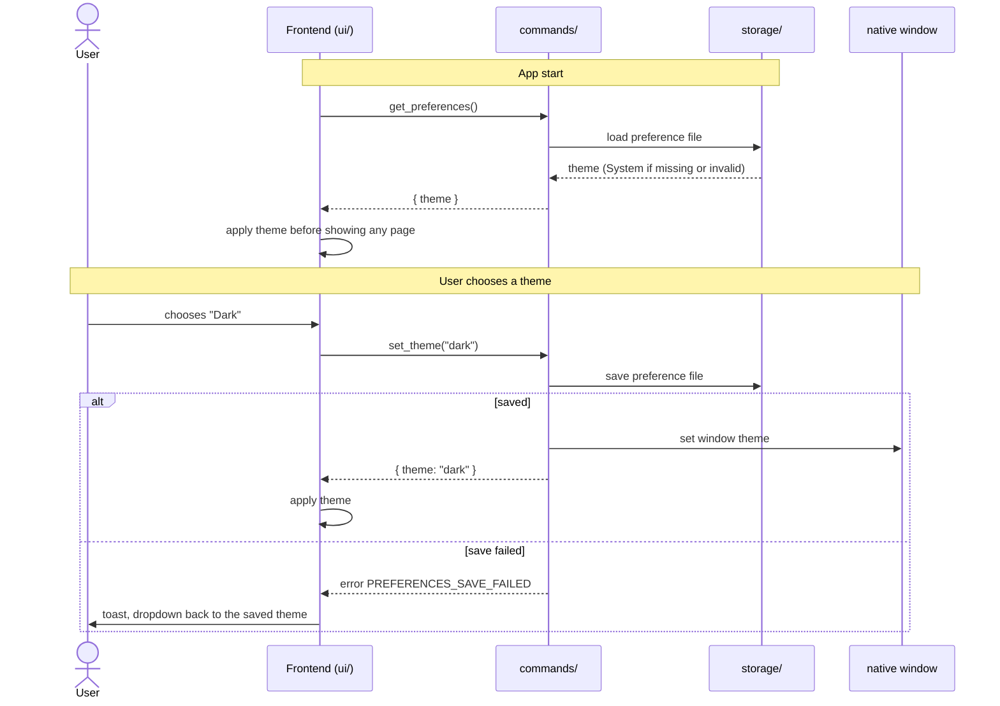

# CSD-008: Application preferences (theme)

## 1. Intent
The app already has a light and a dark look and follows the macOS appearance, but the user cannot choose one. Someone who wants a dark app on a light Mac, or the other way round, has no way to say so. This capability adds a Theme choice (System, Light or Dark) to the Settings page. It is a preference of the person using the app on this Mac, not of the project, so it is kept outside the project file and stays the same whichever project is open. It is for a single user. GitHub issue 11 asked for it.

## 2. Scope
### 2.1 In scope
- A "Theme" choice on the Settings page with System, Light and Dark: choosing, applying, saving and showing it.
- Following the macOS appearance while System is chosen.
- Keeping the preference in the app's own config folder and restoring it at start.
- The native window (title bar, native dialogs) following the chosen theme.

### 2.2 Non-goals
- NG-1: More themes, accent colours or custom colours.
- NG-2: A theme per project. The project file holds no theme (CSD-003 CON-2 stays as it is).
- NG-3: Switching the theme on a schedule or by time of day.
- NG-4: Changing the existing light and dark palettes. This capability only chooses between them.
- NG-5: Other application preferences. Theme is the first and only one, so later preferences need their own requirements.

## 3. Definitions
| Term | Meaning |
|---|---|
| **Theme** | The look of the app: `system`, `light` or `dark`. |
| **System** | The theme that follows the macOS appearance, light or dark, as it is at that moment. |
| **Preference file** | `preferences.json` in the app's own config folder. It holds application preferences, never project data. |

## 4. Requirements

### 4.0 Overview flow


**REQ-1: Theme choice on the Settings page** *(ubiquitous)*
The Settings page shall show an "Appearance" panel below the "General" panel, with a "Theme" choice that offers System, Light and Dark, in that order, and shows the current theme.

```gherkin
@AC-1.1
Scenario: The panel and the choices
  Given the app has started
  When the user opens Settings
  Then the page shows an "Appearance" panel below the "General" panel
  And the "Theme" choice offers "System", "Light" and "Dark" in that order

@AC-1.2
Scenario Outline: The choice shows the current theme
  Given the saved theme is "<theme>"
  When the user opens Settings
  Then the "Theme" choice shows "<label>"

  Examples:
    | theme  | label  |
    | system | System |
    | light  | Light  |
    | dark   | Dark   |
```

**REQ-2: Default theme** *(state-driven)*
While no theme has been saved, the app shall use System.

```gherkin
@AC-2.1
Scenario: First start
  Given no preference file exists
  When the app starts
  Then the "Theme" choice shows "System"
  And the app follows the macOS appearance
```

**REQ-3: Apply the choice at once** *(event-driven)*
When the user chooses a theme, the app shall apply it immediately, without a confirmation, a save button or a restart, and without marking the project as having unsaved changes.

```gherkin
@AC-3.1
Scenario: Choosing Dark
  Given the app shows the light theme and the saved theme is "system"
  When the user chooses "Dark"
  Then the app shows the dark theme at once
  And no confirmation is asked

@AC-3.2
Scenario: The choice is not an unsaved project change
  Given a saved project and the saved theme is "system"
  When the user chooses "Light"
  Then the unsaved indicator is not shown

@AC-3.3
Scenario: Choosing the current theme changes nothing
  Given the saved theme is "dark"
  When the user chooses "Dark"
  Then the saved theme is "dark"
  And the app is not redrawn differently
```

**REQ-4: System follows macOS** *(state-driven)*
While the theme is System, the app shall follow the macOS appearance, including when it changes while the app is open.

```gherkin
@AC-4.1
Scenario Outline: System follows the Mac
  Given the saved theme is "system"
  When the macOS appearance is "<appearance>"
  Then the app shows the "<look>" theme

  Examples:
    | appearance | look  |
    | light      | light |
    | dark       | dark  |

@AC-4.2
Scenario: A change of the macOS appearance while the app is open
  Given the saved theme is "system" and the macOS appearance is "light"
  When the user switches macOS to "dark"
  Then the app shows the dark theme without a restart

@AC-4.3
Scenario: Light and Dark ignore macOS
  Given the saved theme is "light"
  When the macOS appearance is "dark"
  Then the app shows the light theme
```

**REQ-5: The theme is remembered** *(ubiquitous)*
The app shall save the theme in the preference file and restore it when the app starts, whichever project is open.

```gherkin
@AC-5.1
Scenario: Theme survives a restart
  Given the user chose "Dark"
  When the app is closed and started again
  Then the saved theme is "dark"
  And the "Theme" choice shows "Dark"

@AC-5.2
Scenario: The theme does not belong to the project
  Given the saved theme is "dark" and a project "example-a.wealth" is open
  When the user opens another project, or starts a new one
  Then the saved theme is still "dark"

@AC-5.3
Scenario: The project file holds no theme
  Given the saved theme is "dark"
  When the project is saved to "example-a.wealth"
  Then the file contains no theme
```

**REQ-6: No flash of the wrong theme** *(event-driven)*
When the app starts, it shall apply the saved theme before it shows any page.

```gherkin
@AC-6.1
Scenario: Dark on a light Mac
  Given the saved theme is "dark" and the macOS appearance is "light"
  When the app starts
  Then the first page that is shown is already in the dark theme
```

**REQ-7: Native window follows the theme** *(event-driven)*
When a theme is applied, the app shall give the native window the same theme, and for System leave the window to follow macOS.

```gherkin
@AC-7.1
Scenario Outline: Title bar and native dialogs
  Given the macOS appearance is "light"
  When the theme "<theme>" is applied
  Then the title bar and native dialogs are "<look>"

  Examples:
    | theme  | look  |
    | dark   | dark  |
    | light  | light |
    | system | light |
```

**REQ-8: Missing or invalid preference file** *(unwanted behaviour)*
If the preference file is missing, unreadable, larger than 64 KiB, not valid JSON or holds a theme other than system, light or dark, then the app shall use System and start normally.

```gherkin
@AC-8.1
Scenario Outline: The app starts with System
  Given the preference file is <case>
  When the app starts
  Then the "Theme" choice shows "System"
  And the app starts without an error message

  Examples:
    | case                                |
    | missing                             |
    | empty                               |
    | not JSON: "dark"                    |
    | {"theme": "sepia"}                  |
    | {"theme": 7}                        |
    | larger than 64 KiB                  |
```

**REQ-9: Unsupported theme** *(unwanted behaviour)*
If a theme other than system, light or dark is requested, then the app shall reject it with the error code `PREFERENCES_THEME_UNSUPPORTED` and keep the saved theme.

```gherkin
@AC-9.1
Scenario Outline: Unsupported themes are rejected
  Given the saved theme is "light"
  When the theme "<theme>" is requested
  Then it is rejected with error code "PREFERENCES_THEME_UNSUPPORTED"
  And the saved theme is "light"

  Examples:
    | theme |
    | sepia |
    | Dark  |
    |       |
```

**REQ-10: Saving fails** *(unwanted behaviour)*
If the theme cannot be saved, then the app shall keep the previous theme, show the "Theme" choice with it, and show a message with the error code `PREFERENCES_SAVE_FAILED` and no file path.

```gherkin
@AC-10.1
Scenario: The preference file cannot be written
  Given the saved theme is "light" and the config folder is read-only
  When the user chooses "Dark"
  Then the app still shows the light theme
  And the "Theme" choice shows "Light"
  And a message appears that the theme could not be saved
  And the message contains no file path
  And the saved theme is "light"
```

## 5. Interfaces and contracts

Commands: `get_preferences()` returns `{ theme }`, and `set_theme(theme)` takes the lowercase name and returns `{ theme }`. `set_theme` saves first, and only when the save succeeded sets the native window theme (`Some(Light)`, `Some(Dark)` or `None` for System) and returns, so a failed save changes nothing (REQ-10). The frontend applies the theme it is given.

Frontend: the theme is shown by the `data-theme` attribute on the root element: `"light"` or `"dark"`, and no attribute for System, so the existing `prefers-color-scheme` rule decides. The attribute is the whole interface to the existing palettes (NG-4).

Preference file: `preferences.json` in the app's config folder, for example `{ "theme": "system" }`. Unknown fields are ignored.

Error codes: `PREFERENCES_THEME_UNSUPPORTED`, `PREFERENCES_SAVE_FAILED`.

## 6. Constraints
- CON-1: The preference is stored only in `preferences.json` in the app's own config folder, outside the project file, written like the project file (atomic, owner-only), holding preferences only, never project data, and never committed. Rationale: it belongs to the person and the Mac, not to the data, and it must be readable before any project is open. This is the same arrangement as `last-project.json` (CSD-002 CON-7).
- CON-2: Rust is the only place the preference is kept. The frontend holds no copy (no `localStorage`) and no inline script is used to apply it. Rationale: one source of truth, and the future strict CSP forbids inline scripts.
- CON-3: No new plugin, capability or permission. The window theme is set from Rust. Rationale: least privilege per `CLAUDE.md`.
- CON-4: The theme is a closed set (`system`, `light`, `dark`) and is never handled as free text beyond the command edge. Rationale: invalid states are unrepresentable per `CLAUDE.md`.
- CON-5: Errors shown to the user never contain file paths or OS details. Rationale: `CLAUDE.md` error rules, CSD-002 CON-4.
- CON-6: Tests use a temporary directory and never the real app config folder. Rationale: `CLAUDE.md` testing rules.

## 7. Verification
All behaviour except the screens is proven by `cargo test`. Tests are named `test_csd008_ac_<n>_<m>_<description>` (CSD-000 REQ-6).

| Requirement | Command |
|---|---|
| REQ-2, REQ-5 (AC-5.1, AC-5.2, AC-5.3), REQ-8, REQ-9, REQ-10, and the data of REQ-1 and REQ-3 | `cargo test test_csd008_`. Storage tests (save, load, missing, empty, invalid, oversized, read-only folder) run in a temporary directory, and the commands are exercised through the IPC test setup. One requirement, e.g. REQ-8: `cargo test test_csd008_ac_8_` |
| AC-1.1, AC-1.2 (display), AC-3.1, AC-3.2 (indicator), AC-3.3, AC-4.1 to AC-4.3, AC-6.1, AC-7.1, AC-10.1 (message and dropdown) | Manual checklist: the Appearance panel, choosing each theme, switching the macOS appearance while System is chosen, restarting with Dark on a light Mac, the title bar and native dialogs, and the message when saving fails. There is no frontend test setup and none is added |

Done means fmt, clippy (`-D warnings`) and `cargo test --all-features` pass.

## 8. Open questions
None.

## 9. Changelog
- 0.1 (28/10/2026): initial draft, from GitHub issue 11.
