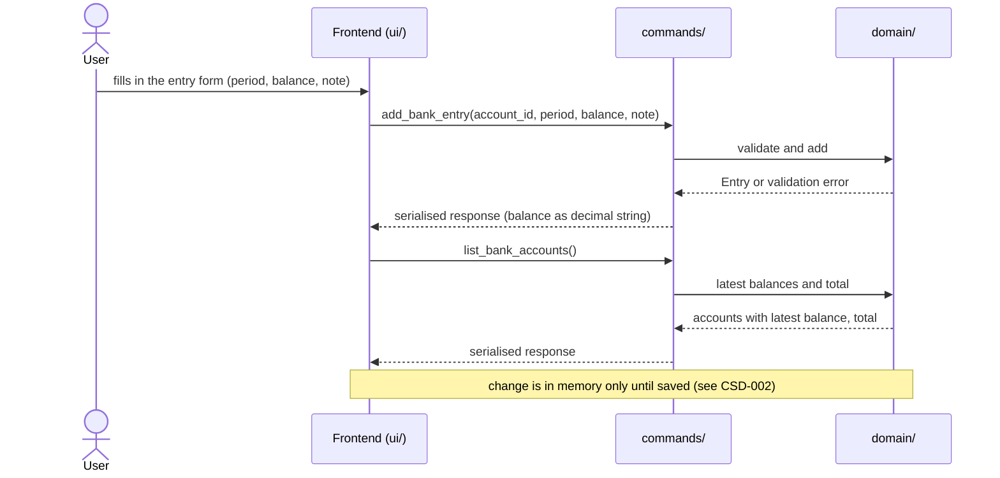
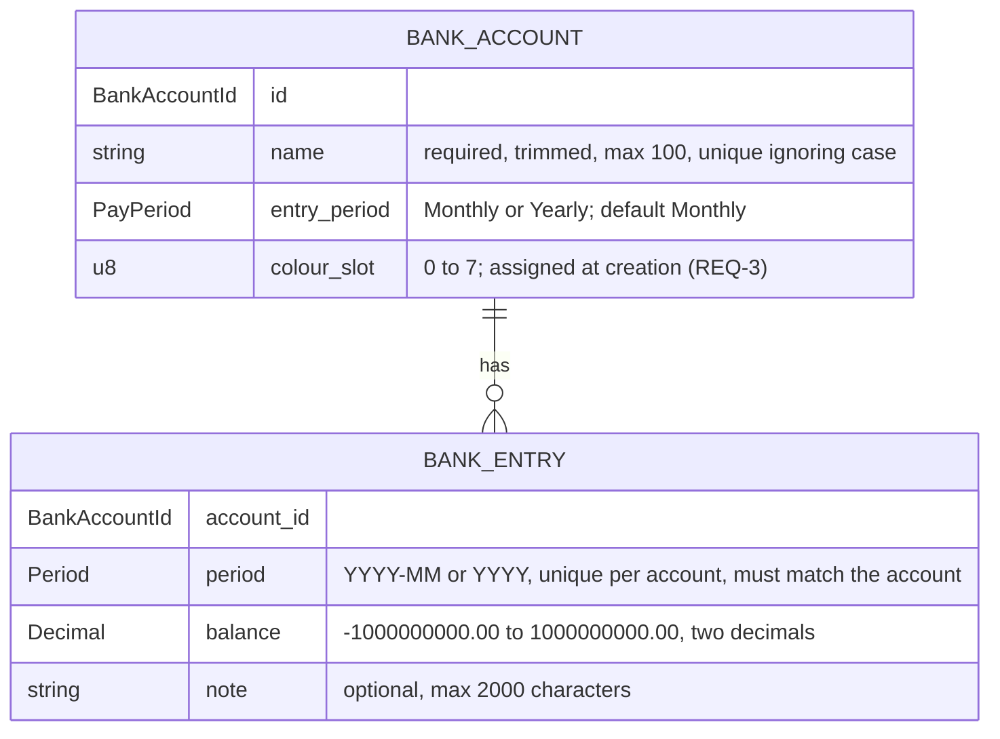

# CSD-009: Bank accounts

## 1. Intent
The app tracks wealth, but has no view of the money the user keeps in bank accounts (a current account, a savings account). This capability lets the user record bank accounts and, per account, one closing balance per month or per year, with an optional note. From these the app derives, per calendar year, the yearly totals, and a total of the latest balances. It is for a single person keeping a private, local history of their bank balances. It records balances as the user reads them off a statement. It does not track individual transactions. The result is a balance history per account that the Insights chart of CSD-010 and later features (net-worth linkage) can build on. It follows the structure of Investments (CSD-005), without net deposits and capital growth, because a bank balance is not an investment return.

## 2. Scope
### 2.1 In scope
- Create, edit and delete bank accounts, each with a name and an entry period (Monthly or Yearly).
- Create, edit and delete one entry per account per period: a closing balance (which may be negative) and an optional note.
- Change the period of an existing entry (REQ-12).
- Copy the previous entry into the add form.
- Yearly totals per calendar year over all accounts: the closing balance. Rust also returns the number of entries per year, but the app does not display it.
- One Bank accounts view (tab Overview) with the accounts, their latest balances, the total of the latest balances, the yearly totals and the entries of all accounts. The Insights tab is CSD-010.
- Bank account data is part of the project file (CSD-002). Entries count for the currency confirmation of CSD-003 (REQ-24).

### 2.2 Non-goals
- NG-1: Individual transactions, categories, budgets and standing orders.
- NG-2: Live or imported data: bank connections, PSD2, any data fetched from the network.
- NG-3: Import of statements (CSV, PDF, bank export).
- NG-4: Bank identifiers and other account details: IBAN, account number, institution name, account type, an overdraft limit, and a note on the account itself.
- NG-5: A currency per account. All amounts are in the project currency (CSD-003).
- NG-6: Interest, returns, growth, year-over-year change, and any other derived figure than the latest balance, the total and the yearly totals of REQ-17 and REQ-19.
- NG-7: Integration with net worth and the dashboard (CSD-004).
- NG-8: Aligning the latest balances of different accounts to one date, or estimating a balance for a period without an entry.
- NG-9: Moving an entry to another account. Only the period of an entry can change (REQ-12).
- NG-10: Changing the periods of several entries at once.
- NG-11: Rich text or attachments in notes.

## 3. Definitions
| Term | Meaning |
|---|---|
| **Bank account** | One place where the user keeps money at a bank, identified by a name. |
| **Entry period** | How an account is recorded: **Monthly** (one entry per calendar month, `YYYY-MM`) or **Yearly** (one entry per calendar year, `YYYY`). An account is Monthly unless Yearly is chosen. |
| **Entry** | The record of one account for one period: the closing balance and an optional note. |
| **Balance** | The value of the account at the end of the period (its closing balance), as one signed amount in the project currency. Negative when the account is overdrawn. |
| **Latest balance** | The balance of the entry with the most recent period of an account. |
| **Total** | The sum of the latest balances of all accounts that have at least one entry. It can be negative. |
| **Yearly total** | One row per calendar year: the closing balance of that year, over all accounts. Rust also returns the number of entries of that year, which is not displayed. See REQ-19. |
| **Closing balance (of a year)** | The sum, over the accounts that have an entry in that year, of the balance of each account's latest entry in that year. |
| **Colour slot** | A number from 0 to 7 stored with an account. CSD-010 draws the account in the colour of its slot. |
| **Note** | Optional plain text, up to 2,000 characters, that goes with one entry. |
| **Project file** | The single user-chosen file holding all app data (CSD-002). Bank accounts are one of its sections. |

## 4. Requirements

### 4.0 Overview flow


### 4.1 Accounts

**REQ-1: Add an account** *(event-driven)*
When the user submits a new bank account with a name and an entry period, the app shall create the account with entry period Monthly unless Yearly is chosen, and with a colour slot under REQ-3.

```gherkin
@AC-1.1
Scenario: Account created with the default period
  Given no bank accounts exist
  When the user adds an account named "Example Current Account" without choosing a period
  Then the account "Example Current Account" exists with entry period "Monthly"
  And it has no entries

@AC-1.2
Scenario: Yearly account
  Given no bank accounts exist
  When the user adds an account named "Example Savings" with entry period "Yearly"
  Then the account "Example Savings" exists with entry period "Yearly"

@AC-1.3
Scenario: Unknown period rejected
  When the user adds an account named "Example Current Account" with entry period "Weekly"
  Then it is rejected with error code "BANK_ACCOUNT_PERIOD_UNSUPPORTED"
  And no account exists
```

**REQ-2: Account name rules** *(unwanted behaviour)*
If the name of a bank account is empty after trimming, is longer than 100 characters, or equals the name of another bank account when case is ignored, then the app shall reject the account or edit without storing or changing it, and shall store an accepted name trimmed.

```gherkin
@AC-2.1
Scenario Outline: Invalid names rejected
  Given an account named "Example Current Account"
  When the user adds an account named "<name>"
  Then it is rejected with error code "<code>"
  And only the account "Example Current Account" exists

  Examples:
    | name                      | code                             |
    | (empty)                   | BANK_ACCOUNT_NAME_REQUIRED       |
    | (three spaces)            | BANK_ACCOUNT_NAME_REQUIRED       |
    | EXAMPLE CURRENT ACCOUNT   | BANK_ACCOUNT_NAME_DUPLICATE      |
    | example current account   | BANK_ACCOUNT_NAME_DUPLICATE      |

@AC-2.2
Scenario: Name length boundary
  When the user adds an account with a name of 100 characters
  Then the account exists
  When the user adds an account with a name of 101 characters
  Then it is rejected with error code "BANK_ACCOUNT_NAME_TOO_LONG"

@AC-2.3
Scenario: The name is stored trimmed
  When the user adds an account named "  Example Current Account  "
  Then the account is named "Example Current Account"

@AC-2.4
Scenario: Renaming to an existing name is rejected
  Given accounts "Example Current Account" and "Example Savings"
  When the user renames "Example Savings" to "example current account"
  Then the edit is rejected with error code "BANK_ACCOUNT_NAME_DUPLICATE"

@AC-2.5
Scenario: Changing only the case of its own name is allowed
  Given an account "Example Savings"
  When the user renames it to "EXAMPLE SAVINGS"
  Then the account is named "EXAMPLE SAVINGS"
```

**REQ-3: Colour slot** *(event-driven)*
When a bank account is created, the app shall give it the lowest colour slot (0 to 7) that is used by the fewest existing accounts, and shall keep that slot for the life of the account, also when other accounts are deleted.

```gherkin
@AC-3.1
Scenario: Slots follow creation order
  Given no bank accounts exist
  When the user adds three accounts
  Then they have colour slots 0, 1 and 2 in the order they were added

@AC-3.2
Scenario: Slots cycle after eight accounts
  Given eight accounts with colour slots 0 to 7
  When the user adds a ninth account
  Then it has colour slot 0

@AC-3.3
Scenario: Deleting an account does not recolour the others
  Given accounts with colour slots 0, 1 and 2
  When the user deletes the account with colour slot 0 and confirms
  Then the other accounts still have colour slots 1 and 2

@AC-3.4
Scenario: A freed slot is used first
  Given accounts with colour slots 0, 1 and 2
  When the user deletes the account with colour slot 1 and confirms
  And adds an account
  Then the new account has colour slot 1

@AC-3.5
Scenario: Renaming keeps the slot
  Given an account with colour slot 2
  When the user renames it
  Then it still has colour slot 2
```

**REQ-4: Edit an account** *(event-driven)*
When the user edits a bank account, the app shall apply a changed name under REQ-2 and a changed entry period under REQ-5, and shall keep the account's entries.

```gherkin
@AC-4.1
Scenario: Rename keeps entries
  Given an account "Example Current Account" with 2 entries
  When the user renames it to "Example Account"
  Then the account is named "Example Account"
  And it still has 2 entries

@AC-4.2
Scenario: Period of an account without entries can change
  Given a "Monthly" account "Example Current Account" with no entries
  When the user changes its entry period to "Yearly"
  Then the account has entry period "Yearly"
```

**REQ-5: Entry period is locked once entries exist** *(unwanted behaviour)*
If the user changes the entry period of a bank account that has at least one entry, then the app shall reject the change with the error code `BANK_ACCOUNT_PERIOD_LOCKED`.

```gherkin
@AC-5.1
Scenario: Period change rejected
  Given a "Monthly" account "Example Current Account" with an entry for 2026-09
  When the user changes its entry period to "Yearly"
  Then the change is rejected with error code "BANK_ACCOUNT_PERIOD_LOCKED"
  And the account still has entry period "Monthly"

@AC-5.2
Scenario: Period change allowed again after deleting the last entry
  Given a "Monthly" account "Example Current Account" with one entry
  When the user deletes the entry and confirms
  And changes the entry period to "Yearly"
  Then the account has entry period "Yearly"
```

**REQ-6: Delete an account** *(event-driven)*
When the user confirms deletion of a bank account, the app shall remove the account and all of its entries. The confirmation reads "This account and all its entries will be deleted.", the same whether or not the account has entries, and states no number.

```gherkin
@AC-6.1
Scenario: Deletion cascades
  Given an account "Example Current Account" with 3 entries
  When the user deletes the account and confirms
  Then the account no longer exists
  And none of its 3 entries exist

@AC-6.2
Scenario: Cancelled deletion changes nothing
  Given an account "Example Current Account" with 3 entries
  When the user starts deleting the account and cancels
  Then the account and its 3 entries still exist

@AC-6.3
Scenario Outline: The deletion confirmation states no count
  Given an account "Example Current Account" with <entries> entries
  When the user starts deleting the account
  Then the confirmation reads "This account and all its entries will be deleted."
  And it shows no number

  Examples:
    | entries |
    | 0       |
    | 3       |
```

### 4.2 Entries

**REQ-7: Add an entry** *(event-driven)*
When the user submits an entry for the account chosen in the add form, a period and a balance, the app shall store it with the given note, or with an empty note if none is given, and shall accept any period that is not later than the current month (monthly account) or the current year (yearly account), including periods before the account existed in the app.

```gherkin
@AC-7.1
Scenario: Monthly entry with a note
  Given the current date is 26/10/2026
  And a monthly account "Example Current Account"
  When the user adds an entry for 2026-09 with balance 2500.00 and note "Salary received"
  Then the entry for 2026-09 has balance 2500.00 and note "Salary received"

@AC-7.2
Scenario: Yearly entry without a note
  Given the current date is 26/10/2026
  And a yearly account "Example Savings"
  When the user adds an entry for 2025 with balance 8000.00 and no note
  Then the entry for 2025 has balance 8000.00 and an empty note

@AC-7.3
Scenario: Old periods are accepted
  Given a monthly account "Example Current Account"
  When the user adds an entry for 2019-01 with balance 1000.00
  Then the entry for 2019-01 exists

@AC-7.4
Scenario Outline: Current period accepted, later period rejected
  Given the current date is 26/10/2026
  And a <period_type> account "Example Account"
  When the user adds an entry for "<period>" with balance 1000.00
  Then <outcome>

  Examples:
    | period_type | period  | outcome                                                    |
    | monthly     | 2026-10 | the entry for 2026-10 exists                               |
    | monthly     | 2026-11 | it is rejected with error code "BANK_ENTRY_IN_FUTURE"      |
    | yearly      | 2026    | the entry for 2026 exists                                  |
    | yearly      | 2027    | it is rejected with error code "BANK_ENTRY_IN_FUTURE"      |

@AC-7.5
Scenario Outline: Invalid period rejected
  Given a <period_type> account "Example Account"
  When the user adds an entry for "<period>" with balance 1000.00
  Then it is rejected with error code "BANK_ENTRY_PERIOD_INVALID"

  Examples:
    | period_type | period   |
    | monthly     | 2026-13  |
    | monthly     | 2026-9   |
    | monthly     | abcd     |
    | yearly      | 26       |
    | yearly      | abcd     |
    | yearly      | 1899     |
```

**REQ-8: One entry per account per period** *(unwanted behaviour)*
If the user adds an entry for an account and period that already has one, then the app shall reject it with the error code `BANK_ENTRY_DUPLICATE` and leave the existing entry unchanged.

```gherkin
@AC-8.1
Scenario: Duplicate period rejected
  Given a monthly account with an entry for 2026-09 with balance 2500.00 and note "First"
  When the user adds another entry for 2026-09 with balance 3000.00
  Then it is rejected with error code "BANK_ENTRY_DUPLICATE"
  And the entry for 2026-09 still has balance 2500.00 and note "First"

@AC-8.2
Scenario: Same period on a different account is allowed
  Given two monthly accounts, and the first has an entry for 2026-09
  When the user adds an entry for 2026-09 to the second account
  Then both accounts have an entry for 2026-09
```

**REQ-9: Entries match the entry period** *(unwanted behaviour)*
If the user adds a monthly entry to a yearly account or a yearly entry to a monthly account, then the app shall reject it with the error code `BANK_ENTRY_PERIOD_MISMATCH`.

```gherkin
@AC-9.1
Scenario: Monthly entry for a yearly account rejected
  Given a "Yearly" account
  When an entry for 2026-09 with balance 1000.00 is added to it
  Then it is rejected with error code "BANK_ENTRY_PERIOD_MISMATCH"

@AC-9.2
Scenario: Yearly entry for a monthly account rejected
  Given a "Monthly" account
  When an entry for 2025 with balance 1000.00 is added to it
  Then it is rejected with error code "BANK_ENTRY_PERIOD_MISMATCH"
```

**REQ-10: Balance validation** *(unwanted behaviour)*
If the balance of an entry is not a plain number such as 2500.00 or -150.25, has more than two decimal places or has an absolute value above 1,000,000,000.00, then the app shall reject the entry or edit without rounding or storing it. A balance of 0.00 and a negative balance are valid.

```gherkin
@AC-10.1
Scenario Outline: Invalid balances rejected
  Given a monthly account "Example Current Account" and the current date 26/10/2026
  When the user adds an entry for 2026-09 with balance "<balance>"
  Then it is rejected with error code "<code>"
  And no entry for 2026-09 exists

  Examples:
    | balance          | code                          |
    | (empty)          | BANK_ENTRY_BALANCE_INVALID    |
    | abc              | BANK_ENTRY_BALANCE_INVALID    |
    | 1e3              | BANK_ENTRY_BALANCE_INVALID    |
    | 2500,50          | BANK_ENTRY_BALANCE_INVALID    |
    | 1000.999         | BANK_ENTRY_BALANCE_PRECISION  |
    | -1000.999        | BANK_ENTRY_BALANCE_PRECISION  |
    | 1000000000.01    | BANK_ENTRY_BALANCE_TOO_LARGE  |
    | -1000000000.01   | BANK_ENTRY_BALANCE_TOO_LARGE  |

@AC-10.2
Scenario Outline: Boundary and negative balances accepted
  Given a monthly account "Example Current Account" and the current date 26/10/2026
  When the user adds an entry for 2026-09 with balance "<balance>"
  Then the entry for 2026-09 has balance <balance>

  Examples:
    | balance          |
    | 0.00             |
    | -150.25          |
    | 1000000000.00    |
    | -1000000000.00   |

@AC-10.3
Scenario: Invalid balance in an edit rejected
  Given an entry for 2026-09 with balance 2500.00
  When the user sets the balance to 1000.999
  Then the edit is rejected with error code "BANK_ENTRY_BALANCE_PRECISION"
  And the entry still has balance 2500.00
```

**REQ-11: Note validation** *(unwanted behaviour)*
If the note of an entry is longer than 2,000 characters, then the app shall reject the entry or edit with the error code `BANK_ENTRY_NOTE_TOO_LONG`, without shortening or storing it. Line breaks in a note are kept as typed.

```gherkin
@AC-11.1
Scenario: Note length boundary
  Given a monthly account "Example Current Account" and the current date 26/10/2026
  When the user adds an entry for 2026-08 with balance 1000.00 and a note of 2000 characters
  Then the entry for 2026-08 exists with that note
  When the user adds an entry for 2026-09 with balance 1000.00 and a note of 2001 characters
  Then it is rejected with error code "BANK_ENTRY_NOTE_TOO_LONG"
  And no entry for 2026-09 exists

@AC-11.2
Scenario: Line breaks are kept
  Given a monthly account "Example Current Account"
  When the user adds an entry for 2026-09 with balance 1000.00 and the note "line one" and "line two" on two lines
  Then the note of the entry has two lines
```

**REQ-12: Edit an entry and change its period** *(event-driven)*
When the user edits an existing entry in the edit form and saves, the app shall give the entry the edited balance and note under REQ-10 and REQ-11 and, when the period was changed, the new period, as one change, without asking for confirmation. The entry stays with its account, and the latest balances, the yearly totals and the insights show it under its new period.

```gherkin
@AC-12.1
Scenario: Edit balance and note
  Given an entry for 2026-09 with balance 2500.00 and note "First"
  When the user sets the balance to 2750.00 and the note to "Corrected"
  Then the entry has balance 2750.00 and note "Corrected"

@AC-12.2
Scenario: Clear a note
  Given an entry for 2026-09 with balance 2500.00 and note "First"
  When the user empties the note
  Then the entry has an empty note

@AC-12.3
Scenario: Move an entry to another month
  Given a monthly account with an entry for 2026-09 with balance 2500.00 and note "First"
  When the user changes its period to 2026-08
  Then the account has an entry for 2026-08 with balance 2500.00 and note "First"
  And the account has no entry for 2026-09
  And no confirmation was asked

@AC-12.4
Scenario: Change the period and the balance together
  Given a monthly account with an entry for 2026-09 with balance 2500.00
  When the user changes its period to 2026-08 and sets the balance to 2750.00
  Then the entry for 2026-08 has balance 2750.00
  And there is no entry for 2026-09

@AC-12.5
Scenario: Move a yearly entry
  Given a yearly account with an entry for 2025 with balance 8000.00
  When the user changes its period to 2024
  Then the account has an entry for 2024 with balance 8000.00
  And the account has no entry for 2025

@AC-12.6
Scenario: The yearly totals follow the move
  Given a monthly account with entries 2025-11 (balance 2000.00), 2025-12 (balance 2500.00) and 2026-05 (balance 3000.00)
  When the user changes the period of the entry for 2025-12 to 2026-01
  Then 2025 shows closing balance 2000.00 and entries 1
  And 2026 shows closing balance 3000.00 and entries 2

@AC-12.7
Scenario Outline: The edit form offers the period
  Given <entry>
  When the user opens it for editing
  Then the form shows the <field> "<value>" and the account, which cannot be changed

  Examples:
    | entry                        | field | value   |
    | a monthly entry for 2026-09  | month | 2026-09 |
    | a yearly entry for 2025      | year  | 2025    |

@AC-12.8
Scenario: Keeping the period changes only the values
  Given a monthly account with an entry for 2026-09 with balance 2500.00
  When the user saves it with the period 2026-09 and balance 2750.00
  Then the entry for 2026-09 has balance 2750.00
  And no error about a duplicate period is shown

@AC-12.9
Scenario: An edit is an unsaved change
  Given a saved project with a monthly entry for 2026-09
  When the user changes its period to 2026-08
  Then the unsaved indicator is shown
```

**REQ-13: Invalid new period** *(unwanted behaviour)*
If the new period of an edited entry is later than the current month (monthly account) or the current year (yearly account), or is not a valid period, or the account already has another entry for it, or it does not match the entry period of the account, or the edit also has an invalid value, then the app shall reject the whole edit with the error code of the violated rule and leave the entry, with its period and its values, as it was. Another account may have an entry for the same period.

```gherkin
@AC-13.1
Scenario Outline: A period in the future is rejected
  Given the current date is 26/10/2026
  And <account> with an entry for <old> with balance 2500.00
  When the user changes its period to "<new>"
  Then the edit is rejected with error code "BANK_ENTRY_IN_FUTURE"
  And the entry for <old> still has balance 2500.00

  Examples:
    | account           | old     | new     |
    | a monthly account | 2026-09 | 2026-11 |
    | a yearly account  | 2025    | 2027    |

@AC-13.2
Scenario: A period that already has an entry is rejected
  Given a monthly account with an entry for 2026-08 with balance 2000.00 and one for 2026-09 with balance 2500.00
  When the user changes the period of the entry for 2026-09 to 2026-08 and sets the balance to 3000.00
  Then the edit is rejected with error code "BANK_ENTRY_DUPLICATE"
  And the entry for 2026-08 still has balance 2000.00
  And the entry for 2026-09 still has balance 2500.00

@AC-13.3
Scenario Outline: A period of the wrong kind is rejected
  Given <account> with an entry for <old>
  When the user changes its period to "<new>"
  Then the edit is rejected with error code "BANK_ENTRY_PERIOD_MISMATCH"
  And the entry is still for <old>

  Examples:
    | account           | old     | new     |
    | a monthly account | 2026-09 | 2026    |
    | a yearly account  | 2025    | 2024-12 |

@AC-13.4
Scenario: An invalid value rejects the whole edit
  Given a monthly account with an entry for 2026-09 with balance 2500.00
  When the user changes its period to 2026-08 and sets the balance to 1000.999
  Then the edit is rejected with error code "BANK_ENTRY_BALANCE_PRECISION"
  And the entry is still for 2026-09 with balance 2500.00
  And the unsaved indicator is not shown

@AC-13.5
Scenario: Another account may have the same period
  Given two monthly accounts, the first with an entry for 2026-08 and the second with one for 2026-09
  When the user changes the period of the second account's entry to 2026-08
  Then both accounts have an entry for 2026-08

@AC-13.6
Scenario: An invalid period is rejected
  Given a monthly account with an entry for 2026-09 with balance 2500.00
  When the user changes its period to "2026-13"
  Then the edit is rejected with error code "BANK_ENTRY_PERIOD_INVALID"
  And the entry is still for 2026-09
```

**REQ-14: Delete an entry** *(event-driven)*
When the user confirms deletion of an entry, the app shall remove that entry and no other data.

```gherkin
@AC-14.1
Scenario: Confirmed deletion
  Given a monthly account with entries for 2026-08 and 2026-09
  When the user deletes the entry for 2026-09 and confirms
  Then only the entry for 2026-08 remains

@AC-14.2
Scenario: Cancelled deletion changes nothing
  Given a monthly account with entries for 2026-08 and 2026-09
  When the user starts deleting the entry for 2026-09 and cancels
  Then both entries still exist
```

**REQ-15: Copy the previous period** *(event-driven)*
When the user chooses "copy previous month" (monthly account) or "copy previous year" (yearly account) in the add form, the app shall pre-fill the balance with that of the account's most recent entry and leave the note empty, and shall not store anything until the user confirms.

```gherkin
@AC-15.1
Scenario: Form pre-filled from the latest entry
  Given a monthly account with entries for 2026-07 (balance 2000.00) and 2026-08 (balance 2500.00, note "Salary received")
  When the user chooses "copy previous month" in the add form for that account
  Then the form shows balance 2500.00 and an empty note
  And no new entry exists

@AC-15.2
Scenario: Account without entries
  Given a monthly account with no entries
  When the user chooses "copy previous month" in the add form for that account
  Then the form is left empty
  And no error is shown

@AC-15.3
Scenario: A negative balance is copied as it is
  Given a monthly account with an entry for 2026-08 with balance -150.25
  When the user chooses "copy previous month" in the add form for that account
  Then the form shows balance -150.25
```

**REQ-16: The add form follows the entry period** *(event-driven)*
When the user chooses an account in the add form, the app shall ask for a month if the account is monthly and for a year if it is yearly, and shall label the copy button "Copy previous month" or "Copy previous year" accordingly.

```gherkin
@AC-16.1
Scenario: Monthly account
  Given a "Monthly" account
  When the user chooses it in the add form
  Then the form asks for "Month (YYYY-MM)"
  And the copy button reads "Copy previous month"

@AC-16.2
Scenario: Yearly account
  Given a "Yearly" account
  When the user chooses it in the add form
  Then the form asks for "Year (YYYY)"
  And the copy button reads "Copy previous year"

@AC-16.3
Scenario: Switching account switches the form
  Given a "Monthly" account and a "Yearly" account
  When the user chooses the yearly account and then the monthly account in the add form
  Then the form asks for a year and then for a month again
```

### 4.3 Views

**REQ-17: Latest balance and total** *(ubiquitous)*
The app shall show for each account the balance of its most recent entry together with that entry's period, and shall show the total of the latest balances of all accounts that have an entry, as computed in Rust, without converting or aligning the periods.

```gherkin
@AC-17.1
Scenario: Latest balance per account
  Given a monthly account with entries for 2026-07 (balance 2000.00) and 2026-09 (balance 2500.00)
  Then the account shows latest balance 2500.00 for 2026-09

@AC-17.2
Scenario: Total over accounts with different periods
  Given a monthly account with latest entry 2026-09 (balance 2500.50)
  And a yearly account with latest entry 2025 (balance 8000.00)
  Then the total is 10500.50
  And the accounts show the periods 2026-09 and 2025

@AC-17.3
Scenario: Accounts without entries do not count
  Given a monthly account with latest entry 2026-09 (balance 2500.00)
  And a monthly account with no entries
  Then the total is 2500.00

@AC-17.4
Scenario: An overdrawn account lowers the total
  Given a monthly account with latest entry 2026-09 (balance 2500.00)
  And a monthly account "Example Overdraft" with latest entry 2026-09 (balance -400.00)
  Then the total is 2100.00
  And "Example Overdraft" shows latest balance -400.00

@AC-17.5
Scenario: A new latest entry updates the total
  Given a monthly account with an entry for 2026-09 (balance 2500.00)
  When the user adds an entry for 2026-10 with balance 3000.00
  Then the account shows latest balance 3000.00 for 2026-10
  And the total is 3000.00

@AC-17.6
Scenario: An older entry does not change the latest balance
  Given a monthly account with an entry for 2026-09 (balance 2500.00)
  When the user adds an entry for 2026-01 with balance 900.00
  Then the account still shows latest balance 2500.00 for 2026-09
```

**REQ-18: Ordering** *(ubiquitous)*
The app shall list accounts alphabetically by name ignoring case, and the entries of all accounts by period, newest first, with a yearly entry counting as December of its year and, within a period, by account in the alphabetical order of the accounts.

```gherkin
@AC-18.1
Scenario: Accounts alphabetical
  Given accounts "example savings", "Example Current Account" and "Example Joint"
  Then the accounts are listed "Example Current Account", "Example Joint", "example savings"

@AC-18.2
Scenario: Newest entry first
  Given a monthly account with entries for 2026-07 and 2026-09
  Then the entry for 2026-09 is listed before the entry for 2026-07

@AC-18.3
Scenario: Yearly entry counts as December
  Given a monthly account with entries for 2025-11 and 2025-12 and a yearly account with an entry for 2025
  Then the entry for 2025-12 and the entry for 2025 are listed before the entry for 2025-11

@AC-18.4
Scenario: Same period is ordered by account
  Given monthly accounts "Example Joint" and "Example Current Account", both with an entry for 2026-09
  Then the entry of "Example Current Account" is listed before that of "Example Joint"
```

**REQ-19: Yearly totals** *(event-driven)*
When the user views the Bank accounts overview, the app shall show, for each calendar year with at least one entry of any account and newest year first, in Rust: the closing balance of that year, and shall return the number of entries of that year without displaying it, without extrapolating partial years and without carrying balances forward. An entry counts in the year of its own period only. In the ACs of this requirement and in AC-12.6, "entries" is that returned count field, which the screen does not show.

```gherkin
@AC-19.1
Scenario: Totals per calendar year
  Given a monthly account with entries 2025-11 (balance 2000.00), 2025-12 (balance 2500.00) and 2026-05 (balance 3000.00)
  When the user views the yearly totals
  Then 2026 shows closing balance 3000.00 and entries 1
  And 2025 shows closing balance 2500.00 and entries 2

@AC-19.2
Scenario: No entries
  Given an account with no entries
  When the user views the yearly totals
  Then the yearly totals list is empty

@AC-19.3
Scenario: Totals add up all accounts
  Given account "Example Current Account" with entries 2026-08 (balance 2000.00) and 2026-09 (balance 2500.00)
  And account "Example Savings" with an entry 2026-09 (balance 500.00)
  When the user views the yearly totals
  Then there is one row for 2026 with closing balance 3000.00 and entries 3

@AC-19.4
Scenario: Closing balance is the latest balance of the year, not a sum over months
  Given a monthly account with entries 2026-03 (balance 1000.00) and 2026-09 (balance 2000.00)
  When the user views the yearly totals
  Then 2026 shows closing balance 2000.00

@AC-19.5
Scenario: Monthly and yearly accounts add up together
  Given a monthly account "Example Current Account" with an entry 2025-12 (balance 2000.00)
  And a yearly account "Example Savings" with entries 2024 (balance 7000.00) and 2025 (balance 8000.00)
  When the user views the yearly totals
  Then 2025 shows closing balance 10000.00 and entries 2
  And 2024 shows closing balance 7000.00 and entries 1

@AC-19.6
Scenario: An account without an entry in a year does not count in it
  Given a monthly account "Example Current Account" with entries 2025-12 (balance 2000.00) and 2026-03 (balance 2500.00)
  And a yearly account "Example Savings" with an entry 2025 (balance 8000.00)
  When the user views the yearly totals
  Then 2026 shows closing balance 2500.00 and entries 1
  And 2025 shows closing balance 10000.00 and entries 2

@AC-19.7
Scenario: An overdrawn account lowers the closing balance
  Given account "Example Current Account" with an entry 2026-09 (balance 2500.00)
  And account "Example Overdraft" with an entry 2026-09 (balance -400.00)
  When the user views the yearly totals
  Then 2026 shows closing balance 2100.00

@AC-19.8
Scenario: A new entry updates the totals
  Given a monthly account with an entry 2026-09 (balance 2500.00)
  When the user adds an entry for 2026-10 with balance 3000.00
  Then 2026 shows closing balance 3000.00 and entries 2

@AC-19.9
Scenario: Newest year first
  Given a yearly account with entries 2024, 2025 and 2026
  When the user views the yearly totals
  Then the rows are listed 2026, 2025, 2024
```

**REQ-20: Bank accounts view layout** *(ubiquitous)*
The app shall offer Bank accounts as its own item in the left pane (CSD-004 REQ-1), and shall show the Overview tab as the sections Accounts, Yearly totals and Entries in that order, with the entry period (and no entry count), the latest balance with its period and the icon buttons Edit (pencil) and Delete (trash) (flush right) on each account row, the button "Add account" in the header of the Accounts section, the button "Add entry" in the header of the Entries section, the icon buttons Edit (pencil) and Delete (trash) flush right on each entry row, the total in a footer row of the Accounts section, the column Year and the column Closing balance, and no entries column and no actions, in the Yearly totals section, the columns Period, Account, Balance and Note in the Entries section, and no account selection that changes what the sections show. A note longer than one line is cut to one line in the table and shown in full when the entry is edited, and a negative balance is shown with a minus sign. The app shall display no count of entries anywhere on the page: not in the yearly totals, on the account rows, in a confirmation, in a chart tooltip or in the screen-reader description of a chart.

```gherkin
@AC-20.1
Scenario: Sections in order
  Given an account with an entry
  Then the sections appear in the order Accounts, Yearly totals, Entries
  And Bank accounts is an item in the left pane (CSD-004 REQ-1)

@AC-20.2
Scenario: Account rows carry their period, latest balance and actions
  Given monthly account "Example Current Account" with 2 entries, the latest for 2026-09 with balance 2500.00
  And yearly account "Example Savings" with 1 entry for 2025 with balance 8000.00
  Then the row of "Example Current Account" shows "Monthly" and "2500.00" for 2026-09
  And the row of "Example Savings" shows "Yearly" and "8000.00" for 2025
  And no row shows a number of entries
  And each row has the icon buttons Edit (pencil) and Delete (trash) at its right edge, each named for screen readers and in a tooltip, such as "Edit Example Savings"
  And the footer row shows the total "10500.00"

@AC-20.3
Scenario: Entries of all accounts with their period and account
  Given monthly account "Example Current Account" with an entry for 2026-09 and yearly account "Example Savings" with an entry for 2025
  Then the Entries section lists both
  And the Period column shows "2026-09" and "2025"
  And the Account column shows "Example Current Account" and "Example Savings"
  And the columns are Period, Account, Balance and Note in that order

@AC-20.4
Scenario: Long note cut to one line
  Given an entry with a note of three lines
  Then the Note column shows one line of it
  And editing the entry shows the whole note

@AC-20.5
Scenario: Clicking an account changes nothing
  Given two accounts with entries
  When the user clicks an account row
  Then the totals and the entries are unchanged

@AC-20.6
Scenario: Notes are shown as plain text
  Given an entry with the note "<b>bold</b>"
  Then the Note column shows the characters "<b>bold</b>" and no formatting

@AC-20.7
Scenario: Add buttons sit in the section headers
  Given an account
  Then the header of the Accounts section holds the button "Add account" at its right edge
  And the header of the Entries section holds the button "Add entry" at its right edge
  And the page title row holds no button

@AC-20.8
Scenario: Yearly totals section
  Given a monthly account "Example Current Account" with an entry for 2026-09
  Then the Yearly totals section shows the columns Year and Closing balance in that order
  And it shows no column with a number of entries
  And its header holds no button and its rows hold no Edit or Delete button
  And the section is not shown while no accounts exist

@AC-20.9
Scenario: A negative balance
  Given an entry for 2026-09 with balance -150.25
  Then the Balance column shows "-150.25"
```

**REQ-21: Empty states** *(state-driven)*
While no bank accounts exist, the app shall show an "Add your first bank account" prompt and no entry form, while an account has no entries, the app shall show "No entries yet" and a dash as its latest balance, and while no account has an entry, the app shall show "No totals yet. Totals appear once there is an entry." in the Yearly totals section, with no error.

```gherkin
@AC-21.1
Scenario: No accounts
  Given no bank accounts exist
  Then the Bank accounts view shows an "Add your first bank account" prompt
  And there is no entry form

@AC-21.2
Scenario: Account without entries
  Given an account with no entries
  Then its row shows a dash as latest balance and only its period as meta, without "No entries yet"
  And the Entries section shows "No entries yet"
  And no error is shown

@AC-21.3
Scenario: No entries in any account
  Given an account with no entries
  Then the Yearly totals section shows "No totals yet. Totals appear once there is an entry."
  And it shows no table and no error
```

**REQ-22: No currency outside Settings** *(ubiquitous)*
The app shall show no currency in the Accounts, Yearly totals and Entries sections: not in their titles, on the account rows, in the yearly totals table or in the entries table.

```gherkin
@AC-22.1
Scenario: No currency in the sections
  Given a project in "EUR" with an account and an entry
  Then the sections are titled "Accounts", "Yearly totals" and "Entries"
  And the account rows, the yearly totals table and the entries table show no currency
```

### 4.4 Saving, loading and currency

**REQ-23: Bank accounts are part of the project file** *(event-driven)*
When the user saves and later opens a project, the app shall restore all bank accounts and entries exactly, including colour slots, signed balances and notes. When the project file has no `bank_accounts` section, the app shall open the project with no bank accounts.

```gherkin
@AC-23.1
Scenario: Round trip
  Given a project with a yearly account "Example Savings" (colour slot 1) with an entry for 2025 (balance 8000.00, note "Line one" and "Line two" on two lines)
  When the user saves the project and opens it again
  Then the account, its colour slot and the entry exist unchanged, including the two-line note

@AC-23.2
Scenario: File without the section
  Given a project file made before this capability, without a "bank_accounts" section
  When the user opens it
  Then it opens with no bank accounts and no error

@AC-23.3
Scenario: Negative balance round trip
  Given an entry for 2026-09 with balance -150.25
  When the user saves the project and opens it again
  Then the entry has balance -150.25

@AC-23.4
Scenario: Other sections are untouched
  Given a project with an employment job, an investment account and a bank account
  When the user saves the project and opens it again
  Then all three exist unchanged
```

**REQ-24: Entries count for the currency confirmation** *(event-driven)*
When the project has bank entries and the user chooses another currency, the app shall ask for the confirmation of CSD-003 REQ-5, explaining that amounts are not converted, and a bank account without entries shall need no confirmation.

```gherkin
@AC-24.1
Scenario: Confirmation with only a bank entry
  Given a project in "EUR" with no jobs, no investments and a bank account with 1 entry for 2026-09 with balance 2500.00
  When the user chooses the currency "USD"
  Then the app asks for confirmation before changing it
  And cancelling leaves the currency "EUR"

@AC-24.2
Scenario: A bank account without entries needs no confirmation
  Given a project in "EUR" with a bank account and no entries
  When the user chooses the currency "USD"
  Then the currency changes to "USD" without a confirmation
```

## 5. Interfaces and contracts

Periods: a monthly entry has period `YYYY-MM` and a yearly one `YYYY`, everywhere (UI, commands, project file). The year must be 1900 or later, like annual statements in CSD-001 and statements in CSD-005. Months are shown to the user as `YYYY-MM` (CSD-000 CON-7).



The project file gets a new section `bank_accounts` with the lists `accounts` and `entries`, accounts in the order they were created. Balances are decimal strings. `format_version` stays 1 and nothing is migrated: a file without the section opens with no accounts, as the app is not released yet.

Commands (all inputs validated in Rust; amounts cross IPC as decimal strings): `list_bank_accounts()` (each account with its entry count, which is not displayed, latest balance and period and colour slot, plus the total), `create_bank_account`, `update_bank_account`, `delete_bank_account`, `list_bank_entries()` (entries of all accounts, each with its account name), `add_bank_entry`, `update_bank_entry` (keeps the period that identifies the entry as an argument and takes the new period as an extra one, equal to it when the period does not change, and applies the edit as a whole or not at all, REQ-13), `delete_bank_entry`, `copy_previous_bank_entry(account_id)` and `yearly_bank_totals()` (over all accounts; each row has the year, closing balance and entry count, newest year first; the count is not displayed, but the frontend may use it, for example to lock the period or to detect an empty year). The insights command is in CSD-010. Project commands (save, open, new) are in CSD-002.

Error codes (returned as code plus safe message): `BANK_ACCOUNT_NAME_REQUIRED`, `BANK_ACCOUNT_NAME_TOO_LONG`, `BANK_ACCOUNT_NAME_DUPLICATE`, `BANK_ACCOUNT_PERIOD_UNSUPPORTED`, `BANK_ACCOUNT_PERIOD_LOCKED`, `BANK_ACCOUNT_NOT_FOUND`, `BANK_ENTRY_PERIOD_MISMATCH`, `BANK_ENTRY_IN_FUTURE`, `BANK_ENTRY_PERIOD_INVALID`, `BANK_ENTRY_DUPLICATE`, `BANK_ENTRY_BALANCE_INVALID`, `BANK_ENTRY_BALANCE_PRECISION`, `BANK_ENTRY_BALANCE_TOO_LARGE`, `BANK_ENTRY_NOTE_TOO_LONG`, `BANK_ENTRY_NOT_FOUND`. The two NOT_FOUND codes are returned for an account or an entry that does not exist (a stale screen). Project error codes are in CSD-002.

## 6. Constraints
- CON-1: Amounts use `rust_decimal::Decimal` and are in the project currency (CSD-003), so adding balances across accounts never mixes currencies. Rationale: `CLAUDE.md` money rules.
- CON-2: The frontend displays figures computed in Rust, including the latest balances, the total and the yearly totals, and computes none itself. Rationale: `CLAUDE.md` layout rule.
- CON-3: No network access. Rationale: `CLAUDE.md` Tauri security rules, and NG-2.
- CON-4: Errors shown to the user never contain file paths or OS details. Rationale: `CLAUDE.md` error rules.
- CON-5: Balances, account names and notes are not logged at `info` or above. Rationale: `CLAUDE.md` privacy rules.
- CON-6: Tests and fixtures use synthetic data only ("Example Current Account", round amounts). Rationale: the repo is public.
- CON-7: Notes are stored as typed and displayed as plain text, never as HTML. Rationale: the frontend must not run markup typed into a note.
- CON-8: The length of a name or a note is counted in characters (Unicode scalar values), not bytes. Rationale: names and notes in any language must fit the stated limits.
- CON-9: The yearly totals and the total are computed in Rust each time they are needed and are never stored in the project file. Rationale: CON-2, and stored totals would go stale when an entry changes.
- CON-10: Bank accounts get their own module, commands and page. Shared helpers may be reused or extracted when that is small, and Investments is not refactored. Rationale: `CLAUDE.md` asks before large refactors across modules.

## 7. Verification
All ACs are proven by `cargo test`, with domain logic tested in `domain/`. Tests are named `test_csd009_ac_<n>_<m>_<description>` (CSD-000 REQ-6).

| Requirement | Command |
|---|---|
| REQ-1 to REQ-19 (except AC-6.3), REQ-23 and REQ-24 (data) | `cargo test test_csd009_` |
| AC-17.1 to AC-17.4, AC-20.2 and AC-20.3 (data of the accounts and entries tables) | `cargo test test_csd009_ac_17_` and `cargo test test_csd009_ac_20_` |
| AC-6.3 (confirmation text), AC-12.7, AC-16.1 to AC-16.3, REQ-20 (all ACs, including that no count is displayed), REQ-21, REQ-22, AC-24.1 (the dialog) | Manual checklist: form labels, period field in the edit form, section order and contents, titles without a currency, button placement, left-pane item, empty states, note cut-off, plain-text note, no entry counts anywhere, the delete confirmation text, negative balance display, the currency confirmation dialog. There is no frontend test setup |
| The currency confirmation for bank entries | Governed by CSD-003 REQ-5 (AC-5.7, AC-5.8), verified there |
| One requirement, e.g. REQ-7 | `cargo test test_csd009_ac_7_` |

Done means fmt, clippy (`-D warnings`) and `cargo test --all-features` pass.

## 8. Open questions
- OQ-1: (resolved in v0.2) CSD-003 0.6 amends REQ-5 (AC-5.7, AC-5.8) and `entry_count` so that bank entries count for the currency confirmation.
- OQ-2: Whether `docs/architecture.md` and the layout line of `CLAUDE.md` ("money, income, investments") get a bank accounts mention when this CSD is implemented. Owner: Thijs. Blocks: none.

## 9. Changelog
- 0.4 (29/10/2026): The position in the left pane is stated in CSD-004 REQ-1 and no longer repeated here (GitHub issue 21).
- 0.3 (29/10/2026): Entry counts are no longer displayed. REQ-20 drops the count from the account rows and the Entries column from the yearly totals (AC-20.2, AC-20.8 amended) and says no count is shown anywhere, REQ-6 gets a fixed delete confirmation text without a number (AC-6.3 added), AC-21.2 amended, REQ-19 and the definitions say the count is still returned over IPC (used for the period lock and empty-year detection) but not shown. Verification marks AC-6.3 and the amended ACs as manual checklist items.
- 0.2 (28/10/2026): Resolved OQ-1: CSD-003 0.6 covers bank entries in the currency confirmation. REQ-24 and its verification row point to CSD-003 AC-5.7 and AC-5.8.
- 0.1 (28/10/2026): initial draft, from GitHub issue 13 and the grill-me interview. It follows CSD-005 (accounts, period lock, entries, changing the period, copy previous, yearly totals, layout), with signed balances, no net deposits or growth, and a stored colour slot per account for the insights chart of CSD-010.
