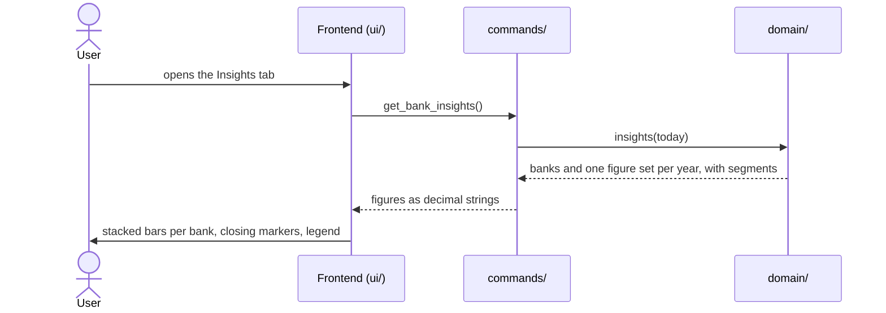

# CSD-010: Bank account insights

## 1. Intent
The Bank accounts page lists accounts, entries and a table of yearly totals, but a table does not show how the money at the banks is spread over the accounts and how that changed over the years. This capability adds an insights layer to the Bank accounts page: a chart with one bar per calendar year, stacked from one segment per bank, with a marker at the closing balance of the year. It is for the owner looking back over their own bank balances. It follows the Investment insights of CSD-007, but a bank entry is only a balance, so the segments are the banks instead of opening balance, deposits and growth. It supersedes CSD-009 NG-6 for this view only to the extent that the chart shows the closing balance per bank.

## 2. Scope
### 2.1 In scope
- An "Insights" tab on the Bank accounts page, next to the existing content ("Overview").
- A yearly stacked bar chart over all accounts with one segment per bank, a closing-balance marker, a legend of the banks, a tooltip and the highlight of one bank.
- Its empty state.

### 2.2 Non-goals
- NG-1: A monthly view, or any granularity other than a calendar year.
- NG-2: A filter, a selection or a hiding of banks.
- NG-3: Growth, a percentage, a year-over-year change, a forecast, or any other figure than the balances and the closing balance. The number of entries is never displayed.
- NG-4: Click-through, zooming, or exporting the chart.
- NG-5: Charts on the Dashboard or on the Reports page.
- NG-6: A chart library or any other new dependency.
- NG-7: Estimating balances for years without an entry (CSD-009 NG-8), and carrying a balance forward into a year in which a bank has no entry.
- NG-8: Letting the user choose the colour of a bank.

## 3. Definitions
| Term | Meaning |
|---|---|
| **Year** | A calendar year. An entry counts in the year of its own period only, as in the yearly totals (CSD-009 REQ-19). |
| **Current year** | The calendar year of today, in local time. Its figures run up to the latest entry so far, and are therefore partial. |
| **Segment** | The part of a year's bar that belongs to one bank: the balance of that bank's latest entry in that year. A bank without an entry in that year has no segment in it. |
| **Closing balance** | The sum of the segments of a year, as in the yearly totals of CSD-009 REQ-19. |
| **Colour slot** | The number from 0 to 7 stored with a bank (CSD-009 REQ-3), which decides its colour. |

## 4. Requirements

### 4.0 Overview flow


**REQ-1: Tabs on the Bank accounts page** *(ubiquitous)*
The Bank accounts page shall offer the tabs "Overview" and "Insights" while at least one bank account exists, with Overview, which holds the content of CSD-009, shown first.

```gherkin
@AC-1.1
Scenario: Overview is shown first
  Given a project with one bank account
  When the user opens the Bank accounts page
  Then the Overview tab is selected
  And it shows the Accounts, Yearly totals and Entries sections

@AC-1.2
Scenario: Switching to Insights
  Given the Bank accounts page shows the Overview tab
  When the user selects the Insights tab
  Then the Overview sections are hidden
  And the insights chart is shown

@AC-1.3
Scenario: No accounts yet
  Given a project without bank accounts
  When the user opens the Bank accounts page
  Then the prompt to add the first bank account is shown
  And there are no tabs
```

**REQ-2: Year series** *(ubiquitous)*
The app shall return one set of figures for every calendar year from the year of the earliest entry up to and including the current year, oldest year first, holding the closing balance, the number of entries (returned, not displayed) and, per bank with an entry in that year, its segment.

```gherkin
@AC-2.1
Scenario: Series runs from the first entry to the current year
  Given today is 26/10/2026
  And the earliest entry is for 2024-03
  And there are entries in 2025 and 2026
  When the insights are requested
  Then the series holds the years 2024, 2025 and 2026 in that order

@AC-2.2
Scenario: A single year
  Given today is 26/10/2026
  And the only entry is for 2026-09
  When the insights are requested
  Then the series holds only the year 2026

@AC-2.3
Scenario: No entries
  Given today is 26/10/2026
  And an account without entries
  When the insights are requested
  Then the series is empty
```

**REQ-3: Years without entries** *(unwanted behaviour)*
If a year in the series has no entry, then the app shall return that year with closing balance 0.00, 0 entries and no segments.

```gherkin
@AC-3.1
Scenario: Gap year
  Given today is 26/10/2026
  And there are entries in 2022 and 2024 but none in 2023
  When the insights are requested
  Then the year 2023 has closing balance 0.00, 0 entries and no segments
  And the series holds the years 2022, 2023, 2024, 2025 and 2026
```

**REQ-4: Current year is partial** *(state-driven)*
While a year is the current year, the app shall mark it as partial.

```gherkin
@AC-4.1
Scenario: Current year is marked
  Given today is 26/10/2026
  And there are entries in 2025 and 2026
  When the insights are requested
  Then the year 2026 is marked partial
  And the year 2025 is not

@AC-4.2
Scenario: Current year without entries is still in the series and marked
  Given today is 26/10/2026
  And the only entry is for 2025-12
  When the insights are requested
  Then the series holds 2025 and 2026
  And 2026 is marked partial and has 0 entries
```

**REQ-5: Segments are the latest balances per bank** *(ubiquitous)*
The app shall give each year one segment per bank that has an entry in that year, equal to the balance of that bank's latest entry in that year, ordered by the creation of the banks, and the segments shall add up to the closing balance, which equals the closing balance and the entry count of the yearly totals of CSD-009 REQ-19. The entry count is a returned data field and is never displayed; "entries" in the ACs of this requirement and of REQ-2 to REQ-4 refers to it.

```gherkin
@AC-5.1
Scenario: Segments of a year
  Given today is 26/10/2026
  And account "Example Current Account" with entries 2026-03 (balance 2000.00) and 2026-09 (balance 2500.00)
  And account "Example Savings" with an entry 2026-06 (balance 8000.00)
  When the insights are requested
  Then 2026 has the segments "Example Current Account" 2500.00 and "Example Savings" 8000.00
  And 2026 has closing balance 10500.00 and 3 entries

@AC-5.2
Scenario: A bank without an entry in the year has no segment
  Given today is 26/10/2026
  And a monthly account "Example Current Account" with entries 2025-12 (balance 2000.00) and 2026-03 (balance 2500.00)
  And a yearly account "Example Savings" with an entry 2025 (balance 8000.00)
  When the insights are requested
  Then 2025 has the segments "Example Current Account" 2000.00 and "Example Savings" 8000.00
  And 2026 has only the segment "Example Current Account" 2500.00

@AC-5.3
Scenario: An overdrawn bank has a negative segment
  Given today is 26/10/2026
  And account "Example Current Account" with an entry 2026-09 (balance 5000.00)
  And account "Example Overdraft" with an entry 2026-09 (balance -1000.00)
  When the insights are requested
  Then 2026 has the segments 5000.00 and -1000.00
  And 2026 has closing balance 4000.00

@AC-5.4
Scenario: Segments are ordered by creation, not by name
  Given today is 26/10/2026
  And accounts "Example Savings" and then "Example Current Account", both with an entry 2026-09
  When the insights are requested
  Then the segments of 2026 are listed "Example Savings" first and "Example Current Account" second

@AC-5.5
Scenario: Closing balance and entries equal the yearly totals
  Given today is 26/10/2026
  And the entries of AC-5.1 and AC-5.2
  When the insights and the yearly totals are requested
  Then for every year the closing balance and the number of entries of the insights equal those of the yearly totals
```

**REQ-6: Chart** *(ubiquitous)*
The Insights tab shall draw one bar per year in the order received, stacked from one segment per bank in which positive segments rise from the zero line in the order received and negative segments hang down from it in that order, on a y-axis that includes 0, ends at a rounded-up value of at least the highest positive sum and starts at a rounded-down value of at most the lowest negative sum, with gridlines, compact axis labels (such as "10k"), a gap year as a labelled slot without a bar, and no currency.

```gherkin
@AC-6.1
Scenario: Stacked bars per year
  Given the series holds the years 2025 and 2026
  When the user opens the Insights tab
  Then two bars are drawn, 2025 on the left and 2026 on the right
  And each bar has one segment per bank with an entry in that year

@AC-6.2
Scenario: Negative segments hang down
  Given 2026 has the segments 5000.00 and -1000.00
  When the user opens the Insights tab
  Then the segment of 5000.00 rises from the zero line
  And the segment of -1000.00 hangs down from the zero line

@AC-6.3
Scenario: Axis covers the highest and the lowest level
  Given the highest positive sum of any year is 13100.00 and the lowest negative sum is -1000.00
  When the user opens the Insights tab
  Then the top of the y-axis is at least 13100.00
  And the bottom of the y-axis is at most -1000.00

@AC-6.4
Scenario: Only positive balances
  Given every segment of every year is positive
  When the user opens the Insights tab
  Then the y-axis starts at 0

@AC-6.5
Scenario: Gap year is an empty slot
  Given the year 2023 has no entries
  When the user opens the Insights tab
  Then 2023 has a labelled slot without a bar

@AC-6.6
Scenario: Current year is marked
  Given the year 2026 is partial
  When the user opens the Insights tab
  Then the 2026 bar has a lighter fill
  And its label reads "2026 YTD"
```

**REQ-7: Closing-balance marker** *(ubiquitous)*
The Insights tab shall draw for each year with entries a horizontal marker line of 2 px with round ends in the muted text colour, wider than the bar, at the closing balance, with its compact value next to it (above the line), not connected to the markers of other years, and dashed for the current year.

```gherkin
@AC-7.1
Scenario: Marker at the closing balance
  Given 2025 has the segments 2000.00 and 8000.00 and closing balance 10000.00
  When the user opens the Insights tab
  Then a marker line is drawn across the 2025 bar at 10000.00
  And its label reads "10k"

@AC-7.2
Scenario: Marker sits at the net sum when a segment is negative
  Given 2026 has the segments 5000.00 and -1000.00
  When the user opens the Insights tab
  Then the 2026 marker sits at 4000.00, inside the positive stack

@AC-7.3
Scenario: Markers are not connected and the current year is dashed
  Given the series holds 2024, a gap year 2025 and the partial year 2026
  When the user opens the Insights tab
  Then no line joins the markers
  And the marker of 2026 is dashed
  And 2025 has no marker
```

**REQ-8: A colour per bank** *(ubiquitous)*
The Insights tab shall draw every segment of a bank in the colour of the bank's colour slot, taken from a palette of eight colours with a variant for light mode and one for dark mode, each of at most 60% HSL saturation, so that a bank has the same colour in every year, in the legend and in the tooltip, and keeps it when other banks are deleted.

```gherkin
@AC-8.1
Scenario: A bank has one colour everywhere
  Given bank "Example Savings" has colour slot 1 and entries in 2025 and 2026
  When the user opens the Insights tab
  Then its segments in 2025 and 2026, its legend swatch and its tooltip swatch have the colour of slot 1

@AC-8.2
Scenario: Colours survive a deletion
  Given banks with colour slots 0, 1 and 2 and entries
  When the user deletes the bank with slot 0 on the Overview tab and opens the Insights tab
  Then the other banks are still drawn in the colours of slots 1 and 2

@AC-8.3
Scenario: The palette in both modes
  Given the Insights tab shows the chart
  When the app is in light mode and then in dark mode
  Then the eight colours are distinct from each other in each mode
  And each has at most 60% HSL saturation

@AC-8.4
Scenario: More than eight banks
  Given nine banks with entries
  When the user opens the Insights tab
  Then the first and the ninth bank share a colour
  And each is named in the legend and in the tooltip
```

**REQ-9: Legend of banks** *(ubiquitous)*
The Insights tab shall show a legend with a colour swatch and the name of every bank that has at least one entry, in the order the banks were created, wrapping onto more lines when it does not fit, with no limit on the number of banks, and shall cut a name that does not fit on one legend item with an ellipsis, with the full name available in a tooltip and to screen readers. The legend shall also show the closing-balance marker.

```gherkin
@AC-9.1
Scenario: Legend lists the banks in creation order
  Given banks "Example Savings" and then "Example Current Account", both with entries
  When the user opens the Insights tab
  Then the legend lists "Example Savings" and "Example Current Account" in that order, each with its colour swatch
  And the legend shows the closing-balance marker

@AC-9.2
Scenario: A bank without entries is not in the legend
  Given a bank "Example Empty" with no entries and a bank "Example Savings" with an entry
  When the user opens the Insights tab
  Then the legend lists only "Example Savings"

@AC-9.3
Scenario: Many banks wrap
  Given twelve banks with entries
  When the user opens the Insights tab on a narrow window
  Then the legend shows all twelve banks, wrapped onto more than one line
  And no bank is left out

@AC-9.4
Scenario: A long name is cut with an ellipsis
  Given a bank with a name of 100 characters and an entry
  When the user opens the Insights tab
  Then its legend item shows the name cut with an ellipsis
  And the full name is available in a tooltip and to screen readers

@AC-9.5
Scenario: A deleted bank leaves the legend
  Given the legend lists "Example Savings" and "Example Current Account"
  When the user deletes "Example Savings" on the Overview tab and opens the Insights tab
  Then the legend lists only "Example Current Account"
```

**REQ-10: Details of a year** *(event-driven)*
When the user hovers over or moves keyboard focus to a year, the Insights tab shall show a tooltip with the year, one row per segment with the bank's swatch, full name and balance in the order the bar shows them from top to bottom (the highest segment first, the segments below the zero line last), then the closing balance and, for the current year, that it is partial, beside the year's bar as CSD-007 REQ-14 places a tooltip, and shall give the same values to screen readers. The tooltip and the screen-reader description show no number of entries, and a year without entries shows the note "No entries".

```gherkin
@AC-10.1
Scenario: Tooltip on hover
  Given 2026 has the segments "Example Current Account" 2500.00 and "Example Savings" 8000.00 and closing balance 10500.00
  When the user hovers over the 2026 bar
  Then a tooltip shows both banks with their swatch and balance and the closing balance 10500.00
  And it shows no number of entries

@AC-10.2
Scenario: Tooltip on keyboard focus
  Given the Insights tab shows the chart
  When the user moves focus to the 2026 bar with the Tab key
  Then the same tooltip is shown
  And the tooltip disappears when focus leaves the bar

@AC-10.3
Scenario: Accessible label
  Given 2026 has a segment "Example Overdraft" with balance -1000.00
  When a screen reader reads the 2026 bar
  Then it announces the year, each bank with its balance and the closing balance
  And it announces no number of entries
  And it announces that "Example Overdraft" is negative

@AC-10.4
Scenario: Partial year
  Given the year 2026 is partial
  When the user hovers over the 2026 bar
  Then the tooltip says that the year is partial

@AC-10.5
Scenario: Tooltip beside the bar
  Given the chart shows the years 2024, 2025 and 2026
  When the user hovers over the 2024 bar
  Then the tooltip is shown to the right of that bar with its top level with the top of the bar
  When the user hovers over the 2026 bar and the tooltip does not fit to its right
  Then the tooltip is shown to the left of that bar and stays inside the chart area

@AC-10.6
Scenario: Year without a bar
  Given the year 2023 has no entries
  When the user hovers over its slot
  Then the tooltip is centred over that slot
  And it shows no bank rows
  And it shows the note "No entries"

@AC-10.7
Scenario: Rows follow the bar from top to bottom
  Given 2026 has the segments "Example Current Account" 2500.00, "Example Savings" 8000.00 and "Example Overdraft" -1000.00 in creation order
  When the user hovers over the 2026 bar
  Then the tooltip rows are listed "Example Savings", "Example Current Account", "Example Overdraft"
  And the closing balance 9500.00 is listed after them

@AC-10.8
Scenario: Only positive segments
  Given 2025 has the segments "Example Current Account" 2000.00 and "Example Savings" 8000.00
  When the user hovers over the 2025 bar
  Then the tooltip rows are listed "Example Savings" first and "Example Current Account" second
  And the closing balance is listed last
```

**REQ-11: Highlight one bank** *(event-driven)*
When the mouse is over a segment or a legend item of a bank, or keyboard focus is on a legend item, the Insights tab shall keep all segments of that bank at full colour in every year and ease all other segments to 70% opacity, set the legend item and the tooltip row of that bank in the full text colour and a heavier font weight, and ease the other legend items to 70% opacity, and while no segment or legend item is hovered or focused, the Insights tab shall highlight nothing. Keyboard focus on a year highlights nothing.

```gherkin
@AC-11.1
Scenario: Hovering a segment
  Given 2025 and 2026 each have a segment of "Example Savings" and of "Example Current Account"
  When the user hovers over the "Example Savings" segment of 2025
  Then all "Example Savings" segments, in 2025 and 2026, keep their full colour
  And all "Example Current Account" segments are eased down to 70% opacity
  And the "Example Savings" legend item is in the full text colour and a heavier font weight
  And the other legend items are eased down to 70% opacity

@AC-11.2
Scenario: Hovering a legend item
  Given the legend lists "Example Savings" and "Example Current Account"
  When the user hovers over the legend item "Example Savings"
  Then the segments of "Example Savings" keep their full colour in every year
  And the other segments are eased down to 70% opacity

@AC-11.3
Scenario: Focusing a legend item
  Given the legend lists "Example Savings" and "Example Current Account"
  When the user moves keyboard focus to the legend item "Example Savings"
  Then the highlight is the same as when hovering over it
  And it ends when focus leaves the legend item

@AC-11.4
Scenario: Leaving the segment
  Given the user hovers over a segment
  When the user moves the mouse to empty space in the year's column
  Then no legend item is highlighted and no segment is dimmed
  And the tooltip is still shown

@AC-11.5
Scenario: Not colour alone
  Given the user hovers over a segment
  Then the highlighted legend item has a heavier font weight than the other items
  And the other segments are lighter, not differently coloured

@AC-11.6
Scenario: Keyboard focus on a year highlights nothing
  Given the Insights tab shows the chart
  When the user moves focus to the 2025 bar with the Tab key
  Then no legend item is highlighted and no segment is dimmed
```

**REQ-12: Motion and reduced motion** *(event-driven)*
When a tooltip appears or moves to another year, or the highlight of REQ-11 changes, the Insights tab shall animate the change over 120 to 150 ms with an ease-out curve, and while the user prefers reduced motion it shall show tooltips and highlight changes at once.

```gherkin
@AC-12.1
Scenario: Tooltip fades in and glides
  Given the Insights tab shows the chart
  When the user hovers over the 2025 bar and then over the 2026 bar
  Then the tooltip fades in over 120 to 150 ms while it slides 4 px towards its place
  And it glides to its new place over 120 to 150 ms instead of jumping

@AC-12.2
Scenario: Dimming eases
  Given the user hovers over a segment of "Example Savings"
  When the user moves the mouse away from the segment
  Then the other segments and the legend items ease back to full opacity over 120 to 150 ms

@AC-12.3
Scenario: Reduced motion
  Given the user prefers reduced motion
  When the user hovers over the 2025 bar and then over the 2026 bar
  Then each tooltip appears at once at its place without sliding or gliding
  And the dimming of segments and legend items changes at once
```

**REQ-13: Refined look and accessible segments** *(ubiquitous)*
The Insights tab shall draw the chart with bars at most 50% of the width of their slot and at most 44 px wide, with the top corners of the topmost positive segment and the bottom corners of the lowest negative segment rounded by 3 px and a 1 px gap between stacked segments in place of an outline, so that neighbouring segments of the same hue stay apart, with a plot height of 390 px and a year slot at least 64 px wide, the same size and behaviour as every other yearly chart of the app, with 1 px gridlines at 55% opacity of the border colour and a 1 px zero line in the muted text colour at 70% opacity that is always drawn, also when no segment is negative, with axis and year labels in the muted text colour at regular font weight, with marker values in 10 px medium weight, and with tooltips of 10 px corner radius, 12 px by 14 px padding, a shadow of at least 16 px blur and at most 12% opacity, a 12 px title in semibold and row labels in the muted text colour, in light and in dark mode. Every segment shall carry an accessible label with the bank, the year and the balance.

```gherkin
@AC-13.1
Scenario: Bars
  Given the series holds the years 2024, 2025 and 2026
  When the user opens the Insights tab
  Then no bar is wider than 50% of its slot or 44 px
  And the outer corners of each bar are rounded by 3 px
  And stacked segments are separated by a 1 px gap and have no outline

@AC-13.2
Scenario: Gridlines, zero line and labels
  Given the Insights tab shows the chart with a negative segment
  Then the gridlines are 1 px lines at 55% opacity of the border colour
  And the zero line is 1 px in the muted text colour at 70% opacity
  And the axis labels and the year labels are in the muted text colour at regular font weight

@AC-13.3
Scenario: Tooltip
  Given the user hovers over a year
  Then the tooltip has a 10 px corner radius, 12 px by 14 px padding and a soft shadow
  And its title is semibold and its row labels are in the muted text colour

@AC-13.4
Scenario: Segment labels
  Given 2026 has a segment of "Example Savings" with balance 8000.00
  When a screen reader reads that segment
  Then it announces "Example Savings", 2026 and 8000.00

@AC-13.5
Scenario: The zero line is always drawn
  Given every segment of every year is positive
  When the user opens the Insights tab
  Then a 1 px zero line in the muted text colour at 70% opacity is drawn at 0

@AC-13.6
Scenario: Same size as the other yearly charts
  Given the Insights tab shows the chart
  Then the plot is 390 px high
  And each year slot is at least 64 px wide
```

**REQ-14: No entries yet** *(state-driven)*
While at least one account exists but no entry, the Insights tab shall show a note instead of a chart.

```gherkin
@AC-14.1
Scenario: Accounts without entries
  Given a project with one account and no entries
  When the user opens the Insights tab
  Then the note "No entries yet. The chart appears once there is an entry." is shown
  And no chart is drawn
```

**REQ-15: Current figures** *(event-driven)*
When the user opens the Insights tab, the app shall show figures computed from the project at that moment.

```gherkin
@AC-15.1
Scenario: Figures follow changes
  Given the Insights tab showed closing balance 2500.00 for 2026
  And the user added an entry for 2026-10 with balance 3000.00 on the Overview tab
  When the user opens the Insights tab again
  Then the 2026 marker shows 3000.00

@AC-15.2
Scenario: Last entry deleted
  Given the Insights tab showed a chart
  And the user deleted the only entry on the Overview tab
  When the user opens the Insights tab again
  Then the note of AC-14.1 is shown and no chart is drawn

@AC-15.3
Scenario: A moved entry follows to its new year
  Given a monthly account with an entry for 2026-01
  When the user changes its period to 2025-12 and opens the Insights tab
  Then the series holds 2025 and 2026, and the segment is in 2025
```

## 5. Interfaces and contracts

Command: `get_bank_insights()` returns the banks that have at least one entry, in creation order, and the series, oldest year first:

```json
{
  "banks": [
    { "id": "…", "name": "Example Current Account", "colour_slot": 0 },
    { "id": "…", "name": "Example Savings", "colour_slot": 1 }
  ],
  "years": [
    { "year": 2025, "closing_balance": "10000.00", "entry_count": 2, "is_partial": false,
      "segments": [ { "account_id": "…", "balance": "2000.00" }, { "account_id": "…", "balance": "8000.00" } ] },
    { "year": 2026, "closing_balance": "2500.00", "entry_count": 1, "is_partial": true,
      "segments": [ { "account_id": "…", "balance": "2500.00" } ] }
  ]
}
```

`entry_count` is returned but never displayed. `banks` and `years` are empty when there are no entries. `segments` follow the creation order of the banks and are empty for a gap year. Amounts are decimal strings. Rust decides "today" (local time), the years, the partial flag and the segments, and the frontend only displays what it receives. Error codes are those of CSD-009.

## 6. Constraints
- CON-1: The chart reuses the shared chart code of the frontend (`ui/shared/yearly-chart.js`) and adds no chart library or other dependency. Rationale: NG-6, and `CLAUDE.md` asks before adding dependencies.
- CON-2: The frontend displays figures computed in Rust and computes no amounts, not even the sum of the segments or the axis total beyond what drawing needs. Rationale: `CLAUDE.md` layout rule.
- CON-3: No network access. Rationale: `CLAUDE.md` Tauri security rules.
- CON-4: Bank names are drawn as plain text, never as HTML. Rationale: a name is typed by the user and must not run as markup.
- CON-5: Tests and fixtures use synthetic data only. Rationale: the repo is public.
- CON-6: The palette is defined once as colour tokens per mode, and no colour of a bank is written inline in the page code. Rationale: one place to adjust, and both modes stay in step.

## 7. Verification
The series is computed in Rust, so REQ-2 to REQ-5 are proven by `cargo test`. Tests are named `test_csd010_ac_<n>_<m>_<description>` (CSD-000 REQ-6).

| Requirement | Command |
|---|---|
| REQ-2 to REQ-5, AC-15.1 to AC-15.3 (the data) | `cargo test test_csd010_` |
| REQ-1, REQ-6 to REQ-14 (all ACs, including AC-10.7, AC-10.8, AC-13.5 and AC-13.6), AC-15.1 to AC-15.3 (the screen) | Manual checklist: tabs, tooltip row order and no entry count, plot height 390 px and slot width of at least 64 px, zero line always drawn, stacking and negative segments, axis range, markers, colours of both modes and of the ninth bank, legend order, wrapping and ellipsis, tooltip placement, highlight from a segment and from the legend including keyboard, motion and reduced motion, the look, accessible labels and the empty note. There is no frontend test setup |
| One requirement, e.g. REQ-5 | `cargo test test_csd010_ac_5_` |

Done means fmt, clippy (`-D warnings`) and `cargo test --all-features` pass.

## 8. Open questions
- OQ-1: (resolved in v0.2) The legend lists only banks that have at least one entry (REQ-9), because a bank without entries has no segment to identify.

## 9. Changelog
- 0.4 (29/10/2026): The plot of every yearly chart is 390 px high (was 260 px), 50% taller. No other behaviour change.
- 0.3 (29/10/2026): Entry counts are no longer displayed: REQ-10 (AC-10.1, AC-10.3 amended) drops the count from the tooltip and the screen-reader description, an empty year shows "No entries" (AC-10.6), NG-3 and REQ-5 say the count is returned but never shown. REQ-10 orders the tooltip rows as the bar shows them, top to bottom, segments below the zero line last (AC-10.7, AC-10.8 added). REQ-13 sets the shared chart size (plot height 260 px, slot at least 64 px) and an always-drawn zero line (AC-13.5, AC-13.6 added). The legend hover and focus highlight of REQ-11 is unchanged. New ACs are manual checklist items.
- 0.2 (28/10/2026): Resolved OQ-1: the legend lists only banks with at least one entry, as REQ-9 says.
- 0.1 (28/10/2026): initial draft, from GitHub issue 13 and the grill-me interview. It follows CSD-007 (tabs, year series, partial year, marker, tooltip, highlight, motion, look), with one segment per bank instead of opening balance, deposits and growth.
