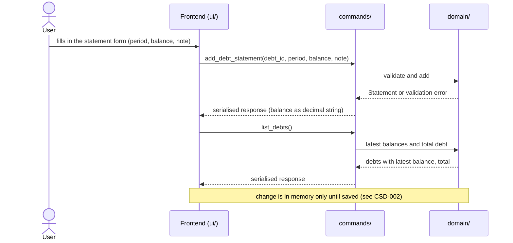
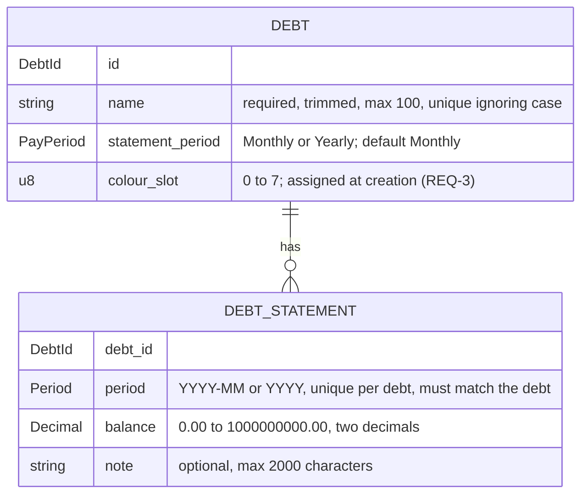

# CSD-011: Debts

## 1. Intent
The app tracks wealth, but has no view of what the user owes: a mortgage, a student loan, a credit card. This capability lets the user record debts and, per debt, one remaining balance per month or per year, with an optional note. From these the app derives, per statement, how much was repaid since the previous one and, per calendar year, the yearly totals with the closing balance and the amount repaid. It is for a single person keeping a private, local history of their debts. It records balances as the user reads them off a statement. It does not model loans: no interest, terms or payments. The result is a balance history per debt that shows how the debts shrink, which the Insights chart of CSD-012 and later features (net-worth linkage) can build on. It follows the structure of Bank accounts (CSD-009), with a balance that cannot be negative and with the progress derived.

## 2. Scope
### 2.1 In scope
- Create, edit and delete debts, each with a name and a statement period (Monthly or Yearly).
- Create, edit and delete one statement per debt per period: the remaining balance (0.00 or more) and an optional note.
- Change the period of an existing statement (REQ-12).
- Copy the previous statement into the add form.
- The change per statement: the balance of the previous statement minus this one (REQ-25).
- Yearly totals per calendar year over all debts: closing balance and amount repaid.
- One Debts view (tab Overview) with the debts, their latest balances, the total debt, the yearly totals and the statements of all debts. The Insights tab is CSD-012.
- Debt data is part of the project file (CSD-002). Statements count for the currency confirmation of CSD-003 (REQ-24).

### 2.2 Non-goals
- NG-1: Interest rates, terms, monthly payments and repayment schedules.
- NG-2: A forecast of when a debt is paid off, and any percentage of the debt repaid.
- NG-3: (removed in v0.4) A house linked to a debt is now CSD-020. A collateral or a lien stays out of scope.
- NG-4: Netting the debts against bank accounts and investments, and integration with net worth and the dashboard (CSD-004).
- NG-5: Money owed to the user.
- NG-6: Data fetched from a lender, and import of statements (CSV, PDF, lender export).
- NG-7: Archiving a debt. A debt at 0.00 stays a normal row, marked Repaid (REQ-26). (Marking it Repaid or Cancelled on the sale of its house is CSD-020.)
- NG-8: Lender identifiers and other details: an account or contract number, a lender name apart from the name of the debt, a debt type other than the category of CSD-020 (Mortgage, Loan, Scholarship, Other), and a note on the debt itself.
- NG-9: A currency per debt. All amounts are in the project currency (CSD-003).
- NG-10: Individual payments, a stored original amount, and negative balances.
- NG-11: Aligning the latest balances of different debts to one date, or estimating a balance for a period without a statement.
- NG-12: Moving a statement to another debt. Only the period of a statement can change (REQ-12).
- NG-13: Changing the periods of several statements at once.
- NG-14: Rich text or attachments in notes.

## 3. Definitions
| Term | Meaning |
|---|---|
| **Debt** | One amount the user owes to one party, identified by a name such as "Example Mortgage". |
| **Statement period** | How a debt is recorded: **Monthly** (one statement per calendar month, `YYYY-MM`) or **Yearly** (one statement per calendar year, `YYYY`). A debt is Monthly unless Yearly is chosen. |
| **Statement** | The record of one debt for one period: the remaining balance and an optional note. |
| **Balance** | What the user still owes on the debt at the end of the period, as one amount of 0.00 or more in the project currency. |
| **Previous statement** | The statement of the same debt with the latest period before that of the statement at hand, also when periods in between have none. |
| **Change** | For a statement: the balance of its previous statement minus its own balance. Positive when the debt was repaid, negative when it grew. It is derived and never stored. A first statement has no change. |
| **Latest balance** | The balance of the statement with the most recent period of a debt. |
| **Total debt** | The sum of the latest balances of all debts that have at least one statement. |
| **Yearly total** | One row per calendar year: the closing balance and the amount repaid of that year, over all debts. See REQ-19. |
| **Closing balance (of a year)** | The sum, over the debts that have a statement in that year, of the balance of each debt's latest statement in that year. |
| **Opening balance (of a debt in a year)** | The balance of the latest statement of the debt before that year. A debt without an earlier statement has none. |
| **Repaid (in a year)** | The sum, over the debts that have a statement in that year and an opening balance in it, of the opening balance minus the closing balance of that debt. It is negative when those debts grew. It is none when no debt has an opening balance in that year. |
| **Colour slot** | A number from 0 to 7 stored with a debt. CSD-012 draws the debt in the colour of its slot. |
| **Note** | Optional plain text, up to 2,000 characters, that goes with one statement. |
| **Project file** | The single user-chosen file holding all app data (CSD-002). Debts are one of its sections. |

## 4. Requirements

### 4.0 Overview flow


### 4.1 Debts

**REQ-1: Add a debt** *(event-driven)*
When the user submits a new debt with a name and a statement period, the app shall create the debt with statement period Monthly unless Yearly is chosen, and with a colour slot under REQ-3.

```gherkin
@AC-1.1
Scenario: Debt created with the default period
  Given no debts exist
  When the user adds a debt named "Example Mortgage" without choosing a period
  Then the debt "Example Mortgage" exists with statement period "Monthly"
  And it has no statements

@AC-1.2
Scenario: Yearly debt
  Given no debts exist
  When the user adds a debt named "Example Student Loan" with statement period "Yearly"
  Then the debt "Example Student Loan" exists with statement period "Yearly"

@AC-1.3
Scenario: Unknown period rejected
  When the user adds a debt named "Example Mortgage" with statement period "Weekly"
  Then it is rejected with error code "DEBT_PERIOD_UNSUPPORTED"
  And no debt exists
```

**REQ-2: Debt name rules** *(unwanted behaviour)*
If the name of a debt is empty after trimming, is longer than 100 characters, or equals the name of another debt when case is ignored, then the app shall reject the debt or edit without storing or changing it, and shall store an accepted name trimmed.

```gherkin
@AC-2.1
Scenario Outline: Invalid names rejected
  Given a debt named "Example Mortgage"
  When the user adds a debt named "<name>"
  Then it is rejected with error code "<code>"
  And only the debt "Example Mortgage" exists

  Examples:
    | name              | code                   |
    | (empty)           | DEBT_NAME_REQUIRED     |
    | (three spaces)    | DEBT_NAME_REQUIRED     |
    | EXAMPLE MORTGAGE  | DEBT_NAME_DUPLICATE    |
    | example mortgage  | DEBT_NAME_DUPLICATE    |

@AC-2.2
Scenario: Name length boundary
  When the user adds a debt with a name of 100 characters
  Then the debt exists
  When the user adds a debt with a name of 101 characters
  Then it is rejected with error code "DEBT_NAME_TOO_LONG"

@AC-2.3
Scenario: The name is stored trimmed
  When the user adds a debt named "  Example Mortgage  "
  Then the debt is named "Example Mortgage"

@AC-2.4
Scenario: Renaming to an existing name is rejected
  Given debts "Example Mortgage" and "Example Student Loan"
  When the user renames "Example Student Loan" to "example mortgage"
  Then the edit is rejected with error code "DEBT_NAME_DUPLICATE"

@AC-2.5
Scenario: Changing only the case of its own name is allowed
  Given a debt "Example Student Loan"
  When the user renames it to "EXAMPLE STUDENT LOAN"
  Then the debt is named "EXAMPLE STUDENT LOAN"
```

**REQ-3: Colour slot** *(event-driven)*
When a debt is created, the app shall give it the lowest colour slot (0 to 7) that is used by the fewest existing debts, and shall keep that slot for the life of the debt, also when other debts are deleted.

```gherkin
@AC-3.1
Scenario: Slots follow creation order
  Given no debts exist
  When the user adds three debts
  Then they have colour slots 0, 1 and 2 in the order they were added

@AC-3.2
Scenario: Slots cycle after eight debts
  Given eight debts with colour slots 0 to 7
  When the user adds a ninth debt
  Then it has colour slot 0

@AC-3.3
Scenario: Deleting a debt does not recolour the others
  Given debts with colour slots 0, 1 and 2
  When the user deletes the debt with colour slot 0 and confirms
  Then the other debts still have colour slots 1 and 2

@AC-3.4
Scenario: A freed slot is used first
  Given debts with colour slots 0, 1 and 2
  When the user deletes the debt with colour slot 1 and confirms
  And adds a debt
  Then the new debt has colour slot 1

@AC-3.5
Scenario: Renaming keeps the slot
  Given a debt with colour slot 2
  When the user renames it
  Then it still has colour slot 2
```

**REQ-4: Edit a debt** *(event-driven)*
When the user edits a debt, the app shall apply a changed name under REQ-2 and a changed statement period under REQ-5, and shall keep the debt's statements.

```gherkin
@AC-4.1
Scenario: Rename keeps statements
  Given a debt "Example Mortgage" with 2 statements
  When the user renames it to "Example Home Loan"
  Then the debt is named "Example Home Loan"
  And it still has 2 statements

@AC-4.2
Scenario: Period of a debt without statements can change
  Given a "Monthly" debt "Example Mortgage" with no statements
  When the user changes its statement period to "Yearly"
  Then the debt has statement period "Yearly"

@AC-4.3
Scenario: An invalid edit changes nothing
  Given debts "Example Mortgage" and "Example Student Loan"
  When the user renames "Example Student Loan" to "  "
  Then the edit is rejected with error code "DEBT_NAME_REQUIRED"
  And "Example Student Loan" keeps its name
```

**REQ-5: Statement period is locked once statements exist** *(unwanted behaviour)*
If the user changes the statement period of a debt that has at least one statement, then the app shall reject the change with the error code `DEBT_PERIOD_LOCKED`.

```gherkin
@AC-5.1
Scenario: Period change rejected
  Given a "Monthly" debt "Example Mortgage" with a statement for 2026-09
  When the user changes its statement period to "Yearly"
  Then the change is rejected with error code "DEBT_PERIOD_LOCKED"
  And the debt still has statement period "Monthly"

@AC-5.2
Scenario: Period change allowed again after deleting the last statement
  Given a "Monthly" debt "Example Mortgage" with one statement
  When the user deletes the statement and confirms
  And changes the statement period to "Yearly"
  Then the debt has statement period "Yearly"
```

**REQ-6: Delete a debt** *(event-driven)*
When the user confirms deletion of a debt, the app shall remove the debt and all of its statements. The confirmation reads "This debt and all its statements will be deleted.", the same whether or not the debt has statements, and states no number of statements.

```gherkin
@AC-6.1
Scenario: Deletion cascades
  Given a debt "Example Mortgage" with 3 statements
  When the user deletes the debt and confirms
  Then the debt no longer exists
  And none of its 3 statements exist

@AC-6.2
Scenario: Cancelled deletion changes nothing
  Given a debt "Example Mortgage" with 3 statements
  When the user starts deleting the debt and cancels
  Then the debt and its 3 statements still exist

@AC-6.3
Scenario: A debt at 0.00 is deleted like any other
  Given a debt "Example Student Loan" whose latest balance is 0.00
  When the user deletes the debt and confirms
  Then the debt and its statements no longer exist

@AC-6.4
Scenario Outline: The confirmation states no count
  Given a debt "Example Mortgage" with <statements>
  When the user starts deleting the debt
  Then the confirmation reads "This debt and all its statements will be deleted."
  And it states no number of statements

  Examples:
    | statements   |
    | 3 statements |
    | no statements |
```

### 4.2 Statements

**REQ-7: Add a statement** *(event-driven)*
When the user submits a statement for the debt chosen in the add form, a period and a balance, the app shall store it with the given note, or with an empty note if none is given, and shall accept any period that is not later than the current month (monthly debt) or the current year (yearly debt), including periods before the debt existed in the app.

```gherkin
@AC-7.1
Scenario: Monthly statement with a note
  Given the current date is 26/10/2026
  And a monthly debt "Example Mortgage"
  When the user adds a statement for 2026-09 with balance 150000.00 and note "Paid extra"
  Then the statement for 2026-09 has balance 150000.00 and note "Paid extra"

@AC-7.2
Scenario: Yearly statement without a note
  Given the current date is 26/10/2026
  And a yearly debt "Example Student Loan"
  When the user adds a statement for 2025 with balance 8000.00 and no note
  Then the statement for 2025 has balance 8000.00 and an empty note

@AC-7.3
Scenario: Old periods are accepted
  Given a monthly debt "Example Mortgage"
  When the user adds a statement for 2019-01 with balance 200000.00
  Then the statement for 2019-01 exists

@AC-7.4
Scenario Outline: Current period accepted, later period rejected
  Given the current date is 26/10/2026
  And a <period_type> debt "Example Debt"
  When the user adds a statement for "<period>" with balance 1000.00
  Then <outcome>

  Examples:
    | period_type | period  | outcome                                                      |
    | monthly     | 2026-10 | the statement for 2026-10 exists                             |
    | monthly     | 2026-11 | it is rejected with error code "DEBT_STATEMENT_IN_FUTURE"    |
    | yearly      | 2026    | the statement for 2026 exists                                |
    | yearly      | 2027    | it is rejected with error code "DEBT_STATEMENT_IN_FUTURE"    |

@AC-7.5
Scenario Outline: Invalid period rejected
  Given a <period_type> debt "Example Debt"
  When the user adds a statement for "<period>" with balance 1000.00
  Then it is rejected with error code "DEBT_STATEMENT_PERIOD_INVALID"

  Examples:
    | period_type | period   |
    | monthly     | 2026-13  |
    | monthly     | 2026-9   |
    | monthly     | abcd     |
    | yearly      | 26       |
    | yearly      | abcd     |
    | yearly      | 1899     |
```

**REQ-8: One statement per debt per period** *(unwanted behaviour)*
If the user adds a statement for a debt and period that already has one, then the app shall reject it with the error code `DEBT_STATEMENT_DUPLICATE` and leave the existing statement unchanged.

```gherkin
@AC-8.1
Scenario: Duplicate period rejected
  Given a monthly debt with a statement for 2026-09 with balance 150000.00 and note "First"
  When the user adds another statement for 2026-09 with balance 149000.00
  Then it is rejected with error code "DEBT_STATEMENT_DUPLICATE"
  And the statement for 2026-09 still has balance 150000.00 and note "First"

@AC-8.2
Scenario: Same period on a different debt is allowed
  Given two monthly debts, and the first has a statement for 2026-09
  When the user adds a statement for 2026-09 to the second debt
  Then both debts have a statement for 2026-09
```

**REQ-9: Statements match the statement period** *(unwanted behaviour)*
If the user adds a monthly statement to a yearly debt or a yearly statement to a monthly debt, then the app shall reject it with the error code `DEBT_PERIOD_MISMATCH`.

```gherkin
@AC-9.1
Scenario: Monthly statement for a yearly debt rejected
  Given a "Yearly" debt
  When a statement for 2026-09 with balance 1000.00 is added to it
  Then it is rejected with error code "DEBT_PERIOD_MISMATCH"

@AC-9.2
Scenario: Yearly statement for a monthly debt rejected
  Given a "Monthly" debt
  When a statement for 2025 with balance 1000.00 is added to it
  Then it is rejected with error code "DEBT_PERIOD_MISMATCH"
```

**REQ-10: Balance validation** *(unwanted behaviour)*
If the balance of a statement is not a plain number such as 150000.00, is negative, has more than two decimal places or exceeds 1,000,000,000.00, then the app shall reject the statement or edit without rounding or storing it. A balance of 0.00 is valid.

```gherkin
@AC-10.1
Scenario Outline: Invalid balances rejected
  Given a monthly debt "Example Mortgage" and the current date 26/10/2026
  When the user adds a statement for 2026-09 with balance "<balance>"
  Then it is rejected with error code "<code>"
  And no statement for 2026-09 exists

  Examples:
    | balance          | code                               |
    | (empty)          | DEBT_STATEMENT_BALANCE_INVALID     |
    | abc              | DEBT_STATEMENT_BALANCE_INVALID     |
    | 1e3              | DEBT_STATEMENT_BALANCE_INVALID     |
    | 2500,50          | DEBT_STATEMENT_BALANCE_INVALID     |
    | -0.01            | DEBT_STATEMENT_BALANCE_NEGATIVE    |
    | 1000.999         | DEBT_STATEMENT_BALANCE_PRECISION   |
    | 1000000000.01    | DEBT_STATEMENT_BALANCE_TOO_LARGE   |

@AC-10.2
Scenario Outline: Boundary balances accepted
  Given a monthly debt "Example Mortgage" and the current date 26/10/2026
  When the user adds a statement for 2026-09 with balance "<balance>"
  Then the statement for 2026-09 has balance <balance>

  Examples:
    | balance          |
    | 0.00             |
    | 1000000000.00    |

@AC-10.3
Scenario: Invalid balance in an edit rejected
  Given a statement for 2026-09 with balance 150000.00
  When the user sets the balance to -1.00
  Then the edit is rejected with error code "DEBT_STATEMENT_BALANCE_NEGATIVE"
  And the statement still has balance 150000.00
```

**REQ-11: Note validation** *(unwanted behaviour)*
If the note of a statement is longer than 2,000 characters, then the app shall reject the statement or edit with the error code `DEBT_STATEMENT_NOTE_TOO_LONG`, without shortening or storing it. Line breaks in a note are kept as typed.

```gherkin
@AC-11.1
Scenario: Note length boundary
  Given a monthly debt "Example Mortgage" and the current date 26/10/2026
  When the user adds a statement for 2026-08 with balance 1000.00 and a note of 2000 characters
  Then the statement for 2026-08 exists with that note
  When the user adds a statement for 2026-09 with balance 1000.00 and a note of 2001 characters
  Then it is rejected with error code "DEBT_STATEMENT_NOTE_TOO_LONG"
  And no statement for 2026-09 exists

@AC-11.2
Scenario: Line breaks are kept
  Given a monthly debt "Example Mortgage"
  When the user adds a statement for 2026-09 with balance 1000.00 and the note "line one" and "line two" on two lines
  Then the note of the statement has two lines
```

**REQ-12: Edit a statement and change its period** *(event-driven)*
When the user edits an existing statement in the edit form and saves, the app shall give the statement the edited balance and note under REQ-10 and REQ-11 and, when the period was changed, the new period, as one change, without asking for confirmation. The statement stays with its debt, and the latest balances, the changes, the yearly totals and the insights show it under its new period.

```gherkin
@AC-12.1
Scenario: Edit balance and note
  Given a statement for 2026-09 with balance 150000.00 and note "First"
  When the user sets the balance to 149000.00 and the note to "Corrected"
  Then the statement has balance 149000.00 and note "Corrected"

@AC-12.2
Scenario: Clear a note
  Given a statement for 2026-09 with balance 150000.00 and note "First"
  When the user empties the note
  Then the statement has an empty note

@AC-12.3
Scenario: Move a statement to another month
  Given a monthly debt with a statement for 2026-09 with balance 150000.00 and note "First"
  When the user changes its period to 2026-08
  Then the debt has a statement for 2026-08 with balance 150000.00 and note "First"
  And the debt has no statement for 2026-09
  And no confirmation was asked

@AC-12.4
Scenario: Change the period and the balance together
  Given a monthly debt with a statement for 2026-09 with balance 150000.00
  When the user changes its period to 2026-08 and sets the balance to 149000.00
  Then the statement for 2026-08 has balance 149000.00
  And there is no statement for 2026-09

@AC-12.5
Scenario: Move a yearly statement
  Given a yearly debt with a statement for 2025 with balance 8000.00
  When the user changes its period to 2024
  Then the debt has a statement for 2024 with balance 8000.00
  And the debt has no statement for 2025

@AC-12.6
Scenario: The yearly totals follow the move
  Given a monthly debt with statements 2025-11 (balance 10000.00), 2025-12 (balance 9800.00) and 2026-05 (balance 9000.00)
  When the user changes the period of the statement for 2025-12 to 2026-01
  Then 2025 shows closing balance 10000.00
  And 2026 shows closing balance 9000.00

@AC-12.7
Scenario Outline: The edit form offers the period
  Given <statement>
  When the user opens it for editing
  Then the form shows the <field> "<value>" and the debt, which cannot be changed

  Examples:
    | statement                      | field | value   |
    | a monthly statement for 2026-09 | month | 2026-09 |
    | a yearly statement for 2025     | year  | 2025    |

@AC-12.8
Scenario: Keeping the period changes only the values
  Given a monthly debt with a statement for 2026-09 with balance 150000.00
  When the user saves it with the period 2026-09 and balance 149000.00
  Then the statement for 2026-09 has balance 149000.00
  And no error about a duplicate period is shown

@AC-12.9
Scenario: An edit is an unsaved change
  Given a saved project with a monthly statement for 2026-09
  When the user changes its period to 2026-08
  Then the unsaved indicator is shown
```

**REQ-13: Invalid new period** *(unwanted behaviour)*
If the new period of an edited statement is later than the current month (monthly debt) or the current year (yearly debt), or is not a valid period, or the debt already has another statement for it, or it does not match the statement period of the debt, or the edit also has an invalid value, then the app shall reject the whole edit with the error code of the violated rule and leave the statement, with its period and its values, as it was. Another debt may have a statement for the same period.

```gherkin
@AC-13.1
Scenario Outline: A period in the future is rejected
  Given the current date is 26/10/2026
  And <debt> with a statement for <old> with balance 1000.00
  When the user changes its period to "<new>"
  Then the edit is rejected with error code "DEBT_STATEMENT_IN_FUTURE"
  And the statement for <old> still has balance 1000.00

  Examples:
    | debt           | old     | new     |
    | a monthly debt | 2026-09 | 2026-11 |
    | a yearly debt  | 2025    | 2027    |

@AC-13.2
Scenario: A period that already has a statement is rejected
  Given a monthly debt with a statement for 2026-08 with balance 151000.00 and one for 2026-09 with balance 150000.00
  When the user changes the period of the statement for 2026-09 to 2026-08 and sets the balance to 149000.00
  Then the edit is rejected with error code "DEBT_STATEMENT_DUPLICATE"
  And the statement for 2026-08 still has balance 151000.00
  And the statement for 2026-09 still has balance 150000.00

@AC-13.3
Scenario Outline: A period of the wrong kind is rejected
  Given <debt> with a statement for <old>
  When the user changes its period to "<new>"
  Then the edit is rejected with error code "DEBT_PERIOD_MISMATCH"
  And the statement is still for <old>

  Examples:
    | debt           | old     | new     |
    | a monthly debt | 2026-09 | 2026    |
    | a yearly debt  | 2025    | 2024-12 |

@AC-13.4
Scenario: An invalid value rejects the whole edit
  Given a monthly debt with a statement for 2026-09 with balance 150000.00
  When the user changes its period to 2026-08 and sets the balance to -1.00
  Then the edit is rejected with error code "DEBT_STATEMENT_BALANCE_NEGATIVE"
  And the statement is still for 2026-09 with balance 150000.00
  And the unsaved indicator is not shown

@AC-13.5
Scenario: Another debt may have the same period
  Given two monthly debts, the first with a statement for 2026-08 and the second with one for 2026-09
  When the user changes the period of the second debt's statement to 2026-08
  Then both debts have a statement for 2026-08

@AC-13.6
Scenario: An invalid period is rejected
  Given a monthly debt with a statement for 2026-09 with balance 150000.00
  When the user changes its period to "2026-13"
  Then the edit is rejected with error code "DEBT_STATEMENT_PERIOD_INVALID"
  And the statement is still for 2026-09
```

**REQ-14: Delete a statement** *(event-driven)*
When the user confirms deletion of a statement, the app shall remove that statement and no other data.

```gherkin
@AC-14.1
Scenario: Confirmed deletion
  Given a monthly debt with statements for 2026-08 and 2026-09
  When the user deletes the statement for 2026-09 and confirms
  Then only the statement for 2026-08 remains

@AC-14.2
Scenario: Cancelled deletion changes nothing
  Given a monthly debt with statements for 2026-08 and 2026-09
  When the user starts deleting the statement for 2026-09 and cancels
  Then both statements still exist
```

**REQ-15: Copy the previous period** *(event-driven)*
When the user chooses "copy previous month" (monthly debt) or "copy previous year" (yearly debt) in the add form, the app shall pre-fill the balance with that of the debt's most recent statement and leave the note empty, and shall not store anything until the user confirms.

```gherkin
@AC-15.1
Scenario: Form pre-filled from the latest statement
  Given a monthly debt with statements for 2026-07 (balance 151000.00) and 2026-08 (balance 150000.00, note "Paid extra")
  When the user chooses "copy previous month" in the add form for that debt
  Then the form shows balance 150000.00 and an empty note
  And no new statement exists

@AC-15.2
Scenario: Debt without statements
  Given a monthly debt with no statements
  When the user chooses "copy previous month" in the add form for that debt
  Then the form is left empty
  And no error is shown

@AC-15.3
Scenario: A balance of 0.00 is copied as it is
  Given a monthly debt with a statement for 2026-08 with balance 0.00
  When the user chooses "copy previous month" in the add form for that debt
  Then the form shows balance 0.00
```

**REQ-16: The add form follows the statement period** *(event-driven)*
When the user chooses a debt in the add form, the app shall ask for a month if the debt is monthly and for a year if it is yearly, and shall label the copy button "Copy previous month" or "Copy previous year" accordingly.

```gherkin
@AC-16.1
Scenario: Monthly debt
  Given a "Monthly" debt
  When the user chooses it in the add form
  Then the form asks for "Month (YYYY-MM)"
  And the copy button reads "Copy previous month"

@AC-16.2
Scenario: Yearly debt
  Given a "Yearly" debt
  When the user chooses it in the add form
  Then the form asks for "Year (YYYY)"
  And the copy button reads "Copy previous year"

@AC-16.3
Scenario: Switching debt switches the form
  Given a "Monthly" debt and a "Yearly" debt
  When the user chooses the yearly debt and then the monthly debt in the add form
  Then the form asks for a year and then for a month again
```

### 4.3 Views

**REQ-17: Latest balance and total debt** *(ubiquitous)*
The app shall show for each debt the balance of its most recent statement together with that statement's period, and shall show the total of the latest balances of all debts that have a statement, as computed in Rust, without converting or aligning the periods.

```gherkin
@AC-17.1
Scenario: Latest balance per debt
  Given a monthly debt with statements for 2026-07 (balance 151000.00) and 2026-09 (balance 150000.00)
  Then the debt shows latest balance 150000.00 for 2026-09

@AC-17.2
Scenario: Total over debts with different periods
  Given a monthly debt with latest statement 2026-09 (balance 150000.50)
  And a yearly debt with latest statement 2025 (balance 8000.00)
  Then the total debt is 158000.50
  And the debts show the periods 2026-09 and 2025

@AC-17.3
Scenario: Debts without statements do not count
  Given a monthly debt with latest statement 2026-09 (balance 150000.00)
  And a monthly debt with no statements
  Then the total debt is 150000.00

@AC-17.4
Scenario: A repaid debt counts as 0.00
  Given a monthly debt with latest statement 2026-09 (balance 150000.00)
  And a monthly debt "Example Car Loan" with latest statement 2026-09 (balance 0.00)
  Then the total debt is 150000.00
  And "Example Car Loan" shows latest balance 0.00

@AC-17.5
Scenario: A new latest statement updates the total
  Given a monthly debt with a statement for 2026-09 (balance 150000.00)
  When the user adds a statement for 2026-10 with balance 149000.00
  Then the debt shows latest balance 149000.00 for 2026-10
  And the total debt is 149000.00

@AC-17.6
Scenario: An older statement does not change the latest balance
  Given a monthly debt with a statement for 2026-09 (balance 150000.00)
  When the user adds a statement for 2026-01 with balance 160000.00
  Then the debt still shows latest balance 150000.00 for 2026-09
```

**REQ-18: Ordering** *(ubiquitous)*
The app shall list debts alphabetically by name ignoring case, and the statements of all debts by period, newest first, with a yearly statement counting as December of its year and, within a period, by debt in the alphabetical order of the debts.

```gherkin
@AC-18.1
Scenario: Debts alphabetical
  Given debts "example student loan", "Example Mortgage" and "Example Car Loan"
  Then the debts are listed "Example Car Loan", "Example Mortgage", "example student loan"

@AC-18.2
Scenario: Newest statement first
  Given a monthly debt with statements for 2026-07 and 2026-09
  Then the statement for 2026-09 is listed before the statement for 2026-07

@AC-18.3
Scenario: Yearly statement counts as December
  Given a monthly debt with statements for 2025-11 and 2025-12 and a yearly debt with a statement for 2025
  Then the statement for 2025-12 and the statement for 2025 are listed before the statement for 2025-11

@AC-18.4
Scenario: Same period is ordered by debt
  Given monthly debts "Example Mortgage" and "Example Car Loan", both with a statement for 2026-09
  Then the statement of "Example Car Loan" is listed before that of "Example Mortgage"
```

**REQ-25: Change per statement** *(ubiquitous)*
The app shall show for each statement its change, the balance of the previous statement of the same debt minus its own balance, computed in Rust each time it is needed, and a dash for a statement that has no previous statement.

```gherkin
@AC-25.1
Scenario: Change follows the previous statement
  Given a monthly debt with statements 2026-07 (balance 10000.00), 2026-08 (balance 9500.00) and 2026-09 (balance 9600.00)
  Then the change of 2026-07 is none
  And the change of 2026-08 is 500.00
  And the change of 2026-09 is -100.00

@AC-25.2
Scenario: A gap does not matter
  Given a monthly debt with statements 2026-03 (balance 10000.00) and 2026-09 (balance 8000.00)
  Then the change of 2026-09 is 2000.00

@AC-25.3
Scenario: Yearly statements
  Given a yearly debt with statements 2024 (balance 8000.00) and 2025 (balance 6000.00)
  Then the change of 2025 is 2000.00
  And the change of 2024 is none

@AC-25.4
Scenario: Another debt does not count
  Given a monthly debt "Example Mortgage" with a statement 2026-09 (balance 150000.00)
  And a monthly debt "Example Car Loan" with statements 2026-08 (balance 5000.00) and 2026-09 (balance 4500.00)
  Then the change of "Example Mortgage" 2026-09 is none
  And the change of "Example Car Loan" 2026-09 is 500.00

@AC-25.5
Scenario: Changes follow edits
  Given a monthly debt with statements 2026-07 (balance 10000.00), 2026-08 (balance 9500.00) and 2026-09 (balance 9000.00)
  When the user changes the period of the statement for 2026-08 to 2026-10
  Then the change of 2026-09 is 1000.00
  And the change of 2026-10 is -500.00

@AC-25.6
Scenario: Editing an earlier statement changes the later change
  Given a monthly debt with statements 2026-08 (balance 9500.00) and 2026-09 (balance 9000.00)
  When the user sets the balance of 2026-08 to 9800.00
  Then the change of 2026-09 is 800.00
```

**REQ-19: Yearly totals** *(event-driven)*
When the user views the Debts overview, the app shall show, for each calendar year with at least one statement of any debt and newest year first, in Rust: the closing balance and the amount repaid of that year, without extrapolating partial years and without carrying balances forward. A statement counts in the year of its own period only.

```gherkin
@AC-19.1
Scenario: Totals per calendar year
  Given a monthly debt with statements 2025-11 (balance 10000.00), 2025-12 (balance 9800.00) and 2026-05 (balance 9000.00)
  When the user views the yearly totals
  Then 2026 shows closing balance 9000.00, repaid 800.00
  And 2025 shows closing balance 9800.00, repaid none

@AC-19.2
Scenario: No statements
  Given a debt with no statements
  When the user views the yearly totals
  Then the yearly totals list is empty

@AC-19.3
Scenario: Totals add up all debts
  Given debt "Example Mortgage" with statements 2026-08 (balance 150000.00) and 2026-09 (balance 149500.00)
  And debt "Example Student Loan" with a statement 2026-09 (balance 5000.00)
  When the user views the yearly totals
  Then there is one row for 2026 with closing balance 154500.00, repaid none

@AC-19.4
Scenario: Closing balance is the latest balance of the year, not a sum over months
  Given a monthly debt with statements 2026-03 (balance 10000.00) and 2026-09 (balance 8000.00)
  When the user views the yearly totals
  Then 2026 shows closing balance 8000.00

@AC-19.5
Scenario: Monthly and yearly debts add up together
  Given a monthly debt "Example Mortgage" with a statement 2025-12 (balance 10000.00)
  And a yearly debt "Example Student Loan" with statements 2024 (balance 7000.00) and 2025 (balance 6000.00)
  When the user views the yearly totals
  Then 2025 shows closing balance 16000.00, repaid 1000.00
  And 2024 shows closing balance 7000.00, repaid none

@AC-19.6
Scenario: A debt without a statement in a year does not count in it
  Given a monthly debt "Example Mortgage" with statements 2025-12 (balance 10000.00) and 2026-03 (balance 9500.00)
  And a yearly debt "Example Student Loan" with a statement 2025 (balance 6000.00)
  When the user views the yearly totals
  Then 2026 shows closing balance 9500.00, repaid 500.00
  And 2025 shows closing balance 16000.00, repaid none

@AC-19.7
Scenario: A debt that grew shows a negative amount repaid
  Given a monthly debt with statements 2025-12 (balance 5000.00) and 2026-03 (balance 5200.00)
  When the user views the yearly totals
  Then 2026 shows repaid -200.00

@AC-19.8
Scenario: A debt without an opening balance adds no repaid amount
  Given a monthly debt "Example Mortgage" with statements 2025-12 (balance 10000.00) and 2026-03 (balance 9000.00)
  And a monthly debt "Example Car Loan" with a first statement 2026-03 (balance 4000.00)
  When the user views the yearly totals
  Then 2026 shows closing balance 13000.00, repaid 1000.00

@AC-19.9
Scenario: Repaid after a gap counts in the later year
  Given a monthly debt with statements 2024-12 (balance 10000.00) and 2026-06 (balance 8000.00)
  When the user views the yearly totals
  Then 2026 shows repaid 2000.00
  And 2025 is not listed

@AC-19.10
Scenario: A new statement updates the totals
  Given a monthly debt with statements 2025-12 (balance 10000.00) and 2026-09 (balance 9000.00)
  When the user adds a statement for 2026-10 with balance 8500.00
  Then 2026 shows closing balance 8500.00, repaid 1500.00

@AC-19.11
Scenario: Newest year first
  Given a yearly debt with statements 2024, 2025 and 2026
  When the user views the yearly totals
  Then the rows are listed 2026, 2025, 2024
```

**REQ-20: Debts view layout** *(ubiquitous)*
The app shall offer Debts as its own item in the left pane (CSD-004 REQ-1), and shall show the Overview tab as the sections Debts, Yearly totals and Statements in that order, with the statement period, the latest balance with its period and the icon buttons Edit (pencil) and Delete (trash) (flush right) on each debt row, the button "Add debt" in the header of the Debts section, the button "Add statement" in the header of the Statements section, the icon buttons Edit (pencil) and Delete (trash) flush right on each statement row, the total debt in a footer row of the Debts section labelled "Total debt", the columns Year, Closing balance and Repaid and no actions in the Yearly totals section, and no count of statements anywhere in the view, the columns Period, Debt, Balance, Change and Note in the Statements section, and no debt selection that changes what the sections show. A note longer than one line is cut to one line in the table and shown in full when the statement is edited. A change of none and a repaid of none are shown as a dash.

```gherkin
@AC-20.1
Scenario: Sections in order
  Given a debt with a statement
  Then the sections appear in the order Debts, Yearly totals, Statements
  And Debts is an item in the left pane (CSD-004 REQ-1)

@AC-20.2
Scenario: Debt rows carry their period, latest balance and actions
  Given monthly debt "Example Mortgage" with 2 statements, the latest for 2026-09 with balance 150000.00
  And yearly debt "Example Student Loan" with 1 statement for 2025 with balance 8000.00
  Then the row of "Example Mortgage" shows "Monthly" and "150000.00" for 2026-09
  And the row of "Example Student Loan" shows "Yearly" and "8000.00" for 2025
  And no row shows a number of statements
  And each row has the icon buttons Edit (pencil) and Delete (trash) at its right edge, each named for screen readers and in a tooltip, such as "Edit Example Student Loan"
  And the footer row reads "Total debt" with "158000.00"

@AC-20.3
Scenario: Statements of all debts with their period, debt and change
  Given monthly debt "Example Mortgage" with statements for 2026-08 (balance 150500.00) and 2026-09 (balance 150000.00)
  Then the Statements section shows the columns Period, Debt, Balance, Change and Note in that order
  And the row for 2026-09 shows change "500.00"
  And the row for 2026-08 shows a dash as change

@AC-20.4
Scenario: Long note cut to one line
  Given a statement with a note of three lines
  Then the Note column shows one line of it
  And editing the statement shows the whole note

@AC-20.5
Scenario: Clicking a debt changes nothing
  Given two debts with statements
  When the user clicks a debt row
  Then the totals and the statements are unchanged

@AC-20.6
Scenario: Notes are shown as plain text
  Given a statement with the note "<b>bold</b>"
  Then the Note column shows the characters "<b>bold</b>" and no formatting

@AC-20.7
Scenario: Add buttons sit in the section headers
  Given a debt
  Then the header of the Debts section holds the button "Add debt" at its right edge
  And the header of the Statements section holds the button "Add statement" at its right edge
  And the page title row holds no button

@AC-20.8
Scenario: Yearly totals section
  Given a monthly debt "Example Mortgage" with statements for 2025-12 and 2026-09
  Then the Yearly totals section shows the columns Year, Closing balance and Repaid in that order
  And the section has no column with a number of statements
  And a year with repaid none shows a dash
  And its header holds no button and its rows hold no Edit or Delete button
  And the section is not shown while no debts exist
```

**REQ-21: Empty states** *(state-driven)*
While no debts exist, the app shall show an "Add your first debt" prompt and no statement form, while a debt has no statements, the app shall show a dash as its latest balance and no count or "No statements yet" on its row, while no debt has a statement, the app shall show "No statements yet." in the Statements section, and while no debt has a statement, the app shall show "No totals yet. Totals appear once there is a statement." in the Yearly totals section, with no error.

```gherkin
@AC-21.1
Scenario: No debts
  Given no debts exist
  Then the Debts view shows an "Add your first debt" prompt
  And there is no statement form

@AC-21.2
Scenario: Debt without statements
  Given a debt with no statements
  Then its row shows a dash as latest balance
  And its row shows its statement period and no "No statements yet"
  And the Statements section shows "No statements yet."
  And no error is shown

@AC-21.3
Scenario: No statements in any debt
  Given a debt with no statements
  Then the Yearly totals section shows "No totals yet. Totals appear once there is a statement."
  And it shows no table and no error
```

**REQ-22: No currency outside Settings** *(ubiquitous)*
The app shall show no currency in the Debts, Yearly totals and Statements sections: not in their titles, on the debt rows, in the yearly totals table or in the statements table.

```gherkin
@AC-22.1
Scenario: No currency in the sections
  Given a project in "EUR" with a debt and a statement
  Then the sections are titled "Debts", "Yearly totals" and "Statements"
  And the debt rows, the yearly totals table and the statements table show no currency
```

**REQ-26: Repaid mark** *(state-driven)*
While the latest statement of a debt has the balance 0.00, the app shall mark the debt row of the Debts overview "Repaid", decided in Rust, and for a debt settled on the sale of its house (CSD-020) the badge of its settlement shall be shown instead.

```gherkin
@AC-26.1
Scenario: A latest balance of 0.00 is marked Repaid
  Given a monthly debt "Example Car Loan" with statements 2026-08 (balance 4000.00) and 2026-09 (balance 0.00)
  When the user opens the Debts overview
  Then the row of "Example Car Loan" shows the mark "Repaid"

@AC-26.2
Scenario: A later balance above 0.00 removes the mark
  Given the same debt
  When the user adds a statement for 2026-10 with balance 500.00
  Then the row of "Example Car Loan" shows no mark

@AC-26.3
Scenario: A debt without statements has no mark
  Given a monthly debt "Example Card" with no statements
  Then its row shows no mark

@AC-26.4
Scenario: A settled debt shows its settlement badge
  Given "Example Loan" settled as Cancelled on the sale of "Example House" (settled amount 10000.00, latest balance 0.00)
  When the user opens the Debts overview
  Then its row shows the badge "Cancelled 10000.00" and not the mark "Repaid"
```

### 4.4 Saving, loading and currency

**REQ-23: Debts are part of the project file** *(event-driven)*
When the user saves and later opens a project, the app shall restore all debts and statements exactly, including colour slots, balances and notes. When the project file has no `debts` section, the app shall open the project with no debts.

```gherkin
@AC-23.1
Scenario: Round trip
  Given a project with a yearly debt "Example Student Loan" (colour slot 1) with a statement for 2025 (balance 8000.00, note "Line one" and "Line two" on two lines)
  When the user saves the project and opens it again
  Then the debt, its colour slot and the statement exist unchanged, including the two-line note

@AC-23.2
Scenario: File without the section
  Given a project file made before this capability, without a "debts" section
  When the user opens it
  Then it opens with no debts and no error

@AC-23.3
Scenario: A balance of 0.00 round trip
  Given a statement for 2026-09 with balance 0.00
  When the user saves the project and opens it again
  Then the statement has balance 0.00

@AC-23.4
Scenario: Other sections are untouched
  Given a project with an employment job, an investment account, a bank account and a debt
  When the user saves the project and opens it again
  Then all four exist unchanged

@AC-23.5
Scenario: A damaged section is an invalid file
  Given a project file whose "debts" section has a statement for a debt that does not exist
  When the user opens it
  Then it is rejected with the error code "PROJECT_INVALID_FILE"
```

**REQ-24: Statements count for the currency confirmation** *(event-driven)*
When the project has debt statements and the user chooses another currency, the app shall ask for the confirmation of CSD-003 REQ-5, explaining that amounts are not converted, and a debt without statements shall need no confirmation.

```gherkin
@AC-24.1
Scenario: Confirmation with only a debt statement
  Given a project in "EUR" with no jobs, no investments, no bank accounts and a debt with 1 statement for 2026-09 with balance 150000.00
  When the user chooses the currency "USD"
  Then the app asks for confirmation before changing it
  And cancelling leaves the currency "EUR"

@AC-24.2
Scenario: A debt without statements needs no confirmation
  Given a project in "EUR" with a debt and no statements
  When the user chooses the currency "USD"
  Then the currency changes to "USD" without a confirmation
```

## 5. Interfaces and contracts

Periods: a monthly statement has period `YYYY-MM` and a yearly one `YYYY`, everywhere (UI, commands, project file). The year must be 1900 or later, like statements in CSD-005 and CSD-009. Months are shown to the user as `YYYY-MM` (CSD-000 CON-7).



The change per statement, the opening balance and the amount repaid are not part of the model: they are derived (REQ-25, REQ-19).

The project file gets a new section `debts` with the lists `debts` and `statements`, debts in the order they were created. Balances are decimal strings. `format_version` stays 1 and nothing is migrated: a file without the section opens with no debts, as the app is not released yet.

Commands (all inputs validated in Rust; amounts cross IPC as decimal strings): `list_debts()` (each debt with its statement count, latest balance and period and colour slot, plus the total debt; the count is used to lock the period (REQ-5) and is not displayed), `create_debt`, `update_debt`, `delete_debt`, `list_debt_statements()` (statements of all debts, each with its debt name and its change, or null), `add_debt_statement`, `update_debt_statement` (keeps the period that identifies the statement as an argument and takes the new period as an extra one, equal to it when the period does not change, and applies the edit as a whole or not at all, REQ-13), `delete_debt_statement`, `copy_previous_debt_statement(debt_id)` and `yearly_debt_totals()` (over all debts; each row has the year, closing balance, repaid or null and statement count, newest year first; the count is not displayed). The insights command is in CSD-012. Project commands (save, open, new) are in CSD-002.

Error codes (returned as code plus safe message): `DEBT_NAME_REQUIRED`, `DEBT_NAME_TOO_LONG`, `DEBT_NAME_DUPLICATE`, `DEBT_NOT_FOUND`, `DEBT_PERIOD_UNSUPPORTED`, `DEBT_PERIOD_LOCKED`, `DEBT_PERIOD_MISMATCH`, `DEBT_STATEMENT_IN_FUTURE`, `DEBT_STATEMENT_PERIOD_INVALID`, `DEBT_STATEMENT_DUPLICATE`, `DEBT_STATEMENT_NOT_FOUND`, `DEBT_STATEMENT_BALANCE_INVALID`, `DEBT_STATEMENT_BALANCE_NEGATIVE`, `DEBT_STATEMENT_BALANCE_PRECISION`, `DEBT_STATEMENT_BALANCE_TOO_LARGE`, `DEBT_STATEMENT_NOTE_TOO_LONG`. `DEBT_NOT_FOUND` and `DEBT_STATEMENT_NOT_FOUND` are returned for a debt or a statement that does not exist (a stale screen). Project error codes are in CSD-002.

## 6. Constraints
- CON-1: Amounts use `rust_decimal::Decimal` and are in the project currency (CSD-003), so adding balances across debts never mixes currencies. Rationale: `CLAUDE.md` money rules.
- CON-2: The frontend displays figures computed in Rust, including the latest balances, the total debt, the changes and the yearly totals, and computes none itself. Rationale: `CLAUDE.md` layout rule.
- CON-3: No network access. Rationale: `CLAUDE.md` Tauri security rules, and NG-6.
- CON-4: Errors shown to the user never contain file paths or OS details. Rationale: `CLAUDE.md` error rules.
- CON-5: Balances, debt names and notes are not logged at `info` or above. Rationale: `CLAUDE.md` privacy rules.
- CON-6: Tests and fixtures use synthetic data only ("Example Mortgage", round amounts). Rationale: the repo is public.
- CON-7: Notes are stored as typed and displayed as plain text, never as HTML. Rationale: the frontend must not run markup typed into a note.
- CON-8: The length of a name or a note is counted in characters (Unicode scalar values), not bytes. Rationale: names and notes in any language must fit the stated limits.
- CON-9: The change, the yearly totals and the total debt are computed in Rust each time they are needed and are never stored in the project file. Rationale: CON-2, and stored figures would go stale when a statement changes.
- CON-10: Debts get their own module, commands and page. Shared helpers may be reused or extracted when that is small, and Investments and Bank accounts are not refactored. Rationale: `CLAUDE.md` asks before large refactors across modules.

## 7. Verification
All ACs are proven by `cargo test`, with domain logic tested in `domain/`. Tests are named `test_csd011_ac_<n>_<m>_<description>` (CSD-000 REQ-6).

| Requirement | Command |
|---|---|
| REQ-1 to REQ-19, REQ-23, REQ-24 (data) and REQ-25 | `cargo test test_csd011_` |
| AC-17.1 to AC-17.4, AC-20.2, AC-20.3 (data of the debts and statements tables) | `cargo test test_csd011_ac_17_` and `cargo test test_csd011_ac_20_` |
| AC-6.4, AC-12.7, AC-16.1 to AC-16.3, REQ-20 (all ACs), REQ-21, REQ-22, AC-24.1 (the dialog) | Manual checklist: form labels, period field in the edit form, section order and contents, no counts anywhere, delete confirmation text, titles without a currency, button placement, left-pane item, empty states, note cut-off, plain-text note, dashes for none, the currency confirmation dialog. There is no frontend test setup |
| The currency confirmation for debt statements | Governed by CSD-003 REQ-5 (AC-5.9, AC-5.10), verified there |
| One requirement, e.g. REQ-7 | `cargo test test_csd011_ac_7_` |

Done means fmt, clippy (`-D warnings`) and `cargo test --all-features` pass.

## 8. Open questions
None.

## 9. Changelog
- 0.6 (30/10/2026): A debt whose latest statement is 0.00 is marked Repaid in the Debts overview (new REQ-26; NG-7 reworded). Back to `draft` until re-approved.
- 0.5 (30/10/2026): NG-8 allows the debt category of CSD-020 (Mortgage, Loan, Scholarship, Other) and the house link set in the debt form. Back to `draft` until re-approved.
- 0.4 (30/10/2026): A debt may be linked to a house and settled when that house is sold (CSD-020). NG-3 and NG-7 no longer exclude the link and the Repaid/Cancelled marking; NG-8 stays (there is no debt type). Back to `draft` until re-approved (GitHub issue 31).
- 0.3 (29/10/2026): The position in the left pane is stated in CSD-004 REQ-1 and no longer repeated here (GitHub issue 21).
- 0.1 (28/10/2026): initial draft, from GitHub issue 15 and the grill-me interview. It follows CSD-009 (debts, colour slot, period lock, statements, changing the period, copy previous, yearly totals, layout), with a balance of 0.00 or more, a change per statement (REQ-25) and an amount repaid in the yearly totals.
- 0.2 (29/10/2026): No counts are displayed any more: the yearly totals have the columns Year, Closing balance and Repaid (REQ-19, REQ-20, AC-12.6, AC-19.x, AC-20.2, AC-20.8), debt rows show only the period (REQ-20, REQ-21, AC-21.2), and the delete confirmation states no count (REQ-6, new AC-6.4). The count fields stay in IPC but are not displayed (section 5). The Statements section keeps its "No statements yet." note.
