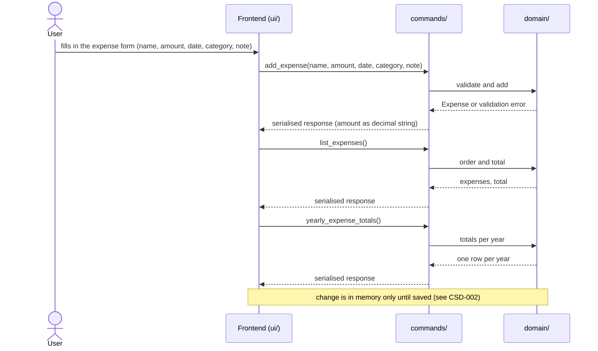
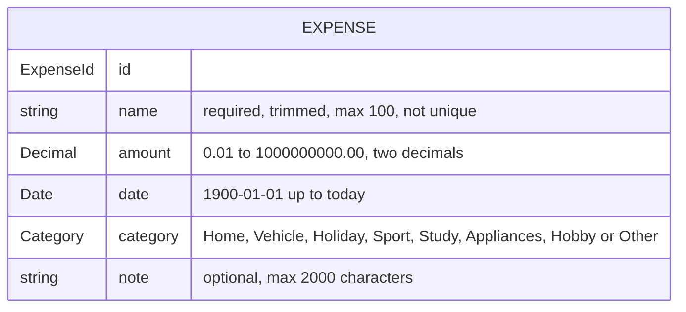

# CSD-013: Expenses

## 1. Intent
The app tracks what the user owns and owes, but has no view of what the user spends money on: a new roof, a car, a holiday, a washing machine. This capability lets the user log expenses, each on a specific date, with an amount, a category and an optional note. From these the app derives, per calendar year, the total spent and the largest expense, and lists all expenses with their total. It is for a single person keeping a private, local history of their purchases. It is a log of what was spent: it has no budgets, no recurrence and no link to bank accounts. The result is a dated history of expenses that the Insights chart of CSD-014 builds on. It follows the structure of Debts (CSD-011), but an expense is one dated record on its own and does not belong to a parent item such as a debt.

## 2. Scope
### 2.1 In scope
- Create, edit and delete expenses, each with a name, an amount above 0.00, a date, a category and an optional note.
- Copy the previous expense into the add form.
- List all expenses, newest first, with their total.
- Yearly totals per calendar year: total spent and the largest expense.
- One Expenses view (tab Overview) with the yearly totals and the list of expenses. The Insights tab is CSD-014.
- Expense data is part of the project file (CSD-002). Expenses count for the currency confirmation of CSD-003 (REQ-17).

### 2.2 Non-goals
- NG-1: Budgets, spending limits, and a comparison with income or any other figure.
- NG-2: Recurring expenses, instalments and spreading one expense over several months or years.
- NG-3: A link to bank accounts, so recording an expense never changes a balance, and integration with net worth and the dashboard (CSD-004).
- NG-4: A threshold or any other rule that limits which expenses can be recorded, such as a minimum amount. The user decides what to record.
- NG-5: Categories that the user can add, rename or remove. The categories are fixed (REQ-3).
- NG-6: More than one category per expense, tags, and sub-categories.
- NG-7: A currency per expense. All amounts are in the project currency (CSD-003).
- NG-8: Expenses dated in the future, planned expenses and forecasts.
- NG-9: Import of expenses (CSV, PDF, bank export), and data fetched from any service.
- NG-10: Attachments such as receipts or photos, and rich text in notes.
- NG-11: Changing several expenses at once, and filtering, searching or sorting by anything.
- NG-12: Refunds and negative amounts.

## 3. Definitions
| Term | Meaning |
|---|---|
| **Expense** | One purchase or cost: a name, an amount, a date, a category and an optional note. It stands on its own and does not belong to another item. |
| **Date** | The calendar day the expense was made, typed and shown as `dd/mm/yyyy`. Its month and year are derived from it and never stored apart from it. |
| **Amount** | What the expense cost, one amount above 0.00 in the project currency. |
| **Category** | One of the fixed values Home, Vehicle, Holiday, Sport, Study, Appliances, Hobby and Other, in that order. |
| **Today** | The calendar date of the user's local time. |
| **Previous expense** | The expense with the latest date, and among expenses with that date the one added last. |
| **Yearly total** | One row per calendar year with at least one expense: the total spent and the largest expense of that year (and, in the data only, the number of expenses, which is not displayed). See REQ-12. |
| **Largest expense (of a year)** | The highest amount of a single expense in that year. |
| **Note** | Optional plain text, up to 2,000 characters, that goes with one expense. |
| **Project file** | The single user-chosen file holding all app data (CSD-002). Expenses are one of its sections. |

## 4. Requirements

### 4.0 Overview flow


### 4.1 Expenses

**REQ-1: Add an expense** *(event-driven)*
When the user submits an expense with a name, an amount, a date, a category and optionally a note, the app shall store it with the given values and with an empty note if none is given, and shall offer the category "Other" in the add form until another is chosen.

```gherkin
@AC-1.1
Scenario: Expense with a note
  Given the current date is 29/10/2026
  When the user adds an expense named "Example Roof Repair" with amount 4500.00, date 15/09/2026, category "Home" and note "Replaced tiles"
  Then the expense "Example Roof Repair" exists with amount 4500.00, date 15/09/2026, category "Home" and note "Replaced tiles"

@AC-1.2
Scenario: Expense without a note
  Given the current date is 29/10/2026
  When the user adds an expense named "Example Washing Machine" with amount 650.00, date 02/10/2026 and category "Appliances" without a note
  Then the expense has an empty note

@AC-1.3
Scenario: The category defaults to Other in the form
  When the user opens the add form
  Then the category shows "Other"

@AC-1.4
Scenario: Two expenses on one day with one name
  Given the current date is 29/10/2026
  And an expense "Example Bike" dated 10/10/2026 with amount 900.00
  When the user adds an expense "Example Bike" dated 10/10/2026 with amount 900.00
  Then both expenses exist

@AC-1.5
Scenario: Adding an expense is an unsaved change
  Given a saved project
  When the user adds an expense
  Then the unsaved indicator is shown
```

**REQ-2: Name rules** *(unwanted behaviour)*
If the name of an expense is empty after trimming or is longer than 100 characters, then the app shall reject the expense or edit without storing or changing it, and shall store an accepted name trimmed. Two expenses may have the same name.

```gherkin
@AC-2.1
Scenario Outline: Invalid names rejected
  When the user adds an expense named "<name>" with amount 100.00, date 15/09/2026 and category "Other"
  Then it is rejected with error code "<code>"
  And no expense exists

  Examples:
    | name           | code                  |
    | (empty)        | EXPENSE_NAME_REQUIRED |
    | (three spaces) | EXPENSE_NAME_REQUIRED |

@AC-2.2
Scenario: Name length boundary
  When the user adds an expense with a name of 100 characters
  Then the expense exists
  When the user adds an expense with a name of 101 characters
  Then it is rejected with error code "EXPENSE_NAME_TOO_LONG"

@AC-2.3
Scenario: The name is stored trimmed
  When the user adds an expense named "  Example Roof Repair  "
  Then the expense is named "Example Roof Repair"
```

**REQ-3: Category** *(unwanted behaviour)*
If the category of an expense is not one of Home, Vehicle, Holiday, Sport, Study, Appliances, Hobby or Other, then the app shall reject the expense or edit with the error code `EXPENSE_CATEGORY_UNSUPPORTED`, without storing or changing it.

```gherkin
@AC-3.1
Scenario Outline: Every category is accepted
  When the user adds an expense with category "<category>"
  Then the expense exists with category "<category>"

  Examples:
    | category   |
    | Home       |
    | Vehicle    |
    | Holiday    |
    | Sport      |
    | Study      |
    | Appliances |
    | Hobby      |
    | Other      |

@AC-3.2
Scenario: Unknown category rejected
  When the user adds an expense with category "Health"
  Then it is rejected with error code "EXPENSE_CATEGORY_UNSUPPORTED"
  And no expense exists

@AC-3.3
Scenario: The category match is exact
  When the user adds an expense with category "home"
  Then it is rejected with error code "EXPENSE_CATEGORY_UNSUPPORTED"
```

**REQ-4: Date rules** *(unwanted behaviour)*
If the date of an expense is not a real calendar date, is before 01/01/1900 or is later than today, then the app shall reject the expense or edit with the error code of the violated rule, without storing or changing it. Today itself is valid.

```gherkin
@AC-4.1
Scenario Outline: Boundary dates
  Given the current date is 29/10/2026
  When the user adds an expense with date "<date>"
  Then <outcome>

  Examples:
    | date       | outcome                                                   |
    | 29/10/2026 | the expense exists with date 29/10/2026                   |
    | 30/10/2026 | it is rejected with error code "EXPENSE_DATE_IN_FUTURE"   |
    | 01/01/1900 | the expense exists with date 01/01/1900                   |
    | 31/12/1899 | it is rejected with error code "EXPENSE_DATE_INVALID"     |

@AC-4.2
Scenario Outline: Invalid dates rejected
  Given the current date is 29/10/2026
  When the user adds an expense with date "<date>"
  Then it is rejected with error code "EXPENSE_DATE_INVALID"
  And no expense exists

  Examples:
    | date       |
    | (empty)    |
    | 31/04/2026 |
    | 29/02/2026 |
    | 2026-09-15 |
    | 15-09-2026 |
    | abc        |

@AC-4.3
Scenario: A leap day is a real date
  Given the current date is 29/10/2026
  When the user adds an expense with date "29/02/2024"
  Then the expense exists with date 29/02/2024
```

**REQ-5: Amount validation** *(unwanted behaviour)*
If the amount of an expense is not a plain number such as 4500.00, is 0.00 or negative, has more than two decimal places or exceeds 1,000,000,000.00, then the app shall reject the expense or edit without rounding or storing it.

```gherkin
@AC-5.1
Scenario Outline: Invalid amounts rejected
  Given the current date is 29/10/2026
  When the user adds an expense with amount "<amount>", date 15/09/2026 and category "Other"
  Then it is rejected with error code "<code>"
  And no expense exists

  Examples:
    | amount        | code                         |
    | (empty)       | EXPENSE_AMOUNT_INVALID       |
    | abc           | EXPENSE_AMOUNT_INVALID       |
    | 1e3           | EXPENSE_AMOUNT_INVALID       |
    | 2500,50       | EXPENSE_AMOUNT_INVALID       |
    | 0.00          | EXPENSE_AMOUNT_NOT_POSITIVE  |
    | -0.01         | EXPENSE_AMOUNT_NOT_POSITIVE  |
    | 100.999       | EXPENSE_AMOUNT_PRECISION     |
    | 1000000000.01 | EXPENSE_AMOUNT_TOO_LARGE     |

@AC-5.2
Scenario Outline: Boundary amounts accepted
  Given the current date is 29/10/2026
  When the user adds an expense with amount "<amount>", date 15/09/2026 and category "Other"
  Then the expense has amount <amount>

  Examples:
    | amount        |
    | 0.01          |
    | 1000000000.00 |

@AC-5.3
Scenario: Invalid amount in an edit rejected
  Given an expense with amount 4500.00
  When the user sets the amount to 0.00
  Then the edit is rejected with error code "EXPENSE_AMOUNT_NOT_POSITIVE"
  And the expense still has amount 4500.00
```

**REQ-6: Note validation** *(unwanted behaviour)*
If the note of an expense is longer than 2,000 characters, then the app shall reject the expense or edit with the error code `EXPENSE_NOTE_TOO_LONG`, without shortening or storing it. Line breaks in a note are kept as typed.

```gherkin
@AC-6.1
Scenario: Note length boundary
  Given the current date is 29/10/2026
  When the user adds an expense dated 15/09/2026 with a note of 2000 characters
  Then the expense exists with that note
  When the user adds an expense dated 16/09/2026 with a note of 2001 characters
  Then it is rejected with error code "EXPENSE_NOTE_TOO_LONG"
  And no expense dated 16/09/2026 exists

@AC-6.2
Scenario: Line breaks are kept
  When the user adds an expense with the note "line one" and "line two" on two lines
  Then the note of the expense has two lines
```

**REQ-7: Edit an expense** *(event-driven)*
When the user edits an expense in the edit form and saves, the app shall give it the edited name, amount, date, category and note under REQ-2 to REQ-6 as one change, without asking for confirmation, and if any edited value is invalid, then the app shall reject the whole edit with the error code of the violated rule and leave the expense as it was. The list, the yearly totals and the insights show the expense under its new values.

```gherkin
@AC-7.1
Scenario: Edit every field
  Given the current date is 29/10/2026
  And an expense "Example Bike" with amount 900.00, date 10/09/2026, category "Hobby" and note "First"
  When the user sets the name "Example E-Bike", the amount 1200.00, the date 12/09/2026, the category "Vehicle" and the note "Upgraded"
  Then the expense has name "Example E-Bike", amount 1200.00, date 12/09/2026, category "Vehicle" and note "Upgraded"
  And no confirmation was asked

@AC-7.2
Scenario: Clear a note
  Given an expense with the note "First"
  When the user empties the note
  Then the expense has an empty note

@AC-7.3
Scenario: Move an expense to another year
  Given the current date is 29/10/2026
  And an expense "Example Bike" with amount 900.00 and date 10/01/2026
  When the user changes its date to 20/12/2025
  Then 2025 shows total 900.00
  And 2026 is not listed in the yearly totals

@AC-7.4
Scenario: An invalid value rejects the whole edit
  Given the current date is 29/10/2026
  And an expense "Example Bike" with amount 900.00 and date 10/09/2026
  When the user changes its date to 11/09/2026 and its amount to -1.00
  Then the edit is rejected with error code "EXPENSE_AMOUNT_NOT_POSITIVE"
  And the expense still has amount 900.00 and date 10/09/2026
  And the unsaved indicator is not shown

@AC-7.5
Scenario: A date in the future is rejected
  Given the current date is 29/10/2026
  And an expense with date 10/09/2026
  When the user changes its date to 30/10/2026
  Then the edit is rejected with error code "EXPENSE_DATE_IN_FUTURE"
  And the expense still has date 10/09/2026

@AC-7.6
Scenario: An edit is an unsaved change
  Given a saved project with an expense
  When the user changes its amount
  Then the unsaved indicator is shown

@AC-7.7
Scenario: A stale screen
  Given the user opened an expense for editing
  And that expense was deleted in the meantime
  When the user saves the edit
  Then it is rejected with error code "EXPENSE_NOT_FOUND"
```

**REQ-8: Delete an expense** *(event-driven)*
When the user confirms deletion of an expense, the app shall remove that expense and no other data.

```gherkin
@AC-8.1
Scenario: Confirmed deletion
  Given expenses "Example Bike" and "Example Roof Repair"
  When the user deletes "Example Bike" and confirms
  Then only "Example Roof Repair" remains

@AC-8.2
Scenario: Cancelled deletion changes nothing
  Given expenses "Example Bike" and "Example Roof Repair"
  When the user starts deleting "Example Bike" and cancels
  Then both expenses still exist

@AC-8.3
Scenario: Deleting the last expense of a year removes the year
  Given the only expense of 2025 and an expense in 2026
  When the user deletes the expense of 2025 and confirms
  Then 2025 is no longer listed in the yearly totals
```

**REQ-9: Copy the previous expense** *(event-driven)*
When the user chooses "Copy previous expense" in the add form, the app shall pre-fill the name, the amount and the category with those of the previous expense and leave the date and the note empty, and shall not store anything until the user confirms.

```gherkin
@AC-9.1
Scenario: Form pre-filled from the previous expense
  Given an expense "Example Bike" with amount 900.00, date 10/09/2026, category "Hobby" and note "First"
  And an expense "Example Roof Repair" with amount 4500.00, date 15/09/2026, category "Home"
  When the user chooses "Copy previous expense" in the add form
  Then the form shows name "Example Roof Repair", amount 4500.00 and category "Home"
  And the date and the note are empty
  And no new expense exists

@AC-9.2
Scenario: Same date, the one added last is copied
  Given an expense "Example Bike" dated 10/09/2026 added first
  And an expense "Example Helmet" dated 10/09/2026 added second
  When the user chooses "Copy previous expense" in the add form
  Then the form shows name "Example Helmet"

@AC-9.3
Scenario: No expenses yet
  Given no expenses exist
  When the user chooses "Copy previous expense" in the add form
  Then the form is left empty except for the category "Other"
  And no error is shown
```

### 4.2 Views

**REQ-10: Ordering** *(ubiquitous)*
The app shall list expenses by date, newest first, and expenses with the same date by name ignoring case, and expenses that are still equal by the order they were added.

```gherkin
@AC-10.1
Scenario: Newest first
  Given expenses dated 10/09/2026, 15/10/2026 and 01/01/2026
  Then they are listed 15/10/2026, 10/09/2026, 01/01/2026

@AC-10.2
Scenario: Same date ordered by name
  Given expenses "example sofa" and "Example Bike", both dated 10/09/2026
  Then "Example Bike" is listed before "example sofa"

@AC-10.3
Scenario: Equal expenses keep the order they were added
  Given two expenses "Example Bike" dated 10/09/2026, the first added before the second
  Then the one added first is listed first
```

**REQ-11: List and total** *(event-driven)*
When the user views the Expenses overview, the app shall list all expenses, newest first as in REQ-10, together with the total amount of all expenses, computed in Rust. The overview has no filter: it always lists every expense, whatever the year or month.

```gherkin
@AC-11.1
Scenario: The total is the sum of all expenses
  Given expenses "Example Bike" 900.00 dated 10/09/2025, "Example Helmet" 80.00 dated 12/09/2026 and "Example Sofa" 1200.00 dated 03/10/2026
  When the user views the Expenses overview
  Then all three expenses are listed, newest first
  And the total of the list is 2180.00

@AC-11.2
Scenario: No expenses
  Given no expenses exist
  When the user views the Expenses overview
  Then the list is empty
  And the total of the list is 0.00
```

AC-11.3 to AC-11.9 (removed in v0.3): the year and month filter no longer exists, so there is nothing to choose, keep or fall back to.

**REQ-12: Yearly totals** *(event-driven)*
When the user views the Expenses overview, the app shall show, for each calendar year with at least one expense and newest year first, in Rust: the total amount spent, and the largest expense of that year, without extrapolating partial years. Rust still returns the number of expenses of each year over IPC (`expense_count`), for internal use, but the app does not display it.

```gherkin
@AC-12.1
Scenario: Totals per calendar year
  Given expenses 900.00 dated 10/09/2025, 80.00 dated 12/09/2025 and 1200.00 dated 03/10/2026
  When the user views the yearly totals
  Then 2026 shows total 1200.00 and largest 1200.00
  And 2025 shows total 980.00 and largest 900.00
  And no row shows a number of expenses

@AC-12.2
Scenario: No expenses
  Given no expenses exist
  When the user views the yearly totals
  Then the yearly totals list is empty

AC-12.3 (removed in v0.3): there is no filter that could change the totals.

@AC-12.4
Scenario: A gap year is not listed
  Given expenses dated 15/09/2024 and 10/03/2026
  When the user views the yearly totals
  Then the rows are listed 2026 and 2024

@AC-12.5
Scenario: Largest ignores the other categories
  Given expenses 900.00 "Hobby" and 4500.00 "Home", both dated in 2026
  When the user views the yearly totals
  Then 2026 shows largest 4500.00

@AC-12.6
Scenario: Totals follow changes
  Given an expense 900.00 dated 10/09/2026
  When the user adds an expense 1200.00 dated 03/10/2026
  Then 2026 shows total 2100.00 and largest 1200.00

@AC-12.7
Scenario: The 1900 and the current year
  Given the current date is 29/10/2026
  And expenses dated 01/01/1900 and 29/10/2026
  When the user views the yearly totals
  Then the rows are listed 2026 and 1900
```

**REQ-13: Expenses view layout** *(ubiquitous)*
The app shall offer "Expenses" as its own item in the left pane directly under Debts with a receipt icon, and shall show the Overview tab as the sections Yearly totals and Expenses in that order, with the columns Year, Total and Largest and no actions in the Yearly totals section, only the button "Add expense" in the header of the Expenses section (no filters), all expenses in the Expenses section, the columns Date, Name, Category, Amount and Note and the icon buttons Edit (pencil) and Delete (trash) flush right on each row in the Expenses section, and the total of the listed expenses in a footer row labelled "Total". A note longer than one line is cut to one line in the table and shown in full when the expense is edited. Dates are shown as `dd/mm/yyyy`. The page offers the tabs "Overview" and "Insights" (CSD-014), with Overview shown first.

```gherkin
@AC-13.1
Scenario: Left pane item
  Then "Expenses" is an item in the left pane directly under "Debts"
  And it shows a receipt icon

@AC-13.2
Scenario: Sections in order
  Given an expense
  When the user opens the Expenses page
  Then the Overview tab is selected
  And the sections appear in the order Yearly totals, Expenses

@AC-13.3
Scenario: Expense rows
  Given an expense "Example Roof Repair" with amount 4500.00, date 15/09/2026, category "Home" and note "Replaced tiles"
  Then the Expenses section shows the columns Date, Name, Category, Amount and Note in that order
  And the row shows "15/09/2026", "Example Roof Repair", "Home", "4500.00" and "Replaced tiles"
  And the row has the icon buttons Edit (pencil) and Delete (trash) at its right edge, each named for screen readers and in a tooltip, such as "Edit Example Roof Repair"

@AC-13.4
Scenario: Footer total
  Given expenses 900.00 dated 10/09/2025 and 80.00 dated 12/09/2026
  Then the list shows both expenses
  And the footer row reads "Total" with "980.00"

@AC-13.5
Scenario: Header of the Expenses section
  Then the header of the Expenses section holds only the button "Add expense"
  And it holds no year or month filter
  And the page title row holds no button

@AC-13.6
Scenario: Yearly totals section
  Given an expense in 2026
  Then the Yearly totals section shows the columns Year, Total and Largest in that order
  And it shows no column with a number of expenses
  And its header holds no button and its rows hold no Edit or Delete button

@AC-13.7
Scenario: Long note cut to one line
  Given an expense with a note of three lines
  Then the Note column shows one line of it
  And editing the expense shows the whole note

@AC-13.8
Scenario: Notes and names are shown as plain text
  Given an expense named "<i>Bike</i>" with the note "<b>bold</b>"
  Then the Name and Note columns show those characters and no formatting

@AC-13.9
Scenario: Tabs
  When the user selects the Insights tab
  Then the Overview sections are hidden
  And the insights chart of CSD-014 is shown
```

**REQ-14: Empty states** *(state-driven)*
While no expenses exist, the app shall show "No expenses yet. Add your first expense." in the Expenses section and "No totals yet. Totals appear once there is an expense." in the Yearly totals section, with the button "Add expense" still available and no error.

```gherkin
@AC-14.1
Scenario: No expenses
  Given no expenses exist
  Then the Expenses section shows "No expenses yet. Add your first expense."
  And the Yearly totals section shows "No totals yet. Totals appear once there is an expense."
  And the button "Add expense" is available
  And no error is shown

AC-14.2 (removed in v0.3): there is no filter, so the list is never empty while expenses exist.
```

**REQ-15: No currency outside Settings** *(ubiquitous)*
The app shall show no currency in the Yearly totals and Expenses sections: not in their titles, in the yearly totals table, in the expenses table or in the add and edit forms.

```gherkin
@AC-15.1
Scenario: No currency in the sections
  Given a project in "EUR" with an expense
  Then the sections are titled "Yearly totals" and "Expenses"
  And the yearly totals table, the expenses table and the forms show no currency
```

### 4.3 Saving, loading and currency

**REQ-16: Expenses are part of the project file** *(event-driven)*
When the user saves and later opens a project, the app shall restore all expenses exactly, including amounts, dates, categories, notes and the order they were added. When the project file has no `expenses` section, the app shall open the project with no expenses. If the section holds an expense with a name, an amount, a date, a category or a note that breaks the rules of REQ-2 to REQ-6, or two expenses with the same id, then the app shall reject the file with the error code `PROJECT_INVALID_FILE`. The date is not checked against today when a file is opened, only against being a real date from 01/01/1900.

```gherkin
@AC-16.1
Scenario: Round trip
  Given a project with an expense "Example Roof Repair" with amount 4500.00, date 15/09/2026, category "Home" and the note "Line one" and "Line two" on two lines
  When the user saves the project and opens it again
  Then the expense exists unchanged, including the two-line note

@AC-16.2
Scenario: File without the section
  Given a project file made before this capability, without an "expenses" section
  When the user opens it
  Then it opens with no expenses and no error

@AC-16.3
Scenario: Other sections are untouched
  Given a project with an employment job, an investment account, a bank account, a debt and an expense
  When the user saves the project and opens it again
  Then all five exist unchanged

@AC-16.4
Scenario Outline: A damaged section is an invalid file
  Given a project file whose "expenses" section has an expense with <damage>
  When the user opens it
  Then it is rejected with the error code "PROJECT_INVALID_FILE"

  Examples:
    | damage                |
    | the category "Health" |
    | the amount "0.00"     |
    | the date "2026-02-30" |
    | a duplicate id        |

@AC-16.5
Scenario: The order they were added survives
  Given two expenses "Example Bike" dated 10/09/2026, the first added before the second, with notes "A" and "B"
  When the user saves the project and opens it again
  Then the expense with the note "A" is listed first
```

**REQ-17: Expenses count for the currency confirmation** *(event-driven)*
When the project has at least one expense and the user chooses another currency, the app shall ask for the confirmation of CSD-003 REQ-5, explaining that amounts are not converted, and a project without expenses shall need no confirmation for them.

```gherkin
@AC-17.1
Scenario: Confirmation with only an expense
  Given a project in "EUR" with no jobs, no investments, no bank accounts, no debts and an expense with amount 4500.00
  When the user chooses the currency "USD"
  Then the app asks for confirmation before changing it
  And cancelling leaves the currency "EUR" and the amount 4500.00

@AC-17.2
Scenario: No expenses needs no confirmation for them
  Given a project in "EUR" with no entries of any kind
  When the user chooses the currency "USD"
  Then the currency changes to "USD" without a confirmation
```

## 5. Interfaces and contracts

Dates: the user types and sees `dd/mm/yyyy` (CSD-000 CON-7). The frontend sends the date as typed, and Rust parses it, validates it and returns it as ISO 8601 (`YYYY-MM-DD`) for the frontend to show as `dd/mm/yyyy`. The project file holds `YYYY-MM-DD`. The year must be 1900 or later, like statements in CSD-005 and CSD-009.



The expense has no parent entity. The month and year of an expense, the yearly totals, the largest expense and the total of the list are not part of the model: they are derived (REQ-11, REQ-12).

The project file gets a new section `expenses` with the list `expenses`, in the order the expenses were added. Amounts are decimal strings. `format_version` stays 1 and nothing is migrated: a file without the section opens with no expenses, as the app is not released yet.

Commands (all inputs validated in Rust; amounts cross IPC as decimal strings): `list_expenses()` (no arguments; returns `{ expenses, total }`: all expenses in the order of REQ-10, each with its id, name, amount, ISO date, category and note, plus their total), `add_expense`, `update_expense` (applies the edit as a whole or not at all, REQ-7), `delete_expense`, `copy_previous_expense()` (returns name, amount and category, or nothing) and `yearly_expense_totals()` (one row per year with the year, total, expense count and largest, newest year first; the count is returned but not displayed). The insights command is in CSD-014. Project commands (save, open, new) are in CSD-002.

Error codes (returned as code plus safe message): `EXPENSE_NAME_REQUIRED`, `EXPENSE_NAME_TOO_LONG`, `EXPENSE_CATEGORY_UNSUPPORTED`, `EXPENSE_DATE_INVALID`, `EXPENSE_DATE_IN_FUTURE`, `EXPENSE_AMOUNT_INVALID`, `EXPENSE_AMOUNT_NOT_POSITIVE`, `EXPENSE_AMOUNT_PRECISION`, `EXPENSE_AMOUNT_TOO_LARGE`, `EXPENSE_NOTE_TOO_LONG`, `EXPENSE_NOT_FOUND`. `EXPENSE_NOT_FOUND` is returned for an expense that does not exist (a stale screen). Project error codes are in CSD-002.

## 6. Constraints
- CON-1: Amounts use `rust_decimal::Decimal` and are in the project currency (CSD-003), so adding amounts never mixes currencies. Rationale: `CLAUDE.md` money rules.
- CON-2: The frontend displays figures computed in Rust, including the total of the list, the yearly totals and the largest expenses, and computes none itself. Rationale: `CLAUDE.md` layout rule.
- CON-3: No network access. Rationale: `CLAUDE.md` Tauri security rules, and NG-9.
- CON-4: Errors shown to the user never contain file paths or OS details. Rationale: `CLAUDE.md` error rules.
- CON-5: Amounts, expense names and notes are not logged at `info` or above. Rationale: `CLAUDE.md` privacy rules.
- CON-6: Tests and fixtures use synthetic data only ("Example Roof Repair", round amounts). Rationale: the repo is public.
- CON-7: Names and notes are stored as typed and displayed as plain text, never as HTML. Rationale: the frontend must not run markup typed by the user.
- CON-8: The length of a name or a note is counted in characters (Unicode scalar values), not bytes. Rationale: names and notes in any language must fit the stated limits.
- CON-9: The totals, the largest expenses and the total of the list are computed in Rust each time they are needed and are never stored in the project file. Rationale: CON-2, and stored figures would go stale when an expense changes.
- CON-10: Expenses get their own module, commands and page. Shared helpers may be reused or extracted when that is small, and Debts, Bank accounts and Investments are not refactored. Rationale: `CLAUDE.md` asks before large refactors across modules.
- CON-11: "Today" is the local calendar date and is decided in Rust. Rationale: the rule against future dates (REQ-4) must not depend on the webview.

## 7. Verification
All ACs are proven by `cargo test`, with domain logic tested in `domain/`, except the screens. Tests are named `test_csd013_ac_<n>_<m>_<description>` (CSD-000 REQ-6).

| Requirement | Command |
|---|---|
| REQ-1 to REQ-12, REQ-16, REQ-17 (data) | `cargo test test_csd013_` |
| AC-11.1 `test_csd013_ac_11_1_the_total_is_the_sum_of_all_expenses` (total of all expenses across years), AC-11.2 `test_csd013_ac_11_2_no_expenses` (empty list, total 0.00), AC-12.1, AC-12.2, AC-12.4 to AC-12.7 (the yearly totals) | `cargo test test_csd013_ac_11_` and `cargo test test_csd013_ac_12_` |
| AC-1.3, AC-1.5, AC-7.6, REQ-13 (all ACs), REQ-14, REQ-15, AC-17.1 (the dialog) | Manual checklist: form labels and the default category, the unsaved indicator, section order and contents, left-pane item and icon, titles without a currency, button placement (only "Add expense" in the section header, no filters), no counts, empty states, note cut-off, plain-text name and note, the currency confirmation dialog. There is no frontend test setup |
| The currency confirmation for expenses | Governed by CSD-003 REQ-5, verified there |
| One requirement, e.g. REQ-4 | `cargo test test_csd013_ac_4_` |

Done means fmt, clippy (`-D warnings`) and `cargo test --all-features` pass.

## 8. Open questions
None.

## 9. Changelog
- 0.3 (29/10/2026): The year and month filter is removed. The overview always lists all expenses, newest first, with their total. REQ-11 is now "List and total" (AC-11.1 and AC-11.2 rewritten, AC-11.3 to AC-11.9 removed), AC-12.3 and AC-14.2 removed, the Filter definition, the filter wording in NG-11, REQ-7, REQ-12, REQ-13, REQ-14, the flow, CON-2 and CON-9 removed or reworded. `list_expenses()` takes no arguments and returns `{ expenses, total }` (no `years`). The number of expenses is no longer displayed (the Expenses column of the yearly totals is gone, REQ-12, REQ-13, AC-12.1, AC-12.6, AC-7.3); `expense_count` stays in the IPC data.
- 0.2 (29/10/2026): Renamed from "Major expenses" to "Expenses": title, file name, page and navigation labels, and wording. No behaviour change. NG-4 is reworded: there is no minimum amount.
- 0.1 (29/10/2026): initial draft, from GitHub issue 16 and the grill-me interview. It follows CSD-011 (layout, validation, copy previous, yearly totals, project file, currency confirmation), with a dated expense that has no parent item, a fixed category list, a year and month filter and no future dates.
