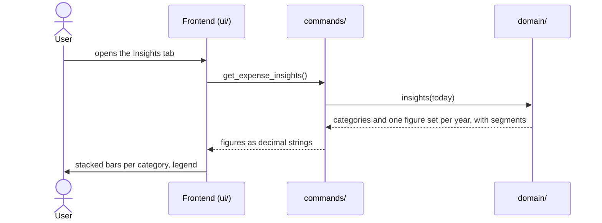

# CSD-014: Major expense insights

## 1. Intent
The Major expenses page lists expenses and a table of yearly totals, but a table does not show how spending develops over the years or what it went to. This capability adds an insights layer to the Major expenses page: one chart with one bar per calendar year, stacked from one segment per category, so the height of a bar is what was spent that year and its segments show where it went. It is for the owner looking back over their own larger purchases. It follows the Debt insights of CSD-012, with the eight fixed categories of CSD-013 as segments, with sums in place of balances, and without a total marker, because the top of the stack is the total. It shows what was spent and nothing else: no budget, no comparison and no forecast.

## 2. Scope
### 2.1 In scope
- The "Insights" tab on the Major expenses page, next to "Overview" (CSD-013 REQ-13).
- A yearly stacked bar chart over all expenses with one segment per category, a legend of the categories, a tooltip and the highlight of one category.
- Its empty state.

### 2.2 Non-goals
- NG-1: A monthly view, or any granularity other than a calendar year.
- NG-2: A filter, a selection or a hiding of categories or years, and any link with the filters of the Overview tab.
- NG-3: Any figure other than the amount per category, the total and the number of expenses of a year: no average, no percentage, no comparison with income and no forecast.
- NG-4: A list of the largest expenses, and a view of single expenses.
- NG-5: Click-through, zooming, or exporting the chart.
- NG-6: Charts on the Dashboard or on the Reports page.
- NG-7: A chart library or any other new dependency.
- NG-8: Spreading an expense over several periods, and estimating spending for a year without expenses.
- NG-9: Letting the user choose the colour of a category.
- NG-10: A marker or line for the total of a year.

## 3. Definitions
| Term | Meaning |
|---|---|
| **Year** | A calendar year. An expense counts in the year of its own date. |
| **Current year** | The calendar year of today, in local time. Its figures run up to today, and are therefore partial. |
| **Segment** | The part of a year's bar that belongs to one category: the sum of the amounts of all expenses of that category in that year. A category without an expense in that year has no segment in it. |
| **Total (of a year)** | The sum of the segments of a year, which is the total of the yearly totals of CSD-013 REQ-12. |
| **Colour slot** | The number from 0 to 7 of a category, fixed by its place in the list of categories: Home 0, Vehicle 1, Holiday 2, Sport 3, Study 4, Appliances 5, Hobby 6, Other 7. It decides the colour of the category. |

## 4. Requirements

### 4.0 Overview flow


**REQ-1: Year series** *(ubiquitous)*
The app shall return one set of figures for every calendar year from the year of the earliest expense up to and including the current year, oldest year first, holding the total, the number of expenses and, per category with an expense in that year, its segment.

```gherkin
@AC-1.1
Scenario: Series runs from the first expense to the current year
  Given today is 29/10/2026
  And the earliest expense is dated 15/03/2024
  And there are expenses in 2025 and 2026
  When the insights are requested
  Then the series holds the years 2024, 2025 and 2026 in that order

@AC-1.2
Scenario: A single year
  Given today is 29/10/2026
  And the only expense is dated 15/09/2026
  When the insights are requested
  Then the series holds only the year 2026

@AC-1.3
Scenario: No expenses
  Given today is 29/10/2026
  And no expenses exist
  When the insights are requested
  Then the series is empty

@AC-1.4
Scenario: An old expense extends the series
  Given today is 29/10/2026
  And the only expense is dated 01/01/2022
  When the insights are requested
  Then the series holds the years 2022, 2023, 2024, 2025 and 2026
```

**REQ-2: Years without expenses** *(unwanted behaviour)*
If a year in the series has no expense, then the app shall return that year with total 0.00, 0 expenses and no segments.

```gherkin
@AC-2.1
Scenario: Gap year
  Given today is 29/10/2026
  And there are expenses in 2022 and 2024 but none in 2023
  When the insights are requested
  Then the year 2023 has total 0.00, 0 expenses and no segments
  And the series holds the years 2022, 2023, 2024, 2025 and 2026
```

**REQ-3: Current year is partial** *(state-driven)*
While a year is the current year, the app shall mark it as partial.

```gherkin
@AC-3.1
Scenario: Current year is marked
  Given today is 29/10/2026
  And there are expenses in 2025 and 2026
  When the insights are requested
  Then the year 2026 is marked partial
  And the year 2025 is not

@AC-3.2
Scenario: Current year without expenses is still in the series and marked
  Given today is 29/10/2026
  And the only expense is dated 15/12/2025
  When the insights are requested
  Then the series holds 2025 and 2026
  And 2026 is marked partial, has total 0.00 and has 0 expenses
```

**REQ-4: Segments are the sums per category** *(ubiquitous)*
The app shall give each year one segment per category that has an expense in that year, equal to the sum of the amounts of those expenses, in the fixed order Home, Vehicle, Holiday, Sport, Study, Appliances, Hobby, Other, and the segments shall add up to the total of the year, which equals the total and the number of expenses of the yearly totals of CSD-013 REQ-12.

```gherkin
@AC-4.1
Scenario: Segments of a year
  Given today is 29/10/2026
  And expenses 4500.00 "Home" dated 15/03/2026, 1200.00 "Home" dated 02/06/2026 and 900.00 "Hobby" dated 10/09/2026
  When the insights are requested
  Then 2026 has the segments "Home" 5700.00 and "Hobby" 900.00
  And 2026 has total 6600.00 and 3 expenses

@AC-4.2
Scenario: A category without an expense in the year has no segment
  Given today is 29/10/2026
  And expenses 900.00 "Hobby" dated 10/09/2025 and 650.00 "Appliances" dated 02/10/2026
  When the insights are requested
  Then 2025 has only the segment "Hobby" 900.00
  And 2026 has only the segment "Appliances" 650.00

@AC-4.3
Scenario: Segments follow the fixed order, not the order added
  Given today is 29/10/2026
  And an expense 900.00 "Hobby" added first and an expense 4500.00 "Home" added second, both dated in 2026
  When the insights are requested
  Then the segments of 2026 are listed "Home" first and "Hobby" second

@AC-4.4
Scenario: The insights equal the yearly totals
  Given today is 29/10/2026
  And expenses 900.00 "Hobby" and 80.00 "Sport" dated in 2025, and 1200.00 "Appliances" dated in 2026
  When the insights and the yearly totals are requested
  Then for every year the total and the number of expenses of the insights equal those of the yearly totals

@AC-4.5
Scenario: All eight categories
  Given today is 29/10/2026
  And one expense of 100.00 in each of the eight categories, all dated in 2026
  When the insights are requested
  Then 2026 has eight segments of 100.00 each in the order Home, Vehicle, Holiday, Sport, Study, Appliances, Hobby, Other
  And 2026 has total 800.00 and 8 expenses

@AC-4.6
Scenario: Cents add up exactly
  Given today is 29/10/2026
  And expenses 0.10 and 0.20 in the category "Other" dated in 2026
  When the insights are requested
  Then 2026 has the segment "Other" 0.30

@AC-4.7
Scenario: An edit moves the segment
  Given today is 29/10/2026
  And an expense 900.00 "Hobby" dated 10/09/2026
  When the user changes its category to "Sport" and requests the insights
  Then 2026 has only the segment "Sport" 900.00
```

**REQ-5: Chart** *(ubiquitous)*
The Insights tab shall draw one bar per year in the order received, stacked upwards from the zero line from one segment per category in the order received, on a y-axis that starts at 0 and ends at a rounded-up value of at least the highest total, with gridlines, compact axis labels (such as "10k"), a gap year as a labelled slot without a bar, and no currency.

```gherkin
@AC-5.1
Scenario: Stacked bars per year
  Given the series holds the years 2025 and 2026
  When the user opens the Insights tab
  Then two bars are drawn, 2025 on the left and 2026 on the right
  And each bar has one segment per category with an expense in that year

@AC-5.2
Scenario: Axis covers the highest total
  Given the highest total of any year is 6600.00
  When the user opens the Insights tab
  Then the top of the y-axis is at least 6600.00
  And the axis starts at 0

@AC-5.3
Scenario: Bar height is the total
  Given 2026 has the segments 5700.00 and 900.00
  When the user opens the Insights tab
  Then the 2026 bar is 6600.00 high

@AC-5.4
Scenario: Gap year is an empty slot
  Given the year 2023 has no expenses
  When the user opens the Insights tab
  Then 2023 has a labelled slot without a bar

@AC-5.5
Scenario: Current year is marked
  Given the year 2026 is partial
  When the user opens the Insights tab
  Then the 2026 bar has a lighter fill
  And its label reads "2026 YTD"

@AC-5.6
Scenario: No total marker
  Given the series holds two years with expenses
  When the user opens the Insights tab
  Then no marker line is drawn for the total of a year
  And the legend shows no marker
```

**REQ-6: A fixed colour per category** *(ubiquitous)*
The Insights tab shall draw every segment of a category in the colour of the category's colour slot (Home 0, Vehicle 1, Holiday 2, Sport 3, Study 4, Appliances 5, Hobby 6, Other 7), taken from the palette of eight colours with a variant for light mode and one for dark mode that CSD-010 REQ-8 defines, so that a category has the same colour in every year, in the legend and in the tooltip, whatever expenses exist.

```gherkin
@AC-6.1
Scenario: A category has one colour everywhere
  Given "Hobby" has segments in 2025 and 2026
  When the user opens the Insights tab
  Then its segments, its legend swatch and its tooltip swatch have the colour of slot 6

@AC-6.2
Scenario: Colours do not depend on the data
  Given only the categories "Sport" and "Other" have expenses
  When the user opens the Insights tab
  Then "Sport" is drawn in the colour of slot 3 and "Other" in the colour of slot 7

@AC-6.3
Scenario: The palette in both modes
  Given the Insights tab shows the chart
  When the app is in light mode and then in dark mode
  Then the eight colours are distinct from each other in each mode
  And each has at most 60% HSL saturation
```

**REQ-7: Legend of categories** *(ubiquitous)*
The Insights tab shall show a legend with a colour swatch and the name of every one of the eight categories, also those without an expense, in the fixed order of REQ-4, wrapping onto more lines when it does not fit.

```gherkin
@AC-7.1
Scenario: The legend lists all categories
  Given only the category "Home" has expenses
  When the user opens the Insights tab
  Then the legend lists Home, Vehicle, Holiday, Sport, Study, Appliances, Hobby and Other in that order, each with its colour swatch

@AC-7.2
Scenario: Narrow window
  Given the Insights tab shows the chart
  When the window is narrow
  Then the legend wraps onto more than one line
  And no category is left out
```

**REQ-8: Details of a year** *(event-driven)*
When the user hovers over or moves keyboard focus to a year, the Insights tab shall show a tooltip with the year, one row per segment with the category's swatch, name and amount in the order of REQ-4, the total, the number of expenses and, for the current year, that it is partial, beside the year's bar as CSD-007 REQ-14 places a tooltip, and shall give the same values to screen readers.

```gherkin
@AC-8.1
Scenario: Tooltip on hover
  Given 2026 has the segments "Home" 5700.00 and "Hobby" 900.00, total 6600.00 and 3 expenses
  When the user hovers over the 2026 bar
  Then a tooltip shows both categories with their swatch and amount, the total 6600.00 and 3 expenses
  And it shows no row for the other six categories

@AC-8.2
Scenario: Tooltip on keyboard focus
  Given the Insights tab shows the chart
  When the user moves focus to the 2026 bar with the Tab key
  Then the same tooltip is shown
  And the tooltip disappears when focus leaves the bar

@AC-8.3
Scenario: Accessible label
  Given 2026 has the segments "Home" 5700.00 and "Hobby" 900.00 and 3 expenses
  When a screen reader reads the 2026 bar
  Then it announces the year, each category with its amount, the total and the number of expenses

@AC-8.4
Scenario: Partial year
  Given the year 2026 is partial
  When the user hovers over the 2026 bar
  Then the tooltip says that the year is partial

@AC-8.5
Scenario: Tooltip beside the bar
  Given the chart shows the years 2024, 2025 and 2026
  When the user hovers over the 2024 bar
  Then the tooltip is shown to the right of that bar with its top level with the top of the bar
  When the user hovers over the 2026 bar and the tooltip does not fit to its right
  Then the tooltip is shown to the left of that bar and stays inside the chart area

@AC-8.6
Scenario: Year without a bar
  Given the year 2023 has no expenses
  When the user hovers over its slot
  Then the tooltip is centred over that slot
  And it shows the total 0.00, 0 expenses and no category rows

@AC-8.7
Scenario: One expense
  Given 2026 has one expense of 650.00 in "Appliances"
  When the user hovers over the 2026 bar
  Then the tooltip shows "Appliances" 650.00, the total 650.00 and 1 expense
```

**REQ-9: Highlight one category** *(event-driven)*
When the mouse is over a segment or a legend item of a category, or keyboard focus is on a legend item, the Insights tab shall keep all segments of that category at full colour in every year and ease all other segments to 70% opacity, set the legend item and the tooltip row of that category in the full text colour and a heavier font weight, and ease the other legend items to 70% opacity, and while no segment or legend item is hovered or focused, the Insights tab shall highlight nothing. Keyboard focus on a year highlights nothing.

```gherkin
@AC-9.1
Scenario: Hovering a segment
  Given 2025 and 2026 each have a segment of "Home" and of "Hobby"
  When the user hovers over the "Home" segment of 2025
  Then all "Home" segments, in 2025 and 2026, keep their full colour
  And all "Hobby" segments are eased down to 70% opacity
  And the "Home" legend item is in the full text colour and a heavier font weight
  And the other legend items are eased down to 70% opacity

@AC-9.2
Scenario: Hovering a legend item
  Given the legend lists the eight categories
  When the user hovers over the legend item "Home"
  Then the segments of "Home" keep their full colour in every year
  And the other segments are eased down to 70% opacity

@AC-9.3
Scenario: Focusing a legend item
  Given the legend lists the eight categories
  When the user moves keyboard focus to the legend item "Home"
  Then the highlight is the same as when hovering over it
  And it ends when focus leaves the legend item

@AC-9.4
Scenario: Leaving the segment
  Given the user hovers over a segment
  When the user moves the mouse to empty space in the year's column
  Then no legend item is highlighted and no segment is dimmed
  And the tooltip is still shown

@AC-9.5
Scenario: Not colour alone
  Given the user hovers over a segment
  Then the highlighted legend item has a heavier font weight than the other items
  And the other segments are lighter, not differently coloured

@AC-9.6
Scenario: Keyboard focus on a year highlights nothing
  Given the Insights tab shows the chart
  When the user moves focus to the 2025 bar with the Tab key
  Then no legend item is highlighted and no segment is dimmed

@AC-9.7
Scenario: A category without expenses
  Given "Sport" has no expense in any year
  When the user hovers over the legend item "Sport"
  Then all segments are eased down to 70% opacity
  And the "Sport" legend item is in a heavier font weight
```

**REQ-10: Motion and reduced motion** *(event-driven)*
When a tooltip appears or moves to another year, or the highlight of REQ-9 changes, the Insights tab shall animate the change over 120 to 150 ms with an ease-out curve, and while the user prefers reduced motion it shall show tooltips and highlight changes at once.

```gherkin
@AC-10.1
Scenario: Tooltip fades in and glides
  Given the Insights tab shows the chart
  When the user hovers over the 2025 bar and then over the 2026 bar
  Then the tooltip fades in over 120 to 150 ms while it slides 4 px towards its place
  And it glides to its new place over 120 to 150 ms instead of jumping

@AC-10.2
Scenario: Dimming eases
  Given the user hovers over a segment of "Home"
  When the user moves the mouse away from the segment
  Then the other segments and the legend items ease back to full opacity over 120 to 150 ms

@AC-10.3
Scenario: Reduced motion
  Given the user prefers reduced motion
  When the user hovers over the 2025 bar and then over the 2026 bar
  Then each tooltip appears at once at its place without sliding or gliding
  And the dimming of segments and legend items changes at once
```

**REQ-11: Refined look and accessible segments** *(ubiquitous)*
The Insights tab shall draw the chart with the look that CSD-012 REQ-13 describes: bars at most 50% of the width of their slot and at most 44 px wide, the top corners of the highest segment rounded by 3 px and a 1 px gap between stacked segments in place of an outline, 1 px gridlines at 55% opacity of the border colour, a 1 px zero line in the muted text colour at 70% opacity, axis and year labels in the muted text colour at regular font weight, and tooltips of 10 px corner radius, 12 px by 14 px padding, a shadow of at least 16 px blur and at most 12% opacity, a 12 px title in semibold and row labels in the muted text colour, in light and in dark mode. Every segment shall carry an accessible label with the category, the year and the amount.

```gherkin
@AC-11.1
Scenario: Bars
  Given the series holds the years 2024, 2025 and 2026
  When the user opens the Insights tab
  Then no bar is wider than 50% of its slot or 44 px
  And the top corners of each bar are rounded by 3 px
  And stacked segments are separated by a 1 px gap and have no outline

@AC-11.2
Scenario: Gridlines, zero line and labels
  Given the Insights tab shows the chart
  Then the gridlines are 1 px lines at 55% opacity of the border colour
  And the zero line is 1 px in the muted text colour at 70% opacity
  And the axis labels and the year labels are in the muted text colour at regular font weight

@AC-11.3
Scenario: Tooltip
  Given the user hovers over a year
  Then the tooltip has a 10 px corner radius, 12 px by 14 px padding and a soft shadow
  And its title is semibold and its row labels are in the muted text colour

@AC-11.4
Scenario: Segment labels
  Given 2026 has a segment of "Home" with amount 5700.00
  When a screen reader reads that segment
  Then it announces "Home", 2026 and 5700.00
```

**REQ-12: No expenses yet** *(state-driven)*
While no expense exists, the Insights tab shall show a note instead of a chart.

```gherkin
@AC-12.1
Scenario: No expenses
  Given a project without expenses
  When the user opens the Insights tab
  Then the note "No expenses yet. The chart appears once there is an expense." is shown
  And no chart is drawn
```

**REQ-13: Current figures** *(event-driven)*
When the user opens the Insights tab, the app shall show figures computed from the project at that moment.

```gherkin
@AC-13.1
Scenario: Figures follow changes
  Given the Insights tab showed total 900.00 for 2026
  And the user added an expense of 650.00 dated in 2026 on the Overview tab
  When the user opens the Insights tab again
  Then the 2026 bar is 1550.00 high

@AC-13.2
Scenario: Last expense deleted
  Given the Insights tab showed a chart
  And the user deleted the only expense on the Overview tab
  When the user opens the Insights tab again
  Then the note of AC-12.1 is shown and no chart is drawn

@AC-13.3
Scenario: A moved expense follows to its new year
  Given an expense dated 10/01/2026
  When the user changes its date to 20/12/2025 and opens the Insights tab
  Then the series holds 2025 and 2026, and the segment is in 2025

@AC-13.4
Scenario: The Overview filter has no effect
  Given expenses in 2025 and 2026
  And the Overview tab has the year 2026 and the month October chosen
  When the user opens the Insights tab
  Then the chart still shows 2025 and 2026
```

## 5. Interfaces and contracts

Command: `get_expense_insights()` returns the fixed list of categories with their colour slots and the series, oldest year first:

```json
{
  "categories": [
    { "name": "Home", "colour_slot": 0 },
    { "name": "Vehicle", "colour_slot": 1 },
    { "name": "Holiday", "colour_slot": 2 },
    { "name": "Sport", "colour_slot": 3 },
    { "name": "Study", "colour_slot": 4 },
    { "name": "Appliances", "colour_slot": 5 },
    { "name": "Hobby", "colour_slot": 6 },
    { "name": "Other", "colour_slot": 7 }
  ],
  "years": [
    { "year": 2025, "total": "900.00", "expense_count": 1, "is_partial": false,
      "segments": [ { "category": "Hobby", "amount": "900.00" } ] },
    { "year": 2026, "total": "6600.00", "expense_count": 3, "is_partial": true,
      "segments": [ { "category": "Home", "amount": "5700.00" }, { "category": "Hobby", "amount": "900.00" } ] }
  ]
}
```

`categories` always holds the eight categories. `years` is empty when there are no expenses. `segments` follow the fixed category order and are empty for a gap year, where `total` is "0.00". Amounts are decimal strings. Rust decides "today" (local time), the years, the partial flag and the sums, and the frontend only displays what it receives. Error codes are those of CSD-013.

## 6. Constraints
- CON-1: The chart reuses the shared chart code of the frontend (`ui/shared/yearly-chart.js`) and adds no chart library or other dependency. Rationale: NG-7, and `CLAUDE.md` asks before adding dependencies.
- CON-2: The frontend displays figures computed in Rust and computes no amounts, not even the sum of the segments. The only arithmetic is turning values into positions. Rationale: `CLAUDE.md` layout rule.
- CON-3: No network access. Rationale: `CLAUDE.md` Tauri security rules.
- CON-4: Category names are drawn as plain text, never as HTML. Rationale: names are data from Rust and must not run as markup.
- CON-5: Tests and fixtures use synthetic data only. Rationale: the repo is public.
- CON-6: The palette is the one of the bank accounts chart (CSD-010 CON-6), defined once as colour tokens per mode, and no colour of a category is written inline in the page code. Rationale: one place to adjust, and both modes stay in step.
- CON-7: The mapping from category to colour slot is defined once in Rust and travels with the data. Rationale: the frontend decides nothing about categories, and a new category later changes one place.

## 7. Verification
The series is computed in Rust, so REQ-1 to REQ-4 are proven by `cargo test`. Tests are named `test_csd014_ac_<n>_<m>_<description>` (CSD-000 REQ-6).

| Requirement | Command |
|---|---|
| REQ-1 to REQ-4, AC-13.3 and AC-13.4 (the data) | `cargo test test_csd014_` |
| REQ-5 to REQ-12 (all ACs), AC-13.1, AC-13.2 (the screen) | Manual checklist: stacking, axis range, no marker, colours of both modes, legend order and wrapping, tooltip placement and rows, highlight from a segment and from the legend including keyboard and a category without expenses, motion and reduced motion, the look, accessible labels and the empty note. There is no frontend test setup |
| One requirement, e.g. REQ-4 | `cargo test test_csd014_ac_4_` |

Done means fmt, clippy (`-D warnings`) and `cargo test --all-features` pass.

## 8. Open questions
None.

## 9. Changelog
- 0.1 (29/10/2026): initial draft, from GitHub issue 16 and the grill-me interview. It follows CSD-012 (year series, partial year, tooltip, highlight, motion, look), with one segment per fixed category holding a sum, a legend of all eight categories and no total marker.
