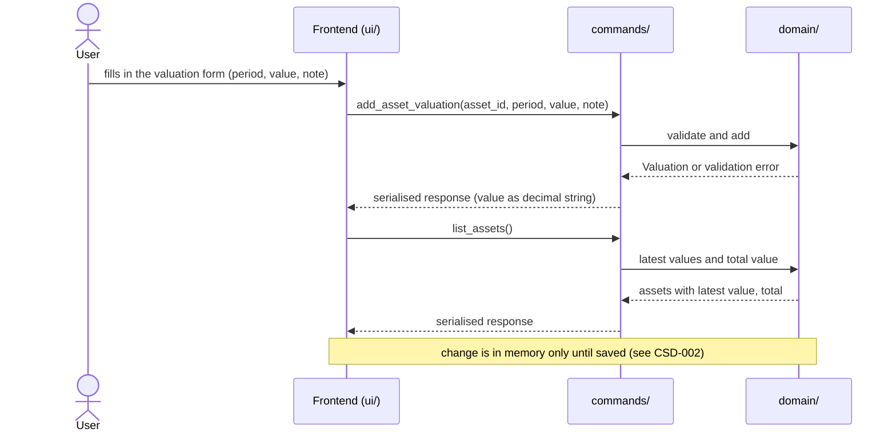
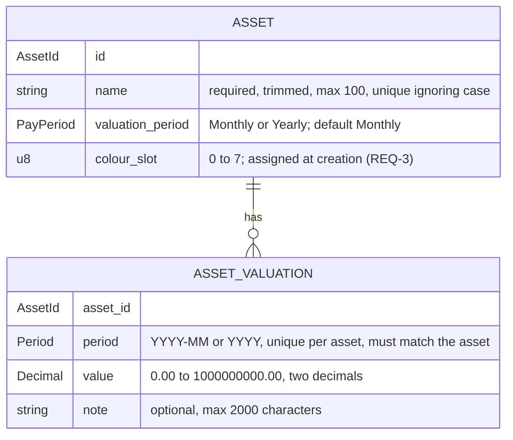

# CSD-015: Assets

## 1. Intent
The app tracks bank accounts, investments and debts, but has no view of what the user owns apart from those: a home, land, a car. This capability lets the user record assets and, per asset, one value per month or per year, with an optional note. From these the app derives, per valuation, how much the value changed since the previous one and, per calendar year, the yearly values with the closing value and the change. It is for a single person keeping a private, local history of what their assets are worth. It records values as the user estimates or reads them, such as a valuation report. It does not model the asset: no purchase price, no depreciation, no address. The result is a value history per asset, which the Insights chart of CSD-016 and later features (net-worth linkage) can build on. It follows the structure of Debts (CSD-011), with a value that cannot be negative and with the change counted as growth.

## 2. Scope
### 2.1 In scope
- Create, edit and delete assets, each with a name and a valuation period (Monthly or Yearly).
- Create, edit and delete one valuation per asset per period: the value (0.00 or more) and an optional note.
- Change the period of an existing valuation (REQ-12).
- Copy the previous valuation into the add form.
- The change per valuation: its value minus the value of the previous valuation (REQ-19).
- Yearly values per calendar year over all assets: closing value, change and the number of valuations.
- One Assets view (tab Overview) with the assets, their latest values, the total value, the yearly values and the valuations of all assets. The Insights tab is CSD-016.
- Asset data is part of the project file (CSD-002). Valuations count for the currency confirmation of CSD-003 (REQ-25).

### 2.2 Non-goals
- NG-1: Purchase price, depreciation, appreciation rates and any forecast of a value.
- NG-2: An asset type (home, car, land), an address and other details of the asset: a name is the only identifier. A home is an asset like any other.
- NG-3: A debt linked to an asset, such as a mortgage on a home (CSD-011 NG-3).
- NG-4: Netting the assets against debts, bank accounts and investments, and integration with net worth and the dashboard (CSD-004).
- NG-5: Data fetched from a valuation service, and import of valuations (CSV, PDF).
- NG-6: Archiving or marking an asset as sold. An asset at 0.00 stays a normal row.
- NG-7: A currency per asset. All amounts are in the project currency (CSD-003).
- NG-8: Individual transactions (purchase, sale, renovation costs), a stored original value, and negative values.
- NG-9: Aligning the latest values of different assets to one date, or estimating a value for a period without a valuation.
- NG-10: Moving a valuation to another asset. Only the period of a valuation can change (REQ-12).
- NG-11: Changing the periods of several valuations at once.
- NG-12: Rich text or attachments in notes.
- NG-13: Letting the user choose the colour of an asset (CSD-016 NG-6).

## 3. Definitions
| Term | Meaning |
|---|---|
| **Asset** | One thing the user owns that has a value, identified by a name such as "Example House". |
| **Valuation period** | How an asset is recorded: **Monthly** (one valuation per calendar month, `YYYY-MM`) or **Yearly** (one valuation per calendar year, `YYYY`). An asset is Monthly unless Yearly is chosen. |
| **Valuation** | The record of one asset for one period: its value and an optional note. |
| **Value** | What the asset is worth at the end of the period, as one amount of 0.00 or more in the project currency. |
| **Previous valuation** | The valuation of the same asset with the latest period before that of the valuation at hand, also when periods in between have none. |
| **Change** | For a valuation: its value minus the value of its previous valuation. Positive when the value grew, negative when it fell. It is derived and never stored. A first valuation has no change. |
| **Latest value** | The value of the valuation with the most recent period of an asset. |
| **Total value** | The sum of the latest values of all assets that have at least one valuation. |
| **Yearly value** | One row per calendar year: the closing value, the change and the number of valuations of that year, over all assets. See REQ-20. |
| **Closing value (of a year)** | The sum, over the assets that have a valuation in that year, of the value of each asset's latest valuation in that year. |
| **Opening value (of an asset in a year)** | The value of the latest valuation of the asset before that year. An asset without an earlier valuation has none. |
| **Change (in a year)** | The sum, over the assets that have a valuation in that year and an opening value in it, of the closing value minus the opening value of that asset. It is negative when those assets lost value. It is none when no asset has an opening value in that year. |
| **Colour slot** | A number from 0 to 7 stored with an asset. CSD-016 draws the asset in the colour of its slot. |
| **Note** | Optional plain text, up to 2,000 characters, that goes with one valuation. |
| **Project file** | The single user-chosen file holding all app data (CSD-002). Assets are one of its sections. |

## 4. Requirements

### 4.0 Overview flow


### 4.1 Assets

**REQ-1: Add an asset** *(event-driven)*
When the user submits a new asset with a name and a valuation period, the app shall create the asset with valuation period Monthly unless Yearly is chosen, and with a colour slot under REQ-3.

```gherkin
@AC-1.1
Scenario: Asset created with the default period
  Given no assets exist
  When the user adds an asset named "Example House" without choosing a period
  Then the asset "Example House" exists with valuation period "Monthly"
  And it has no valuations

@AC-1.2
Scenario: Yearly asset
  Given no assets exist
  When the user adds an asset named "Example Land" with valuation period "Yearly"
  Then the asset "Example Land" exists with valuation period "Yearly"

@AC-1.3
Scenario: Unknown period rejected
  When the user adds an asset named "Example House" with valuation period "Weekly"
  Then it is rejected with error code "ASSET_PERIOD_UNSUPPORTED"
  And no asset exists
```

**REQ-2: Asset name rules** *(unwanted behaviour)*
If the name of an asset is empty after trimming, is longer than 100 characters, or equals the name of another asset when case is ignored, then the app shall reject the asset or edit without storing or changing it, and shall store an accepted name trimmed.

```gherkin
@AC-2.1
Scenario Outline: Invalid names rejected
  Given an asset named "Example House"
  When the user adds an asset named "<name>"
  Then it is rejected with error code "<code>"
  And only the asset "Example House" exists

  Examples:
    | name           | code                  |
    | (empty)        | ASSET_NAME_REQUIRED   |
    | (three spaces) | ASSET_NAME_REQUIRED   |
    | EXAMPLE HOUSE  | ASSET_NAME_DUPLICATE  |
    | example house  | ASSET_NAME_DUPLICATE  |

@AC-2.2
Scenario: Name length boundary
  When the user adds an asset with a name of 100 characters
  Then the asset exists
  When the user adds an asset with a name of 101 characters
  Then it is rejected with error code "ASSET_NAME_TOO_LONG"

@AC-2.3
Scenario: The name is stored trimmed
  When the user adds an asset named "  Example House  "
  Then the asset is named "Example House"

@AC-2.4
Scenario: Renaming to an existing name is rejected
  Given assets "Example House" and "Example Land"
  When the user renames "Example Land" to "example house"
  Then the edit is rejected with error code "ASSET_NAME_DUPLICATE"

@AC-2.5
Scenario: Changing only the case of its own name is allowed
  Given an asset "Example Land"
  When the user renames it to "EXAMPLE LAND"
  Then the asset is named "EXAMPLE LAND"
```

**REQ-3: Colour slot** *(event-driven)*
When an asset is created, the app shall give it the lowest colour slot (0 to 7) that is used by the fewest existing assets, and shall keep that slot for the life of the asset, also when other assets are deleted.

```gherkin
@AC-3.1
Scenario: Slots follow creation order
  Given no assets exist
  When the user adds three assets
  Then they have colour slots 0, 1 and 2 in the order they were added

@AC-3.2
Scenario: Slots cycle after eight assets
  Given eight assets with colour slots 0 to 7
  When the user adds a ninth asset
  Then it has colour slot 0

@AC-3.3
Scenario: Deleting an asset does not recolour the others
  Given assets with colour slots 0, 1 and 2
  When the user deletes the asset with colour slot 0 and confirms
  Then the other assets still have colour slots 1 and 2

@AC-3.4
Scenario: A freed slot is used first
  Given assets with colour slots 0, 1 and 2
  When the user deletes the asset with colour slot 1 and confirms
  And adds an asset
  Then the new asset has colour slot 1

@AC-3.5
Scenario: Renaming keeps the slot
  Given an asset with colour slot 2
  When the user renames it
  Then it still has colour slot 2
```

**REQ-4: Edit an asset** *(event-driven)*
When the user edits an asset, the app shall apply a changed name under REQ-2 and a changed valuation period under REQ-5, and shall keep the asset's valuations.

```gherkin
@AC-4.1
Scenario: Rename keeps valuations
  Given an asset "Example House" with 2 valuations
  When the user renames it to "Example Home"
  Then the asset is named "Example Home"
  And it still has 2 valuations

@AC-4.2
Scenario: Period of an asset without valuations can change
  Given a "Monthly" asset "Example House" with no valuations
  When the user changes its valuation period to "Yearly"
  Then the asset has valuation period "Yearly"

@AC-4.3
Scenario: An invalid edit changes nothing
  Given assets "Example House" and "Example Land"
  When the user renames "Example Land" to "  "
  Then the edit is rejected with error code "ASSET_NAME_REQUIRED"
  And "Example Land" keeps its name
```

**REQ-5: Valuation period is locked once valuations exist** *(unwanted behaviour)*
If the user changes the valuation period of an asset that has at least one valuation, then the app shall reject the change with the error code `ASSET_PERIOD_LOCKED`.

```gherkin
@AC-5.1
Scenario: Period change rejected
  Given a "Monthly" asset "Example House" with a valuation for 2026-09
  When the user changes its valuation period to "Yearly"
  Then the change is rejected with error code "ASSET_PERIOD_LOCKED"
  And the asset still has valuation period "Monthly"

@AC-5.2
Scenario: Period change allowed again after deleting the last valuation
  Given a "Monthly" asset "Example House" with one valuation
  When the user deletes the valuation and confirms
  And changes the valuation period to "Yearly"
  Then the asset has valuation period "Yearly"
```

**REQ-6: Delete an asset** *(event-driven)*
When the user confirms deletion of an asset, the app shall remove the asset and all of its valuations.

```gherkin
@AC-6.1
Scenario: Deletion cascades
  Given an asset "Example House" with 3 valuations
  When the user deletes the asset and confirms
  Then the asset no longer exists
  And none of its 3 valuations exist

@AC-6.2
Scenario: Cancelled deletion changes nothing
  Given an asset "Example House" with 3 valuations
  When the user starts deleting the asset and cancels
  Then the asset and its 3 valuations still exist

@AC-6.3
Scenario: An asset at 0.00 is deleted like any other
  Given an asset "Example Car" whose latest value is 0.00
  When the user deletes the asset and confirms
  Then the asset and its valuations no longer exist
```

### 4.2 Valuations

**REQ-7: Add a valuation** *(event-driven)*
When the user submits a valuation for the asset chosen in the add form, a period and a value, the app shall store it with the given note, or with an empty note if none is given, and shall accept any period that is not later than the current month (monthly asset) or the current year (yearly asset), including periods before the asset existed in the app.

```gherkin
@AC-7.1
Scenario: Monthly valuation with a note
  Given the current date is 29/10/2026
  And a monthly asset "Example House"
  When the user adds a valuation for 2026-09 with value 300000.00 and note "Valuation report"
  Then the valuation for 2026-09 has value 300000.00 and note "Valuation report"

@AC-7.2
Scenario: Yearly valuation without a note
  Given the current date is 29/10/2026
  And a yearly asset "Example Land"
  When the user adds a valuation for 2025 with value 80000.00 and no note
  Then the valuation for 2025 has value 80000.00 and an empty note

@AC-7.3
Scenario: Old periods are accepted
  Given a monthly asset "Example House"
  When the user adds a valuation for 2019-01 with value 200000.00
  Then the valuation for 2019-01 exists

@AC-7.4
Scenario Outline: Current period accepted, later period rejected
  Given the current date is 29/10/2026
  And a <period_type> asset "Example Asset"
  When the user adds a valuation for "<period>" with value 1000.00
  Then <outcome>

  Examples:
    | period_type | period  | outcome                                                      |
    | monthly     | 2026-10 | the valuation for 2026-10 exists                             |
    | monthly     | 2026-11 | it is rejected with error code "ASSET_VALUATION_IN_FUTURE"   |
    | yearly      | 2026    | the valuation for 2026 exists                                |
    | yearly      | 2027    | it is rejected with error code "ASSET_VALUATION_IN_FUTURE"   |

@AC-7.5
Scenario Outline: Invalid period rejected
  Given a <period_type> asset "Example Asset"
  When the user adds a valuation for "<period>" with value 1000.00
  Then it is rejected with error code "ASSET_VALUATION_PERIOD_INVALID"

  Examples:
    | period_type | period  |
    | monthly     | 2026-13 |
    | monthly     | 2026-9  |
    | monthly     | abcd    |
    | yearly      | 26      |
    | yearly      | abcd    |
    | yearly      | 1899    |
```

**REQ-8: One valuation per asset per period** *(unwanted behaviour)*
If the user adds a valuation for an asset and period that already has one, then the app shall reject it with the error code `ASSET_VALUATION_DUPLICATE` and leave the existing valuation unchanged.

```gherkin
@AC-8.1
Scenario: Duplicate period rejected
  Given a monthly asset with a valuation for 2026-09 with value 300000.00 and note "First"
  When the user adds another valuation for 2026-09 with value 310000.00
  Then it is rejected with error code "ASSET_VALUATION_DUPLICATE"
  And the valuation for 2026-09 still has value 300000.00 and note "First"

@AC-8.2
Scenario: Same period on a different asset is allowed
  Given two monthly assets, and the first has a valuation for 2026-09
  When the user adds a valuation for 2026-09 to the second asset
  Then both assets have a valuation for 2026-09
```

**REQ-9: Valuations match the valuation period** *(unwanted behaviour)*
If the user adds a monthly valuation to a yearly asset or a yearly valuation to a monthly asset, then the app shall reject it with the error code `ASSET_PERIOD_MISMATCH`.

```gherkin
@AC-9.1
Scenario: Monthly valuation for a yearly asset rejected
  Given a "Yearly" asset
  When a valuation for 2026-09 with value 1000.00 is added to it
  Then it is rejected with error code "ASSET_PERIOD_MISMATCH"

@AC-9.2
Scenario: Yearly valuation for a monthly asset rejected
  Given a "Monthly" asset
  When a valuation for 2025 with value 1000.00 is added to it
  Then it is rejected with error code "ASSET_PERIOD_MISMATCH"
```

**REQ-10: Value validation** *(unwanted behaviour)*
If the value of a valuation is not a plain number such as 300000.00, is negative, has more than two decimal places or exceeds 1,000,000,000.00, then the app shall reject the valuation or edit without rounding or storing it. A value of 0.00 is valid.

```gherkin
@AC-10.1
Scenario Outline: Invalid values rejected
  Given a monthly asset "Example House" and the current date 29/10/2026
  When the user adds a valuation for 2026-09 with value "<value>"
  Then it is rejected with error code "<code>"
  And no valuation for 2026-09 exists

  Examples:
    | value          | code                          |
    | (empty)        | ASSET_VALUATION_VALUE_INVALID   |
    | abc            | ASSET_VALUATION_VALUE_INVALID   |
    | 1e3            | ASSET_VALUATION_VALUE_INVALID   |
    | 2500,50        | ASSET_VALUATION_VALUE_INVALID   |
    | -0.01          | ASSET_VALUATION_VALUE_NEGATIVE  |
    | 1000.999       | ASSET_VALUATION_VALUE_PRECISION |
    | 1000000000.01  | ASSET_VALUATION_VALUE_TOO_LARGE |

@AC-10.2
Scenario Outline: Boundary values accepted
  Given a monthly asset "Example House" and the current date 29/10/2026
  When the user adds a valuation for 2026-09 with value "<value>"
  Then the valuation for 2026-09 has value <value>

  Examples:
    | value         |
    | 0.00          |
    | 1000000000.00 |

@AC-10.3
Scenario: Invalid value in an edit rejected
  Given a valuation for 2026-09 with value 300000.00
  When the user sets the value to -1.00
  Then the edit is rejected with error code "ASSET_VALUATION_VALUE_NEGATIVE"
  And the valuation still has value 300000.00
```

**REQ-11: Note validation** *(unwanted behaviour)*
If the note of a valuation is longer than 2,000 characters, then the app shall reject the valuation or edit with the error code `ASSET_VALUATION_NOTE_TOO_LONG`, without shortening or storing it. Line breaks in a note are kept as typed.

```gherkin
@AC-11.1
Scenario: Note length boundary
  Given a monthly asset "Example House" and the current date 29/10/2026
  When the user adds a valuation for 2026-08 with value 1000.00 and a note of 2000 characters
  Then the valuation for 2026-08 exists with that note
  When the user adds a valuation for 2026-09 with value 1000.00 and a note of 2001 characters
  Then it is rejected with error code "ASSET_VALUATION_NOTE_TOO_LONG"
  And no valuation for 2026-09 exists

@AC-11.2
Scenario: Line breaks are kept
  Given a monthly asset "Example House"
  When the user adds a valuation for 2026-09 with value 1000.00 and the note "line one" and "line two" on two lines
  Then the note of the valuation has two lines
```

**REQ-12: Edit a valuation and change its period** *(event-driven)*
When the user edits an existing valuation in the edit form and saves, the app shall give the valuation the edited value and note under REQ-10 and REQ-11 and, when the period was changed, the new period, as one change, without asking for confirmation. The valuation stays with its asset, and the latest values, the changes, the yearly values and the insights show it under its new period.

```gherkin
@AC-12.1
Scenario: Edit value and note
  Given a valuation for 2026-09 with value 300000.00 and note "First"
  When the user sets the value to 310000.00 and the note to "Corrected"
  Then the valuation has value 310000.00 and note "Corrected"

@AC-12.2
Scenario: Clear a note
  Given a valuation for 2026-09 with value 300000.00 and note "First"
  When the user empties the note
  Then the valuation has an empty note

@AC-12.3
Scenario: Move a valuation to another month
  Given a monthly asset with a valuation for 2026-09 with value 300000.00 and note "First"
  When the user changes its period to 2026-08
  Then the asset has a valuation for 2026-08 with value 300000.00 and note "First"
  And the asset has no valuation for 2026-09
  And no confirmation was asked

@AC-12.4
Scenario: Change the period and the value together
  Given a monthly asset with a valuation for 2026-09 with value 300000.00
  When the user changes its period to 2026-08 and sets the value to 310000.00
  Then the valuation for 2026-08 has value 310000.00
  And there is no valuation for 2026-09

@AC-12.5
Scenario: Move a yearly valuation
  Given a yearly asset with a valuation for 2025 with value 80000.00
  When the user changes its period to 2024
  Then the asset has a valuation for 2024 with value 80000.00
  And the asset has no valuation for 2025

@AC-12.6
Scenario: The yearly values follow the move
  Given a monthly asset with valuations 2025-11 (value 10000.00), 2025-12 (value 10200.00) and 2026-05 (value 11000.00)
  When the user changes the period of the valuation for 2025-12 to 2026-01
  Then 2025 shows closing value 10000.00 and valuations 1
  And 2026 shows closing value 11000.00 and valuations 2

@AC-12.7
Scenario Outline: The edit form offers the period
  Given <valuation>
  When the user opens it for editing
  Then the form shows the <field> "<value>" and the asset, which cannot be changed

  Examples:
    | valuation                        | field | value   |
    | a monthly valuation for 2026-09  | month | 2026-09 |
    | a yearly valuation for 2025      | year  | 2025    |

@AC-12.8
Scenario: Keeping the period changes only the values
  Given a monthly asset with a valuation for 2026-09 with value 300000.00
  When the user saves it with the period 2026-09 and value 310000.00
  Then the valuation for 2026-09 has value 310000.00
  And no error about a duplicate period is shown

@AC-12.9
Scenario: An edit is an unsaved change
  Given a saved project with a monthly valuation for 2026-09
  When the user changes its period to 2026-08
  Then the unsaved indicator is shown
```

**REQ-13: Invalid new period** *(unwanted behaviour)*
If the new period of an edited valuation is later than the current month (monthly asset) or the current year (yearly asset), or is not a valid period, or the asset already has another valuation for it, or it does not match the valuation period of the asset, or the edit also has an invalid value, then the app shall reject the whole edit with the error code of the violated rule and leave the valuation, with its period and its values, as it was. Another asset may have a valuation for the same period.

```gherkin
@AC-13.1
Scenario Outline: A period in the future is rejected
  Given the current date is 29/10/2026
  And <asset> with a valuation for <old> with value 1000.00
  When the user changes its period to "<new>"
  Then the edit is rejected with error code "ASSET_VALUATION_IN_FUTURE"
  And the valuation for <old> still has value 1000.00

  Examples:
    | asset           | old     | new     |
    | a monthly asset | 2026-09 | 2026-11 |
    | a yearly asset  | 2025    | 2027    |

@AC-13.2
Scenario: A period that already has a valuation is rejected
  Given a monthly asset with a valuation for 2026-08 with value 299000.00 and one for 2026-09 with value 300000.00
  When the user changes the period of the valuation for 2026-09 to 2026-08 and sets the value to 310000.00
  Then the edit is rejected with error code "ASSET_VALUATION_DUPLICATE"
  And the valuation for 2026-08 still has value 299000.00
  And the valuation for 2026-09 still has value 300000.00

@AC-13.3
Scenario Outline: A period of the wrong kind is rejected
  Given <asset> with a valuation for <old>
  When the user changes its period to "<new>"
  Then the edit is rejected with error code "ASSET_PERIOD_MISMATCH"
  And the valuation is still for <old>

  Examples:
    | asset           | old     | new     |
    | a monthly asset | 2026-09 | 2026    |
    | a yearly asset  | 2025    | 2024-12 |

@AC-13.4
Scenario: An invalid value rejects the whole edit
  Given a monthly asset with a valuation for 2026-09 with value 300000.00
  When the user changes its period to 2026-08 and sets the value to -1.00
  Then the edit is rejected with error code "ASSET_VALUATION_VALUE_NEGATIVE"
  And the valuation is still for 2026-09 with value 300000.00
  And the unsaved indicator is not shown

@AC-13.5
Scenario: Another asset may have the same period
  Given two monthly assets, the first with a valuation for 2026-08 and the second with one for 2026-09
  When the user changes the period of the second asset's valuation to 2026-08
  Then both assets have a valuation for 2026-08

@AC-13.6
Scenario: An invalid period is rejected
  Given a monthly asset with a valuation for 2026-09 with value 300000.00
  When the user changes its period to "2026-13"
  Then the edit is rejected with error code "ASSET_VALUATION_PERIOD_INVALID"
  And the valuation is still for 2026-09
```

**REQ-14: Delete a valuation** *(event-driven)*
When the user confirms deletion of a valuation, the app shall remove that valuation and no other data.

```gherkin
@AC-14.1
Scenario: Confirmed deletion
  Given a monthly asset with valuations for 2026-08 and 2026-09
  When the user deletes the valuation for 2026-09 and confirms
  Then only the valuation for 2026-08 remains

@AC-14.2
Scenario: Cancelled deletion changes nothing
  Given a monthly asset with valuations for 2026-08 and 2026-09
  When the user starts deleting the valuation for 2026-09 and cancels
  Then both valuations still exist
```

**REQ-15: Copy the previous period** *(event-driven)*
When the user chooses "copy previous month" (monthly asset) or "copy previous year" (yearly asset) in the add form, the app shall pre-fill the value with that of the asset's most recent valuation and leave the note empty, and shall not store anything until the user confirms.

```gherkin
@AC-15.1
Scenario: Form pre-filled from the latest valuation
  Given a monthly asset with valuations for 2026-07 (value 299000.00) and 2026-08 (value 300000.00, note "Valuation report")
  When the user chooses "copy previous month" in the add form for that asset
  Then the form shows value 300000.00 and an empty note
  And no new valuation exists

@AC-15.2
Scenario: Asset without valuations
  Given a monthly asset with no valuations
  When the user chooses "copy previous month" in the add form for that asset
  Then the form is left empty
  And no error is shown

@AC-15.3
Scenario: A value of 0.00 is copied as it is
  Given a monthly asset with a valuation for 2026-08 with value 0.00
  When the user chooses "copy previous month" in the add form for that asset
  Then the form shows value 0.00
```

**REQ-16: The add form follows the valuation period** *(event-driven)*
When the user chooses an asset in the add form, the app shall ask for a month if the asset is monthly and for a year if it is yearly, and shall label the copy button "Copy previous month" or "Copy previous year" accordingly.

```gherkin
@AC-16.1
Scenario: Monthly asset
  Given a "Monthly" asset
  When the user chooses it in the add form
  Then the form asks for "Month (YYYY-MM)"
  And the copy button reads "Copy previous month"

@AC-16.2
Scenario: Yearly asset
  Given a "Yearly" asset
  When the user chooses it in the add form
  Then the form asks for "Year (YYYY)"
  And the copy button reads "Copy previous year"

@AC-16.3
Scenario: Switching asset switches the form
  Given a "Monthly" asset and a "Yearly" asset
  When the user chooses the yearly asset and then the monthly asset in the add form
  Then the form asks for a year and then for a month again
```

### 4.3 Views

**REQ-17: Latest value and total value** *(ubiquitous)*
The app shall show for each asset the value of its most recent valuation together with that valuation's period, and shall show the total of the latest values of all assets that have a valuation, as computed in Rust, without converting or aligning the periods.

```gherkin
@AC-17.1
Scenario: Latest value per asset
  Given a monthly asset with valuations for 2026-07 (value 299000.00) and 2026-09 (value 300000.00)
  Then the asset shows latest value 300000.00 for 2026-09

@AC-17.2
Scenario: Total over assets with different periods
  Given a monthly asset with latest valuation 2026-09 (value 300000.50)
  And a yearly asset with latest valuation 2025 (value 80000.00)
  Then the total value is 380000.50
  And the assets show the periods 2026-09 and 2025

@AC-17.3
Scenario: Assets without valuations do not count
  Given a monthly asset with latest valuation 2026-09 (value 300000.00)
  And a monthly asset with no valuations
  Then the total value is 300000.00

@AC-17.4
Scenario: An asset at 0.00 counts as 0.00
  Given a monthly asset with latest valuation 2026-09 (value 300000.00)
  And a monthly asset "Example Car" with latest valuation 2026-09 (value 0.00)
  Then the total value is 300000.00
  And "Example Car" shows latest value 0.00

@AC-17.5
Scenario: A new latest valuation updates the total
  Given a monthly asset with a valuation for 2026-09 (value 300000.00)
  When the user adds a valuation for 2026-10 with value 305000.00
  Then the asset shows latest value 305000.00 for 2026-10
  And the total value is 305000.00

@AC-17.6
Scenario: An older valuation does not change the latest value
  Given a monthly asset with a valuation for 2026-09 (value 300000.00)
  When the user adds a valuation for 2026-01 with value 280000.00
  Then the asset still shows latest value 300000.00 for 2026-09
```

**REQ-18: Ordering** *(ubiquitous)*
The app shall list assets alphabetically by name ignoring case, and the valuations of all assets by period, newest first, with a yearly valuation counting as December of its year and, within a period, by asset in the alphabetical order of the assets.

```gherkin
@AC-18.1
Scenario: Assets alphabetical
  Given assets "example land", "Example House" and "Example Car"
  Then the assets are listed "Example Car", "Example House", "example land"

@AC-18.2
Scenario: Newest valuation first
  Given a monthly asset with valuations for 2026-07 and 2026-09
  Then the valuation for 2026-09 is listed before the valuation for 2026-07

@AC-18.3
Scenario: Yearly valuation counts as December
  Given a monthly asset with valuations for 2025-11 and 2025-12 and a yearly asset with a valuation for 2025
  Then the valuation for 2025-12 and the valuation for 2025 are listed before the valuation for 2025-11

@AC-18.4
Scenario: Same period is ordered by asset
  Given monthly assets "Example House" and "Example Car", both with a valuation for 2026-09
  Then the valuation of "Example Car" is listed before that of "Example House"
```

**REQ-19: Change per valuation** *(ubiquitous)*
The app shall show for each valuation its change, its value minus the value of the previous valuation of the same asset, computed in Rust each time it is needed, and a dash for a valuation that has no previous valuation.

```gherkin
@AC-19.1
Scenario: Change follows the previous valuation
  Given a monthly asset with valuations 2026-07 (value 10000.00), 2026-08 (value 10500.00) and 2026-09 (value 10400.00)
  Then the change of 2026-07 is none
  And the change of 2026-08 is 500.00
  And the change of 2026-09 is -100.00

@AC-19.2
Scenario: A gap does not matter
  Given a monthly asset with valuations 2026-03 (value 10000.00) and 2026-09 (value 12000.00)
  Then the change of 2026-09 is 2000.00

@AC-19.3
Scenario: Yearly valuations
  Given a yearly asset with valuations 2024 (value 80000.00) and 2025 (value 85000.00)
  Then the change of 2025 is 5000.00
  And the change of 2024 is none

@AC-19.4
Scenario: Another asset does not count
  Given a monthly asset "Example House" with a valuation 2026-09 (value 300000.00)
  And a monthly asset "Example Car" with valuations 2026-08 (value 15000.00) and 2026-09 (value 14500.00)
  Then the change of "Example House" 2026-09 is none
  And the change of "Example Car" 2026-09 is -500.00

@AC-19.5
Scenario: Changes follow edits
  Given a monthly asset with valuations 2026-07 (value 10000.00), 2026-08 (value 10500.00) and 2026-09 (value 11000.00)
  When the user changes the period of the valuation for 2026-08 to 2026-10
  Then the change of 2026-09 is 1000.00
  And the change of 2026-10 is -500.00

@AC-19.6
Scenario: Editing an earlier valuation changes the later change
  Given a monthly asset with valuations 2026-08 (value 10500.00) and 2026-09 (value 11000.00)
  When the user sets the value of 2026-08 to 10200.00
  Then the change of 2026-09 is 800.00
```

**REQ-20: Yearly values** *(event-driven)*
When the user views the Assets overview, the app shall show, for each calendar year with at least one valuation of any asset and newest year first, in Rust: the closing value, the change and the number of valuations of that year, without extrapolating partial years and without carrying values forward. A valuation counts in the year of its own period only.

```gherkin
@AC-20.1
Scenario: Values per calendar year
  Given a monthly asset with valuations 2025-11 (value 10000.00), 2025-12 (value 10200.00) and 2026-05 (value 11000.00)
  When the user views the yearly values
  Then 2026 shows closing value 11000.00, change 800.00, valuations 1
  And 2025 shows closing value 10200.00, change none, valuations 2

@AC-20.2
Scenario: No valuations
  Given an asset with no valuations
  When the user views the yearly values
  Then the yearly values list is empty

@AC-20.3
Scenario: Values add up all assets
  Given asset "Example House" with valuations 2026-08 (value 300000.00) and 2026-09 (value 301000.00)
  And asset "Example Land" with a valuation 2026-09 (value 50000.00)
  When the user views the yearly values
  Then there is one row for 2026 with closing value 351000.00, change none, valuations 3

@AC-20.4
Scenario: Closing value is the latest value of the year, not a sum over months
  Given a monthly asset with valuations 2026-03 (value 10000.00) and 2026-09 (value 12000.00)
  When the user views the yearly values
  Then 2026 shows closing value 12000.00

@AC-20.5
Scenario: Monthly and yearly assets add up together
  Given a monthly asset "Example House" with a valuation 2025-12 (value 300000.00)
  And a yearly asset "Example Land" with valuations 2024 (value 50000.00) and 2025 (value 55000.00)
  When the user views the yearly values
  Then 2025 shows closing value 355000.00, change 5000.00, valuations 2
  And 2024 shows closing value 50000.00, change none, valuations 1

@AC-20.6
Scenario: An asset without a valuation in a year does not count in it
  Given a monthly asset "Example House" with valuations 2025-12 (value 300000.00) and 2026-03 (value 310000.00)
  And a yearly asset "Example Land" with a valuation 2025 (value 55000.00)
  When the user views the yearly values
  Then 2026 shows closing value 310000.00, change 10000.00, valuations 1
  And 2025 shows closing value 355000.00, change none, valuations 2

@AC-20.7
Scenario: An asset that lost value shows a negative change
  Given a monthly asset with valuations 2025-12 (value 15000.00) and 2026-03 (value 14000.00)
  When the user views the yearly values
  Then 2026 shows change -1000.00

@AC-20.8
Scenario: An asset without an opening value adds no change
  Given a monthly asset "Example House" with valuations 2025-12 (value 300000.00) and 2026-03 (value 310000.00)
  And a monthly asset "Example Car" with a first valuation 2026-03 (value 15000.00)
  When the user views the yearly values
  Then 2026 shows closing value 325000.00, change 10000.00, valuations 2

@AC-20.9
Scenario: Change after a gap counts in the later year
  Given a monthly asset with valuations 2024-12 (value 10000.00) and 2026-06 (value 12000.00)
  When the user views the yearly values
  Then 2026 shows change 2000.00
  And 2025 is not listed

@AC-20.10
Scenario: A new valuation updates the yearly values
  Given a monthly asset with valuations 2025-12 (value 10000.00) and 2026-09 (value 11000.00)
  When the user adds a valuation for 2026-10 with value 11500.00
  Then 2026 shows closing value 11500.00, change 1500.00, valuations 2

@AC-20.11
Scenario: Newest year first
  Given a yearly asset with valuations 2024, 2025 and 2026
  When the user views the yearly values
  Then the rows are listed 2026, 2025, 2024
```

**REQ-21: Assets view layout** *(ubiquitous)*
The app shall offer Assets as its own item in the left pane with a house icon at the position of REQ-26, and shall show the Overview tab as the sections Assets, Yearly values and Valuations in that order, with the valuation period, the valuation count, the latest value with its period and the icon buttons Edit (pencil) and Delete (trash) (flush right) on each asset row, the button "Add asset" in the header of the Assets section, the button "Add valuation" in the header of the Valuations section, the icon buttons Edit (pencil) and Delete (trash) flush right on each valuation row, the total value in a footer row of the Assets section labelled "Total value", the columns Year, Closing value, Change and Valuations and no actions in the Yearly values section, the columns Period, Asset, Value, Change and Note in the Valuations section, and no asset selection that changes what the sections show. A note longer than one line is cut to one line in the table and shown in full when the valuation is edited. A change of none is shown as a dash. The page shall use the same layout, components and styles as the Debts page.

```gherkin
@AC-21.1
Scenario: Sections in order
  Given an asset with a valuation
  Then the sections appear in the order Assets, Yearly values, Valuations
  And Assets is an item with a house icon in the left pane at the position of REQ-26

@AC-21.2
Scenario: Asset rows carry their period, count, latest value and actions
  Given monthly asset "Example House" with 2 valuations, the latest for 2026-09 with value 300000.00
  And yearly asset "Example Land" with 1 valuation for 2025 with value 80000.00
  Then the row of "Example House" shows "Monthly", "2 valuations" and "300000.00" for 2026-09
  And the row of "Example Land" shows "Yearly", "1 valuation" and "80000.00" for 2025
  And each row has the icon buttons Edit (pencil) and Delete (trash) at its right edge, each named for screen readers and in a tooltip, such as "Edit Example Land"
  And the footer row reads "Total value" with "380000.00"

@AC-21.3
Scenario: Valuations of all assets with their period, asset and change
  Given monthly asset "Example House" with valuations for 2026-08 (value 299500.00) and 2026-09 (value 300000.00)
  Then the Valuations section shows the columns Period, Asset, Value, Change and Note in that order
  And the row for 2026-09 shows change "500.00"
  And the row for 2026-08 shows a dash as change

@AC-21.4
Scenario: Long note cut to one line
  Given a valuation with a note of three lines
  Then the Note column shows one line of it
  And editing the valuation shows the whole note

@AC-21.5
Scenario: Clicking an asset changes nothing
  Given two assets with valuations
  When the user clicks an asset row
  Then the totals and the valuations are unchanged

@AC-21.6
Scenario: Notes are shown as plain text
  Given a valuation with the note "<b>bold</b>"
  Then the Note column shows the characters "<b>bold</b>" and no formatting

@AC-21.7
Scenario: Add buttons sit in the section headers
  Given an asset
  Then the header of the Assets section holds the button "Add asset" at its right edge
  And the header of the Valuations section holds the button "Add valuation" at its right edge
  And the page title row holds no button

@AC-21.8
Scenario: Yearly values section
  Given a monthly asset "Example House" with valuations for 2025-12 and 2026-09
  Then the Yearly values section shows the columns Year, Closing value, Change and Valuations in that order
  And a year with change none shows a dash
  And its header holds no button and its rows hold no Edit or Delete button
  And the section is not shown while no assets exist
```

**REQ-22: Empty states** *(state-driven)*
While no assets exist, the app shall show an "Add your first asset" prompt and no valuation form, while an asset has no valuations, the app shall show "No valuations yet" and a dash as its latest value, and while no asset has a valuation, the app shall show "No yearly values yet. They appear once there is a valuation." in the Yearly values section, with no error.

```gherkin
@AC-22.1
Scenario: No assets
  Given no assets exist
  Then the Assets view shows an "Add your first asset" prompt
  And there is no valuation form

@AC-22.2
Scenario: Asset without valuations
  Given an asset with no valuations
  Then its row shows a dash as latest value
  And the Valuations section shows "No valuations yet"
  And no error is shown

@AC-22.3
Scenario: No valuations in any asset
  Given an asset with no valuations
  Then the Yearly values section shows "No yearly values yet. They appear once there is a valuation."
  And it shows no table and no error
```

**REQ-23: No currency outside Settings** *(ubiquitous)*
The app shall show no currency in the Assets, Yearly values and Valuations sections: not in their titles, on the asset rows, in the yearly values table or in the valuations table.

```gherkin
@AC-23.1
Scenario: No currency in the sections
  Given a project in "EUR" with an asset and a valuation
  Then the sections are titled "Assets", "Yearly values" and "Valuations"
  And the asset rows, the yearly values table and the valuations table show no currency
```

### 4.4 Saving, loading and currency

**REQ-24: Assets are part of the project file** *(event-driven)*
When the user saves and later opens a project, the app shall restore all assets and valuations exactly, including colour slots, values and notes. When the project file has no `assets` section, the app shall open the project with no assets.

```gherkin
@AC-24.1
Scenario: Round trip
  Given a project with a yearly asset "Example Land" (colour slot 1) with a valuation for 2025 (value 80000.00, note "Line one" and "Line two" on two lines)
  When the user saves the project and opens it again
  Then the asset, its colour slot and the valuation exist unchanged, including the two-line note

@AC-24.2
Scenario: File without the section
  Given a project file made before this capability, without an "assets" section
  When the user opens it
  Then it opens with no assets and no error

@AC-24.3
Scenario: A value of 0.00 round trip
  Given a valuation for 2026-09 with value 0.00
  When the user saves the project and opens it again
  Then the valuation has value 0.00

@AC-24.4
Scenario: Other sections are untouched
  Given a project with an employment job, an investment account, a bank account, a debt, an expense and an asset
  When the user saves the project and opens it again
  Then all six exist unchanged

@AC-24.5
Scenario: A damaged section is an invalid file
  Given a project file whose "assets" section has a valuation for an asset that does not exist
  When the user opens it
  Then it is rejected with the error code "PROJECT_INVALID_FILE"
```

**REQ-25: Valuations count for the currency confirmation** *(event-driven)*
When the project has asset valuations and the user chooses another currency, the app shall ask for the confirmation of CSD-003 REQ-5, explaining that amounts are not converted, and an asset without valuations shall need no confirmation.

```gherkin
@AC-25.1
Scenario: Confirmation with only an asset valuation
  Given a project in "EUR" with no jobs, no investments, no bank accounts, no debts, no expenses and an asset with 1 valuation for 2026-09 with value 300000.00
  When the user chooses the currency "USD"
  Then the app asks for confirmation before changing it
  And cancelling leaves the currency "EUR"

@AC-25.2
Scenario: An asset without valuations needs no confirmation
  Given a project in "EUR" with an asset and no valuations
  When the user chooses the currency "USD"
  Then the currency changes to "USD" without a confirmation
```

**REQ-26: Position in the left pane** *(ubiquitous)*
The app shall show the Assets item in the left pane directly under Bank accounts and directly above Debts, so that what the user owns comes before what the user owes.

```gherkin
@AC-26.1
Scenario: Order of the left pane
  Then the left pane lists Dashboard, Income, Investments, Bank accounts, Assets, Debts, Expenses, Reports and Settings in that order
```

## 5. Interfaces and contracts

Periods: a monthly valuation has period `YYYY-MM` and a yearly one `YYYY`, everywhere (UI, commands, project file). The year must be 1900 or later, like statements in CSD-005, CSD-009 and CSD-011. Months are shown to the user as `YYYY-MM` (CSD-000 CON-7).



The change per valuation, the opening value and the change in a year are not part of the model: they are derived (REQ-19, REQ-20).

The project file gets a new section `assets` with the lists `assets` and `valuations`, assets in the order they were created. Values are decimal strings. `format_version` stays 1 and nothing is migrated: a file without the section opens with no assets, as the app is not released yet.

Commands (all inputs validated in Rust; amounts cross IPC as decimal strings): `list_assets()` (each asset with its valuation count, latest value and period and colour slot, plus the total value), `create_asset`, `update_asset`, `delete_asset`, `list_asset_valuations()` (valuations of all assets, each with its asset name and its change, or null), `add_asset_valuation`, `update_asset_valuation` (keeps the period that identifies the valuation as an argument and takes the new period as an extra one, equal to it when the period does not change, and applies the edit as a whole or not at all, REQ-13), `delete_asset_valuation`, `copy_previous_asset_valuation(asset_id)` and `yearly_asset_values()` (over all assets; each row has the year, closing value, change or null and valuation count, newest year first). The insights command is in CSD-016. Project commands (save, open, new) are in CSD-002.

Error codes (returned as code plus safe message): `ASSET_NAME_REQUIRED`, `ASSET_NAME_TOO_LONG`, `ASSET_NAME_DUPLICATE`, `ASSET_NOT_FOUND`, `ASSET_PERIOD_UNSUPPORTED`, `ASSET_PERIOD_LOCKED`, `ASSET_PERIOD_MISMATCH`, `ASSET_VALUATION_IN_FUTURE`, `ASSET_VALUATION_PERIOD_INVALID`, `ASSET_VALUATION_DUPLICATE`, `ASSET_VALUATION_NOT_FOUND`, `ASSET_VALUATION_VALUE_INVALID`, `ASSET_VALUATION_VALUE_NEGATIVE`, `ASSET_VALUATION_VALUE_PRECISION`, `ASSET_VALUATION_VALUE_TOO_LARGE`, `ASSET_VALUATION_NOTE_TOO_LONG`. `ASSET_NOT_FOUND` and `ASSET_VALUATION_NOT_FOUND` are returned for an asset or a valuation that does not exist (a stale screen). Project error codes are in CSD-002.

## 6. Constraints
- CON-1: Amounts use `rust_decimal::Decimal` and are in the project currency (CSD-003), so adding values across assets never mixes currencies. Rationale: `CLAUDE.md` money rules.
- CON-2: The frontend displays figures computed in Rust, including the latest values, the total value, the changes and the yearly values, and computes none itself. Rationale: `CLAUDE.md` layout rule.
- CON-3: No network access. Rationale: `CLAUDE.md` Tauri security rules, and NG-5.
- CON-4: Errors shown to the user never contain file paths or OS details. Rationale: `CLAUDE.md` error rules.
- CON-5: Values, asset names and notes are not logged at `info` or above. Rationale: `CLAUDE.md` privacy rules.
- CON-6: Tests and fixtures use synthetic data only ("Example House", round amounts). Rationale: the repo is public.
- CON-7: Notes are stored as typed and displayed as plain text, never as HTML. Rationale: the frontend must not run markup typed into a note.
- CON-8: The length of a name or a note is counted in characters (Unicode scalar values), not bytes. Rationale: names and notes in any language must fit the stated limits.
- CON-9: The change, the yearly values and the total value are computed in Rust each time they are needed and are never stored in the project file. Rationale: CON-2, and stored figures would go stale when a valuation changes.
- CON-10: Assets get their own module, commands and page. Shared helpers may be reused or extracted when that is small, and Debts, Bank accounts and Investments are not refactored. Rationale: `CLAUDE.md` asks before large refactors across modules.

## 7. Verification
All ACs are proven by `cargo test`, with domain logic tested in `domain/`. Tests are named `test_csd015_ac_<n>_<m>_<description>` (CSD-000 REQ-6).

| Requirement | Command |
|---|---|
| REQ-1 to REQ-20, REQ-24, REQ-25 (data) | `cargo test test_csd015_` |
| AC-17.1 to AC-17.4, AC-21.2, AC-21.3 (data of the assets and valuations tables) | `cargo test test_csd015_ac_17_` and `cargo test test_csd015_ac_21_` |
| AC-12.7, AC-16.1 to AC-16.3, REQ-21 (all ACs), REQ-22, REQ-23, REQ-26, AC-25.1 (the dialog) | Manual checklist: form labels, period field in the edit form, section order and contents, titles without a currency, button placement, left-pane item and its position, empty states, note cut-off, plain-text note, dashes for none, the currency confirmation dialog. There is no frontend test setup |
| The currency confirmation for asset valuations | Governed by CSD-003 REQ-5 (AC-5.13, AC-5.14), verified there |
| One requirement, e.g. REQ-7 | `cargo test test_csd015_ac_7_` |

Done means fmt, clippy (`-D warnings`) and `cargo test --all-features` pass.

## 8. Open questions
None. (OQ-1, the position in the left pane, was resolved on 29/10/2026: directly under Bank accounts and above Debts, REQ-26.)

## 9. Changelog
- 0.1 (29/10/2026): initial draft, from GitHub issue 17 and the grill-me interview. It follows CSD-011 (assets, colour slot, period lock, valuations, changing the period, copy previous, yearly values, layout), with a value of 0.00 or more, a change per valuation (REQ-19) counted as growth, and a yearly change in the yearly values. The Insights tab is CSD-016.
