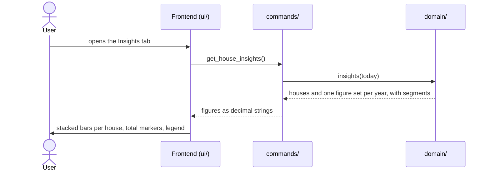

# CSD-016: House insights

## 1. Intent
The Houses page lists houses, valuations and a table of yearly values, but a table does not show how the houses grow and which house is growing. This capability adds an insights layer to the Houses page: a chart with one bar per calendar year, stacked from one segment per house, with a marker at the total value of the year and the change in the tooltip. It is for the owner looking back over their own houses. It follows the Debt insights of CSD-012 and the Bank account insights of CSD-010, with the houses as segments and without negative values, because a house value is never negative. It shows the value per house, and not any percentage or forecast.

## 2. Scope
### 2.1 In scope
- An "Insights" tab on the Houses page, next to the existing content ("Overview").
- A yearly stacked bar chart over all houses with one segment per house, a total-value marker, a legend of the houses, a tooltip and the highlight of one house.
- Its empty state.

### 2.2 Non-goals
- NG-1: A monthly view, or any granularity other than a calendar year.
- NG-2: A filter, a selection or a hiding of houses.
- NG-3: A percentage of growth, a value forecast, and any figure other than the values, the total value and the change.
- NG-4: Click-through, zooming, or exporting the chart.
- NG-5: Charts on the Dashboard or on the Net worth page, and a combined chart of houses and debts on this page. The Net worth page has its own combined chart (CSD-017).
- NG-6: Letting the user choose the colour of a house.
- NG-7: A chart library or any other new dependency.
- NG-8: Estimating values for years without a valuation (CSD-015 NG-9), and carrying a value forward into a year in which a house has no valuation.

## 3. Definitions
| Term | Meaning |
|---|---|
| **Year** | A calendar year. A valuation counts in the year of its own period only, as in the yearly values (CSD-015 REQ-20). |
| **Current year** | The calendar year of today, in local time. Its figures run up to the latest valuation so far, and are therefore partial. |
| **Segment** | The part of a year's bar that belongs to one house: the value of that house's latest valuation in that year. A house without a valuation in that year has no segment in it. |
| **Total value (of a year)** | The sum of the segments of a year, which is the closing value of the yearly values of CSD-015 REQ-20. |
| **Change** | As in CSD-015 section 3 (change in a year). |
| **Colour slot** | The number from 0 to 7 stored with a house (CSD-015 REQ-3), which decides its colour. |

## 4. Requirements

### 4.0 Overview flow


**REQ-1: Tabs on the Houses page** *(ubiquitous)*
The Houses page shall offer the tabs "Overview" and "Insights" while at least one house exists, with Overview, which holds the content of CSD-015, shown first.

```gherkin
@AC-1.1
Scenario: Overview is shown first
  Given a project with one house
  When the user opens the Houses page
  Then the Overview tab is selected
  And it shows the Houses, Yearly values and Valuations sections

@AC-1.2
Scenario: Switching to Insights
  Given the Houses page shows the Overview tab
  When the user selects the Insights tab
  Then the Overview sections are hidden
  And the insights chart is shown

@AC-1.3
Scenario: No houses yet
  Given a project without houses
  When the user opens the Houses page
  Then the prompt to add the first house is shown
  And there are no tabs
```

**REQ-2: Year series** *(ubiquitous)*
The app shall return one set of figures for every calendar year from the year of the earliest valuation up to and including the current year, oldest year first, holding the total value, the change, the number of valuations (used to detect an empty year, not displayed) and, per house with a valuation in that year, its segment.

```gherkin
@AC-2.1
Scenario: Series runs from the first valuation to the current year
  Given today is 29/10/2026
  And the earliest valuation is for 2024-03
  And there are valuations in 2025 and 2026
  When the insights are requested
  Then the series holds the years 2024, 2025 and 2026 in that order

@AC-2.2
Scenario: A single year
  Given today is 29/10/2026
  And the only valuation is for 2026-09
  When the insights are requested
  Then the series holds only the year 2026

@AC-2.3
Scenario: No valuations
  Given today is 29/10/2026
  And a house without valuations
  When the insights are requested
  Then the series is empty
```

**REQ-3: Years without valuations** *(unwanted behaviour)*
If a year in the series has no valuation, then the app shall return that year with total value 0.00, change none, 0 valuations and no segments.

```gherkin
@AC-3.1
Scenario: Gap year
  Given today is 29/10/2026
  And there are valuations in 2022 and 2024 but none in 2023
  When the insights are requested
  Then the year 2023 has total value 0.00, change none, 0 valuations and no segments
  And the series holds the years 2022, 2023, 2024, 2025 and 2026
```

**REQ-4: Current year is partial** *(state-driven)*
While a year is the current year, the app shall mark it as partial.

```gherkin
@AC-4.1
Scenario: Current year is marked
  Given today is 29/10/2026
  And there are valuations in 2025 and 2026
  When the insights are requested
  Then the year 2026 is marked partial
  And the year 2025 is not

@AC-4.2
Scenario: Current year without valuations is still in the series and marked
  Given today is 29/10/2026
  And the only valuation is for 2025-12
  When the insights are requested
  Then the series holds 2025 and 2026
  And 2026 is marked partial and has 0 valuations
```

**REQ-5: Segments are the latest values per house** *(ubiquitous)*
The app shall give each year one segment per house that has a valuation in that year and was held at the end of that year (CSD-019 REQ-11), equal to the value of that house's latest valuation in that year, ordered by the creation of the houses, and the segments shall add up to the total value, which equals the closing value of the yearly values of CSD-015 REQ-20, and the change shall equal that of the yearly values.

```gherkin
@AC-5.1
Scenario: Segments of a year
  Given today is 29/10/2026
  And house "Example House" with valuations 2026-03 (value 299000.00) and 2026-09 (value 300000.00)
  And house "Example Lodge" with a valuation 2026-06 (value 50000.00)
  When the insights are requested
  Then 2026 has the segments "Example House" 300000.00 and "Example Lodge" 50000.00
  And 2026 has total value 350000.00

@AC-5.2
Scenario: A house without a valuation in the year has no segment
  Given today is 29/10/2026
  And a monthly house "Example House" with valuations 2025-12 (value 300000.00) and 2026-03 (value 310000.00)
  And a yearly house "Example Lodge" with a valuation 2025 (value 55000.00)
  When the insights are requested
  Then 2025 has the segments "Example House" 300000.00 and "Example Lodge" 55000.00
  And 2026 has only the segment "Example House" 310000.00

@AC-5.3
Scenario: A house at 0.00 has no visible segment
  Given today is 29/10/2026
  And house "Example House" with a valuation 2026-09 (value 300000.00)
  And house "Example Cabin" with a valuation 2026-09 (value 0.00)
  When the insights are requested
  Then 2026 has the segments 300000.00 and 0.00
  And 2026 has total value 300000.00

@AC-5.4
Scenario: Segments are ordered by creation, not by name
  Given today is 29/10/2026
  And houses "Example Lodge" and then "Example House", both with a valuation 2026-09
  When the insights are requested
  Then the segments of 2026 are listed "Example Lodge" first and "Example House" second

@AC-5.5
Scenario: The insights equal the yearly values
  Given today is 29/10/2026
  And a monthly house with valuations 2025-11 (value 10000.00), 2025-12 (value 10200.00) and 2026-03 (value 11000.00)
  And a yearly house with valuations 2024 (value 70000.00) and 2025 (value 75000.00)
  When the insights and the yearly values are requested
  Then for every year the total value and the change of the insights equal those of the yearly values
```

**REQ-6: Chart** *(ubiquitous)*
The Insights tab shall draw one bar per year in the order received, stacked upwards from the zero line from one segment per house in the order received, on a y-axis that starts at 0 and ends at a rounded-up value of at least the highest total value, with gridlines, compact axis labels (such as "10k"), a gap year as a labelled slot without a bar, and no currency.

```gherkin
@AC-6.1
Scenario: Stacked bars per year
  Given the series holds the years 2025 and 2026
  When the user opens the Insights tab
  Then two bars are drawn, 2025 on the left and 2026 on the right
  And each bar has one segment per house with a valuation in that year

@AC-6.2
Scenario: Axis covers the highest level
  Given the highest total value of any year is 350000.00
  When the user opens the Insights tab
  Then the top of the y-axis is at least 350000.00
  And the axis starts at 0

@AC-6.3
Scenario: A house at 0.00 adds no height
  Given 2026 has the segments 300000.00 and 0.00
  When the user opens the Insights tab
  Then the 2026 bar is 300000.00 high
  And the second house is still named in the legend and the tooltip

@AC-6.4
Scenario: Gap year is an empty slot
  Given the year 2023 has no valuations
  When the user opens the Insights tab
  Then 2023 has a labelled slot without a bar

@AC-6.5
Scenario: Current year is marked
  Given the year 2026 is partial
  When the user opens the Insights tab
  Then the 2026 bar has a lighter fill
  And its label reads "2026 YTD"
```

**REQ-7: Total-value marker** *(ubiquitous)*
The Insights tab shall draw for each year with valuations a horizontal marker line of 2 px with round ends in the muted text colour, wider than the bar, at the total value, with its compact value next to it (above the line), not connected to the markers of other years, and dashed for the current year.

```gherkin
@AC-7.1
Scenario: Marker at the total value
  Given 2025 has the segments 2000.00 and 8000.00 and total value 10000.00
  When the user opens the Insights tab
  Then a marker line is drawn across the 2025 bar at 10000.00
  And its label reads "10k"

@AC-7.2
Scenario: Marker sits at the top of the stack
  Given 2025 has the segments 2000.00 and 8000.00
  When the user opens the Insights tab
  Then the 2025 marker sits at the top of the stack

@AC-7.3
Scenario: Markers are not connected and the current year is dashed
  Given the series holds 2024, a gap year 2025 and the partial year 2026
  When the user opens the Insights tab
  Then no line joins the markers
  And the marker of 2026 is dashed
  And 2025 has no marker
```

**REQ-8: A colour per house** *(ubiquitous)*
The Insights tab shall draw every segment of a house in the colour of the house's colour slot, taken from the palette of eight colours with a variant for light mode and one for dark mode that CSD-010 REQ-8 defines, so that a house has the same colour in every year, in the legend and in the tooltip, and keeps it when other houses are deleted.

```gherkin
@AC-8.1
Scenario: A house has one colour everywhere
  Given house "Example Lodge" has colour slot 1 and valuations in 2025 and 2026
  When the user opens the Insights tab
  Then its segments in 2025 and 2026, its legend swatch and its tooltip swatch have the colour of slot 1

@AC-8.2
Scenario: Colours survive a deletion
  Given houses with colour slots 0, 1 and 2 and valuations
  When the user deletes the house with slot 0 on the Overview tab and opens the Insights tab
  Then the other houses are still drawn in the colours of slots 1 and 2

@AC-8.3
Scenario: The palette in both modes
  Given the Insights tab shows the chart
  When the app is in light mode and then in dark mode
  Then the eight colours are distinct from each other in each mode
  And each has at most 60% HSL saturation

@AC-8.4
Scenario: More than eight houses
  Given nine houses with valuations
  When the user opens the Insights tab
  Then the first and the ninth house share a colour
  And each is named in the legend and in the tooltip
```

**REQ-9: Legend of houses** *(ubiquitous)*
The Insights tab shall show a legend with a colour swatch and the name of every house that has at least one valuation, in the order the houses were created, wrapping onto more lines when it does not fit, with no limit on the number of houses, and shall cut a name that does not fit on one legend item with an ellipsis, with the full name available in a tooltip and to screen readers. The legend shall also show the total-value marker.

```gherkin
@AC-9.1
Scenario: Legend lists the houses in creation order
  Given houses "Example Lodge" and then "Example House", both with valuations
  When the user opens the Insights tab
  Then the legend lists "Example Lodge" and "Example House" in that order, each with its colour swatch
  And the legend shows the total-value marker

@AC-9.2
Scenario: A house without valuations is not in the legend
  Given a house "Example Empty" with no valuations and a house "Example House" with a valuation
  When the user opens the Insights tab
  Then the legend lists only "Example House"

@AC-9.3
Scenario: Many houses wrap
  Given twelve houses with valuations
  When the user opens the Insights tab on a narrow window
  Then the legend shows all twelve houses, wrapped onto more than one line
  And no house is left out

@AC-9.4
Scenario: A long name is cut with an ellipsis
  Given a house with a name of 100 characters and a valuation
  When the user opens the Insights tab
  Then its legend item shows the name cut with an ellipsis
  And the full name is available in a tooltip and to screen readers

@AC-9.5
Scenario: A deleted house leaves the legend
  Given the legend lists "Example Lodge" and "Example House"
  When the user deletes "Example Lodge" on the Overview tab and opens the Insights tab
  Then the legend lists only "Example House"
```

**REQ-10: Details of a year** *(event-driven)*
When the user hovers over or moves keyboard focus to a year, the Insights tab shall show a tooltip with the year, its rows in the order the bar shows them, top to bottom (one row per segment with the house's swatch, full name and value, the highest segment first, which is the last in stacking order, then the Total value row, then the Change row, a dash for none), no number of valuations, for the current year that it is partial and for a year without valuations the note "No valuations", beside the year's bar as CSD-007 REQ-14 places a tooltip, and shall give the same values to screen readers, also without a number of valuations.

```gherkin
@AC-10.1
Scenario: Tooltip on hover
  Given 2026 has the segments "Example House" 300000.00 and "Example Lodge" 50000.00, total value 350000.00, and change 10000.00
  When the user hovers over the 2026 bar
  Then a tooltip shows both houses with their swatch and value, the total value 350000.00 and change 10000.00
  And it shows no number of valuations

@AC-10.2
Scenario: Tooltip on keyboard focus
  Given the Insights tab shows the chart
  When the user moves focus to the 2026 bar with the Tab key
  Then the same tooltip is shown
  And the tooltip disappears when focus leaves the bar

@AC-10.3
Scenario: Accessible label
  Given 2026 has the segments "Example House" 300000.00 and "Example Lodge" 50000.00 and change -200.00
  When a screen reader reads the 2026 bar
  Then it announces the year, each house with its value, the total value and the change and that it is negative
  And it announces no number of valuations

@AC-10.4
Scenario: Partial year
  Given the year 2026 is partial
  When the user hovers over the 2026 bar
  Then the tooltip says that the year is partial

@AC-10.5
Scenario: Change none is a dash
  Given 2025 is the first year of the series and has change none
  When the user hovers over the 2025 bar
  Then the tooltip shows a dash as change

@AC-10.6
Scenario: Tooltip beside the bar
  Given the chart shows the years 2024, 2025 and 2026
  When the user hovers over the 2024 bar
  Then the tooltip is shown to the right of that bar with its top level with the top of the bar
  When the user hovers over the 2026 bar and the tooltip does not fit to its right
  Then the tooltip is shown to the left of that bar and stays inside the chart area

@AC-10.7
Scenario: Year without a bar
  Given the year 2023 has no valuations
  When the user hovers over its slot
  Then the tooltip is centred over that slot
  And it shows the note "No valuations" and no house rows
  And it shows no row with a number of valuations

@AC-10.8
Scenario: Rows follow the bar from top to bottom
  Given 2026 has the segments "Example House" 300000.00 (first in stacking order) and "Example Lodge" 50000.00 (second, so at the top of the bar), total value 350000.00 and change 10000.00
  When the user hovers over the 2026 bar
  Then the tooltip rows are listed "Example Lodge", "Example House", "Total value", "Change" in that order

@AC-10.9
Scenario: Same order in the accessible label
  Given the same year as in AC-10.8
  When a screen reader reads the 2026 bar
  Then it announces the houses, the total value and the change without a number of valuations
```

**REQ-11: Highlight one house** *(event-driven)*
When the mouse is over a segment or a legend item of a house, or keyboard focus is on a legend item, the Insights tab shall keep all segments of that house at full colour in every year and ease all other segments to 70% opacity, set the legend item and the tooltip row of that house in the full text colour and a heavier font weight, and ease the other legend items to 70% opacity, and while no segment or legend item is hovered or focused, the Insights tab shall highlight nothing. Keyboard focus on a year highlights nothing.

```gherkin
@AC-11.1
Scenario: Hovering a segment
  Given 2025 and 2026 each have a segment of "Example Lodge" and of "Example House"
  When the user hovers over the "Example Lodge" segment of 2025
  Then all "Example Lodge" segments, in 2025 and 2026, keep their full colour
  And all "Example House" segments are eased down to 70% opacity
  And the "Example Lodge" legend item is in the full text colour and a heavier font weight
  And the other legend items are eased down to 70% opacity

@AC-11.2
Scenario: Hovering a legend item
  Given the legend lists "Example Lodge" and "Example House"
  When the user hovers over the legend item "Example Lodge"
  Then the segments of "Example Lodge" keep their full colour in every year
  And the other segments are eased down to 70% opacity

@AC-11.3
Scenario: Focusing a legend item
  Given the legend lists "Example Lodge" and "Example House"
  When the user moves keyboard focus to the legend item "Example Lodge"
  Then the highlight is the same as when hovering over it
  And it ends when focus leaves the legend item

@AC-11.4
Scenario: Leaving the segment
  Given the user hovers over a segment
  When the user moves the mouse to empty space in the year's column
  Then no legend item is highlighted and no segment is dimmed
  And the tooltip is still shown

@AC-11.5
Scenario: Not colour alone
  Given the user hovers over a segment
  Then the highlighted legend item has a heavier font weight than the other items
  And the other segments are lighter, not differently coloured

@AC-11.6
Scenario: Keyboard focus on a year highlights nothing
  Given the Insights tab shows the chart
  When the user moves focus to the 2025 bar with the Tab key
  Then no legend item is highlighted and no segment is dimmed
```

**REQ-12: Motion and reduced motion** *(event-driven)*
When a tooltip appears or moves to another year, or the highlight of REQ-11 changes, the Insights tab shall animate the change over 120 to 150 ms with an ease-out curve, and while the user prefers reduced motion it shall show tooltips and highlight changes at once.

```gherkin
@AC-12.1
Scenario: Tooltip fades in and glides
  Given the Insights tab shows the chart
  When the user hovers over the 2025 bar and then over the 2026 bar
  Then the tooltip fades in over 120 to 150 ms while it slides 4 px towards its place
  And it glides to its new place over 120 to 150 ms instead of jumping

@AC-12.2
Scenario: Dimming eases
  Given the user hovers over a segment of "Example Lodge"
  When the user moves the mouse away from the segment
  Then the other segments and the legend items ease back to full opacity over 120 to 150 ms

@AC-12.3
Scenario: Reduced motion
  Given the user prefers reduced motion
  When the user hovers over the 2025 bar and then over the 2026 bar
  Then each tooltip appears at once at its place without sliding or gliding
  And the dimming of segments and legend items changes at once
```

**REQ-13: Refined look and accessible segments** *(ubiquitous)*
The Insights tab shall draw the chart as CSD-010 REQ-13 describes the look of the bank chart: bars at most 50% of the width of their slot and at most 44 px wide, the top corners of the highest segment rounded by 3 px and a 1 px gap between stacked segments in place of an outline, 1 px gridlines at 55% opacity of the border colour, a 1 px zero line in the muted text colour at 70% opacity, axis and year labels in the muted text colour at regular font weight, marker values in 10 px medium weight, and a plot height that scales with the height of the window and a minimum slot width of 64 px per year, the same as the bank accounts chart (CSD-010) so that all yearly charts have one size, and tooltips of 10 px corner radius, 12 px by 14 px padding, a shadow of at least 16 px blur and at most 12% opacity, a 12 px title in semibold and row labels in the muted text colour, in light and in dark mode. Every segment shall carry an accessible label with the house, the year and the value.

```gherkin
@AC-13.1
Scenario: Bars
  Given the series holds the years 2024, 2025 and 2026
  When the user opens the Insights tab
  Then no bar is wider than 50% of its slot or 44 px
  And the top corners of each bar are rounded by 3 px
  And stacked segments are separated by a 1 px gap and have no outline

@AC-13.2
Scenario: Gridlines, zero line and labels
  Given the Insights tab shows the chart
  Then the gridlines are 1 px lines at 55% opacity of the border colour
  And the zero line is 1 px in the muted text colour at 70% opacity
  And the axis labels and the year labels are in the muted text colour at regular font weight

@AC-13.3
Scenario: Tooltip
  Given the user hovers over a year
  Then the tooltip has a 10 px corner radius, 12 px by 14 px padding and a soft shadow
  And its title is semibold and its row labels are in the muted text colour

@AC-13.4
Scenario: Segment labels
  Given 2026 has a segment of "Example Lodge" with value 50000.00
  When a screen reader reads that segment
  Then it announces "Example Lodge", 2026 and 50000.00

@AC-13.5
Scenario: Same size as the bank accounts chart
  Given the Insights tab of the Houses page and that of the Bank accounts page
  Then both plots scale with the height of the window
  And both give every year a slot of at least 64 px
```

**REQ-14: No valuations yet** *(state-driven)*
While at least one house exists but no valuation, the Insights tab shall show a note instead of a chart.

```gherkin
@AC-14.1
Scenario: Houses without valuations
  Given a project with one house and no valuations
  When the user opens the Insights tab
  Then the note "No valuations yet. The chart appears once there is a valuation." is shown
  And no chart is drawn
```

**REQ-15: Current figures** *(event-driven)*
When the user opens the Insights tab, the app shall show figures computed from the project at that moment.

```gherkin
@AC-15.1
Scenario: Figures follow changes
  Given the Insights tab showed total value 300000.00 for 2026
  And the user added a valuation for 2026-10 with value 305000.00 on the Overview tab
  When the user opens the Insights tab again
  Then the 2026 marker shows 305000.00

@AC-15.2
Scenario: Last valuation deleted
  Given the Insights tab showed a chart
  And the user deleted the only valuation on the Overview tab
  When the user opens the Insights tab again
  Then the note of AC-14.1 is shown and no chart is drawn

@AC-15.3
Scenario: A moved valuation follows to its new year
  Given a monthly house with a valuation for 2026-01
  When the user changes its period to 2025-12 and opens the Insights tab
  Then the series holds 2025 and 2026, and the segment is in 2025
```

## 5. Interfaces and contracts

Command: `get_house_insights()` returns the houses that have at least one valuation, in creation order, and the series, oldest year first:

```json
{
  "houses": [
    { "id": "…", "name": "Example House", "colour_slot": 0 },
    { "id": "…", "name": "Example Lodge", "colour_slot": 1 }
  ],
  "years": [
    { "year": 2025, "closing_value": "355000.00", "change": null, "valuation_count": 2, "is_partial": false,
      "segments": [ { "house_id": "…", "value": "300000.00" }, { "house_id": "…", "value": "55000.00" } ] },
    { "year": 2026, "closing_value": "310000.00", "change": "10000.00", "valuation_count": 1, "is_partial": true,
      "segments": [ { "house_id": "…", "value": "310000.00" } ] }
  ]
}
```

`valuation_count` is used to detect a year without valuations and is not displayed. `houses` and `years` are empty when there are no valuations. `segments` follow the creation order of the houses and are empty for a gap year, where `closing_value` is "0.00" and `change` is null. Amounts are decimal strings. Rust decides "today" (local time), the years, the partial flag, the segments and the changes, and the frontend only displays what it receives. Error codes are those of CSD-015.

## 6. Constraints
- CON-1: The chart reuses the shared chart code of the frontend (`ui/shared/yearly-chart.js`) and adds no chart library or other dependency, and the Debts and Bank accounts charts keep working unchanged. Rationale: NG-7, and `CLAUDE.md` asks before adding dependencies.
- CON-2: The frontend displays figures computed in Rust and computes no amounts, not even the sum of the segments or the change. The only arithmetic is turning values into positions. Rationale: `CLAUDE.md` layout rule.
- CON-3: No network access. Rationale: `CLAUDE.md` Tauri security rules.
- CON-4: House names are drawn as plain text, never as HTML. Rationale: a name is typed by the user and must not run as markup.
- CON-5: Tests and fixtures use synthetic data only. Rationale: the repo is public.
- CON-6: The palette is the one of the bank accounts chart (CSD-010 CON-6), defined once as colour tokens per mode, and no colour of a house is written inline in the page code. Rationale: one place to adjust, and both modes stay in step.

## 7. Verification
The series is computed in Rust, so REQ-2 to REQ-5 are proven by `cargo test`. Tests are named `test_csd016_ac_<n>_<m>_<description>` (CSD-000 REQ-6).

| Requirement | Command |
|---|---|
| REQ-2 to REQ-5, AC-15.3 (the data) | `cargo test test_csd016_` |
| REQ-1, REQ-6 to REQ-14 (all ACs), AC-15.1 to AC-15.3 (the screen) | Manual checklist: tabs, stacking, axis range, markers, colours of both modes and of the ninth house, legend order, wrapping and ellipsis, tooltip placement, the order of its rows from top to bottom (AC-10.8, AC-10.9), no counts, its change row, the plot height and slot width, highlight from a segment and from the legend including keyboard, motion and reduced motion, the look, accessible labels and the empty note, and that the Debts chart is unchanged. There is no frontend test setup |
| One requirement, e.g. REQ-5 | `cargo test test_csd016_ac_5_` |

Done means fmt, clippy (`-D warnings`) and `cargo test --all-features` pass.

## 8. Open questions
None.

## 9. Changelog
- 0.7 (30/10/2026): Assets are renamed to houses (labels, the Houses page and chart, error codes, commands, JSON keys such as `houses`). No other requirement changes. Back to `draft` until re-approved (GitHub issue 31).
- 0.6 (29/10/2026): Segments only count houses held at the end of the year, so a sold house drops out from its sale year (REQ-2, CSD-019 REQ-11; GitHub issue 27).
- 0.5 (29/10/2026): The plot height scales with the height of the window instead of being a fixed 390 px: with the page scrolled to the top the chart ends at the bottom of the window, and the plot is never lower than 260 px. It is recomputed when the window is resized.
- 0.4 (29/10/2026): The Reports page is replaced by the Net worth page of CSD-017 (NG-5; GitHub issue 24). No other change.
- 0.3 (29/10/2026): The plot of every yearly chart is 390 px high (was 260 px), 50% taller. No other behaviour change.
- 0.1 (29/10/2026): initial draft, from GitHub issue 17 and the grill-me interview. It follows CSD-012 (tabs, year series, partial year, marker, tooltip, highlight, motion, look), with one segment per house, no negative values, and the change in the tooltip.
- 0.2 (29/10/2026): No valuation count is displayed any more (NG-3, REQ-10, AC-10.1, AC-10.3, AC-10.7, AC-5.x; the count stays in IPC, section 5). The tooltip lists its rows in the order the bar shows them, top to bottom (REQ-10, new AC-10.8 and AC-10.9, manual checklist), and an empty year shows the note "No valuations". The chart has the size of the bank accounts chart: plot height 260 px, minimum slot width 64 px (REQ-13, new AC-13.5, manual checklist).
