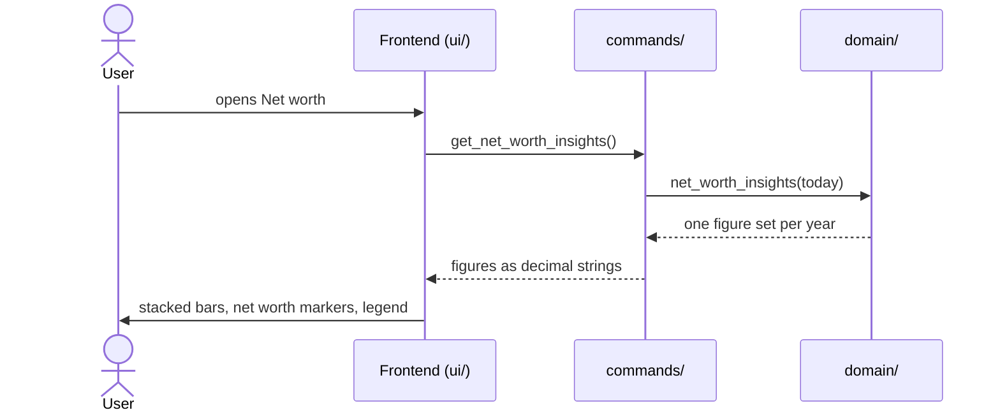

# CSD-017: Net worth insights

## 1. Intent
Each area of the app (assets, investments, bank accounts, debts) has its own yearly chart, but none shows the owner's overall financial state. This capability adds one page, "Net worth", that only provides insights: a chart with one stacked bar per calendar year, with what the owner has (assets, investments and cash) rising above the zero line and what the owner owes (debts) hanging below it, and a marker at the net worth of the year. It is for the owner looking back over their own finances. It reuses the yearly figures of the four areas and adds no data of its own. It is GitHub issue 24.

## 2. Scope
### 2.1 In scope
- A page "Net worth" in the left pane that replaces the "Reports" placeholder (CSD-004 REQ-1).
- A yearly stacked bar chart with four segments (Assets, Investments, Cash, Debts), a net worth marker, a legend, a tooltip and the highlight of one series.
- Its empty state.

### 2.2 Non-goals
- NG-1: A monthly view, or any granularity other than a calendar year.
- NG-2: A breakdown per asset, investment account, bank or debt. The segments are the four totals.
- NG-3: A percentage of growth, a forecast, and any figure other than the four totals and the net worth.
- NG-4: A filter, or hiding a series.
- NG-5: Click-through, zooming, or exporting the chart.
- NG-6: Income and expenses. They are not part of the net worth.
- NG-7: A chart library or any other new dependency.
- NG-8: Estimating a figure for a year in which an area has no record, and carrying a figure forward into such a year (the same non-goal as CSD-016 NG-8).
- NG-9: Tabs on the page, and letting the user choose the colours.

## 3. Definitions
| Term | Meaning |
|---|---|
| **Year** | A calendar year. |
| **Current year** | The calendar year of today, in local time. Its figures run up to the latest record so far and are therefore partial. |
| **Assets** | The total value of a year of CSD-016 (the closing value of CSD-015 REQ-20). |
| **Investments** | The closing balance of a year of CSD-007 (CSD-005 REQ-26). |
| **Cash** | The closing balance of a year over all bank accounts of CSD-010 (CSD-009 REQ-19). It is the sum of the latest balances of the banks, so an overdrawn bank reduces it. |
| **Debts** | The total debt of a year of CSD-012 (the closing balance of CSD-011 REQ-19), never negative. |
| **Net worth (of a year)** | Assets plus Investments plus Cash minus Debts. It can be negative. |

## 4. Requirements

### 4.0 Overview flow


**REQ-1: The Net worth page** *(ubiquitous)*
The app shall offer a page "Net worth" with no tabs, holding one panel titled "Net worth per year" with the legend and the chart.

```gherkin
@AC-1.1
Scenario: One panel, no tabs
  Given a project with a bank account entry
  When the user opens "Net worth"
  Then the page shows one panel titled "Net worth per year"
  And there are no tabs
```

**REQ-2: Year series** *(ubiquitous)*
The app shall return, oldest first, one figure set for every calendar year from the earliest year in which any of assets, investments, bank accounts or debts has a record up to and including the current year, each with Assets, Investments, Cash, Debts and Net worth, computed in Rust.

```gherkin
@AC-2.1
Scenario: Range over all four areas
  Given today is 29/10/2026
  And the first record is a bank account entry for 2024-12
  And the first asset valuation is for 2025-03
  When the series is computed
  Then it holds the years 2024, 2025 and 2026

@AC-2.2
Scenario: No records at all
  Given a project with no asset valuations, investment statements, bank account entries or debt statements
  When the series is computed
  Then it holds no years
```

**REQ-3: Figures of a year** *(ubiquitous)*
For each year the app shall take Assets, Investments, Cash and Debts from the yearly figures of their own areas (section 3) and shall compute Net worth as Assets plus Investments plus Cash minus Debts, so that every figure of this page equals the one on the chart of its area.

```gherkin
@AC-3.1
Scenario: Net worth of a year
  Given 2025 has assets 300000.00, investments 20000.00, cash 5000.00 and debts 9000.00
  When the series is computed
  Then Net worth of 2025 is 316000.00

@AC-3.2
Scenario: Figures equal those of the area charts
  Given the Assets chart shows total value 300000.00 for 2025
  And the Debts chart shows total debt 9000.00 for 2025
  Then this page shows Assets 300000.00 and Debts 9000.00 for 2025

@AC-3.3
Scenario: Debts above everything
  Given 2025 has assets 0.00, investments 0.00, cash 1000.00 and debts 9000.00
  When the series is computed
  Then Net worth of 2025 is -8000.00
```

**REQ-4: Years without records** *(unwanted behaviour)*
If an area has no record in a year of the series, then the app shall give that area 0.00 for the year and shall not carry a figure forward from an earlier year.

```gherkin
@AC-4.1
Scenario: Gap year
  Given investments have statements in 2024 and 2026 and none in 2025
  When the series is computed
  Then Investments of 2025 is 0.00

@AC-4.2
Scenario: Before the first record of an area
  Given the first debt statement is for 2026 and the first bank account entry is for 2024
  When the series is computed
  Then Debts of 2024 and 2025 is 0.00
```

**REQ-5: Current year is partial** *(state-driven)*
While a year is the current year, the app shall mark it as partial, label it with "YTD" under its bar (as "2026 YTD"), draw it at 55% opacity, and state in its tooltip "Partial year: figures so far".

```gherkin
@AC-5.1
Scenario: The running year
  Given today is 29/10/2026
  When the user opens "Net worth"
  Then the label under the last bar reads "2026 YTD"
  And that bar is drawn at 55% opacity

@AC-5.2
Scenario: A past year
  Given today is 29/10/2026
  Then the label under the 2025 bar reads "2025" and the bar is drawn at full opacity
```

**REQ-6: Chart** *(ubiquitous)*
The app shall draw a stacked bar per year in which Assets, Investments and Cash rise from the zero line in that order from the bottom up and Debts hangs down from it, with the top corners of the highest segment and the bottom corners of Debts rounded, with the look, the size and the motion of the bank accounts chart (CSD-010 REQ-12 and REQ-13): bars at most 50% of the slot and at most 44 px wide, a 1 px gap between segments, a plot 390 px high and a minimum slot of 64 px per year. A series of 0.00 adds no height. The axis shall reach the highest bar, the deepest Debts and the net worth markers.

```gherkin
@AC-6.1
Scenario: Order of the segments
  Given 2025 has assets 300000.00, investments 20000.00, cash 5000.00 and debts 9000.00
  When the user opens "Net worth"
  Then the 2025 bar rises from Assets at the bottom to Investments and then Cash at the top
  And Debts hangs below the zero line

@AC-6.2
Scenario: Same size as the other charts
  Given this chart and the chart of Bank accounts
  Then both plots are 390 px high and give every year a slot of at least 64 px

@AC-6.3
Scenario: Nothing to draw for a series
  Given 2024 has only cash 5000.00
  Then the 2024 bar has one segment, Cash, and Assets, Investments and Debts add no height

@AC-6.4
Scenario: Negative net worth reaches the axis
  Given 2025 has net worth -8000.00 and debts 9000.00
  Then the axis reaches below -9000.00
```

**REQ-7: Net worth marker** *(ubiquitous)*
For each year in the series the app shall draw a marker across the bar at the net worth of the year, wider than the bar, with its value above it, as the closing-balance marker of CSD-010 REQ-7.

```gherkin
@AC-7.1
Scenario: Marker at the net worth
  Given 2025 has net worth 316000.00
  Then the 2025 marker stands at 316000.00 and shows 316k above it

@AC-7.2
Scenario: A negative marker
  Given 2025 has net worth -8000.00
  Then the 2025 marker stands below the zero line and shows -8k
```

**REQ-8: Colours and legend** *(ubiquitous)*
The app shall give Assets, Investments and Cash three distinct colours of the shared palette and Debts the loss colour of the Investments chart, defined once as colour tokens per mode, and shall show a legend with the items "Assets", "Investments", "Cash", "Debts" and the marker "Net worth".

```gherkin
@AC-8.1
Scenario: Legend
  When the user opens "Net worth"
  Then the legend shows "Assets", "Investments", "Cash", "Debts" and "Net worth" with their swatches

@AC-8.2
Scenario: Both modes
  Given the theme is Dark
  Then the four colours are the lighter variants and remain distinct from each other
```

**REQ-9: Highlight one series** *(event-driven)*
When the user hovers over or focuses a legend item, or hovers over a segment or the marker, the app shall highlight that series in every year, in the legend and in the open tooltip, and dim the others, and shall undo this when the pointer or the focus leaves.

```gherkin
@AC-9.1
Scenario: Hover a legend item
  Given the chart shows 2024, 2025 and 2026
  When the user hovers over "Cash" in the legend
  Then the Cash segment of every year is highlighted and the other segments are dimmed

@AC-9.2
Scenario: Leave
  Given "Cash" is highlighted
  When the pointer leaves the legend item
  Then all segments return to full opacity
```

**REQ-10: Details of a year** *(event-driven)*
When the user hovers over or focuses a year, the app shall show a tooltip with the year as its title and the rows in the order the bar shows them, from top to bottom: Assets, Investments, Cash, Debts (with a minus sign) and Net worth, with no count of records. A year in which no area has a record shows the note "No records".

```gherkin
@AC-10.1
Scenario: Rows read like the bar
  Given 2025 has assets 300000.00, investments 20000.00, cash 5000.00 and debts 9000.00
  When the user hovers over the 2025 bar
  Then the tooltip lists Assets 300000.00, Investments 20000.00, Cash 5000.00, Debts -9000.00 and Net worth 316000.00 in that order

@AC-10.2
Scenario: A year without records
  Given 2025 lies between years with records and has none itself
  When the user hovers over the 2025 slot
  Then the tooltip shows the title "2025" and the note "No records"

@AC-10.3
Scenario: Keyboard
  When the user focuses the 2025 bar with the keyboard
  Then the same tooltip is shown
```

**REQ-11: Accessible segments** *(ubiquitous)*
Every segment shall carry an accessible label with the series, the year and the value, and every year a description with all five figures.

```gherkin
@AC-11.1
Scenario: Screen reader
  Given 2025 has cash 5000.00
  When a screen reader reads the Cash segment of 2025
  Then it announces "Cash", 2025 and 5000.00
```

**REQ-12: No records yet** *(state-driven)*
While no area has a record, the app shall show the note "No data yet. The chart appears once there is an asset, investment, bank account entry or debt." and no chart. While only some areas have records, the others shall contribute 0.00 and stay in the legend.

```gherkin
@AC-12.1
Scenario: Empty project
  Given a new project
  When the user opens "Net worth"
  Then the note is shown and no chart is drawn

@AC-12.2
Scenario: Only one area has records
  Given only bank account entries exist
  When the user opens "Net worth"
  Then the chart shows Cash and the legend still lists Assets, Investments and Debts
```

**REQ-13: Current figures** *(event-driven)*
When the user opens "Net worth", the app shall show figures computed from the project at that moment, saved or not.

```gherkin
@AC-13.1
Scenario: Figures follow changes
  Given "Net worth" showed cash 5000.00 for 2026
  And the user added a bank account entry for 2026-10 with balance 6000.00
  When the user opens "Net worth" again
  Then the 2026 Cash segment shows 6000.00
```

## 5. Interfaces and contracts

Command: `get_net_worth_insights()` returns the series, oldest year first, and an empty list when no area has a record:

```json
{
  "years": [
    { "year": 2025, "assets": "300000.00", "investments": "20000.00", "cash": "5000.00",
      "debts": "9000.00", "net_worth": "316000.00", "has_records": true, "is_partial": false },
    { "year": 2026, "assets": "0.00", "investments": "0.00", "cash": "0.00",
      "debts": "0.00", "net_worth": "0.00", "has_records": false, "is_partial": true }
  ]
}
```

`debts` is never negative: the chart draws it below the zero line and the tooltip shows it with a minus sign. `has_records` is used to detect a year in which no area has a record and is not displayed. Amounts are decimal strings in the project currency (CSD-003). The command only reads the project; it changes nothing and the project file is unchanged.

## 6. Constraints
- CON-1: The chart reuses the shared chart code of the frontend (`ui/shared/yearly-chart.js`) and adds no chart library or other dependency, and the other yearly charts keep working unchanged. Rationale: NG-7, and `CLAUDE.md` asks before adding dependencies.
- CON-2: The frontend displays figures computed in Rust and computes no amounts, not even the net worth or a sum of the segments. The only arithmetic is turning values into positions. Rationale: `CLAUDE.md` layout rule.
- CON-3: No network access. Rationale: `CLAUDE.md` Tauri security rules.
- CON-4: The four yearly figures come from the same code that draws the chart of their own area, not from a second calculation. Rationale: REQ-3, so the figures can never differ between pages.
- CON-5: Tests and fixtures use synthetic data only. Rationale: the repo is public.
- CON-6: Colours are defined once as tokens per mode and none is written inline in the page code. Rationale: one place to adjust, and both modes stay in step.

## 7. Verification
The series is computed in Rust, so REQ-2 to REQ-4 and REQ-13 (the data) are proven by `cargo test`. Tests are named `test_csd017_ac_<n>_<m>_<description>` (CSD-000 REQ-6).

| Requirement | Command |
|---|---|
| REQ-2, REQ-3, REQ-4, REQ-5 (the data), AC-12.2, AC-13.1 (the data) | `cargo test test_csd017_` |
| REQ-1, REQ-5 (display), REQ-6 to REQ-12 (all ACs), AC-13.1 (the screen) | Manual checklist: the page without tabs, stacking and the order of the segments, Debts below the zero line, axis range with a negative net worth, markers, colours of both modes, legend, highlight in every year, tooltip order and the "No records" note, accessible labels, empty states, the same size as the other charts. There is no frontend test setup |
| One requirement, e.g. REQ-3 | `cargo test test_csd017_ac_3_` |

Done means fmt, clippy (`-D warnings`) and `cargo test --all-features` pass.

## 8. Open questions
None.

## 9. Changelog
- 0.1 (29/10/2026): initial draft, from GitHub issue 24 and the grill-me interview. It follows CSD-010 and CSD-016 (yearly series, partial year, marker, tooltip, highlight, look and size), with four fixed series, Debts below the zero line and a net worth marker. Approving it also changes CSD-004 REQ-1 (the "Reports" placeholder becomes "Net worth") and the combined-chart non-goals of CSD-012 NG-5 and CSD-016 NG-5.
