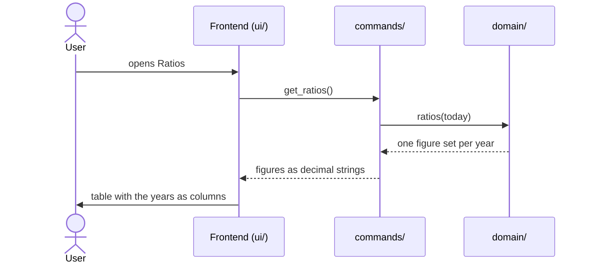

# CSD-018: Ratios

## 1. Intent
The charts show how each area develops, but not how the owner's income relates to the wealth that was built. This capability adds a page, "Ratios", to the Insights group: one table with the years as columns and seven ratios as rows, grouped as Wealth, Growth and Free income. It shows how much was earned, how much of it ended up as wealth, how fast the investments and the total wealth grew, and how much was left to spend freely. It is for the owner looking back over their own finances. It reuses the yearly figures of the other areas and adds no data of its own. It is GitHub issue 25.

## 2. Scope
### 2.1 In scope
- A page "Ratios" in the Insights group, after "Net worth" (CSD-004 REQ-1).
- A table with the years as columns and the seven rows of REQ-3, and its empty state.

### 2.2 Non-goals
- NG-1: Net income, taxes, or any income other than the total gross of CSD-001.
- NG-2: Charts, and any ratio other than the seven rows of REQ-3.
- NG-3: A monthly view, or any granularity other than a calendar year.
- NG-4: Estimating a figure for a year in which an area has no record, and carrying a figure forward into such a year (as CSD-016 NG-8).
- NG-5: Choosing, hiding or reordering rows or years, and exporting the table.
- NG-6: Tabs on the page.
- NG-7: Counting assets in the wealth accumulation: only cash, investments and debts count (REQ-5).

## 3. Definitions
| Term | Meaning |
|---|---|
| **Year** | A calendar year. |
| **Current year** | The calendar year of today, in local time. Its figures run up to the latest record so far and are therefore partial. |
| **Total income** | The total gross of the year over all jobs (CSD-001 REQ-11). |
| **Expenses** | The total amount of the expenses of the year (CSD-013 REQ-12). |
| **Net worth** | As in CSD-017 section 3. |
| **Bank increase (in a year)** | The sum, over the bank accounts that have an entry in that year and an earlier entry, of the balance of its latest entry in that year minus the balance of its latest entry before that year. It is negative when those accounts shrank. A bank account without an earlier entry adds nothing, because it is not known what it grew from. It is none when no bank account has both. |
| **Net deposits (in a year)** | The net deposits of the year over all investment accounts (CSD-005 REQ-26). |
| **Repaid (in a year)** | As in CSD-011 section 3. It is negative when debts grew, and none when no debt has an opening balance in the year. |
| **Wealth accumulation (from cash)** | Bank increase plus net deposits plus repaid, where a part that is none counts as 0.00. |
| **Disposable income** | Wealth accumulation plus expenses: what was set aside and what was spent. |

## 4. Requirements

### 4.0 Overview flow


**REQ-1: The Ratios page** *(ubiquitous)*
The app shall offer a page "Ratios" with no tabs, holding one panel titled "Ratios per year" with the table.

```gherkin
@AC-1.1
Scenario: One panel, no tabs
  Given a project with an expense
  When the user opens "Ratios"
  Then the page shows one panel titled "Ratios per year"
  And there are no tabs
```

**REQ-2: Year series** *(ubiquitous)*
The app shall return, oldest first, one figure set for every calendar year from the earliest year in which any of income, expenses, assets, investments, bank accounts or debts has a record up to and including the current year, computed in Rust, and shall show the years as columns from the oldest on the left to the newest on the right, with the current year labelled with "YTD" (as "2026 YTD").

```gherkin
@AC-2.1
Scenario: Range over all areas
  Given today is 29/10/2026
  And the first expense is dated 05/03/2024
  And the first bank account entry is for 2025-01
  When the series is computed
  Then it holds the years 2024, 2025 and 2026

@AC-2.2
Scenario: Column order and label
  Given the series holds 2025 and 2026
  When the user opens "Ratios"
  Then the columns read "2025" and "2026 YTD" from left to right

@AC-2.3
Scenario: No records at all
  Given a project with no records in any area
  When the series is computed
  Then it holds no years
```

**REQ-3: Rows** *(ubiquitous)*
The table shall have these rows, in this order, under the sub-headings in bold: **Wealth**: "Total income (gross)", "Wealth accumulation from cash", "Percentage of income to wealth"; **Growth**: "Growth of investments", "Growth of total wealth"; **Free income**: "Disposable income", "Percentage of disposable income".

```gherkin
@AC-3.1
Scenario: Rows and sub-headings
  When the user opens "Ratios"
  Then the table shows the sub-heading "Wealth" with "Total income (gross)", "Wealth accumulation from cash" and "Percentage of income to wealth"
  And the sub-heading "Growth" with "Growth of investments" and "Growth of total wealth"
  And the sub-heading "Free income" with "Disposable income" and "Percentage of disposable income"
```

**REQ-4: Total income** *(ubiquitous)*
For each year the app shall show the total income of the year, 0.00 when the year has no income.

```gherkin
@AC-4.1
Scenario: Income of a year
  Given 2025 has paychecks with a total gross of 48000.00
  When the series is computed
  Then Total income of 2025 is 48000.00

@AC-4.2
Scenario: A year without income
  Given 2024 has an expense and no paycheck
  When the series is computed
  Then Total income of 2024 is 0.00
```

**REQ-5: Wealth accumulation from cash** *(ubiquitous)*
For each year the app shall compute the wealth accumulation as the bank increase plus the net deposits plus the repaid amount of the year, and shall give it none when no bank account has a bank increase, no investment account has a statement and no debt has a repaid amount in that year.

```gherkin
@AC-5.1
Scenario: The three parts
  Given the bank accounts grew by 2000.00 in 2025
  And the net deposits of the investments in 2025 are 3000.00
  And 1000.00 of debt was repaid in 2025
  When the series is computed
  Then the wealth accumulation of 2025 is 6000.00

@AC-5.2
Scenario: Parts can be negative
  Given the bank accounts shrank by 500.00 in 2025
  And the net deposits of the investments in 2025 are -1000.00
  And the debts grew by 200.00 in 2025, so the repaid amount is -200.00
  When the series is computed
  Then the wealth accumulation of 2025 is -1700.00

@AC-5.3
Scenario: Bank increase against the last earlier entry
  Given "Example Bank" has a balance of 1000.00 for 2023 and 1500.00 for 2025 and no entry for 2024
  When the series is computed
  Then the bank increase of 2025 is 500.00
  And the bank increase of 2024 is none

@AC-5.4
Scenario: A new bank account adds nothing in its first year
  Given "Example Bank" has a balance of 1000.00 for 2024 and no earlier entry
  When the series is computed
  Then the bank increase of 2024 is none

@AC-5.5
Scenario: No part available
  Given 2024 has only an expense
  When the series is computed
  Then the wealth accumulation of 2024 is none
```

**REQ-6: Percentage of income to wealth** *(ubiquitous)*
For each year the app shall compute the wealth accumulation divided by the total income, times 100, rounded to one decimal as the growth percentage of CSD-007 REQ-6, and shall give it none when the wealth accumulation is none or the total income is 0.00.

```gherkin
@AC-6.1
Scenario: A share of the income
  Given the wealth accumulation of 2025 is 6000.00 and the total income is 48000.00
  When the series is computed
  Then the percentage of income to wealth of 2025 is "12.5"

@AC-6.2
Scenario: A negative share
  Given the wealth accumulation of 2025 is -1700.00 and the total income is 48000.00
  When the series is computed
  Then the percentage of income to wealth of 2025 is "-3.5"

@AC-6.3
Scenario: No income
  Given the total income of 2024 is 0.00 and its wealth accumulation is 500.00
  When the series is computed
  Then the percentage of income to wealth of 2024 is none
```

**REQ-7: Growth of investments** *(ubiquitous)*
For each year the app shall show the growth percentage of the investments as the Investments chart of CSD-007 gives it (CSD-007 REQ-6), and none where that chart gives none (CSD-007 REQ-7).

```gherkin
@AC-7.1
Scenario: Same figure as the Investments chart
  Given the Investments chart shows a growth percentage of "4.2" for 2026
  When the series is computed
  Then the growth of investments of 2026 is "4.2"

@AC-7.2
Scenario: First year
  Given the earliest investment statement is in 2025
  When the series is computed
  Then the growth of investments of 2025 is none
```

**REQ-8: Growth of total wealth** *(ubiquitous)*
For each year the app shall compute the net worth of the year minus the net worth of the year before, divided by the net worth of the year before, times 100, rounded to one decimal, and shall give it none when the year or the year before has no records, or when the net worth of the year before is 0.00 or negative.

```gherkin
@AC-8.1
Scenario: Growth of the net worth
  Given the net worth of 2025 is 100000.00 and that of 2026 is 110000.00
  When the series is computed
  Then the growth of total wealth of 2026 is "10.0"

@AC-8.2
Scenario: Shrinking net worth
  Given the net worth of 2025 is 100000.00 and that of 2026 is 95000.00
  When the series is computed
  Then the growth of total wealth of 2026 is "-5.0"

@AC-8.3
Scenario: Year before not positive
  Given the net worth of 2025 is -5000.00 and that of 2026 is 1000.00
  When the series is computed
  Then the growth of total wealth of 2026 is none

@AC-8.4
Scenario: Year before has no records
  Given 2025 has no records in any area and 2026 has
  When the series is computed
  Then the growth of total wealth of 2026 is none
```

**REQ-9: Free income** *(ubiquitous)*
For each year the app shall show the disposable income as the wealth accumulation plus the expenses, and the percentage of disposable income as the disposable income divided by the total income, times 100, rounded to one decimal, and shall give the disposable income none when the wealth accumulation is none, and the percentage none when the disposable income is none or the total income is 0.00.

```gherkin
@AC-9.1
Scenario: Set aside plus spent
  Given the wealth accumulation of 2025 is 6000.00 and the expenses are 4000.00
  When the series is computed
  Then the disposable income of 2025 is 10000.00

@AC-9.2
Scenario: Percentage of the income
  Given the disposable income of 2025 is 10000.00 and the total income is 48000.00
  When the series is computed
  Then the percentage of disposable income of 2025 is "20.8"

@AC-9.3
Scenario: No expenses
  Given the wealth accumulation of 2025 is 6000.00 and 2025 has no expenses
  When the series is computed
  Then the disposable income of 2025 is 6000.00

@AC-9.4
Scenario: No wealth accumulation
  Given the wealth accumulation of 2024 is none
  When the series is computed
  Then the disposable income and its percentage of 2024 are none
```

**REQ-10: Display** *(ubiquitous)*
The app shall show amounts in the project currency as the other tables do, percentages with one decimal and a sign as CSD-007 REQ-10 labels them (+6.4%, −2.5%, 0.0%), negative figures in the negative colour, a figure that is none as "–", and no count of records. While the table is wider than the page, the app shall scroll it sideways and keep the row labels in view.

```gherkin
@AC-10.1
Scenario: Percentages and none
  Given the percentage of income to wealth of 2025 is "12.5" and that of 2024 is none
  When the user opens "Ratios"
  Then the 2025 cell shows "+12.5%" and the 2024 cell shows "–"

@AC-10.2
Scenario: Negative figures
  Given the wealth accumulation of 2025 is -1700.00
  When the user opens "Ratios"
  Then that cell is shown in the negative colour

@AC-10.3
Scenario: Many years
  Given the series holds more years than fit the page
  When the user scrolls the table sideways
  Then the row labels stay in view
```

**REQ-11: No data yet** *(state-driven)*
While no area has a record, the app shall show the note "No data yet. The table appears once there is income, an asset, an investment, a bank account entry, a debt or an expense." and no table.

```gherkin
@AC-11.1
Scenario: Empty project
  Given a new project
  When the user opens "Ratios"
  Then the note is shown and no table is drawn
```

**REQ-12: Current figures** *(event-driven)*
When the user opens "Ratios", the app shall show figures computed from the project at that moment, saved or not.

```gherkin
@AC-12.1
Scenario: Figures follow changes
  Given "Ratios" showed disposable income 10000.00 for 2025
  And the user added an expense of 500.00 dated in 2025
  When the user opens "Ratios" again
  Then the disposable income of 2025 shows 10500.00
```

## 5. Interfaces and contracts

Command: `get_ratios()` returns the series, oldest year first, and an empty list when no area has a record:

```json
{
  "years": [
    { "year": 2025, "is_partial": false, "total_income": "48000.00",
      "wealth_accumulation": "6000.00", "wealth_percent": "12.5",
      "investment_growth_percent": "4.2", "wealth_growth_percent": "10.0",
      "disposable_income": "10000.00", "disposable_percent": "20.8" }
  ]
}
```

Amounts are decimal strings in the project currency (CSD-003) and percentages decimal strings with one decimal. A figure that is none is `null`. The command only reads the project and the project file is unchanged.

## 6. Constraints
- CON-1: The frontend displays figures computed in Rust and computes none itself, not even a percentage or a sum. Rationale: `CLAUDE.md` layout rule.
- CON-2: The figures of each area come from the same code that gives them to its own page (CSD-001, 005, 007, 011, 013, 017), and the bank increase is defined in this CSD alone. Rationale: the figures can never differ between pages.
- CON-3: Percentages are rounded to one decimal with banker's rounding, as in CSD-007. Rationale: `CLAUDE.md` money rule, and one rounding rule for all percentages.
- CON-4: No network access, no new dependency. Rationale: `CLAUDE.md` Tauri security rules and dependency rule.
- CON-5: Tests and fixtures use synthetic data only. Rationale: the repo is public.

## 7. Verification
The figures are computed in Rust, so REQ-2 and REQ-4 to REQ-9 are proven by `cargo test`. Tests are named `test_csd018_ac_<n>_<m>_<description>` (CSD-000 REQ-6).

| Requirement | Command |
|---|---|
| REQ-2 (AC-2.1, AC-2.3), REQ-4 to REQ-9, AC-12.1 (the data) | `cargo test test_csd018_` |
| REQ-1, AC-2.2, REQ-3, REQ-10, REQ-11, AC-12.1 (the screen) | Manual checklist: page without tabs, column order and "YTD", rows and sub-headings, signs and "–", negative colour, sideways scrolling with the labels in view, empty state. There is no frontend test setup |
| One requirement, e.g. REQ-5 | `cargo test test_csd018_ac_5_` |

Done means fmt, clippy (`-D warnings`) and `cargo test --all-features` pass.

## 8. Open questions
None.

## 9. Changelog
- 0.1 (29/10/2026): initial draft, from GitHub issue 25 and the grill-me interview. Beyond the interview, a year in which no bank account has an increase, no investment account has a statement and no debt has a repaid amount has no wealth accumulation (REQ-5, AC-5.5), and the growth of total wealth is none when the year itself has no records (REQ-8). Approving it also changes CSD-004 REQ-1 (the Insights group holds Net worth and Ratios).
