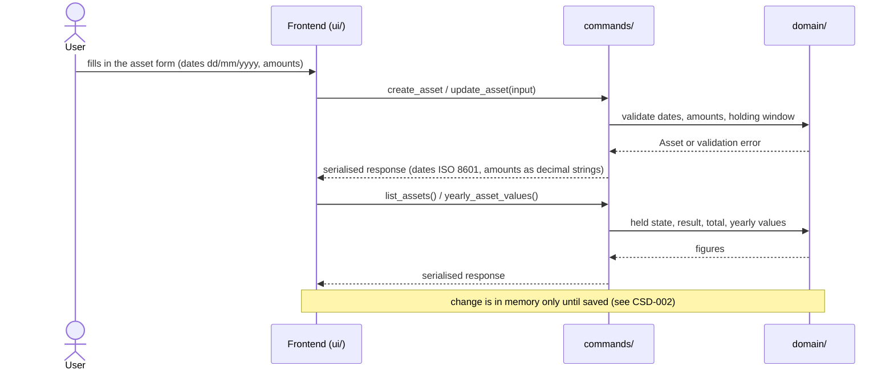
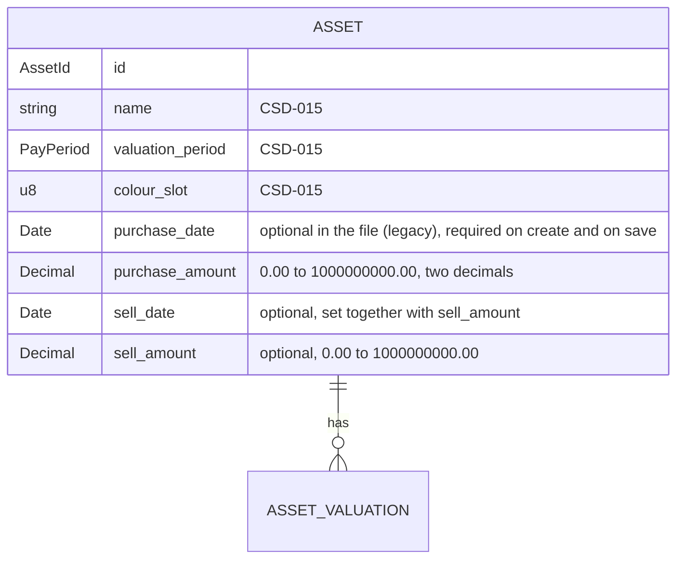

# CSD-019: Asset purchase and sale

## 1. Intent
Assets (CSD-015) are a value history only: the app does not know when an asset was bought, for how much, or whether it was sold. A sold asset keeps counting in the total value, the yearly values, the net worth and the ratios wherever its last valuation falls. This capability gives every asset one purchase (date and amount) and at most one sale (date and amount), so the app knows which assets are held and in which years. It is for a single person keeping a private, local history. The amounts are a record: they do not change net worth or cash. From them the app derives the result of a sale. It follows GitHub issue 27 and the grill-me interview, and it replaces the non-goals of CSD-015 that excluded a purchase price, a sold state and purchase and sale transactions.

## 2. Scope
### 2.1 In scope
- A purchase date and purchase amount on every asset, required for a new asset.
- An optional sale: sell date and sell amount, set together, and removable by clearing both.
- Date and amount rules, and the holding window that limits an asset's valuations.
- The held or sold state and the result of a sale, shown in the Assets view.
- The effect on the total value (held assets only) and on the yearly values (assets held at the end of the year), which net worth, the asset insights and the ratios inherit.
- Opening project files whose assets have no purchase fields.

### 2.2 Non-goals
- NG-1: More than one purchase or sale per asset: top-ups, partial sales, quantities and lots. A top-up is a new asset.
- NG-2: Fees, tax and cost-basis methods.
- NG-3: Percentage and annualised returns. Only the amount difference is shown.
- NG-4: Any cash or net-worth effect of the amounts. Net worth stays valuation-based (CSD-017).
- NG-5: Creating a valuation automatically at the purchase or the sale date.
- NG-6: Importing or back-filling purchase dates for existing assets.
- NG-7: Archiving, filtering or hiding sold assets. They stay listed.

## 3. Definitions
| Term | Meaning |
|---|---|
| **Purchase** | The purchase date and the purchase amount of an asset. Required for a new asset. |
| **Sale** | The sell date and the sell amount of an asset. Both or neither. |
| **Held** | An asset without a sale. **Sold** is an asset with one. |
| **Holding window** | From the period of the purchase date to the period of the sell date, both included, where *period* is the month (`YYYY-MM`) of a monthly asset and the year (`YYYY`) of a yearly asset. It has no end while the asset is held. |
| **Held at the end of a year** | Purchased on or before 31/12 of that year, and not sold on or before 31/12 of that year. An asset without a purchase (REQ-6) counts as purchased before any year. |
| **Result** | The sell amount minus the purchase amount of a sold asset. Positive for a gain, negative for a loss. It is derived and never stored. |
| **Legacy asset** | An asset from a project file made before this capability: it has no purchase. |

## 4. Requirements

### 4.0 Overview flow


### 4.1 Purchase and sale

**REQ-1: Purchase on a new asset** *(event-driven)*
When the user adds an asset, the app shall require a purchase date and a purchase amount and store them with the asset.

```gherkin
@AC-1.1
Scenario: Asset with a purchase
  Given the current date is 29/10/2026
  When the user adds an asset "Example House" with purchase date 15/03/2024 and purchase amount 250000.00
  Then the asset has purchase date 15/03/2024 and purchase amount 250000.00
  And it has no sale and is held

@AC-1.2
Scenario Outline: A missing purchase field is rejected
  When the user adds an asset "Example House" with purchase date "<date>" and purchase amount "<amount>"
  Then it is rejected with error code "<code>"
  And no asset exists

  Examples:
    | date       | amount    | code                           |
    | (empty)    | 250000.00 | ASSET_PURCHASE_DATE_REQUIRED   |
    | 15/03/2024 | (empty)   | ASSET_PURCHASE_AMOUNT_REQUIRED |
```

**REQ-2: Record and undo a sale** *(event-driven)*
When the user saves an asset with a sell date and a sell amount, the app shall store the sale, and when the user saves it with both emptied, the app shall remove the sale and the asset is held again.

```gherkin
@AC-2.1
Scenario: Sell an asset
  Given the current date is 29/10/2026
  And a held asset "Example House" bought on 15/03/2024 for 250000.00
  When the user sets sell date 10/06/2026 and sell amount 300000.00
  Then the asset is sold on 10/06/2026 for 300000.00

@AC-2.2
Scenario: Undo a sale
  Given an asset "Example House" sold on 10/06/2026 for 300000.00
  When the user empties the sell date and the sell amount and saves
  Then the asset has no sale and is held

@AC-2.3
Scenario: A sale on the day of purchase is allowed
  Given a held asset "Example Car" bought on 01/09/2026 for 10000.00
  When the user sets sell date 01/09/2026 and sell amount 9500.00
  Then the asset is sold on 01/09/2026
```

**REQ-3: Date rules** *(unwanted behaviour)*
If a purchase or sell date is not a valid date, is later than today, or the sell date is earlier than the purchase date, then the app shall reject the asset or edit with the error code of the violated rule, without storing or changing anything.

```gherkin
@AC-3.1
Scenario Outline: Invalid dates rejected
  Given the current date is 29/10/2026
  When the user adds an asset "Example House" with purchase date "<purchase>" and purchase amount 250000.00 and sell date "<sell>" and sell amount 1000.00
  Then it is rejected with error code "<code>"
  And no asset exists

  Examples:
    | purchase   | sell       | code                         |
    | 31/02/2024 | (empty)    | ASSET_DATE_INVALID           |
    | 2024-03-15 | (empty)    | ASSET_DATE_INVALID           |
    | 30/10/2026 | (empty)    | ASSET_DATE_IN_FUTURE         |
    | 15/03/2024 | 30/10/2026 | ASSET_DATE_IN_FUTURE         |
    | 15/03/2024 | 14/03/2024 | ASSET_SELL_BEFORE_PURCHASE   |

@AC-3.2
Scenario: Today is accepted
  Given the current date is 29/10/2026
  When the user adds an asset "Example House" with purchase date 29/10/2026 and purchase amount 250000.00
  Then the asset exists
```

**REQ-4: Amount rules** *(unwanted behaviour)*
If a purchase or sell amount is not a plain number, is negative, has more than two decimal places or exceeds 1,000,000,000.00, then the app shall reject the asset or edit with the error code of the violated rule, without rounding or storing it. An amount of 0.00 is valid.

```gherkin
@AC-4.1
Scenario Outline: Invalid amounts rejected
  Given a held asset "Example House" bought on 15/03/2024 for 250000.00
  When the user sets sell date 10/06/2026 and sell amount "<amount>"
  Then it is rejected with error code "<code>"
  And the asset is still held

  Examples:
    | amount         | code                    |
    | abc            | ASSET_AMOUNT_INVALID    |
    | 1e3            | ASSET_AMOUNT_INVALID    |
    | -0.01          | ASSET_AMOUNT_NEGATIVE   |
    | 1000.999       | ASSET_AMOUNT_PRECISION  |
    | 1000000000.01  | ASSET_AMOUNT_TOO_LARGE  |

@AC-4.2
Scenario: A worthless sale and a free purchase are valid
  When the user adds an asset "Example Gift" with purchase date 15/03/2024 and purchase amount 0.00 and sell date 10/06/2026 and sell amount 0.00
  Then the asset is sold with result 0.00
```

**REQ-5: A sale is complete** *(unwanted behaviour)*
If the user saves an asset with a sell date but no sell amount, or a sell amount but no sell date, then the app shall reject it with the error code `ASSET_SALE_INCOMPLETE`.

```gherkin
@AC-5.1
Scenario Outline: Half a sale rejected
  Given a held asset "Example House" bought on 15/03/2024 for 250000.00
  When the user saves it with sell date "<date>" and sell amount "<amount>"
  Then it is rejected with error code "ASSET_SALE_INCOMPLETE"
  And the asset is still held

  Examples:
    | date       | amount    |
    | 10/06/2026 | (empty)   |
    | (empty)    | 300000.00 |
```

**REQ-6: Legacy assets** *(event-driven)*
When the user opens a project file whose assets have no purchase, the app shall open it without error and show those assets as held with a dash for the purchase date and amount, and when the user saves an edit of a legacy asset, the app shall require the purchase under REQ-1.

```gherkin
@AC-6.1
Scenario: Legacy file opens
  Given a project file with an asset "Example House" and no purchase fields
  When the user opens it
  Then the asset exists, is held, and shows a dash as purchase date and purchase amount
  And no error is shown

@AC-6.2
Scenario: Editing a legacy asset needs the purchase
  Given a legacy asset "Example House"
  When the user renames it to "Example Home" without a purchase
  Then the edit is rejected with error code "ASSET_PURCHASE_DATE_REQUIRED"
  And the asset is still named "Example House"

@AC-6.3
Scenario: A legacy asset is complete once the purchase is filled in
  Given a legacy asset "Example House"
  When the user saves it with purchase date 15/03/2024 and purchase amount 250000.00
  Then the asset has that purchase

@AC-6.4
Scenario: A legacy asset has no lower bound on valuations
  Given a legacy monthly asset "Example House"
  When the user adds a valuation for 2019-01 with value 200000.00
  Then the valuation for 2019-01 exists
```

### 4.2 Holding window

**REQ-7: Valuations lie in the holding window** *(unwanted behaviour)*
If the period of an added or edited valuation is earlier than the period of the purchase date or later than the period of the sell date, then the app shall reject it with the error code `ASSET_VALUATION_OUTSIDE_HOLDING`, leaving the valuations unchanged.

```gherkin
@AC-7.1
Scenario Outline: Period outside the window rejected
  Given a monthly asset "Example House" bought on 15/03/2024 and sold on 10/06/2026
  When the user adds a valuation for "<period>" with value 1000.00
  Then <outcome>

  Examples:
    | period  | outcome                                                          |
    | 2024-02 | it is rejected with error code "ASSET_VALUATION_OUTSIDE_HOLDING" |
    | 2024-03 | the valuation for 2024-03 exists                                 |
    | 2026-06 | the valuation for 2026-06 exists                                 |
    | 2026-07 | it is rejected with error code "ASSET_VALUATION_OUTSIDE_HOLDING" |

@AC-7.2
Scenario: A yearly asset is compared by year
  Given a yearly asset "Example Land" bought on 15/03/2024
  When the user adds a valuation for 2023 with value 1000.00
  Then it is rejected with error code "ASSET_VALUATION_OUTSIDE_HOLDING"
  When the user adds a valuation for 2024 with value 1000.00
  Then the valuation for 2024 exists

@AC-7.3
Scenario: Moving a valuation out of the window is rejected
  Given a monthly asset bought on 15/03/2024 with a valuation for 2024-05 with value 1000.00
  When the user changes its period to 2024-01
  Then the edit is rejected with error code "ASSET_VALUATION_OUTSIDE_HOLDING"
  And the valuation is still for 2024-05
```

**REQ-8: Dates may not orphan valuations** *(unwanted behaviour)*
If the user saves a purchase date or sell date so that an existing valuation of the asset falls outside the holding window, then the app shall reject the whole edit with the error code `ASSET_DATES_EXCLUDE_VALUATIONS`.

```gherkin
@AC-8.1
Scenario Outline: Narrowing the window is rejected
  Given a monthly asset "Example House" bought on 15/03/2024 with a valuation for 2024-05 and one for 2026-09
  When the user saves it with <change>
  Then the edit is rejected with error code "ASSET_DATES_EXCLUDE_VALUATIONS"
  And the dates of the asset are unchanged

  Examples:
    | change                                    |
    | purchase date 01/06/2024                  |
    | sell date 10/06/2026 and sell amount 1.00 |

@AC-8.2
Scenario: Widening the window is accepted
  Given a monthly asset bought on 15/03/2024 with a valuation for 2024-05
  When the user saves it with purchase date 01/01/2024
  Then the asset has purchase date 01/01/2024
```

### 4.3 Views and figures

**REQ-9: Held or sold, and the result** *(ubiquitous)*
The app shall show for each asset its purchase date and amount, and either "Held" or "Sold on dd/mm/yyyy" with the sell amount and, computed in Rust, the result. Sold assets shall stay in the list in the order of CSD-015 REQ-18.

```gherkin
@AC-9.1
Scenario: Held asset
  Given an asset "Example House" bought on 15/03/2024 for 250000.00 and not sold
  Then its row shows purchase "15/03/2024" and "250000.00" and "Held"

@AC-9.2
Scenario Outline: Sold asset with its result
  Given an asset "Example House" bought on 15/03/2024 for 250000.00 and sold on 10/06/2026 for <sell>
  Then its row shows "Sold on 10/06/2026" with sell amount <sell> and result <result>

  Examples:
    | sell      | result     |
    | 300000.00 | 50000.00   |
    | 240000.00 | -10000.00  |
    | 250000.00 | 0.00       |

@AC-9.3
Scenario: A sold asset stays in the list
  Given a sold asset "Example House" and a held asset "Example Land"
  Then both are listed alphabetically
```

**REQ-10: Total value counts held assets** *(ubiquitous)*
The app shall compute the total value of CSD-015 REQ-17 over held assets only. A sold asset keeps showing its latest value on its row and is not part of the total.

```gherkin
@AC-10.1
Scenario: Sold asset not in the total
  Given a held asset "Example Land" with latest valuation 2026-09 (value 50000.00)
  And a sold asset "Example House" with latest valuation 2026-05 (value 300000.00)
  Then the total value is 50000.00
  And "Example House" shows latest value 300000.00 for 2026-05

@AC-10.2
Scenario: Selling an asset lowers the total
  Given held assets "Example House" (latest value 300000.00) and "Example Land" (latest value 50000.00)
  When the user sells "Example House" on 10/06/2026 for 310000.00
  Then the total value is 50000.00
```

**REQ-11: Yearly figures count assets held at year end** *(ubiquitous)*
The app shall include an asset in the closing value and the change of a calendar year only if it was held at the end of that year, in the yearly values (CSD-015 REQ-20) and in the figures built on them: the asset insights (CSD-016), the net worth (CSD-017) and the ratios (CSD-018). A year is listed in the yearly values only if at least one asset held at its end has a valuation in it. Values are still not carried forward.

```gherkin
@AC-11.1
Scenario: A sold asset stops counting in its sale year
  Given a monthly asset "Example House" bought on 15/03/2024 and sold on 10/06/2026
  And valuations 2024-12 (value 200000.00), 2025-12 (value 210000.00) and 2026-03 (value 215000.00)
  When the user views the yearly values
  Then 2025 shows closing value 210000.00, change 10000.00
  And 2024 shows closing value 200000.00, change none
  And 2026 is not listed

@AC-11.2
Scenario: The insights show zero from the sale year
  Given the same asset and the current date 29/10/2026
  When the user views the asset insights
  Then 2026 shows closing value 0.00

@AC-11.3
Scenario: Year-end boundary
  Given a monthly asset with a valuation 2026-12 (value 1000.00)
  And the asset is sold on <sell>
  Then 2026 <outcome>

  Examples:
    | sell       | outcome                           |
    | 31/12/2026 | is not listed in the yearly values |
    | (none)     | shows closing value 1000.00       |

@AC-11.4
Scenario: Other assets are unaffected
  Given a sold asset "Example House" and a held asset "Example Land" with a valuation 2026-03 (value 50000.00)
  When the user views the yearly values
  Then 2026 shows closing value 50000.00

@AC-11.5
Scenario: A purchase after year end is not counted in that year
  Given a monthly asset bought on 15/01/2026 with a valuation 2026-03 (value 1000.00)
  Then 2025 is not listed in the yearly values

@AC-11.6
Scenario: Net worth drops the sold asset
  Given a monthly asset sold on 10/06/2026 with valuation 2025-12 (value 210000.00)
  When the user views the net worth
  Then the assets figure of 2025 is 210000.00
  And the assets figure of 2026 is 0.00
```

**REQ-12: The asset form** *(event-driven)*
When the user opens the add or edit asset form, the app shall offer the purchase date, purchase amount, sell date and sell amount next to the name and the valuation period, with dates typed as dd/mm/yyyy, and shall do all date and amount validation in Rust.

```gherkin
@AC-12.1
Scenario: Fields in the form
  When the user opens the add asset form
  Then it asks for Name, Valuation period, "Purchase date (dd/mm/yyyy)", "Purchase amount", "Sell date (dd/mm/yyyy)" and "Sell amount"
  And the sell fields are marked optional

@AC-12.2
Scenario: Editing shows the stored values
  Given an asset sold on 10/06/2026 for 300000.00
  When the user opens it for editing
  Then the form shows sell date "10/06/2026" and sell amount "300000.00"

@AC-12.3
Scenario: An edit is an unsaved change
  Given a saved project with a held asset
  When the user sells it
  Then the unsaved indicator is shown
```

### 4.4 Saving, loading and currency

**REQ-13: Purchase and sale are part of the project file** *(event-driven)*
When the user saves and later opens a project, the app shall restore the purchase and the sale of every asset exactly.

```gherkin
@AC-13.1
Scenario: Round trip
  Given an asset "Example House" bought on 15/03/2024 for 250000.00 and sold on 10/06/2026 for 300000.00
  When the user saves the project and opens it again
  Then the asset has the same purchase and sale

@AC-13.2
Scenario: A damaged sale is an invalid file
  Given a project file with an asset that has a sell date but no sell amount
  When the user opens it
  Then it is rejected with the error code "PROJECT_INVALID_FILE"

@AC-13.3
Scenario: A valuation outside the window is an invalid file
  Given a project file with an asset bought on 15/03/2024 and a valuation for 2023-12
  When the user opens it
  Then it is rejected with the error code "PROJECT_INVALID_FILE"
```

**REQ-14: Purchase and sale do not count for the currency confirmation** *(ubiquitous)*
The app shall leave the purchase and sale amounts out of the entry count that triggers the currency confirmation of CSD-003 REQ-5.

```gherkin
@AC-14.1
Scenario: Amounts alone need no confirmation
  Given a project in "EUR" with a sold asset and no valuations
  When the user chooses the currency "USD"
  Then the currency changes to "USD" without a confirmation
```

## 5. Interfaces and contracts



The result, the held or sold state and the held-at-year-end rule are derived (REQ-9, REQ-11) and not stored. In the project file the four fields are optional with a default of none, so existing files load and `format_version` stays 1. Dates in the file and over IPC are ISO 8601 (`YYYY-MM-DD`) and amounts decimal strings (CSD-000 CON-7).

Commands: `create_asset` and `update_asset` take the four extra fields. `list_assets()` adds, per asset, the purchase, the sale, held or sold, and the result or null, and its total covers held assets only. `yearly_asset_values()`, `get_asset_insights()` and the net-worth and ratios commands apply REQ-11. Project load validates REQ-13.

Error codes (code plus safe message): `ASSET_PURCHASE_DATE_REQUIRED`, `ASSET_PURCHASE_AMOUNT_REQUIRED`, `ASSET_DATE_INVALID`, `ASSET_DATE_IN_FUTURE`, `ASSET_SELL_BEFORE_PURCHASE`, `ASSET_SALE_INCOMPLETE`, `ASSET_AMOUNT_INVALID`, `ASSET_AMOUNT_NEGATIVE`, `ASSET_AMOUNT_PRECISION`, `ASSET_AMOUNT_TOO_LARGE`, `ASSET_VALUATION_OUTSIDE_HOLDING`, `ASSET_DATES_EXCLUDE_VALUATIONS`.

## 6. Constraints
- CON-1: Amounts use `rust_decimal::Decimal` and reuse the value rules of CSD-015 REQ-10. Rationale: `CLAUDE.md` money rules.
- CON-2: The frontend computes no dates, held state, result or totals. Rationale: `CLAUDE.md` layout rule.
- CON-3: The result and the held-at-year-end rule are computed in `domain/assets` so net worth and ratios inherit them, and are never stored. Rationale: CSD-015 CON-9.
- CON-4: Amounts and dates are not logged at `info` or above, and tests use synthetic data. Rationale: `CLAUDE.md` privacy rules, public repo.
- CON-5: No network access. Rationale: `CLAUDE.md` Tauri security rules.

## 7. Verification
All ACs are proven by `cargo test`, with domain logic in `domain/`. Tests are named `test_csd019_ac_<n>_<m>_<description>` (CSD-000 REQ-6).

| Requirement | Command |
|---|---|
| REQ-1 to REQ-11, REQ-13, REQ-14 (data) | `cargo test test_csd019_` |
| One requirement, e.g. REQ-11 | `cargo test test_csd019_ac_11_` |
| REQ-12, AC-6.1 and AC-9.1 to AC-9.3 (display) | Manual checklist: form fields and labels, dd/mm/yyyy input, dashes for legacy assets, "Held" and "Sold on" text, result with sign, unsaved indicator. There is no frontend test setup |

Done means fmt, clippy (`-D warnings`) and `cargo test --all-features` pass. CSD-015 REQ-17 and REQ-20 tests are updated where REQ-10 and REQ-11 change their figures.

## 8. Open questions
None.

## 9. Changelog
- 0.1 (29/10/2026): initial draft, from GitHub issue 27 and the grill-me interview. It supersedes CSD-015 NG-1 (purchase price), NG-6 (sold state) and NG-8 (purchase and sale transactions), and extends CSD-015 REQ-1, REQ-4, REQ-7, REQ-13, REQ-17, REQ-20 and REQ-24.
