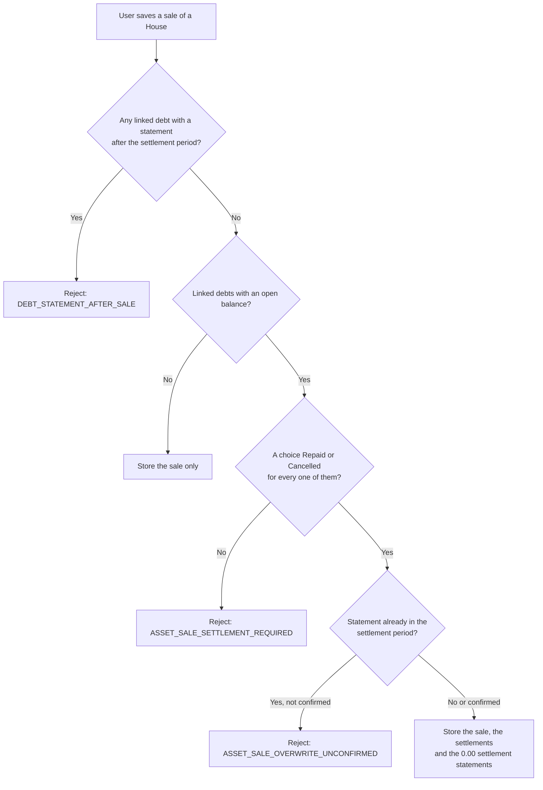
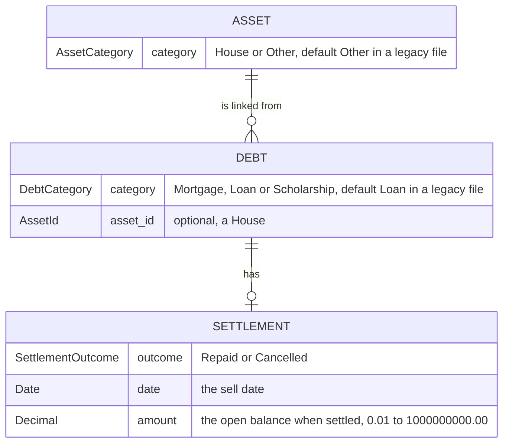

# CSD-020: Debt linked to asset

## 1. Intent
A mortgage belongs to a house, but the app keeps assets (CSD-015) and debts (CSD-011) apart: it cannot show which debts are secured on a house, and when the house is sold it does not know what happened to them. This capability gives every asset a category (House or Other) and every debt a category (Mortgage, Loan or Scholarship), lets a debt be linked to a House, and makes the sale of a House (CSD-019) settle its open debts as either **repaid** or **cancelled**. The difference matters for "Wealth accumulation from cash" (CSD-018): a repaid debt came out of the owner's cash and counts, a cancelled one did not. It is for a single person keeping a private, local history. It follows GitHub issue 31 and the grill-me interview, and it replaces the non-goals of CSD-011 and CSD-015 that excluded a debt type and a debt linked to an asset.

## 2. Scope
### 2.1 In scope
- A category on every asset (House, Other) and on every debt (Mortgage, Loan, Scholarship).
- An optional link from a debt to one House. A House can have many debts.
- Rules that protect the link: a House with linked debts cannot be deleted or recategorised, a sold House takes no new links.
- A settlement (Repaid or Cancelled) of every open linked debt when the House is sold, with the zero statement it creates.
- Locking a settled debt, undoing a sale, and what changing the sell date or deleting a debt does to a settlement.
- The effect on "Wealth accumulation from cash" (CSD-018 REQ-5).
- The category and the link in the Debts and Assets overviews and forms.
- Opening project files without categories.

### 2.2 Non-goals
- NG-1: User-defined categories, or more categories than the fixed lists.
- NG-2: A debt linked to more than one asset, or to an asset that is not a House.
- NG-3: Netting the sell amount against the debts, checking the sell amount against the debt, and any cash or net-worth effect of the settlement beyond the zero statement (CSD-019 NG-4 still holds).
- NG-4: Interest, terms, repayment schedules and loan-to-value (CSD-011 NG-1, NG-2).
- NG-5: Partial repayment or partial cancellation of a debt at a sale. A debt is repaid or cancelled as a whole.
- NG-6: New charts or Insights. Category and link are shown in the overviews only.
- NG-7: Settling debts when an asset other than a House is sold, or when a House is sold without linked debts.

## 3. Definitions
| Term | Meaning |
|---|---|
| **House** | An asset with category House. All other assets have category Other. |
| **Link** | The optional reference of a debt to one House. It is stored on the debt. |
| **Settlement period** | The period of the sell date: the month (`YYYY-MM`) for a monthly debt, the year (`YYYY`) for a yearly debt. |
| **Open balance** | The balance of the latest statement of a debt in a period on or before the settlement period. A debt without such a statement, or whose open balance is 0.00, has no open balance to settle. |
| **Settlement** | The record on a debt that its House was sold: the outcome (Repaid or Cancelled), the sell date and the open balance at that moment (the *settled amount*). A debt has at most one. |
| **Settled debt** | A debt with a settlement. |
| **Settlement statement** | The statement with balance 0.00 in the settlement period that the app creates with the settlement. |

## 4. Requirements

### 4.0 Overview flow


### 4.1 Categories

**REQ-1: Asset category** *(event-driven)*
When the user adds or edits an asset, the app shall store its category, House or Other, defaulting to Other in the add form.

```gherkin
@AC-1.1
Scenario: Add a house
  When the user adds an asset "Example House" with category House
  Then the asset has category House

@AC-1.2
Scenario: The default is Other
  When the user adds an asset "Example Car" without choosing a category
  Then the asset has category Other

@AC-1.3
Scenario: An unknown category is rejected
  When the user adds an asset "Example House" with category "Castle"
  Then it is rejected with error code "ASSET_CATEGORY_INVALID"
  And no asset exists
```

**REQ-2: Debt category** *(event-driven)*
When the user adds or edits a debt, the app shall store its category, Mortgage, Loan or Scholarship, defaulting to Loan in the add form.

```gherkin
@AC-2.1
Scenario Outline: Add a debt with a category
  When the user adds a debt "Example Debt" with category "<category>"
  Then the debt has category "<category>"

  Examples:
    | category    |
    | Mortgage    |
    | Loan        |
    | Scholarship |

@AC-2.2
Scenario: The default is Loan
  When the user adds a debt "Example Debt" without choosing a category
  Then the debt has category Loan

@AC-2.3
Scenario: An unknown category is rejected
  When the user adds a debt "Example Debt" with category "Credit card"
  Then it is rejected with error code "DEBT_CATEGORY_INVALID"
  And no debt exists
```

**REQ-3: Legacy files** *(event-driven)*
When the user opens a project file whose assets or debts have no category, the app shall open it without error, treat those assets as Other and those debts as Loan, and keep them without a link.

```gherkin
@AC-3.1
Scenario: Legacy file opens
  Given a project file with an asset "Example House" and a debt "Example Mortgage", both without category
  When the user opens it
  Then "Example House" has category Other
  And "Example Mortgage" has category Loan and no link
  And no error is shown
```

### 4.2 Link

**REQ-4: Link a debt to a house** *(event-driven)*
When the user saves a debt with a House chosen, the app shall store the link on the debt, and when the user saves it with the House emptied, the app shall remove the link. A House may have many debts.

```gherkin
@AC-4.1
Scenario: Link two debts to one house
  Given a House "Example House"
  When the user links the debts "Example Mortgage" and "Example Renovation Loan" to it
  Then both debts are linked to "Example House"

@AC-4.2
Scenario: Remove the link
  Given a debt "Example Mortgage" linked to "Example House"
  When the user empties the House and saves
  Then the debt has no link

@AC-4.3
Scenario: A debt without a house is valid
  When the user adds a debt "Example Mortgage" with category Mortgage and no House
  Then the debt exists without a link
```

**REQ-5: Link rules** *(unwanted behaviour)*
If the user links a debt to an asset that does not exist or is not a House, then the app shall reject it with the error code `DEBT_LINK_NOT_HOUSE`; if the House is sold, then with `DEBT_LINK_HOUSE_SOLD`; and if the debt is settled and the edit changes its link or its category, then with `DEBT_SETTLED_LOCKED`, storing nothing.

```gherkin
@AC-5.1
Scenario: Only a house can be linked
  Given an asset "Example Car" with category Other
  When the user links the debt "Example Loan" to it
  Then it is rejected with error code "DEBT_LINK_NOT_HOUSE"
  And the debt has no link

@AC-5.2
Scenario: A sold house takes no new links
  Given a House "Example House" sold on 10/06/2026 for 300000.00
  When the user links the debt "Example Loan" to it
  Then it is rejected with error code "DEBT_LINK_HOUSE_SOLD"

@AC-5.3
Scenario Outline: A settled debt keeps its link and category
  Given a debt "Example Mortgage" with category Mortgage, settled on the sale of "Example House"
  When the user changes <change> and saves
  Then it is rejected with error code "DEBT_SETTLED_LOCKED"

  Examples:
    | change                      |
    | the House to empty          |
    | the category to Loan        |

@AC-5.4
Scenario: Other fields of a settled debt can change
  Given a debt "Example Mortgage" settled on the sale of "Example House"
  When the user renames it to "Example Home Loan" and saves
  Then the debt is named "Example Home Loan" and is still linked
```

**REQ-6: A house with debts is protected** *(unwanted behaviour)*
If the user deletes a House, or changes its category from House to Other, while debts are linked to it, then the app shall reject it with the error code `ASSET_HAS_LINKED_DEBTS`, leaving the asset and the links unchanged.

```gherkin
@AC-6.1
Scenario: Delete a house with a debt
  Given a House "Example House" with a linked debt "Example Mortgage"
  When the user deletes "Example House"
  Then it is rejected with error code "ASSET_HAS_LINKED_DEBTS"
  And "Example House" still exists

@AC-6.2
Scenario: Change the category of a house with a debt
  Given a House "Example House" with a linked debt "Example Mortgage"
  When the user changes its category to Other
  Then it is rejected with error code "ASSET_HAS_LINKED_DEBTS"
  And it is still a House

@AC-6.3
Scenario: Unlink first, then delete
  Given a House "Example House" with a linked debt "Example Mortgage"
  When the user removes the link and deletes "Example House"
  Then "Example House" no longer exists
```

### 4.3 Settlement on sale

**REQ-7: Settle the debts on a sale** *(event-driven)*
When the user saves a sale of a House, the app shall store for every linked debt with an open balance a settlement with the chosen outcome (Repaid or Cancelled), the sell date and the open balance as the settled amount, and for a linked debt without an open balance shall store nothing.

```gherkin
@AC-7.1
Scenario: Sell a house with a repaid mortgage
  Given a House "Example House" with a linked monthly debt "Example Mortgage" with a statement 2026-03 balance 8000.00
  When the user sells the house on 10/06/2026 for 300000.00 and chooses Repaid for "Example Mortgage"
  Then "Example Mortgage" has a settlement Repaid dated 10/06/2026 with settled amount 8000.00

@AC-7.2
Scenario: Sell a house with a cancelled loan
  Given a House "Example House" with a linked yearly debt "Example Loan" with a statement 2025 balance 5000.00
  When the user sells the house on 10/06/2026 for 300000.00 and chooses Cancelled for "Example Loan"
  Then "Example Loan" has a settlement Cancelled dated 10/06/2026 with settled amount 5000.00

@AC-7.3
Scenario Outline: A debt without an open balance needs no settlement
  Given a House "Example House" with a linked monthly debt "Example Mortgage" <history>
  When the user sells the house on 10/06/2026 for 300000.00
  Then the sale is stored
  And "Example Mortgage" has no settlement

  Examples:
    | history                                    |
    | and no statements                          |
    | with a statement 2026-05 balance 0.00      |

@AC-7.4
Scenario: A house without debts sells as before
  Given a House "Example House" with no linked debts
  When the user sells it on 10/06/2026 for 300000.00
  Then the sale is stored and nothing else changes

@AC-7.5
Scenario: Selling an asset of category Other settles nothing
  Given an asset "Example Car" with category Other
  When the user sells it on 10/06/2026 for 9000.00
  Then the sale is stored and no debt changes
```

**REQ-8: Every open debt needs a choice** *(unwanted behaviour)*
If the user saves a sale of a House and a linked debt with an open balance has no choice, or a choice is given for a debt that is not linked to the House or has no open balance, then the app shall reject the sale with the error code `ASSET_SALE_SETTLEMENT_REQUIRED` or `ASSET_SALE_SETTLEMENT_INVALID`, storing nothing.

```gherkin
@AC-8.1
Scenario: A missing choice rejects the sale
  Given a House "Example House" with linked debts "Example Mortgage" (statement 2026-03 balance 8000.00) and "Example Renovation Loan" (statement 2026-03 balance 2000.00)
  When the user sells the house on 10/06/2026 and chooses only for "Example Mortgage"
  Then it is rejected with error code "ASSET_SALE_SETTLEMENT_REQUIRED"
  And the house is still held and no debt changes

@AC-8.2
Scenario: A choice for an unrelated debt is rejected
  Given a House "Example House" and an unlinked debt "Example Loan" with a statement 2026-03 balance 500.00
  When the user sells the house on 10/06/2026 and chooses Repaid for "Example Loan"
  Then it is rejected with error code "ASSET_SALE_SETTLEMENT_INVALID"
```

**REQ-9: Later statements block the sale** *(unwanted behaviour)*
If the user saves a sale of a House and a linked debt has a statement in a period after the settlement period, then the app shall reject the sale with the error code `DEBT_STATEMENT_AFTER_SALE`, naming the debt and leaving everything unchanged.

```gherkin
@AC-9.1
Scenario: A statement after the sale period
  Given a House "Example House" with a linked monthly debt "Example Mortgage" with statements 2026-03 (8000.00) and 2026-09 (7000.00)
  When the user sells the house on 10/06/2026 and chooses Repaid for "Example Mortgage"
  Then it is rejected with error code "DEBT_STATEMENT_AFTER_SALE" naming "Example Mortgage"
  And the house is still held

@AC-9.2
Scenario: A statement in the sale period is not after it
  Given a House "Example House" with a linked monthly debt "Example Mortgage" with statements 2026-03 (8000.00) and 2026-06 (7500.00)
  When the user sells the house on 10/06/2026 and chooses Repaid after confirming the overwrite
  Then the sale is stored
```

**REQ-10: The settlement statement** *(event-driven)*
When a settlement is stored, the app shall create a statement with balance 0.00 for the settlement period with the note "Repaid on sale of <asset>" or "Cancelled on sale of <asset>", and if a statement already exists in that period, then the app shall overwrite it only after the user confirms, and otherwise reject the sale with the error code `ASSET_SALE_OVERWRITE_UNCONFIRMED`.

```gherkin
@AC-10.1
Scenario: The debt drops to zero in the sale month
  Given a House "Example House" with a linked monthly debt "Example Mortgage" with a statement 2026-03 balance 8000.00
  When the user sells the house on 10/06/2026 and chooses Cancelled for "Example Mortgage"
  Then "Example Mortgage" has a statement 2026-06 with balance 0.00 and note "Cancelled on sale of Example House"
  And the total debt of CSD-011 no longer includes it

@AC-10.2
Scenario: A yearly debt gets a yearly statement
  Given a House "Example House" with a linked yearly debt "Example Loan" with a statement 2025 balance 5000.00
  When the user sells the house on 10/06/2026 and chooses Repaid for "Example Loan"
  Then "Example Loan" has a statement 2026 with balance 0.00 and note "Repaid on sale of Example House"

@AC-10.3
Scenario: Overwriting needs a confirmation
  Given a linked monthly debt "Example Mortgage" with a statement 2026-06 balance 7500.00
  When the user sells the house on 10/06/2026 and chooses Repaid without confirming the overwrite
  Then it is rejected with error code "ASSET_SALE_OVERWRITE_UNCONFIRMED"
  And the statement 2026-06 still has balance 7500.00
  And the house is still held

@AC-10.4
Scenario: A confirmed overwrite keeps the open balance as settled amount
  Given a linked monthly debt "Example Mortgage" with statements 2026-03 (8000.00) and 2026-06 (7500.00)
  When the user sells the house on 10/06/2026 and chooses Cancelled and confirms the overwrite
  Then the statement 2026-06 has balance 0.00
  And the settlement has settled amount 7500.00

@AC-10.5
Scenario: Net worth drops the debt
  Given a linked monthly debt "Example Mortgage" with a statement 2025-12 balance 10000.00 and none in 2026
  When the user sells the house on 10/06/2026 and chooses Repaid
  Then the debts figure of net worth for 2026 is 0.00
```

**REQ-11: A settled debt is closed** *(unwanted behaviour)*
If the user adds, edits, moves or deletes a statement of a settled debt in or after the settlement period, then the app shall reject it with the error code `DEBT_SETTLED_LOCKED`, leaving the statements unchanged.

```gherkin
@AC-11.1
Scenario Outline: Statements from the settlement period on are locked
  Given a monthly debt "Example Mortgage" settled on 10/06/2026 with statements 2026-03 (8000.00) and 2026-06 (0.00)
  When the user <action>
  Then it is rejected with error code "DEBT_SETTLED_LOCKED"

  Examples:
    | action                                          |
    | adds a statement 2026-07 with balance 1.00      |
    | edits the statement 2026-06 to balance 1.00     |
    | deletes the statement 2026-06                   |
    | changes the period of 2026-03 to 2026-08        |

@AC-11.2
Scenario: Earlier statements stay editable
  Given a monthly debt "Example Mortgage" settled on 10/06/2026 with a statement 2026-03 balance 8000.00
  When the user edits the statement 2026-03 to balance 8100.00
  Then the statement 2026-03 has balance 8100.00
  And the settled amount is still 8000.00
```

**REQ-12: Undo a sale** *(event-driven)*
When the user clears the sell date and the sell amount of a House with settled debts and confirms, the app shall remove those settlements and their settlement statements, so the debts are open again, and the confirmation shall tell the user that a statement that was overwritten is not restored.

```gherkin
@AC-12.1
Scenario: Clearing the sale reopens the debts
  Given a sold House "Example House" with a debt "Example Mortgage" settled Repaid, statements 2026-03 (8000.00) and 2026-06 (0.00)
  When the user clears the sale and confirms
  Then the house is held
  And "Example Mortgage" has no settlement and no statement 2026-06
  And its latest statement is 2026-03 with balance 8000.00

@AC-12.2
Scenario: An overwritten balance is not restored
  Given "Example Mortgage" settled on 10/06/2026 after the user confirmed overwriting its statement 2026-06 (7500.00)
  When the user clears the sale and confirms
  Then "Example Mortgage" has no statement 2026-06

@AC-12.3
Scenario: Without a confirmation nothing changes
  Given a sold House "Example House" with a settled debt
  When the user clears the sale without confirming
  Then it is rejected with error code "ASSET_SALE_UNDO_UNCONFIRMED"
  And the sale and the settlements are unchanged
```

**REQ-13: The sell date is locked while debts are settled** *(unwanted behaviour)*
If the user changes the sell date of a House with settled debts, then the app shall reject it with the error code `ASSET_SELL_DATE_LOCKED`, and the sell amount may still change.

```gherkin
@AC-13.1
Scenario: Moving the sell date is rejected
  Given a House "Example House" sold on 10/06/2026 for 300000.00 with a settled debt
  When the user changes the sell date to 11/06/2026
  Then it is rejected with error code "ASSET_SELL_DATE_LOCKED"
  And the sell date is still 10/06/2026

@AC-13.2
Scenario: Changing the sell amount is allowed
  Given the same house
  When the user changes the sell amount to 310000.00
  Then the sell amount is 310000.00
  And the settlement is unchanged
```

**REQ-14: Deleting a settled debt** *(event-driven)*
When the user deletes a settled debt, the app shall delete its settlement together with its statements.

```gherkin
@AC-14.1
Scenario: Delete a settled debt
  Given a sold House "Example House" with a debt "Example Mortgage" settled Repaid
  When the user deletes "Example Mortgage"
  Then the debt, its statements and its settlement no longer exist
  And the house is still sold
```

### 4.4 Figures and views

**REQ-15: Cancelled debts are not wealth accumulation** *(ubiquitous)*
The app shall, in the repaid amount of a year that CSD-018 REQ-5 adds to the wealth accumulation, subtract the settled amount of every Cancelled debt whose sell date lies in that year and that counts in the repaid amount of CSD-011 of that year, and shall leave the debt figures of CSD-011, the total debt and the net worth unchanged by this subtraction.

```gherkin
@AC-15.1
Scenario: A repaid mortgage counts in full
  Given a monthly debt "Example Mortgage" with statements 2025-12 (10000.00) and 2026-03 (8000.00)
  And its House sold on 10/06/2026 with the debt Repaid
  And no bank accounts and no investment accounts
  Then the repaid amount of 2026 in the debts overview is 10000.00
  And the wealth accumulation of 2026 is 10000.00

@AC-15.2
Scenario: A cancelled mortgage counts only what was paid down
  Given the same debt, sold with the debt Cancelled
  Then the repaid amount of 2026 in the debts overview is 10000.00
  And the wealth accumulation of 2026 is 2000.00

@AC-15.3
Scenario: A debt that first appears in the sale year has no repaid amount
  Given a monthly debt "Example Mortgage" with only a statement 2026-03 (8000.00)
  And its House sold on 10/06/2026 with the debt Cancelled
  And no bank accounts and no investment accounts
  Then the wealth accumulation of 2026 is none

@AC-15.4
Scenario: Cancelled debts of other years are not deducted
  Given a Cancelled debt settled on 10/06/2026
  Then the wealth accumulation of 2025 and 2027 is unchanged

@AC-15.5
Scenario: Net worth drops a cancelled debt like a repaid one
  Given the debt of AC-15.2 with the debt Cancelled
  Then the debts figure of net worth for 2026 is 0.00
```

**REQ-16: Category, link and settlement in the overviews** *(ubiquitous)*
The app shall show in the Debts overview the category and the linked House name of every debt, and in the Assets overview, for every House, its linked debts with their latest balances and, after a sale, a badge Repaid or Cancelled per settled debt. Charts and Insights shall not change.

```gherkin
@AC-16.1
Scenario: Debts overview columns
  Given a debt "Example Mortgage" with category Mortgage linked to "Example House"
  Then its row shows "Mortgage" and "Example House"

@AC-16.2
Scenario: An unlinked debt shows a dash
  Given a debt "Example Loan" with category Loan and no link
  Then its row shows "Loan" and a dash as House

@AC-16.3
Scenario: House row lists its debts
  Given a held House "Example House" with linked debts "Example Mortgage" (latest balance 8000.00) and "Example Renovation Loan" (latest balance 2000.00)
  Then its row lists both with those balances and no badge

@AC-16.4
Scenario: Badge after a sale
  Given a sold House "Example House" with "Example Mortgage" settled Cancelled
  Then its row lists "Example Mortgage" with the badge "Cancelled"
```

**REQ-17: The forms** *(event-driven)*
When the user opens the add or edit form of an asset or a debt, the app shall offer the category, and in the debt form a House dropdown of unsold Houses, and when the user fills in a sell date and amount for a House with open linked debts, the app shall list those debts with a Repaid or Cancelled choice, a warning when a statement of the sell period would be overwritten, and shall do all validation in Rust.

```gherkin
@AC-17.1
Scenario: Fields in the debt form
  When the user opens the add debt form
  Then it asks for Name, Statement period, Category and "House (optional)"
  And the House dropdown lists only unsold Houses

@AC-17.2
Scenario: Fields in the asset form
  When the user opens the add asset form
  Then it also asks for Category

@AC-17.3
Scenario: The sale form asks for a choice per open debt
  Given a House "Example House" with linked debts "Example Mortgage" (balance 8000.00) and "Example Paid Off Loan" (balance 0.00)
  When the user fills in a sell date and a sell amount
  Then the form lists "Example Mortgage" with Repaid and Cancelled and no preselected choice
  And it does not list "Example Paid Off Loan"

@AC-17.4
Scenario: Overwrite warning
  Given a linked debt with a statement in the settlement period
  When the user fills in the sell date
  Then the form warns that the statement of that period will be overwritten with 0.00

@AC-17.5
Scenario: An edit is an unsaved change
  Given a saved project with a House and a linked debt
  When the user sells the house with a settlement
  Then the unsaved indicator is shown
```

### 4.5 Saving and loading

**REQ-18: Categories, links and settlements are part of the project file** *(event-driven)*
When the user saves and later opens a project, the app shall restore the categories, the links and the settlements exactly, and if the file holds a link to a missing or non-House asset, a settlement on a debt without a link, or a settlement whose House is not sold on the settlement date, then the app shall reject it with the error code `PROJECT_INVALID_FILE`.

```gherkin
@AC-18.1
Scenario: Round trip
  Given a sold House "Example House" with a debt "Example Mortgage" settled Cancelled with settled amount 8000.00
  When the user saves the project and opens it again
  Then the categories, the link and the settlement are the same

@AC-18.2
Scenario Outline: A damaged file is invalid
  Given a project file with <damage>
  When the user opens it
  Then it is rejected with the error code "PROJECT_INVALID_FILE"

  Examples:
    | damage                                                         |
    | a debt linked to an asset id that does not exist               |
    | a debt linked to an asset with category Other                  |
    | a settlement on a debt without a link                          |
    | a settlement dated 11/06/2026 on a House sold on 10/06/2026    |
```

## 5. Interfaces and contracts



The link is stored on the debt, never on the asset. In the project file the new fields are optional with the defaults above, so existing files load and `format_version` stays 1. The linked debts of a House and the badges are derived. Dates in the file and over IPC are ISO 8601 and amounts decimal strings (CSD-000 CON-7).

Commands: `create_asset`, `update_asset`, `create_debt` and `update_debt` take the extra fields. The asset save takes the sale together with a list of `{ debt_id, outcome }` and a `confirm_overwrite` flag, and the clear-sale save takes `confirm_undo`. `list_assets()` adds per House its linked debts with their latest balance and settlement outcome, `list_debts()` adds the category and the linked House name, and the ratios command applies REQ-15.

Error codes (code plus safe message): `ASSET_CATEGORY_INVALID`, `DEBT_CATEGORY_INVALID`, `DEBT_LINK_NOT_HOUSE`, `DEBT_LINK_HOUSE_SOLD`, `DEBT_SETTLED_LOCKED`, `ASSET_HAS_LINKED_DEBTS`, `ASSET_SALE_SETTLEMENT_REQUIRED`, `ASSET_SALE_SETTLEMENT_INVALID`, `DEBT_STATEMENT_AFTER_SALE`, `ASSET_SALE_OVERWRITE_UNCONFIRMED`, `ASSET_SALE_UNDO_UNCONFIRMED`, `ASSET_SELL_DATE_LOCKED`.

## 6. Constraints
- CON-1: The settlement, the settlement statement and the ratio deduction are computed in `domain/` and the frontend computes no figure. Rationale: `CLAUDE.md` layout rule.
- CON-2: The settled amount is stored, not derived. Rationale: overwriting the statement of the settlement period removes the balance it came from, and the ratios need it.
- CON-3: A sale with settlements is saved all or nothing. Rationale: a half-settled sale would leave debts and house out of step.
- CON-4: Amounts are `rust_decimal::Decimal` with the value rules of CSD-011. Rationale: `CLAUDE.md` money rules.
- CON-5: Amounts and names are not logged at `info` or above, and tests use synthetic data. Rationale: `CLAUDE.md` privacy rules, public repo.
- CON-6: No network access. Rationale: `CLAUDE.md` Tauri security rules.

## 7. Verification
All ACs are proven by `cargo test`, with domain logic in `domain/`. Tests are named `test_csd020_ac_<n>_<m>_<description>` (CSD-000 REQ-6).

| Requirement | Command |
|---|---|
| REQ-1 to REQ-15, REQ-18 (data) | `cargo test test_csd020_` |
| One requirement, e.g. REQ-15 | `cargo test test_csd020_ac_15_` |
| REQ-16 and REQ-17 (display) | Manual checklist: category and House columns, dash for no link, linked debts and badges on the House row, form fields, House dropdown without sold Houses, one choice per open debt, overwrite warning, unsaved indicator. There is no frontend test setup |

Done means fmt, clippy (`-D warnings`) and `cargo test --all-features` pass. Tests of CSD-018 REQ-5 and CSD-011 are updated only where REQ-15 changes a figure.

## 8. Open questions
None.

## 9. Changelog
- 0.1 (30/10/2026): initial draft, from GitHub issue 31 and the grill-me interview. Approving it supersedes CSD-011 NG-3 (collateral) and NG-8 (a debt type) and CSD-015 NG-3 (a debt linked to an asset), and extends CSD-011 REQ-7 (statements of a settled debt), CSD-015 and CSD-019 REQ-2 (the sale), and CSD-018 REQ-5 (repaid). Beyond the interview, a settlement stores its settled amount (CON-2) and its zero statement is locked with the rest of the settled period (REQ-11).
