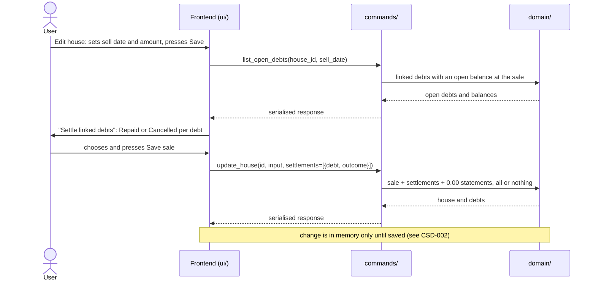
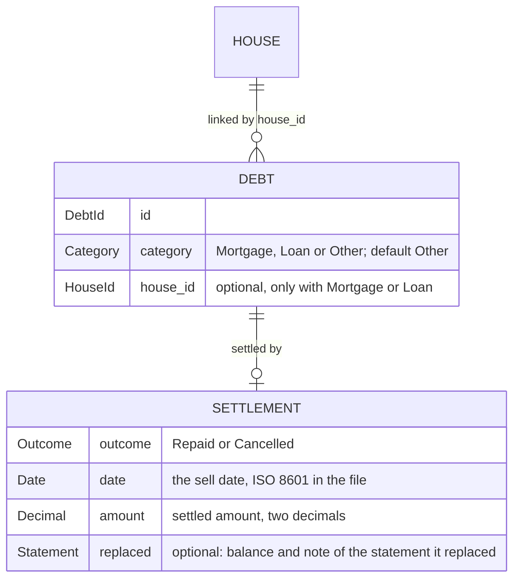

# CSD-020: Debt linked to a house

## 1. Intent
A mortgage or a loan often belongs to one house, but the app keeps houses (CSD-015) and debts (CSD-011) apart. When a house is sold, its debts are normally paid off or written off, yet nothing in the app says which, and the sale does not touch the debts. This capability lets the user give each debt a category (Mortgage, Loan or Other) and, for a Mortgage or Loan, link it to a house in the debt form. When a house with linked debts is sold, the user says per debt whether it was **Repaid** or **Cancelled**. Either way the debt drops to 0.00, so total debt and net worth no longer carry it. A Repaid debt counts in full in the wealth accumulation from cash (CSD-018), while the settled amount of a Cancelled debt is taken out of that year's repaid amount, because no cash paid it. It is for a single person keeping a private, local history. It follows GitHub issue 31 and the grill-me interview, and it replaces CSD-011 NG-3 and NG-7 (in part) and CSD-015 NG-3.

## 2. Scope
### 2.1 In scope
- A category on every debt (Mortgage, Loan or Other), and an optional link from a Mortgage or Loan to one house, set and removed in the Add and Edit debt form.
- The Repaid or Cancelled choice per linked debt when a house is sold, and its effect on the debt (a settlement).
- Undoing a sale, the locks that keep a settlement consistent, and the delete rules.
- The effect on total debt, net worth and the wealth accumulation from cash.
- Showing the links and settlements in the Houses and Debts overviews.
- The project file (CSD-002) for the link and the settlement.

### 2.2 Non-goals
- NG-1: Categories other than Mortgage, Loan and Other, and any effect of the category apart from the link: it changes no figure.
- NG-2: A debt linked to more than one house, and a house-independent link such as a collateral or a lien.
- NG-3: Linking a debt in the Add and Edit house forms: they show no debt selection.
- NG-4: Partial repayment or partial cancellation: a settlement settles the whole open balance.
- NG-5: Putting the sell amount into a bank account or net worth, or netting it against the debts (CSD-019 NG-4).
- NG-6: Settling a debt without selling its house, and settling debts that are not linked.
- NG-7: Changing the Repaid or Cancelled outcome after the sale is saved. The user undoes the sale (REQ-6) and enters it again.
- NG-8: Interest, fees and tax on the settlement.

## 3. Definitions
| Term | Meaning |
|---|---|
| **Category** | The kind of a debt: **Mortgage**, **Loan** or **Other** (the default). Only a Mortgage or a Loan can be linked to a house. |
| **Linked debt** | A debt with a house link. It has at most one, and a house may have many. |
| **Sale period** | The period that holds the sell date: the month (`YYYY-MM`) for a debt with monthly statements and the year (`YYYY`) for a debt with yearly statements. |
| **Open balance** | The balance of the latest statement of the debt in a period up to and including the sale period. A debt without such a statement, or with 0.00, has no open balance. |
| **Settlement** | What the sale does to a linked debt with an open balance: the outcome (**Repaid** or **Cancelled**), the settlement date (the sell date), and the settled amount (the open balance). |
| **Settlement statement** | The statement of balance 0.00 in the sale period that the settlement writes, with the note "Repaid on sale of <house>" or "Cancelled on sale of <house>". |
| **Settled debt** | A debt with a settlement. |

## 4. Requirements

### 4.0 Overview flow


### 4.1 Category and link

**REQ-1: Link a debt in the debt form** *(event-driven)*
When the user saves the Add or Edit debt form with the category Mortgage or Loan and a house, the app shall link the debt to that house, and with no house or the category Other, the app shall store the debt without a link.

```gherkin
@AC-1.1
Scenario: Link a mortgage
  Given a held house "Example House" and a debt "Example Mortgage"
  When the user edits the debt, selects the category Mortgage and the house "Example House" and saves
  Then "Example Mortgage" has the category Mortgage and is linked to "Example House"

@AC-1.2
Scenario: Unlink a debt
  Given "Example Loan" has the category Loan and is linked to the held house "Example House"
  When the user edits the debt, selects no house and saves
  Then "Example Loan" has the category Loan and no house link
  And its statements are unchanged

@AC-1.3
Scenario: Changing the category to Other removes the link
  Given "Example Loan" has the category Loan and is linked to the held house "Example House"
  When the user edits the debt, selects the category Other and saves
  Then "Example Loan" has the category Other and no house link

@AC-1.4
Scenario: Link while adding a debt
  Given a held house "Example House"
  When the user adds a debt "Example Mortgage" with the category Mortgage and the house "Example House"
  Then "Example Mortgage" is linked to "Example House"

@AC-1.5
Scenario: The category defaults to Other
  When the user adds a debt "Example Card" and leaves the category as it is
  Then "Example Card" has the category Other and no house link
```

**REQ-2: Category and link rules** *(unwanted behaviour)*
If a debt is saved with a category other than Mortgage, Loan or Other, a house with the category Other, a house that does not exist or is sold, or while its current house is sold, then the app shall reject the save with the error code of the violated rule and change nothing.

```gherkin
@AC-2.1
Scenario Outline: A forbidden category or link is rejected
  Given a held house "Example House" and a house "Example Guesthouse" sold on 10/06/2026
  And "Example Loan" with the category Loan linked to "Example House"
  And "Example Cabin Loan" with the category Loan linked to "Example Guesthouse"
  When the user saves "<debt>" with the category "<category>" and the house "<house>"
  Then it is rejected with error code "<code>"
  And nothing changed

  Examples:
    | debt              | category | house                  | code                     |
    | Example Loan      | Savings  | (none)                 | DEBT_CATEGORY_INVALID    |
    | Example Loan      | Other    | Example House          | DEBT_LINK_CATEGORY_INVALID |
    | Example Loan      | Loan     | Example Guesthouse     | HOUSE_LINKS_LOCKED_SOLD  |
    | Example Loan      | Loan     | (a deleted house)      | HOUSE_NOT_FOUND          |
    | Example Cabin Loan | Loan    | (none)                 | HOUSE_LINKS_LOCKED_SOLD  |
```

### 4.2 Sale and settlement

**REQ-3: A sale asks Repaid or Cancelled per open debt** *(event-driven)*
When the user saves a house that gains a sale and has linked debts with an open balance, the app shall require an outcome, Repaid or Cancelled, for each of those debts, and shall save the sale and all settlements together or not at all.

```gherkin
@AC-3.1
Scenario: Sell with two outcomes
  Given the held house "Example House" bought on 15/03/2024 with linked debts "Example Mortgage" (latest statement 2026-03, balance 190000.00) and "Example Loan" (latest statement 2026-03, balance 10000.00)
  When the user sets sell date 10/06/2026 and sell amount 300000.00, chooses Repaid for "Example Mortgage" and Cancelled for "Example Loan", and saves
  Then the house is sold on 10/06/2026 for 300000.00
  And "Example Mortgage" is settled as Repaid with settled amount 190000.00
  And "Example Loan" is settled as Cancelled with settled amount 10000.00

@AC-3.2
Scenario: A missing choice saves nothing
  Given the same house and debts
  When the user saves the sale with a choice for "Example Mortgage" only
  Then it is rejected with error code "HOUSE_SETTLEMENT_REQUIRED"
  And the house has no sale and both debts are unchanged

@AC-3.3
Scenario: A choice for a debt that needs none is rejected
  Given a held house with a linked debt "Example Loan" that has no statements
  When the user saves a sale with the choice Repaid for "Example Loan"
  Then it is rejected with error code "HOUSE_SETTLEMENT_INVALID"
  And the house has no sale

@AC-3.4
Scenario: A house with no open debt is sold directly
  Given a held house with no linked debts
  When the user sets sell date 10/06/2026 and sell amount 300000.00 and saves
  Then the house is sold and no choice is asked
```

**REQ-4: The open balance is the settled amount** *(ubiquitous)*
The app shall take the settled amount of a debt from its latest statement in a period up to and including the sale period, shall give no choice for a debt without an open balance, and shall leave such a debt linked.

```gherkin
@AC-4.1
Scenario Outline: Which debts need a choice
  Given a linked debt "Example Loan" with statements <statements>
  And a house sold on 10/06/2026
  When the user saves the sale
  Then the choice is <asked> and the settled amount is <amount>

  Examples:
    | statements                      | asked        | amount    |
    | 2026-02: 5000.00, 2026-05: 4000.00 | asked    | 4000.00   |
    | 2026-06: 3500.00                | asked        | 3500.00   |
    | (none)                          | not asked    | none      |
    | 2026-04: 0.00                   | not asked    | none      |

@AC-4.2
Scenario: A statement after the sale period blocks the sale
  Given a linked debt "Example Loan" with a statement for 2026-08 with balance 3000.00
  When the user saves a sale with sell date 10/06/2026 with an outcome for "Example Loan"
  Then it is rejected with error code "DEBT_STATEMENT_AFTER_SALE"
  And nothing changes
```

**REQ-5: A settlement drops the debt to 0.00** *(event-driven)*
When a sale is saved with an outcome for a debt, the app shall store the settlement on the debt and write its settlement statement of 0.00 in the sale period, and if the debt already has a statement in that period, then the settlement statement shall replace it and the app shall keep the replaced balance and note on the settlement.

```gherkin
@AC-5.1
Scenario: The settlement statement
  Given "Example Mortgage" (monthly) with a statement for 2026-03 with balance 190000.00
  When the house is sold on 10/06/2026 with the outcome Repaid for it
  Then it has a statement for 2026-06 with balance 0.00 and note "Repaid on sale of Example House"
  And its settlement is Repaid, dated 10/06/2026, with settled amount 190000.00
  And its latest balance is 0.00

@AC-5.2
Scenario: A statement in the sale period is replaced
  Given "Example Loan" (monthly) with a statement for 2026-06 with balance 3500.00 and note "Mid-June"
  When the house is sold on 10/06/2026 with the outcome Cancelled for it
  Then its statement for 2026-06 has balance 0.00 and note "Cancelled on sale of Example House"
  And the settled amount is 3500.00
  And the replaced balance 3500.00 and note "Mid-June" are kept on the settlement

@AC-5.3
Scenario: A yearly debt settles in the sale year
  Given "Example Mortgage" (yearly) with a statement for 2025 with balance 200000.00
  When the house is sold on 10/06/2026 with the outcome Repaid for it
  Then it has a statement for 2026 with balance 0.00 and settled amount 200000.00
```

**REQ-6: Undo a sale** *(event-driven)*
When the user saves a sold house with the sell date and the sell amount emptied and has confirmed it, the app shall remove the sale and every settlement of the house, shall remove each settlement statement and restore the statement it replaced, and shall leave the debts linked.

```gherkin
@AC-6.1
Scenario: Undo restores the debts
  Given "Example Loan" was settled as Cancelled on the sale of "Example House" and replaced a statement for 2026-06 with balance 3500.00 and note "Mid-June"
  When the user empties the sell date and sell amount, confirms and saves
  Then the house is held again
  And "Example Loan" has no settlement, is still linked, and its statement for 2026-06 has balance 3500.00 and note "Mid-June"

@AC-6.2
Scenario: Undo without confirmation
  Given a house sold with a settled debt
  When the user empties the sell date and sell amount and saves without confirming
  Then it is rejected with error code "HOUSE_SALE_UNDO_UNCONFIRMED"
  And nothing changes
```

### 4.3 Locks and deletes

**REQ-7: The sell date is locked while debts are settled** *(unwanted behaviour)*
If a house has a settled debt, then the app shall reject a change of its sell date with the error code `HOUSE_SELL_DATE_LOCKED`, and shall accept a change of its sell amount.

```gherkin
@AC-7.1
Scenario: Change the sell date
  Given a house sold on 10/06/2026 for 300000.00 with a settled debt
  When the user sets sell date 11/06/2026
  Then it is rejected with error code "HOUSE_SELL_DATE_LOCKED"

@AC-7.2
Scenario: Change the sell amount
  Given the same house
  When the user sets sell amount 310000.00 and saves
  Then the house is sold on 10/06/2026 for 310000.00 and the settlement is unchanged
```

**REQ-8: Settled debts are locked** *(unwanted behaviour)*
If a debt has a settlement, then the app shall reject, with the error code `DEBT_SETTLED_LOCKED`, adding a statement in or after the settlement period, changing or deleting such a statement, changing the statement period of the debt, removing its house link and changing its category; statements before the settlement period stay editable.

```gherkin
@AC-8.1
Scenario Outline: Locked operations
  Given "Example Mortgage" settled on 10/06/2026 (settlement period 2026-06) with statements for 2026-03 and 2026-06
  When the user <operation>
  Then it is rejected with error code "DEBT_SETTLED_LOCKED"

  Examples:
    | operation                                         |
    | adds a statement for 2026-07                      |
    | edits the statement for 2026-06                   |
    | deletes the statement for 2026-06                 |
    | unlinks it or changes its category in the Edit debt form |

@AC-8.2
Scenario: Earlier statements stay editable
  Given the same debt
  When the user edits the statement for 2026-03 to balance 189000.00
  Then the statement is saved and the settled amount stays 190000.00
```

**REQ-9: Deleting a house or a debt** *(unwanted behaviour)*
If a house has linked debts, then the app shall reject its deletion with the error code `HOUSE_HAS_LINKED_DEBTS`, and when the user deletes a debt that is settled or linked, the app shall remove the debt with its statements, its link and its settlement.

```gherkin
@AC-9.1
Scenario: A house with linked debts cannot be deleted
  Given "Example Loan" is linked to "Example House"
  When the user deletes "Example House"
  Then it is rejected with error code "HOUSE_HAS_LINKED_DEBTS"
  And the house and the debt exist

@AC-9.2
Scenario: Deleting a settled debt
  Given "Example Loan" is settled as Cancelled on the sale of "Example House"
  When the user deletes "Example Loan"
  Then the debt and its settlement are gone and the house is still sold
```

### 4.4 Figures

**REQ-10: Net worth and total debt** *(ubiquitous)*
The app shall count a settled debt like any debt: its settlement statement of 0.00 is its latest balance, so a Repaid and a Cancelled debt both leave the total debt and the Debts of the net worth, and the sell amount shall not change cash or net worth (CSD-019 NG-4).

```gherkin
@AC-10.1
Scenario Outline: Both outcomes drop to 0.00
  Given a house "Example House" with latest valuation 300000.00 and the linked debt "Example Mortgage" with balance 190000.00, and no other records
  When the house is sold on 10/06/2026 with the outcome <outcome>
  Then the total debt is 0.00
  And the Debts of the net worth of 2026 are 0.00 and the Houses of 2026 are 0.00
  And the net worth of 2026 is 0.00

  Examples:
    | outcome   |
    | Repaid    |
    | Cancelled |
```

**REQ-11: A Repaid debt counts in full** *(ubiquitous)*
The app shall let the drop of a Repaid debt to 0.00 count in full in the repaid amount, and so in the wealth accumulation from cash (CSD-018 REQ-5), as any drop in balance does.

```gherkin
@AC-11.1
Scenario: Repaid
  Given "Example Mortgage" with a statement for 2025-12 with balance 200000.00 and Repaid on 10/06/2026 (settled amount 190000.00)
  When the ratios are computed
  Then the repaid amount of 2026 is 200000.00
```

**REQ-12: A Cancelled debt is taken out of the repaid amount** *(ubiquitous)*
The app shall subtract the settled amount of a Cancelled debt from the repaid amount of the year of its settlement in the wealth accumulation from cash, only when the debt has an opening balance in that year (CSD-011 section 3), and the result may be negative.

```gherkin
@AC-12.1
Scenario: Cancelled
  Given "Example Mortgage" with a statement for 2025-12 with balance 200000.00 and Cancelled on 10/06/2026 (settled amount 190000.00)
  When the ratios are computed
  Then the repaid amount of 2026 is 10000.00

@AC-12.2
Scenario: No opening balance
  Given "Example Loan" with its first statement 2026-02 (5000.00) and Cancelled on 10/06/2026 (settled amount 5000.00)
  When the ratios are computed
  Then the repaid amount of 2026 is none

@AC-12.3
Scenario: More cancelled than repaid
  Given "Example Mortgage" with a statement for 2025-12 with balance 200000.00, a statement for 2026-02 with balance 200000.00 and Cancelled on 10/06/2026 (settled amount 200000.00), and no other debt
  When the ratios are computed
  Then the repaid amount of 2026 is 0.00
```

### 4.5 Display and file

**REQ-13: The Houses view shows the linked debts** *(ubiquitous)*
The app shall show, under each house in the Overview of CSD-015, its linked debts with their latest balance and, for a settled debt, the badge Repaid or Cancelled with the settled amount, and shall show the Add and Edit house forms without any selection of debts.

```gherkin
@AC-13.1
Scenario: Linked debts under the house
  Given "Example House" with linked "Example Mortgage" (latest balance 190000.00) and "Example Loan" settled as Cancelled (settled amount 10000.00)
  When the user opens the Houses overview
  Then the house shows "Example Mortgage 190000.00" and "Example Loan 0.00, Cancelled 10000.00"

@AC-13.2
Scenario: The house form has no debts
  Given debts "A" and "B" and a house "Example House"
  When the user opens the Add house form and the Edit house form of "Example House"
  Then neither form has a field to select debts
```

**REQ-14: The debt form and the Debts view** *(ubiquitous)*
The app shall show on each debt row of the Debts overview (CSD-011 REQ-20) the category, the name of the linked house and, for a settled debt, the badge Repaid or Cancelled, and shall show in the debt form a Category dropdown (Mortgage, Loan, Other) and, only while Mortgage or Loan is selected, an optional House dropdown with the unsold houses and a choice for no house.

```gherkin
@AC-14.1
Scenario: Rows show category and house
  Given "Example Loan" with the category Loan linked to "Example House" and settled as Repaid
  When the user opens the Debts overview
  Then the row shows "Loan", "Example House" and "Repaid"

@AC-14.2
Scenario: The house dropdown follows the category
  Given a held house "Example House" and a sold house "Example Guesthouse"
  When the user opens the Add debt form
  Then the Category is Other and there is no House dropdown
  When the user selects the category Mortgage
  Then a House dropdown appears with "No house" and "Example House" and not "Example Guesthouse"
  When the user selects the category Other
  Then the House dropdown disappears
```

**REQ-15: The settlement prompt** *(event-driven)*
When a sale with open linked debts is saved without outcomes, the app shall show the dialog "Settle linked debts" with one row per open debt (name, settled amount, and the choices Repaid and Cancelled, none selected), the line "Repaid counts as wealth accumulation from cash, Cancelled does not.", the button "Save sale" disabled until every row has a choice, and the button "Back", which saves nothing.

```gherkin
@AC-15.1
Scenario: Prompt behaviour
  Given a sale with the open debts "Example Mortgage" (190000.00) and "Example Loan" (10000.00)
  When the user presses Save in the Edit house form
  Then the dialog "Settle linked debts" lists both rows with no choice selected
  And "Save sale" is disabled until both have a choice
  And "Back" returns to the form with nothing saved
```

**REQ-16: The project file** *(event-driven)*
When the user saves and later opens a project, the app shall restore every category, link and settlement exactly, including the replaced statement, and if a link points to a house that does not exist, a debt with the category Other has a link, a settlement lacks its settlement statement, or a settled debt has a later statement, then the app shall reject the file with the error code `PROJECT_INVALID_FILE`.

```gherkin
@AC-16.1
Scenario: Round trip
  Given "Example Loan" linked to "Example House" and settled as Cancelled with a replaced statement
  When the user saves the project and opens it again
  Then the link, the settlement and the replaced statement are unchanged

@AC-16.2
Scenario: A file without categories or links
  Given a project file made before this capability
  When the user opens it
  Then every debt has the category Other, there are no links and no settlements, and there is no error

@AC-16.3
Scenario: A damaged link
  Given a project file in which a debt links to a house that does not exist
  When the user opens it
  Then it is rejected with the error code "PROJECT_INVALID_FILE"
```

## 5. Interfaces and contracts



The link is stored on the debt (`house_id`) and the settlement on the debt (`settlement`), both optional; the project file keeps `format_version` 1 and a file without them opens with no links. The settlement statement is an ordinary statement of the debt (CSD-011) and counts in its figures.

Commands: `create_debt` and `update_debt` take, besides the fields of CSD-011, `category` (`Mortgage`, `Loan` or `Other`; unchanged when omitted on an edit, `Other` on create) and `house_id` (optional; sent empty to unlink). `create_house` and `update_house` take, besides the fields of CSD-015 and CSD-019, `links` with `settlements` (a list of `{ debt_id, outcome }`) and `confirm_undo` (boolean) only. `list_open_debts(house_id, sell_date)` returns the linked debts of that house with an open balance at a sale, for the prompt of REQ-15, and the commands still validate the choices (REQ-3). `list_houses()` returns the linked debts of each house with latest balance and settlement, and `list_debts()` returns the category, house name and settlement of each debt. All validation is in Rust.

Error codes (code plus safe message): `DEBT_CATEGORY_INVALID`, `DEBT_LINK_CATEGORY_INVALID`, `HOUSE_NOT_FOUND`, `HOUSE_LINKS_LOCKED_SOLD`, `HOUSE_SETTLEMENT_REQUIRED`, `HOUSE_SETTLEMENT_INVALID`, `HOUSE_SALE_UNDO_UNCONFIRMED`, `HOUSE_SELL_DATE_LOCKED`, `HOUSE_HAS_LINKED_DEBTS`, `DEBT_STATEMENT_AFTER_SALE`, `DEBT_SETTLED_LOCKED`, `PROJECT_INVALID_FILE`.

## 6. Constraints
- CON-1: Amounts use `rust_decimal::Decimal`, and every figure, including the Cancelled subtraction, is computed in Rust. Rationale: `CLAUDE.md` money rules; the frontend only displays.
- CON-2: A sale and its settlements are one atomic change of the project data. Rationale: a sold house with unsettled debts must never exist.
- CON-3: No network access and no new dependency. Rationale: `CLAUDE.md`.
- CON-4: The settled amount comes from statements, not from the sell amount. Rationale: the sell amount is a record only (CSD-019 NG-4).

## 7. Verification
Tests are named `test_csd020_ac_<n>_<m>_…`.

| What | How |
|---|---|
| REQ-1 to REQ-12, REQ-16 (all ACs) | `cargo test test_csd020_` (domain tests in `domain/houses` and `domain/debts`, the file in `storage/`, ratios in `domain/ratios`) |
| REQ-3, REQ-6, REQ-7 through the commands | `cargo test test_csd020_ac_3_`, `test_csd020_ac_6_`, `test_csd020_ac_7_` |
| REQ-13 to REQ-15 (the dialog, the badges, the multi-select) | Manual checklist in `cargo tauri dev`: sell a house with two linked debts, choose both outcomes, check the Houses and Debts overviews, then undo the sale |

Done means fmt, clippy (`-D warnings`), `cargo test --all-features` and `cargo deny check` pass.

## 8. Open questions
- OQ-1: Should the yearly totals of the Debts overview (CSD-011 REQ-19) show the Cancelled-adjusted repaid amount, or the raw drop as today? This CSD adjusts only the wealth accumulation (REQ-12). Owner: Thijs. Blocks: none (default: raw in the Debts overview).

## 9. Changelog
- 0.2 (30/10/2026): The link is made in the debt form, not in the house forms: every debt gets a category (Mortgage, Loan, Other) and only a Mortgage or Loan can be linked to a house (REQ-1, REQ-2, REQ-13, REQ-14, REQ-16, NG-1, NG-3). The house forms keep only the settlement prompt on a sale and the undo confirmation. Back to `draft` until re-approved.
- 0.1 (30/10/2026): initial draft, from GitHub issue 31 and the grill-me interview. It replaces the earlier CSD-020 draft that was removed.
